# DeepSeek-V4.1-Flash：把 KV Cache 压缩推向极限

> **原文标题:** DeepSeek-V4.1-Flash: Pushing the Limits of KV Cache Compression
> **作者:** DeepSeek-AI（作者名单见[附录 A](#a-作者名单)）
> **机构:** DeepSeek-AI
> **邮箱:** research@deepseek.com
> **发布日期:** 2026 年 9 月（PDF 元数据 2026-09-10）
> **页数:** 51 页（含正文 6 章 + 参考文献 + 附录 A/B/C）
> **模型权重:** <https://huggingface.co/deepseek-ai/DeepSeek-V4.1-Flash>
> **中文版说明:** 本文为原报告的中文翻译版。**全部 12 张插图均由原 PDF 矢量图以 400 DPI 无损渲染**（见 `images/`），公式保留 LaTeX 源，表格按原文重排为 Markdown 表；专有名词（CSA2、CED、Engram、DSpark、mHC 等）保留英文缩写。原报告中大量被引用的论文题目按 AI 领域惯例保留英文原标题。

---

## 摘要

长时程智能体（long-horizon agent）的广泛采用，使模型工作负载日益"输入密集"（input-heavy）。尽管此前的工作已大幅降低了长上下文计算的成本，**prefill（预填充）依然计算昂贵**，而庞大的 KV cache 也持续给 HBM、SSD 容量以及数据传输带宽带来压力。这些算力、存储与带宽需求共同构成了进一步降低部署成本的主要瓶颈。

为应对这一挑战，我们提出 **DeepSeek-V4.1-Flash**：一个多模态专家混合（Mixture-of-Experts, MoE）模型，骨干参数 **552B**，支持最长 **100 万 token** 的上下文。借助其 **因果编码器-解码器（Causal Encoder-Decoder, CED）** 架构，模型在 decode 阶段每 token 激活 **16B** 参数，而在 prefill 阶段仅激活 **8B** 参数，显著提升了智能体类工作负载的成本效率。为把 KV cache 压缩推向极限，DeepSeek-V4.1-Flash 将 **压缩稀疏注意力 2（Compressed Sparse Attention 2, CSA2）中的跨层 KV cache 复用**与 **FP4 KV cache** 相结合。这些设计把其全局 KV cache 占用（始终位于 HBM）降至 **每 token 890 字节**，约为 DeepSeek-V4-Flash 对应占用的 **1/4**。此外，通过一项专门的部署优化 **SWA Bounded Replay**，DeepSeek-V4.1-Flash 将其持久化 KV cache 占用（始终位于 SSD 或主机内存）降至 DeepSeek-V4-Flash 的约 **1/8**。尽管 KV cache 占用大幅缩小，模型性能却显著优于基线。

此外，我们精简了 DeepSeek-V4 的架构，并引入若干高效的架构扩展。我们在包含 **45T token** 的多模态语料上预训练 DeepSeek-V4.1-Flash，并进行了完整的后训练，在多样化的纯文本与多模态智能体场景中均取得强劲表现。模型权重已发布于 <https://huggingface.co/deepseek-ai/DeepSeek-V4.1-Flash>。

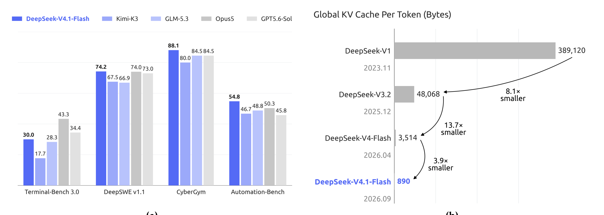

**图 1｜(a)** DeepSeek-V4.1-Flash 与同类模型在智能体基准上的表现。**(b)** 历代 DeepSeek 模型每 token 的全局 KV cache 大小（字节），体现 DeepSeek 在降低上下文内存需求上的持续努力。DeepSeek-V4.1-Flash 每 token 全局 KV cache 相对 DeepSeek-V4-Flash 和 DeepSeek-V1 分别缩小约 **4 倍**与 **437 倍**。

---

## 1. 引言

近年来，长时程智能体的应用迅速扩张，超长上下文处理已成为日益重要的模型工作负载。支撑此类工作负载不仅需要高效的长序列处理，还需要大规模 KV cache 的**持久化存储、复用与传输**。因此，KV cache 管理已成为模型部署的一项基础能力，同时在计算、存储与通信三个维度带来巨大挑战。此前稀疏注意力（DeepSeek-AI, 2025, 2026b）的进展已显著降低了长序列处理的计算开销，这使得**持久化存储与数据搬运**成为越来越突出的瓶颈。

具体而言，DeepSeek-V4（DeepSeek-AI, 2026b）将覆盖完整上下文的全局注意力分支与局部滑动窗口注意力（Sliding-Window Attention, SWA）结合。全局分支维护全局 KV（由 main KV 与 indexer K 组成），而 SWA 维护局部 KV 状态。在窗口大小固定时，SWA 的 KV 存储量与序列长度无关；但对足够长的序列，**全局 KV 会主导运行时的 KV 占用**，并受 HBM 容量约束。此外，部分 KV 会被持久化以支持前缀复用，称为**持久化 KV cache**，受 SSD 与主机内存容量约束。I/O 与互连带宽同样限制着 cache 的迁移与加载。这些约束共同限制了服务吞吐、推高部署成本，并最终阻碍智能体向更长任务时程和更广应用场景的部署与普及。

因此，进一步压缩 KV cache 占用，是缓解存储与通信瓶颈、降低长上下文服务成本的关键。为此我们开发了 DeepSeek-V4.1-Flash：一个面向更激进 KV cache 压缩而设计的多模态 MoE 模型。它具有 552B 骨干参数，原生支持多模态输入，可容纳最长 100 万 token 的上下文。我们采用 **CED 架构**，其中解码器的全局 KV 由编码器最后一层的隐状态投影得到。该设计使模型在 prefill 阶段每 token 激活 8B 参数、decode 阶段激活 16B 参数，对输入密集型智能体场景尤其经济。尽管规模远大于 DeepSeek-V4-Flash，DeepSeek-V4.1-Flash 在相同序列长度下只需约 **1/4** 的运行时 KV cache 存储与 **1/8** 的持久化 KV cache 存储，且整体表现更好。

这一级别的 KV cache 压缩，来自**模型架构、cache 精度与部署策略**的联合优化。从概念上看，DeepSeek-V4 可视为"以 SWA 为局部处理骨干、叠加压缩全局上下文"的结构；这一视角促使我们在尽量保留局部注意力设计的前提下，重点简化全局分支。在架构层面，我们设计了 **CSA2**，对全局 KV（含 main KV 与 indexer K）以及 Top-K 索引施加**跨层复用**，从而大幅削减 KV cache 存储。CSA2 有三种静态分配的模式：**Full、Reindex 与 Reuse**。

- **Full 模式**：生成本层的全局 KV 并执行索引（indexing）。
- **Reindex 模式**：复用来自前一层（最近的 Full 模式层）的全局 KV，并用自己的 indexer Q 对共享的 indexer K 重新打分，选出新的 Top-K 索引。
- **Reuse 模式**：同时复用前一层的全局 KV 与 Top-K 索引，直接执行稀疏注意力。

三种模式下，每一层都保留各自的全局 Q 与 SWA KV。共享全局 KV 与 indexer K 可减少重复的 cache 存储。另外，与采用 **CSA–HCA（Compressed Sparse Attention–Heavily Compressed Attention）混合架构**的 DeepSeek-V4 不同，DeepSeek-V4.1-Flash 使用**纯 CSA2**。在 cache 精度层面，我们在训练中使用 **FP4 全局 KV cache**，性能退化仅为边际水平。CSA2 与 FP4 KV caching 结合，把全局 KV cache 存储降至 DeepSeek-V4-Flash 的约 1/4（如图 1(b) 所示）。

在部署层面，DeepSeek-V4.1-Flash 与 DeepSeek-V4 一样，在每一层都使用 SWA。在 DeepSeek-V4 中，我们采用混合策略来权衡"持久化 SWA KV cache 的存储成本"与"精确重建所需的计算量"；精确重建需要重放最近的 $L \times n_{\text{win}}$ 个 token，其中 $L$ 是层数、$n_{\text{win}}$ 是 SWA 窗口大小。在 DeepSeek-V4.1-Flash 中，我们提出 **SWA Bounded Replay**：仅重放最近的 $n_{\text{win}}$ 个 token 来近似重建所需的 SWA KV 状态。实验表明这仅带来可忽略的性能退化。这一发现确立了新的"存储–计算"权衡，使我们能够**不再把 SWA KV cache 持久化到 SSD**，只付出少量 prefill 重算代价。借助 SWA Bounded Replay，持久化 KV cache 占用进一步降至 DeepSeek-V4-Flash 的约 1/8。这些优化共同大幅缓解了 HBM 与 SSD 容量压力，降低部署成本，为更大规模的部署铺平了道路。

作为 CED 与 CSA2 的补充，我们进一步精简了原有的 DeepSeek-V4 架构。此外，我们把原有的 mHC 设计（Xie et al., 2026）升级为 **Single-Pass mHC**，并配套 **Mega-mHC 部署 kernel**，相对原四 kernel 实现将激活内存流量减半。我们还集成了 **Engram**（Cheng et al., 2026b）条件记忆模块以增强模型能力，并引入 **DSpark**（Cheng et al., 2026a）投机解码架构，通过半自回归草稿生成与置信度调度验证提升解码效率。综合全部架构改进后，DeepSeek-V4.1-Flash 的单 token Decode FLOPs 在不同上下文长度下几乎保持恒定。图 2 显示，把上下文长度扩大 256 倍（从 4K 到 1M），其 Decode FLOPs 仅增加 1/4，远小于 DeepSeek-V4-Flash 的增长幅度。

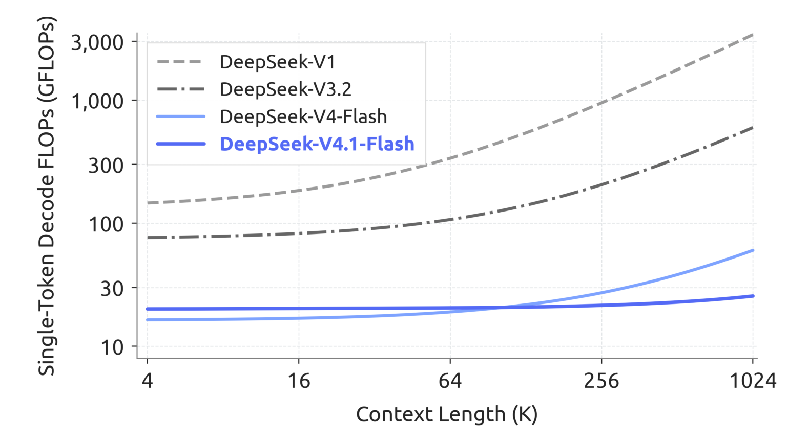

**图 2｜** 历代 DeepSeek 模型的单 token Decode FLOPs 与上下文长度的关系。我们按计算精度对 BF16、FP8、FP4 运算分别加权 1、0.5、0.25。DeepSeek-V4.1-Flash 的 Decode FLOPs 随上下文长度增长几乎保持恒定，大幅降低了长上下文场景的计算成本。

为充分释放这些架构设计带来的 KV cache 压缩收益并进一步提升训练与推理效率，我们为 DeepSeek-V4.1-Flash 系统性地协同优化了训练基础设施与推理系统，确保高效可扩展的大规模多模态训练与长上下文部署。训练基础设施支持**视觉编码器分离执行（disaggregated vision-encoder execution）**、长序列的**均衡图像分片**，以及用于注意力复用的**跨阶段共享状态管理**。推理系统实现了编码器与解码器两条 SWA Bounded Replay 路径。其他优化包括通信–计算重叠、分片的 Engram 嵌入表（sharded embedding tables）与推理 kernel 融合。特别地，每个 CSA2 Reuse 模式层在 prefill 阶段仅需执行 **15 个 kernel**，decode 阶段仅需 **11 个**。我们还在主机内存中把长生命周期的全局 KV 存储与短生命周期的编码器 SWA KV 分离，并用有界重放近似重建缺失的编码器 SWA 状态。

预训练阶段，我们在包含 **45T token** 的大规模多模态语料上训练 DeepSeek-V4.1-Flash。稀疏注意力在 64K 序列长度下**从零开始训练，没有任何稠密注意力预热阶段**。预训练后，模型具备原生多模态能力，并支持最长 100 万 token 的上下文。在评测中，DeepSeek-V4.1-Flash-Base 的世界知识、推理与编码能力与 DeepSeek-V4-Pro-Base 相当，并在留出集评测上取得 **5%–10% 的提升**，而总参数量仅为其 **1/3**、激活参数量仅为其 **1/4**。这些结果凸显了其极强的参数效率，也反映了面向真实部署的训练数据质量改进。

在此基座模型之上，我们开展后训练以激发其推理与智能体能力。与上述架构创新形成对比的是，我们的后训练**没有引入任何算法创新**：训练配方遵循"监督微调（SFT）→ 强化学习（RL）→ 同策略蒸馏（OPD）"的标准范式，除 DeepSeek-V4 开发中已成熟的实践外未作任何改动（DeepSeek-AI, 2026b）。所有实质性变化都发生在**数据管线**上。我们为数据合成与环境构建开发了大规模自动化流水线，并在 RL 过程中逐步扩展数据、任务与 rollout 的规模，从而把模型能力扩展到文本、多模态与智能体领域。图 1(a) 总结了 DeepSeek-V4.1-Flash 在核心智能体基准上的表现。评测显示，尽管体积紧凑，DeepSeek-V4.1-Flash 仍展现出独特的能力画像：

- **推理（Reasoning）。** 模型具备强推理能力，在数学、竞赛编程等推理密集型基准上保持高准确率，表现与顶级开源模型（如 Kimi-K3（Team et al., 2026a）与 DeepSeek-V4-Pro）相当。
- **智能体（Agent）。** 在 Terminal-Bench 2.1（Merrill et al., 2026）、DeepSWE v1.1（DataCurve, 2026）、AutomationBench（Shepard and Salimans, 2026）等标准智能体基准上，DeepSeek-V4.1-Flash 达到与闭源前沿模型相当的水平，足以胜任日常编码任务与白领工作流。但在需要专家级领域知识的科学类智能体任务（如 Terminal-Bench 4.0（Marten et al., 2026a））上，与巨型模型之间仍存在差距。
- **多模态（Multimodal）。** 在多模态领域，模型在评估视觉推理与专业图表解读的基准上超过了 Kimi-K3 等顶级开源对手。除正式指标外，它在真实视觉智能体工作流（如前端开发、办公自动化）中也展现出实用价值——能够利用渲染出的屏幕截图进行视觉检查与自我纠错。不过我们承认，与巨型闭源系统相比，整体上仍存在明显性能差距。

这些结果表明，DeepSeek-V4.1-Flash 已能在绝大多数基准上匹配闭源前沿模型，并可完成超过 **95%** 的真实任务；同时其小激活规模带来低推理延迟与低服务成本。因此我们认为，DeepSeek-V4.1-Flash 在能力与效率之间提供了良好的折中，可以作为一款快速、经济的助手，服务于广大用户的日常工作。总体而言，DeepSeek-V4.1-Flash 在提升模型智能与推理效率的同时降低了部署成本，大幅降低了规模化部署长时程智能体的成本门槛，为其在更广场景中的采用创造了新机会。DeepSeek-V4.1-Flash 也是我们持续扩展（scaling）努力的新起点：在此基础上，我们将推进模型架构、预训练与后训练的联合扩展，进一步探索模型智能的前沿。

---

## 2. 架构

### 2.1 总览

DeepSeek-V4.1-Flash 是一个多模态 MoE Transformer，输入图像与文本，自回归生成文本。其语言骨干由 **40 层因果 Transformer** 构成，组织为 **20 层因果编码器 + 20 层解码器**。除最前两层仅使用 SWA 外，每一层都同时包含全局注意力与滑动窗口注意力。视觉编码器与 MLP 投影器把图像转换为视觉嵌入，与文本嵌入一起被处理，多模态数据从语言模型预训练一开始就被引入。总体而言，DeepSeek-V4.1-Flash 拥有 **552B 骨干参数**与 **196B Engram 参数**，prefill 阶段每 token 激活 8B、decode 阶段激活 16B。图 3 展示了其整体架构。

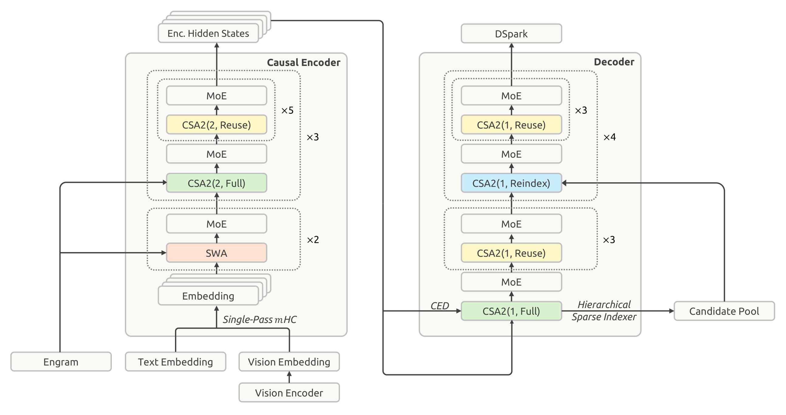

**图 3｜** DeepSeek-V4.1-Flash 整体架构。40 层网络被划分为因果编码器与解码器，各 20 层。所有前馈层均使用标准 DeepSeekMoE。编码器前两层使用滑动窗口注意力（SWA），其余层使用 **压缩稀疏注意力 2（CSA2）**，其中 CSA2(ratio, mode) 指明压缩率与工作模式。模型还使用 Single-Pass mHC、Engram、DSpark 与层次化稀疏索引器。

CED 架构与 CSA2 分别解决长上下文推理中互补的两类成本。CED 从编码器输出构造解码器的全局 KV cache，使大部分 prompt token 可以绕过完整的解码器计算，同时保留层内的滑动窗口注意力；这几乎把 prefill 计算量减半，从而降低智能体工作负载中处理新增或未缓存输入的成本（这类负载的上下文会持续增长）。CSA2 则跨层共享全局 KV 以降低 cache 存储，并复用稀疏选择结果以减少索引计算。在解码器中，**层次化稀疏索引器**把靠后的索引器限制在由更早索引器选出的候选池内，进一步减少每个 query 需要打分的条目数。

我们保留 DeepSeekMoE（Dai et al., 2024）的共享专家与细粒度路由专家，并为图像与文本 token 引入**模态特定的负载均衡**（Wang et al., 2024a）。**Single-Pass mHC**（Xie et al., 2026）修改了残差流的混合方式，以实现更高效的 kernel 融合；**Engram**（Cheng et al., 2026b）则增加了稀疏访问的条件记忆。我们在骨干预训练中**省略 MTP 模块**，改用 DSpark（Cheng et al., 2026a）做投机解码；DSpark 在骨干预训练之后单独训练。此外，我们把 main KV cache 压缩到 **FP4** 以进一步降低存储开销。以下各节描述这些组件及相应的优化改动。

#### 2.1.1 多模态架构

多模态输入通路由视觉编码器与 MLP 投影器组成。对每张输入图像，视觉编码器产生一个空间网格的视觉特征；随后 **3×3 像素反重排（pixel-unshuffle）** 操作把每个局部邻域沿通道维重排，降低空间分辨率；再由 MLP 投影器把特征映射到语言骨干的隐层维度。最后，得到的视觉嵌入被插入到输入嵌入序列中对应的图像 token 位置，与文本嵌入一起交由语言骨干处理。

**DeepSeek-ViT。** 我们从零训练了一个名为 **DeepSeek-ViT** 的视觉编码器，以原生处理不同分辨率的图像。DeepSeek-ViT 基于 Vision Transformer（Dosovitskiy et al., 2021）架构并作了若干修改：为适应任意分辨率输入，我们用 **2D-RoPE** 替换标准绝对位置嵌入；为使 ViT 更贴近 LLM 的设计原则，我们把 patch embedding 层的卷积替换为线性投影，以保证与 Muon 优化器兼容；同时采用 RMSNorm（Zhang and Sennrich, 2019）做归一化、SwiGLU（Shazeer, 2020）作为激活函数。在把视觉特征送入 LLM 之前，我们施加 3×3 下采样的像素反重排，把视觉 token 数量减少为原来的 **1/9**，从而有效支持最高约 **1344×1344** 像素的输入分辨率。

**MoE 的多模态无辅助损失负载均衡。** 图像 token 与文本 token 的表征分布不同，可能在 MoE 中诱发不同的专家路由偏好；对二者做总体负载均衡，反而可能掩盖模态内部的失衡。为此，我们扩展了无辅助损失负载均衡（Wang et al., 2024a）：为文本与图像 token **分别维护专家级修正偏置**。路由时，每个 token 使用与其模态对应的修正偏置进行专家选择，而原始路由分数仍用于对所选专家输出加权。每个训练步后，两组偏置按各自的专家负载独立更新。该设计在每个模态内部均衡专家利用率，有助于稳定高效的多模态训练。

### 2.2 因果编码器-解码器（CED）

在智能体工作流中，频繁的工具调用会产生大量 prefill 请求；一旦 KV cache 未命中，就会带来严重的计算开销。为缓解这一 prefill 瓶颈，受 YoCo（Sun et al., 2024）启发，我们提出 **CED 架构**。YoCo 通过让上半部分层直接共享下半部分层生成的 KV cache 来减少 prefill 计算；在此基础上，CED 引入一系列结构改进，同时提升 KV cache 的整体容量与 KV 生成的计算深度。最终，CED 成功减少了近一半的 prefill 计算量，同时保持与基线相当的性能。

对全局注意力，CED 把 Transformer 的底部 $L/2$ 层视为因果编码器。对上层的 $L/2$ 层（即解码器，$l > L/2$），其 KV 条目不再来自各自的隐状态 $H_l$，而是用**层相关的投影权重**（$W_l^{KV}$ 与 $W_l^{Z}$）直接从第 $(L/2)$ 层的隐状态 $H_{L/2}$ 投影得到：

$$
C_l = H_{L/2} W_l^{KV}, \qquad Z_l = H_{L/2} W_l^{Z}, \qquad l > \frac{L}{2}, \tag{1}
$$

其中 $C$ 与 $Z$ 分别表示 KV 条目及其对应的压缩权重。该设计使 CED 在 prefill 阶段只需计算一半的层，就能以极小的计算代价获得上层的全局 KV cache。

对滑动窗口注意力（SWA），CED 在**所有层**保持传统的逐层计算。具体而言，对任意层 $l$，局部 key 与 value 直接由当前层的隐状态 $H_l$ 导出。这一设计有效提升了局部 KV 生成的计算深度。然而，维持逐层计算也带来了 SWA 重放（replay）过程：在 prefill 阶段，计算解码器的 SWA KV cache 需要额外处理 $n_{\text{win}} \times L/2$ 个 token（$n_{\text{win}}$ 为窗口大小）。对于每轮 prompt 很短的多轮交互，解码器中的这部分计算开销将不可忽略。所幸此前工作（Chen et al., 2025）表明，SWA 的实际有效感受野远小于理论上的 $n_{\text{win}} \times L/2$。受此启发，我们提出 **Decoder SWA Bounded Replay**：对 SWA 计算只 prefill prompt 的最后 $n_{\text{win}}$ 个 token，从而显著降低计算成本。细节见第 3.2.2 节。

总体而言，对序列长度 $N \gg n_{\text{win}}$，CED 把 prefill 复杂度从 $O(NL)$ 降到 $O(NL/2 + n_{\text{win}} \times L/2) \approx O(NL/2)$，有效将整体计算量减半。

### 2.3 压缩稀疏注意力 2（CSA2）

服务长上下文需要同时控制 **KV cache 存储**与**注意力计算**。这些成本可沿三个**可乘**的维度压缩：

1. **条目大小**：GQA（Ainslie et al., 2023）减少 KV head 数量；MLA（DeepSeek-AI, 2024）在各 head 间共享一个小的 latent。
2. **序列维度**：把每 $m$ 个 token 压缩为一个条目，如 DeepSeek-V4 中的 CSA 与 HCA（DeepSeek-AI, 2026b）。
3. **层维度**：某些层复用其他层的 cache 与选择结果，而不保留自己的；或被更高效的层整体替换。

此前工作已表明层维度的压缩是有效的：IndexCache（Bai et al., 2026）跨层复用 Top-K 索引以减少索引器计算；YOIO（Sun et al., 2026b）只计算一次稀疏路由并在所有层共享；HySparse（Gao et al., 2026）让稀疏层复用稠密层的 KV cache。然而，**仅做索引复用并不能节省 main KV 存储**，全网共享路由会限制性能，混合设计仍保留完整的全注意力层；更重要的是，这些方法都没有同时覆盖上述三个可乘维度。

CSA2 **联合利用这三个维度**：它跨层共享 main KV 与 indexer K，并允许各层复用 Top-K 索引，且**把 cache 共享与索引复用解耦**。它把这些复用策略与简化的压缩器（compressor）以及层次化稀疏索引器结合，后者在解码器中收窄后续索引层的搜索域。

与 CSA 类似，CSA2 包含一个轻量索引器，用 indexer Q 与 indexer K 对 main KV 条目打分，并为每个 query 选出 Top-K 条目；每个 Q 与选中的条目以及层内的滑动窗口 KV（SWA KV）一起做注意力。CSA2 也把"未压缩 main KV"作为压缩比为 1 的特例。同时，CSA2 简化了压缩器与索引器：在 CSA 中，压缩比 $m$ 意味着每个 main KV 条目由 $2m$ 个原始 KV cache 条目产生，且相邻压缩条目的源条目存在重叠；CSA 还包含绝对位置嵌入，用于在压缩时编码这 $2m$ 个条目的位置。CSA2 去掉了这种重叠与绝对位置嵌入。此外，CSA2 通过**投影 main KV 条目**得到 indexer K，取代了 CSA 中从隐状态出发的独立压缩路径。这两项设计都简化了实现并提升了训练效率。

第 2.3.1 与 2.3.2 节分别介绍跨层复用策略与层次化稀疏索引器。

#### 2.3.1 跨层 KV 与索引复用

每个 CSA2 层被静态分配为 **Full、Reindex 或 Reuse** 三种模式之一。三种模式中，层都计算自己的 query 与 SWA KV，并将它们与选中的 main KV 条目一起产生新的注意力输出；区别在于如何获得 main KV、indexer K 与 Top-K 索引。图 4 展示了这三种模式。

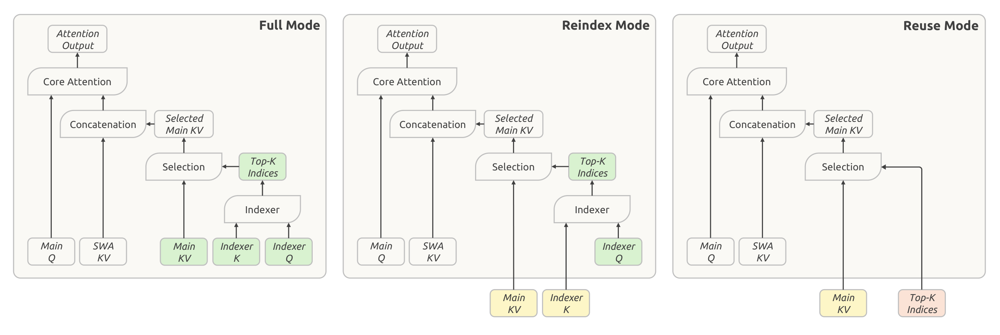

**图 4｜** CSA2 的三种工作模式。三种模式的差异在于如何获得 main KV、indexer K 与 Top-K 索引。**绿色**块表示当前层计算得到的量；**黄色**块表示复用自最近一个 Full 模式层的 main KV 与 indexer K；**红色**块表示复用自最近一个"产生索引"的层（Full 或 Reindex 模式）的 Top-K 索引。三种模式都在当前层计算 main Q 与 SWA KV。

**Full 模式。** 该层计算自己的 main KV 与 indexer Q，从该 main KV 投影出 indexer K，并运行索引器产生全新的 Top-K 索引。因此它执行完整的 CSA2 计算路径，组件职责与 DeepSeek-V4 中的完整 CSA 层相同。

**Reindex 模式。** 该层复用前一层最近可用的 main KV 及其对应的 indexer K；索引器计算自己的 query，对复用的 key 重新打分，产生新的 Top-K 索引。这使稀疏选择可以跨层变化，而 main KV 与 indexer K 保持共享。

**Reuse 模式。** 该层复用最近可用的 main KV，以及前一个 Full 或 Reindex 模式层针对该 main KV 计算出的最新 Top-K 索引，直接用该选择结果执行注意力，**不计算 indexer Q，也不评估索引分数**。

共享 main KV 与 indexer K 减少 cache 存储，而复用 Top-K 索引避免了额外的索引器计算；Reindex 模式在保留 cache 共享的同时允许被选中的条目跨层变化。当 CSA2 与 CED 结合时，被分配为 Full 模式的解码器层从第 $(L/2)$ 层（即因果编码器的最后一层）的隐状态计算自己的全局 KV；Reindex 与 Reuse 模式不变。

#### 2.3.2 层次化稀疏索引器

跨层索引复用减少了索引器评估次数，但剩余的索引器仍要对**全部因果可见上下文**打分。对极长上下文，这一成本依然是主要的计算瓶颈。此前工作通过在对 token 级索引之前先对池化后的块表示打分并剪枝，来引入索引器稀疏性（Xu et al., 2026b）。我们发现，在解码器中，来自较浅层索引器的信息可以自然地用于限制更深层索引器考虑的候选，且不引入任何额外状态。因此我们提出**层次化稀疏索引器**，仅用于 CED 的解码器，以减少解码期间这种重复打分。对每个 query，第一个被分配为 Full 模式的层构造一个**候选池（candidate pool）**，后续重新索引的层把它作为搜索域。在候选池大小固定时，这把更深索引器的每 query 成本**从与上下文长度线性相关变为常数**。该机制是**训练感知**的，并在后训练阶段引入：候选限制在训练与推理时以相同方式施加，因此更深的索引器是在与其推理时相同的搜索域下被优化的。图 5 展示了这一过程。

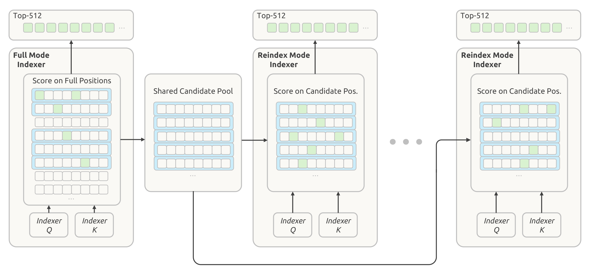

**图 5｜** 层次化稀疏索引器。每个方块代表一个位置；**绿色**方块标记被选中的索引，**蓝色**矩形标记按最大索引分数选出的块。解码器中第一个处于 Full 模式的 CSA2 层选出自己的 Top-512 索引，并由选中的块为后续层构建共享候选池；处于 Reindex 模式的 CSA2 层随后从该池中选出自己的 Top-512 索引。

这个首个 Full 模式层对**所有因果可见的 main KV 位置**打分，并为自己注意力产生 Top-K 索引。它同时执行**分块候选选择**：每个块被赋予其内部位置的最大索引分数，分数最高的若干块被选中；随后把选中块覆盖的位置收集进一个比最终 Top-K 集合更大的候选池。例如，选择 2,048 个块、每块 8 个位置，就得到 16,384 个候选位置。该池定义了后续索引器的搜索范围，而最终的 Top-K 选择才决定每层实际读取哪些 main KV 条目。

后续处于 Reindex 模式的层只对相应 query 的候选位置打分，并在该池内选出自己的 Top-K 条目；处于 Reuse 模式的层不做新的索引，直接使用针对其复用的 main KV 计算出的最新 Top-K 索引。因此，**候选池在索引层之间共享，而它们的最终选择可以不同**。

在候选池大小固定时，后续每个索引器每 query 需要打分的位置数与上下文长度无关。第一个 Full 模式层仍然扫描整个因果可见范围。因此，层次化索引降低了后续索引器评估的成本，同时保留了最初的全范围扫描。

### 2.4 高效架构扩展

#### 2.4.1 Single-Pass mHC

在 DeepSeek-V4 中，我们引入了 mHC（Xie et al., 2026），它在相邻 Transformer 块之间维护 $n$ 条残差流。对每个 token，记这些流为 $X_l \in \mathbb{R}^{n \times d}$，其中 $l$ 是块索引、$d$ 是隐层维度。这些流的更新方式为：

$$
X_{l+1} = B_l X_l + C_l \mathcal{F}_l (A_l X_l), \qquad (A_l, B_l, C_l) = \mathcal{H}(X_l), \tag{2}
$$

其中 $A_l \in \mathbb{R}^{1 \times n}$、$C_l \in \mathbb{R}^{n \times 1}$、$B_l \in \mathbb{R}^{n \times n}$ 是由 $X_l$ 预测的 token 级系数；系数预测器 $\mathcal{H}$ 包含归一化与投影。

理想情况下，两个块之间的残差变换是**单一的映射**：从 $(X_{l-1}, Y_{l-1})$ 到 $(X_l, \hat{X}_l)$，其中 $\hat{X}_l = A_l X_l$ 是当前块的输入，$Y_{l-1} = \mathcal{F}_{l-1}(\hat{X}_{l-1})$ 是前一个块的输出。这样的映射需要 $(n+1)d$ 次读与 $(n+1)d$ 次写，因此激活内存流量的下界是 $(2n+2)d$。实际上，DeepSeek-V4 采用的是式 (2) 的**多趟（multi-pass）实现**，三个 kernel 因数据依赖而串行执行：

$$
X_l = B_{l-1} X_{l-1} + C_{l-1} Y_{l-1} \qquad \text{残差更新，沿 } n \text{ 收缩} \tag{3}
$$

$$
(A_l, B_l, C_l) = \mathcal{H}(X_l) \qquad \text{系数计算，沿 } nd \text{ 收缩} \tag{4}
$$

$$
\hat{X}_l = A_l X_l \qquad \text{输入混合，沿 } n \text{ 收缩} \tag{5}
$$

三个 kernel 分别读取 $(n+1)d$、$nd$ 与 $nd$ 个值，合计写入 $(n+1)d$。若把 $\mathcal{F}_l$ 中的 pre-norm 也计入，总激活内存流量为 $(4n+4)d$，是下界的两倍。

在 $\mathcal{H}$ 中，归一化权重被离线折叠进投影权重，RMS 除法在投影之后施加。因此三个阶段中有两个可以共享对残差的一次遍历：残差更新不需要沿隐层维度做归约，所以 $X_l$ 的每个 tile 一经算出即可立即用于累加投影输出，以及计算 RMS 所需的平方和。**输入混合**无法融合进这一趟，因为 $A_l$ 必须等所有隐层 tile 的归约完成后才可用，它需要第二次读取 $X_l$；这一趟还可以顺便完成输入 pre-norm。这种两趟实现总共需要 $(3n+2)d$ 的激活读写，比下界多一次对 $X_l$ 的读取。

因此我们提出 **Single-Pass mHC**：把输入混合的系数**错位一个块**，即每个块消费前一个块产生的混合系数，从而消除上述依赖：

$$
X_{l+1} = B_l X_l + C_l \mathcal{F}_l (A_{l-1} X_l), \qquad (A_l, B_l, C_l) = \mathcal{H}(X_l). \tag{6}
$$

此时输入混合使用 $A_{l-1}$ 而非 $A_l$，不再依赖由 $X_l$ 计算出的系数。于是 $X_l$ 的每个 tile 都可以立即同时用于输入混合与系数预测，无需等待完整归约。经验上，这一错位带来的性能退化可以忽略。

预训练时我们保留原有的多 kernel 实现，因为该错位只改变每个块施加哪些混合系数。部署时，我们把残差更新、输入混合与系数预测融合为单个 kernel——**Mega-mHC**。该 kernel 以 $(3n+2)d$ 的激活读写实现 mHC，以 $(2n+2)d$ 实现 Single-Pass mHC。Mega-mHC 沿隐层维度把 $X_l$ 分块处理：每个 tile 既用于计算混合后的输入，也用于累加预测下一块 $(A_l, B_l, C_l)$ 所需的量。该 kernel 还融合了输入 pre-norm 与 FP8 转换。于是残差只被读一次、写一次，达到理想映射的 $(n+1)d$ 读与 $(n+1)d$ 写，把原实现的激活内存流量减半。

#### 2.4.2 Engram

我们为 DeepSeek-V4.1-Flash 增加了 **Engram**（Cheng et al., 2026c）——这是我们此前工作中提出的条件记忆模块，用于把"记忆"与"计算"解耦。我们沿用 Engram 的原始设计（tokenizer 压缩、多头哈希、上下文感知门控、多分支集成），并作两点修改：第一，去掉短因果卷积，因为其性能收益不足以抵消推理栈中增加的复杂度；第二，用**基于动量的更新 + Sinkhorn 均衡**来优化 Engram 嵌入，详见第 2.5 节。

我们把 **196B Engram 参数**平均分配到两个模块上。每个模块使用 $N$-gram 阶数 $\{2,3,4\}$，8 个哈希头，每个阶数的总嵌入维度为 2048；每个头索引一张约 **16M** 条目的表，表大小取不同的素数。嵌入表与 key/value 投影均使用 **FP8** 精度。两个模块分别放置在第 1 层与第 14 层（从 0 开始计数），以均衡各训练流水阶段的显存占用。推理时，确定性寻址使得嵌入可以通过后台 RDMA 传输从主机内存预取，其中第一个模块的预取与第一个 Transformer 块的计算重叠。Engram 训练与推理的更多实现细节见第 3.1.3 节。

#### 2.4.3 DSpark

我们为 DeepSeek-V4.1-Flash 配备了 **DSpark**（Cheng et al., 2026a），这是一个把**半自回归草稿生成**与**置信度调度验证**结合的投机解码模块。草稿器（drafter）由三个 Transformer 块构成，滑动注意力窗口为 128 个 token。对这些块的一次前向即可并行计算五个草稿位置的基础 logits，同时一个轻量 **Markov head** 建模草稿 token 之间的依赖；一个**置信度头**预测各位置的条件接受概率，用于估计前缀存活概率。调度器把这些估计与实测的引擎吞吐曲线结合，为每个请求动态选择验证长度，目标是在当前系统负载下最大化系统整体的期望 token 吞吐。

与 DeepSeek-V3（DeepSeek-AI, 2024）中贯穿预训练、与骨干联合训练的 MTP 模块不同，DSpark 在预训练**之后**的一个专门阶段引入：该阶段只训练 DSpark，骨干保持冻结。后训练期间，我们继续让 DSpark 与骨干一起训练，但**不把 DSpark 目标的梯度回传到骨干**。这使 DSpark 与不断演化的策略保持一致，从而既能加速在线服务，也能加速 RL 与 OPD 的 rollout 生成。

#### 2.4.4 FP4 main KV cache

长上下文智能体工作负载需要每请求很大的 KV cache，推高了服务成本。DeepSeek-V4 已对 FP4 indexer query/key 使用量化感知训练（QAT）（Jacob et al., 2018），以加速索引计算并减小 indexer cache；我们采用 OCP 标准的 **MXFP4** 格式（Rouhani et al., 2023）以尽可能兼容更多硬件平台，尽管在我们实验中其他格式精度更高。现在我们把 **QAT 扩展到 main KV cache**：在这里 FP4 的作用是**降低存储**而非加速矩阵乘。在注意力之前对缓存值反量化，使我们能使用更精确的格式而不要求硬件原生支持该格式的矩阵乘，从而保持跨平台兼容性。

在评估过的约 4 bit 格式中，我们选择 **E2M1 + 每 16 通道一个 E4M3 scale**，即遵循 NVFP4（Alvarez et al., 2025）但**去掉其二级全局 scale**，以在精度与简洁性之间取得平衡。去掉该 scale 后，main KV cache 仍有充足的动态范围：该格式支持最大幅值 $448 \times 6 = 2688$，远高于 cache 的幅值上界。在 DeepSeek-V4.1-Flash 中，训练得到的最大 RMSNorm 权重幅值约为 1；经过 RMS 归一化后，512 通道 KV latent 的 L2 范数最多约为 $\sqrt{512}$；RoPE 保持该范数不变，因此旋转后跨通道的最大绝对值同样被约束在约 $\sqrt{512} \approx 22.6$。此外，训练中观测到的最大幅值约为 10。因此，去掉全局 scale 不会带来可测量的精度下降，同时简化了 cache 布局。

为在 DeepSeek-V4.1-Flash 中启用 FP4 main KV cache 存储，我们在后训练阶段引入 QAT。非 RoPE 与 RoPE 分量使用相同的量化格式。我们在 **RoPE 之后**量化 cache：实验中 RoPE 之前量化只能带来边际精度提升，却会在解码时引入额外开销。由于 SWA KV cache 对量化敏感，我们对其保留 **FP8**。与 DeepSeek-V4 的 FP8 main KV cache 相比，该格式在 HBM 中以及卸载到 SSD 时都**几乎把存储占用减半**。

### 2.5 优化器

在 DeepSeek-V4 所用优化配置的基础上，我们做了一些新改动以更好地契合架构设计。

第一，我们使用 **head-wise Muon**：在施加 Muon 更新之前，Query 权重按 head 拆分。这里简要说明该设计的动机。把 Muon 视为一种预条件梯度下降（preconditioned gradient descent）：原始 Muon 对所有 head 使用同一个预条件子，而 head-wise Muon 为不同 head 提供不同的预条件子。该设计能更好地处理注意力头之间的异质性（Zhang et al., 2024; Zhang, 2026, Section 3）。结果显示 head-wise Muon 优于原始 Muon；其经验优势也在 GLM 5（Zeng et al., 2026）与 Kimi-K3（Team et al., 2026a）中得到验证。

第二，对新增的 Engram 参数使用 Adam 会大幅增加优化器状态的内存占用。为降低训练显存，我们改为用**基于动量的更新 + Sinkhorn 均衡**来优化 Engram 嵌入表、token embedding 与预测头（prediction head）。Sinkhorn 均衡此前已在 SinkGD（Scetbon et al., 2025）中用于线性层权重矩阵，这里我们把它扩展到这些大规模参数矩阵。与 Muon 一样，该方法只需一个动量缓冲区，而经验上优于 Adam。

**基础配置。** 归一化层权重以及其他非矩阵参数（含偏置与缩放因子）继续使用 **AdamW**（Loshchilov and Hutter, 2019）。语言模型骨干中线性变换的权重矩阵、Engram 投影层以及视觉-语言投影器使用 **Muon**（Jordan et al., 2024）；Query 与 Key 权重使用 head-wise Muon。我们对 Muon 施加解耦权重衰减与 Nesterov 动量（Nesterov, 1983; Liu et al., 2025）；归一化层权重同样受权重衰减作用，而偏置与缩放因子不受。Sinkhorn 均衡更新也使用 Nesterov 动量，但不施加权重衰减。预训练期间，视觉编码器保持冻结直到学习率衰减阶段，其最后一层归一化层与视觉-语言投影器保持可训练；在学习率衰减开始时解冻视觉编码器，以更小的学习率与 LLM 联合优化。

**Engram / embedding / 预测头的 Sinkhorn 均衡更新。** 完整流程见算法 1。总体而言，它与 Muon 的工作流相同，只是用 **Sinkhorn 均衡**取代 Newton–Schulz 正交化。记较大的矩阵维度为 $m$（对嵌入表与预测头即词表大小），隐层维度为 $n$。

给定 Nesterov 动量更新 $\hat{G}_t$，Sinkhorn 均衡寻找对角缩放矩阵 $D_r$ 与 $D_c$，使得

$$
\Delta_t = \sqrt{n}\, U^{(K)} = \sqrt{n}\, D_r \hat{G}_t D_c, \qquad
\frac{1}{n}\sum_{j=1}^{n} (\Delta_t)_{ij}^2 \approx 1, \qquad
\frac{1}{m}\sum_{i=1}^{m} (\Delta_t)_{ij}^2 \approx 1, \tag{7}
$$

于是该过程近似**均衡更新矩阵的行 RMS 与列 RMS**。这里一行对应一个 token 索引或 n-gram 身份，一列编码一个隐层特征；Sinkhorn 均衡正是利用这种"token–特征"结构，沿行与列同时归一化。为数值稳定，满足 $\rho_i \leqslant \tau \bar{\rho}$ 的行会被掩蔽。因子 $\sqrt{n}$ 把单位行 $\ell_2$ 范数转换为单位行 RMS。另外，我们调整有效学习率 $\tilde{\eta}_t = \gamma \eta_t$ 以匹配 Adam 的更新幅度，取 $\gamma = 0.18$，接近 Moonlight（Liu et al., 2025）中使用的 0.2。

更广泛地说，Sinkhorn 均衡与那些利用矩阵/张量轴结构的优化器密切相关（Shazeer and Stern, 2018; Zhang et al., 2025a; Wen et al., 2025; Glentis et al., 2025; Deng et al., 2026; Yuan et al., 2026; Xu et al., 2026a）。例如 Adafactor（Shazeer and Stern, 2018）以不同方式做行/列归一化，Adam-mini（Zhang et al., 2025a）对嵌入表与预测头采用另一种行归一化。这些归一化策略在优化性能与通信开销上可能各有差异，更细致的研究留作未来方向。

> **算法 1｜带 Sinkhorn 均衡的动量更新**
>
> **输入：** 权重 $W_t \in \mathbb{R}^{m \times n}$，梯度 $G_t$，动量 $M_{t-1}$，动量系数 $\beta$，基础学习率 $\eta_t$，学习率修正 $\gamma$，数值常数 $\varepsilon$ 与 $\tau$，奇数的归一化步数 $K$
>
> 1. $M_t \leftarrow \beta M_{t-1} + (1-\beta) G_t$
> 2. $\hat{G}_t \leftarrow \beta M_t + (1-\beta) G_t$  ▷ Nesterov 动量
> 3. $\rho_i \leftarrow \lVert \hat{G}_{t,i,:} \rVert_2$，$\bar{\rho} \leftarrow \frac{1}{m}\sum_{i=1}^{m}\rho_i$
> 4. $U^{(0)} \leftarrow \hat{G}_t$
> 5. 若 $\rho_i \leqslant \tau\bar{\rho}$ 则置 $U^{(0)}_{i,:} \leftarrow 0$  ▷ 掩蔽近零行
> 6. **for** $k = 1, \ldots, K$ **do**
> 7. 　**if** $k$ 为奇数 **then**
> 8. 　　**for all** $i = 1,\ldots,m$ **do**
> 9. 　　　$U^{(k)}_{i,:} \leftarrow U^{(k-1)}_{i,:} / (\lVert U^{(k-1)}_{i,:} \rVert_2 + \varepsilon)$
> 10. 　　**end for**
> 11. 　**else**
> 12. 　　**for all** $j = 1,\ldots,n$ **do**
> 13. 　　　$U^{(k)}_{:,j} \leftarrow U^{(k-1)}_{:,j} / (\lVert U^{(k-1)}_{:,j} \rVert_2 + \varepsilon)$
> 14. 　　**end for**
> 15. 　**end if**
> 16. **end for**
> 17. $\Delta_t \leftarrow \sqrt{n} U^{(K)}$  ▷ 把单位行 $\ell_2$ 范数转为单位行 RMS
> 18. $\tilde{\eta}_t \leftarrow \gamma \eta_t$  ▷ 匹配 Adam 的更新幅度
> 19. $W_{t+1} \leftarrow W_t - \tilde{\eta}_t \Delta_t$

---

## 3. 通用基础设施

### 3.1 训练基础设施

#### 3.1.1 多模态训练基础设施

**对比学习中的通信–计算重叠。** 视觉编码器先用对比目标优化，再用生成式下一 token 预测损失微调。在对比阶段，损失是在整个 batch 的文本-视觉对上计算的，因此两个模态的特征都必须跨数据并行 rank 做 all-gather，通信量相当可观。由于文本特征的梯度只依赖 gather 来的视觉特征（对称地，视觉特征的梯度也只依赖 gather 来的文本特征），每次 all-gather 都可以与前向或反向计算重叠，而不必阻塞流水线：

$$
\text{Forward}(V) \rightarrow \big(\text{Forward}(T) \parallel \text{AllGather}(V)\big) \rightarrow \nabla_{\text{Text}} \rightarrow \big(\text{Backward}(T) \parallel \text{AllGather}(T)\big) \rightarrow \nabla_{\text{Vision}} \rightarrow \text{Backward}(V),
$$

其中 $V$ 与 $T$ 表示视觉与文本特征，$(A \parallel C)$ 表示计算 $A$ 与通信 $C$ 的重叠，$\nabla$ 表示梯度计算。在该调度下，视觉特征在文本前向期间被 gather，文本特征在文本反向期间被 gather，因此两次 all-gather 都被完全隐藏在有用的计算之后。

**端到端并行。** 为处理视觉编码器与 LLM 之间的模型与数据异质性（Zhang et al., 2025b），我们采用近期训练系统（Team et al., 2025, 2026b）中的**分离式编码器（disaggregated encoder）设计**：视觉编码器被复制到 LLM 参数树之外，每个训练步划分为三个阶段——视觉编码器前向、LLM 前向/反向、视觉编码器反向。这种分离避免了视觉编码器与 LLM 计算之间的相互干扰：负载均衡的视觉处理被限制在第一与最后一个阶段，而 LLM 阶段不含任何视觉计算，从而保持纯文本训练的并行策略。

**长序列多模态训练优化。** DeepSeek-V4.1-Flash 在最长 100 万 token 的序列上训练，预训练与后训练阶段都有相当比例的训练发生在超长序列长度上。在这些长度下，多模态样本会造成严重的 I/O、CPU 与内存瓶颈。

- **均衡图像分片（balanced image sharding）。** 预训练时，单条超长且图像密集的序列可能在加载阶段耗尽一台主机的 I/O、CPU 与内存，因此我们把每条序列的图像在 CP rank 之间**做负载均衡的分片**，且每张图像只加载一次。在图像只读一次的前提下，只要满足下式，加载就能被隐藏在计算之后：
  $$\frac{N \times \rho}{B_{\text{IO}}} < \frac{N \times C}{B_{\text{GPU}}} \iff \rho < \frac{B_{\text{IO}}}{B_{\text{GPU}}}\, C,$$
  其中 $N$ 是 token 数，$\rho$ 是每 token 的原始字节数，$C$ 是每 token 的计算量，$B_{\text{IO}}$ 与 $B_{\text{GPU}}$ 分别是文件系统与 GPU 带宽。由于 $N$ 被消去，判据只涉及每 token 的量（$\rho$ 与 $C$），与序列长度和集群规模无关；$\rho$ 由视觉模块配置决定（如分辨率上限或空间下采样率）。因此，存储吞吐只有在**每 token 计算量很低的小模型**（例如消融实验）中才会成为瓶颈，生产规模模型仍受计算约束。
- **增量式图像传输（incremental image transfer）。** 除上述均衡分片外，RL rollout 只把图像**增量式**地传给推理引擎，并把引擎侧 CPU 上的解码与预处理输出缓存到分布式文件系统，供后续 rollout 与训练复用。

#### 3.1.2 CSA2 的注意力共享训练

第 2.3 节介绍了 CSA2——一种具有三种模式的注意力共享方法，其中一些模式会在多层之间共享 main KV、indexer K 与 Top-K 索引中的一项或多项。在大规模分布式训练中支持 CSA2，需要在注意力计算本身之外引入额外的协调。特别是，共享注意力组件的层可能被放在不同的流水阶段，使直接的模块复用与传统"阶段内局部执行"不兼容。因此我们采用若干设计来支持 CSA2 训练。

**影子索引器（shadow indexers）** 在每个参与阶段放置一个轻量的可执行副本，同时为共享参数保留**唯一的逻辑属主**。属主负责优化与 checkpoint 保存，而参数同步与梯度聚合保持影子副本在整个训练过程中的一致性。该设计在不要求流水调度器把共享层当作特殊执行单元的前提下，保持了原有的模型语义。

**流水线负载扩展（pipeline payload extensions）** 在源层与消费层跨越流水边界时，向下游消费者提供所需的中间表示与稀疏路由信息。这些状态被并入既有的点对点通信路径，并与上下文并行保持一致的分片，既避免了不必要的复制，又维持了相应的梯度流。

**微批级共享状态管理** 跟踪当前并发活跃的流水微批所关联的状态，并在前向执行、激活重计算与反向传播之间协调其生命周期。共享状态会一直保留到其**最后一个消费者**完成，随后立即释放，以限制额外的内存开销。同一套运行时抽象还负责阶段放置与"源–消费者"关系，使注意力实现无需依赖物理流水布局即可访问共享状态。

再加上对优化器、checkpoint、预热与计算图追踪流程的轻量适配，这些机制使 CSA2 能在既有的分布式训练接口与流水调度下透明运行。

#### 3.1.3 Engram

Engram 嵌入表按行划分到专门的进程组（engram 并行度）。组大小控制单设备显存占用与嵌入查找通信范围之间的权衡；优化器状态进一步在各表分区的副本间分片。Engram 的查找索引只依赖输入 token 序列，因此**嵌入预取**可以在每个流水阶段开始处理当前训练步的微批之前，针对整个本地 batch 发起，从而最小化对流水执行的干扰。嵌入梯度在反向期间被缓冲，并在骨干反向结束后送回其所属 rank。为与多模态训练高效集成，嵌入预取与梯度传输被调度为与视觉编码器的前向、反向计算重叠。嵌入以 **FP8** 存储与获取，取回的值与缩放因子直接传给后续 GEMM。对 Engram 表更新，Sinkhorn 归一化在迭代之间维护行、列缩放向量，避免反复写入完整的归一化矩阵；行归一化与列部分统计的累加被融合为单个 kernel，以进一步降低内存流量。RL rollout 期间，Engram 嵌入表常驻 GPU 显存，以降低主机内存压力并避免主机内存碎片导致的 OOM。

### 3.2 推理系统

DeepSeek-V4.1-Flash 把推理效率作为一等设计目标。虽然其架构在概念上相当复杂，但由此得到的推理 kernel 流程却非常简洁。通过合理的 kernel 融合，我们把复杂算子封装起来，让硬件资源在少量融合 kernel 内部保持满流水——包括 FlashMLA（Li and Liu, 2025）中 fused-RoPE-attention-RoPE-cast kernel，DeepGEMM（Zhao et al., 2025）中的 Mega-Gate、Mega-mHC、Mega-MoE kernel，TileKernels（Wang et al., 2026a）中的 kernel，以及 DeepSelect（Qian et al., 2026）中的 TopK kernel。结果是：**绝大多数 Transformer 层（即 CSA2 处于 Reuse 模式的层）在 prefill 阶段仅用 15 个 kernel、decode 阶段仅用 11 个**，从而实现高吞吐与低延迟的推理。

在部署层面，我们采用 **Encoder–Prefill–Decode（EPD）分离**，使视觉编码、prefill 与 decoding 能够独立扩展并在执行上相互重叠。

#### 3.2.1 持久化 KV cache 管理

在相同工作负载下，V4.1 把持久化 KV cache 占用降至 V4 的 **1/8**。这一降幅由两个相乘的因子构成：持久化 KV cache **不再存储 SWA KV**，使其大小几乎减半；其中保留的全局 KV 又通过架构与精度优化进一步压缩到 V4 的 **1/4**。

在 V4 的部署中，SWA KV 占到持久化 KV cache 容量的近一半。该 cache 内，全局 KV 与 SWA KV 独立管理，遵循 LRU 淘汰策略。全局 KV 被完整存储，命中时可复用整个前缀；相比之下，SWA KV 只在**两个特定位置**缓存——prompt 末尾与输出末尾——以支持重新生成与多轮会话，命中时可以从该缓存位置继续计算。为保持高命中率，我们在 SSD 上配置了足够大的持久化 KV cache，使在典型工作负载下两类 KV 都能驻留超过 **72 小时**。尽管只在指定位置保留 $n_{\text{win}}$ 个 KV 条目，未压缩的 SWA KV cache 仍带来可观的存储开销，在"轮次很短的多轮对话"中尤为明显。

持久化存储 SWA KV 既昂贵又低效，因为其访问模式与持久化 KV cache 的长保留策略并不匹配。与呈现长尾复用的全局 KV 不同，SWA KV 只在活跃会话内部一个很窄的、分钟级的窗口内被复用，一旦会话结束或进入下一轮就变成死数据。V4 技术报告曾提出 **Zero SWA Caching**，通过重算缺失的 SWA KV 来避免存储开销；但精确恢复需要对 $L \times n_{\text{win}}$ 个 token 做完整前向，其成本在生产部署中被证明不可接受。

因此 V4.1 对持久化 KV cache 管理作如下修订：

1. **SWA KV 不再缓存在持久化 KV cache 中**，而是存放在一个分布式内存池里，该内存池由每台机器 **10% 的主机 DRAM** 提供。虽然该池的总容量小得多，但其**短 TTL（仅分钟级）** 使过期条目能被立即回收用于新会话；在真实工作负载下，这种高周转率足以服务绝大多数并发活跃会话。全局 KV 仍留在持久化 KV cache 中，保证生命周期至少 72 小时。
2. **淘汰 SWA KV 必然造成未命中**，这依靠一个轻量兜底机制——**Encoder SWA Bounded Replay**（详见第 3.2.2 节）——保持可承受。对于"命中全局 KV 但未命中 SWA KV"这类不可避免但并不频繁的请求，它通过只重算 $n_{\text{win}}$ 个 token（而不是完整的 $L \times n_{\text{win}}$ token 前向）来恢复缺失状态。这一有界重放是整个设计的基石：它把一次灾难性的未命中变成优雅、廉价的性能退化，从而使"把 SWA KV 从持久化 KV cache 中移除"成为合理选择。

#### 3.2.2 SWA Bounded Replay

由于 SWA 依赖跨层累积，精确重建 $L$ 层的 SWA KV 需要重放 $L \times n_{\text{win}}$ 个 token。**SWA Bounded Replay** 则只重放最近的 $n_{\text{win}}$ 个 token，并把 SWA 截断到该重放片段，接受近似状态：对从位置 $s$ 开始的重放，位置 $i$ 的 query 只关注位于 $[\max(s, i-W+1),\, i]$ 区间内的 SWA key。

**Encoder SWA Bounded Replay。** 它使前缀缓存**只依赖全局 KV**，从而允许把 SWA KV 从持久化 KV cache 中删除。当编码器 SWA KV 缺失时，我们重放已缓存前缀的最后 $n_{\text{win}}$ 个 token，并将它们与未缓存的后缀一起处理。被重放的 token 只重新生成 SWA KV，复用已缓存的全局 KV（不重算、不覆盖）；而未缓存的后缀则同时生成全局 KV 与 SWA KV。

按设计，被重放的前缀状态是**近似**的，因此为未缓存后缀计算出的全局 KV 与 SWA KV 依赖于 cache 命中位置，在不同位置之间并非数学上完全相同。令人鼓舞的是，我们的实验证据确认：这种有界重放策略几乎不损害回复质量。

**Decoder SWA Bounded Replay。** 它把解码器前向限制在 $n_{\text{win}}$ 个 token 内，使总 prefill 计算量几乎减半。

在 CED 下，解码器的全局 KV 由编码器最终的隐状态投影而来；唯一阻碍"在编码器处结束 prefill"的因素是**解码器 SWA KV**——它由各解码器层自身的隐状态产生，且是首批 decode 步所必需的。由于我们从不缓存解码器 SWA KV，精确重建它需要在最后 $\frac{L}{2} \times n_{\text{win}}$ 个 prompt token 上运行 $L/2$ 个解码器层；当"很长的已缓存前缀"后面跟着"很短的未缓存后缀"时，这一成本很高。因此我们对这一场景同样施加有界重放：每次 prefill 时，重放 prompt 的最后 $n_{\text{win}}$ 个 token，把它们的编码器输出在相同的 SWA 截断下送入解码器层，得到的解码器 SWA KV **只用于解码，不用于前缀缓存**。

按设计，重建出的解码器 SWA KV 与完整解码器前向得到的并不数学等价。我们同样发现该策略对回复质量的影响可以忽略。为增加安全性，我们在后训练期间**额外模拟同样的重放**，以实现训练感知的适配。

---

## 4. 预训练

### 4.1 数据构建

**文本数据治理。** 为追求更高的智能水平，我们不再只关注小规模数据实验所反映的、样本级的通用质量，而更关注**多样语料之间的整体交互**所带来的独特信息增益。我们采用更系统、更标准化的数据构建流水线来提升数据质量并优化数据配比。具体而言，基于更全面的评估，我们精心设计了一条覆盖模型参数与训练数据的**扩展阶梯（scaling ladder）**来指导大规模训练。我们过滤掉信息增益有限的模型生成内容，包括能力较弱模型的输出与低质量机器翻译文本：我们把这类内容视为**隐式重复**——它在很大程度上只是对已有信息的改写，在长训练周期中可能反而有害。我们还探索了模型在环（model-in-the-loop）的数据迭代方法，作为未来大规模合成数据的基础。此外，我们引入更多领域专家来构建细粒度的数据质量评估维度。与上一版本相比，新语料纳入了来自新发布开源仓库、commit、库与新兴框架的更近期代码，覆盖更广的编程语言范围，更好地反映当代真实软件工程场景。

**多模态数据治理。** 我们的多模态预训练数据集主要包含三类数据：图文对、图文交错数据与领域特定数据。基于"原始网页数据本身已提供丰富多模态知识"这一前提，我们**没有进行大规模数据合成**，而是优先以原生形态清洗和利用数据，以在预训练中实现最直接、可扩展的视觉知识压缩。在早期数据采集阶段，我们发现爬虫系统过度偏向以文本为中心的网页内容，因此我们从 Common Crawl 重新引导（re-bootstrap）以提高对多模态来源的覆盖。对图文数据，我们从网页中抽取图像及其 alt 文本，用图文相关性阈值过滤，并基于图像语义去重。对交错数据，该子集主要来自网页与 PDF。处理大规模多模态语料通常比纯文本语料带来更高的 CPU 与磁盘存储成本，这促使我们把交错数据的构建组织为**成本逐级递增的多个阶段**：在图像检索之前，先用启发式与统计过滤、去重和质量模型筛出高价值文档；存活下来的文档随后被组装为图文交错序列，在其中再次以"图像感知"的方式做过滤与去重；最后我们用 SmolVLM（Marafioti et al., 2025）对图文内容做严格的质量打分，从而提取高质量交错数据。在此过程中被过滤掉的文档，有一部分通过筛选与重组被回收为额外的图文对。为弥补网页采集数据的固有局限，我们还引入领域特定数据集，以增强模型在细粒度视觉感知（如视觉定位与指向）、光学字符识别（OCR）与长尾知识获取方面的能力。我们还收集了大量图像-代码对与计算机使用轨迹，以提升多模态智能体理解能力。

**数据整合与去重。** 由于纯文本与多模态数据经过不同的流水线处理，我们把最终训练语料构造为两个数据源的**并集**。对重叠样本，我们用多模态版本替换纯文本版本，并采用两种配置中较大的 epoch 数。经此替换后，最终语料的纯文本与多模态 token 比例为 **7:1**。我们通过联合预取与训练样本分配，把预训练与上下文扩展阶段的样本重叠降到最低。超长文档在混合之前被确定性地预切分，以保证训练 token 在各数据分片与训练步之间均匀分布。我们进一步增强了 best-fit packing 算法，把 padding 率控制在 **$10^{-4}$** 以内。

### 4.2 预训练配置

#### 4.2.1 模型配置

我们把 Transformer 层数设为 **40**，隐层维度 $d$ 设为 **5120**；采用因果编码器-解码器架构，编码器与解码器各 20 层。前两层使用纯滑动窗口注意力。其余 18 个编码器层使用压缩率 $m = 2$ 的 CSA2，分为三个配置相同的 6 层组：每组第一层为 **Full 模式**，其余五层为 **Reuse 模式**。20 个解码器层使用压缩率 $m = 1$ 的 CSA2，分为五个 4 层组：第一组第一层为 Full 模式、其余三层为 Reuse 模式；其余四组配置相同——第一层为 **Reindex 模式**，其余三层为 Reuse 模式。

对全部 CSA2 层，我们设置：indexer query head 数为 32、indexer head 维度为 128、稀疏注意力选取的 KV 条目数（即 attention top-k）为 512；query head 数为 64、head 维度为 512、query 压缩维度为 1280。对层次化稀疏索引器，我们最多选择 **2,048 个块 × 每块 8 个位置**，即最多 **16,384 个候选位置**。输出投影组数为 8，每个中间注意力输出的维度为 1024。额外的滑动窗口注意力分支窗口大小 $n_{\text{win}} = 128$。

所有 Transformer 块都使用 MoE 层，激活函数为带 clamp 的 SwiGLU（OpenAI, 2025），阈值取 10。每个 MoE 层包含 **1 个共享专家 + 384 个路由专家**，每个专家的中间隐层维度为 2304；每个 token 激活其中 **6 个**路由专家。mHC 的扩展因子为 4，Sinkhorn-Knopp 迭代次数为 20。视觉编码器层数为 32、隐层维度 1024、注意力头数 16、图像 patch 大小 14；视觉 MLP 投影器为 2 层、隐层维度 5120。在该配置下，DeepSeek-V4.1-Flash 拥有 **552B 骨干参数**，prefill 每 token 激活 8B、decode 每 token 激活 16B。

#### 4.2.2 训练配置

线性变换参数使用 **Muon** 优化器（Jordan et al., 2024; Liu et al., 2025）；所有 RMSNorm 模块权重及其他非矩阵参数使用 **AdamW**（Loshchilov and Hutter, 2019）；所有嵌入与预测头使用 **Sinkhorn 均衡更新**。AdamW 超参：$\beta_1 = 0.9$、$\beta_2 = 0.95$、$\varepsilon = 10^{-20}$、weight_decay $= 0.1$。Muon：动量 0.95、权重衰减 0.1，并把每个更新矩阵的 RMS 重新缩放到 0.18，以复用 AdamW 的学习率。Sinkhorn 均衡更新使用与 Muon 相同的动量系数与学习率修正因子，并设 $K = 11$、$\tau = 10^{-3}$、$\varepsilon = 10^{-20}$。参照（Cheng et al., 2026b），Engram 的学习率放大 **5×**。

我们在 **45T token** 的多模态数据上训练 DeepSeek-V4.1-Flash，**未出现任何不稳定性**。整个训练过程中 batch size 固定为 **1.006 亿 token**。学习率在前 2000 步线性预热，随后保持 $2.6 \times 10^{-4}$ 直到 28T token；在 28T 到 40T token 之间按 cosine 调度衰减到 $2.6 \times 10^{-5}$；从 40T 到 45T token 保持该值。我们以 **64K 序列长度、稀疏注意力从零开始**训练模型，并在 **34T token** 处把序列长度扩展到 **1M**。对无辅助损失负载均衡，图像与文本 token 的偏置更新速度均设为 0.001，同时保留一个小的序列级均衡损失（损失权重 0.0001）以避免单条序列内部出现极端失衡。与 DeepSeek-V4 类似，预训练期间我们使用样本级注意力掩蔽。

**视觉编码器训练。** DeepSeek-ViT 在与语言骨干集成之前经历一个独立训练阶段，包含两步：对比预训练与自回归微调。对比预训练阶段，我们用 SigLIP（Zhai et al., 2023）提出的 sigmoid 对比损失，在约 **47B 图文对**（来自 alt 文本数据）上优化模型。为从如此庞大的数据集中高效学习视觉表示，我们把最大输入分辨率限制在 **224×224**（对大图按保持长宽比的方式降采样）。尽管该阶段使用更高分辨率能带来明显收益，但实验显示这些收益对最终模型贡献甚微——因为后续的自回归阶段专门负责高分辨率外推，在对比预训练阶段提升分辨率只会显著增加计算开销而整体提升有限。自回归微调阶段，我们把视觉编码器接到一个 **4B MoE LLM** 上，在包含图像描述、alt 文本、图表与 OCR 的数据集上用下一 token 预测目标训练 **236B token**。该阶段旨在增强编码器对细粒度视觉特征的建模能力，因此我们通过按比例缩放越界图像，把输入分辨率约束在 **544×544 到 1344×1344** 之间。该阶段结束后，我们丢弃 LLM，仅保留优化后的视觉编码器进入后续预训练流水线，并沿用相同的输入分辨率策略。

### 4.3 评测

#### 4.3.1 评测基准

我们把 DeepSeek-V4.1-Flash-Base 与前代模型 DeepSeek-V4-Flash-Base、DeepSeek-V4-Pro-Base 对比，报告覆盖五个关键维度的基准：

- **世界知识：** AGIEval（Zhong et al., 2023）、MMLU-Pro（Wang et al., 2024b）、C-Eval（Huang et al., 2023）、MultiLoKo（Hupkes and Bogoychev, 2025）、SimpleQA-Verified（Haas et al., 2025）、SuperGPQA（Du et al., 2025）。
- **语言理解与推理：** BigBench Hard (BBH)（Suzgun et al., 2022）、BigBench Extra Hard (BBEH)（Kazemi et al., 2025）、DROP（Dua et al., 2019）、HellaSwag（Zellers et al., 2019）。
- **编码与数学：** BigCodeBench（Zhuo et al., 2025）、HumanEval（Chen et al., 2021）、GSM8K（Cobbe et al., 2021）、MATH（Hendrycks et al., 2021）、MGSM（Shi et al., 2023）。
- **长上下文：** LongBench-V2（Bai et al., 2025）。
- **多模态：** MMMU-Pro（Yue et al., 2025）、DocVQA（Mathew et al., 2021）、CVBench（Tong et al., 2024）、RefCOCO/RefCOCO+/RefCOCO-g（Kazemzadeh et al., 2014; Nagaraja et al., 2016; Mao et al., 2016; Yu et al., 2016）。

#### 4.3.2 评测结果

表 1 给出了 DeepSeek-V4-Flash、DeepSeek-V4-Pro 与 DeepSeek-V4.1-Flash 三个基座模型的详细对比，全部在我们内部评测框架下、以严格可控且可复现的设置进行评估。与前两者相比，最新的基座模型展现出可观的效率增益：DeepSeek-V4.1-Flash 的激活参数量远小于 DeepSeek-V4-Pro-Base，KV cache 也大幅缩减，而性能却完全持平。这些结果同样反映了我们在预训练数据治理流水线上的实质改进。本版本引入了**原生多模态训练**，并通过相应的多模态评测验证了其有效性。在更多样、多模态的语料上训练后，DeepSeek-V4.1-Flash 取得了与 DeepSeek-V4-Pro 相当的世界知识与理解能力；在推理与编码基准上，DeepSeek-V4.1-Flash 持续进步，在多个基准上接近或超过 DeepSeek-V4-Pro。

**表 1｜** DeepSeek-V4-Flash-Base、DeepSeek-V4-Pro-Base 与 DeepSeek-V4.1-Flash-Base 的对比。所有模型均在我们内部框架下评测，使用相同的评测设置。分差不超过 0.3 视为同一水平。**每行最高分加粗，次高分加下划线。**

| 基准（指标） | # Shots | DeepSeek-V4-Flash-Base | DeepSeek-V4-Pro-Base | DeepSeek-V4.1-Flash-Base |
|---|---|---|---|---|
| **架构** | - | MoE | MoE | MoE |
| **激活参数量** | - | 13B | 49B | **8B/16B** |
| **骨干参数量** | - | 284B | 1.6T | 552B |
| **世界知识** | | | | |
| AGIEval (EM) | 3–5-shot | 83.9 | **84.4** | 83.4 |
| MMLU-Pro (EM) | 5-shot | 68.3 | 73.5 | **74.1** |
| C-Eval (EM) | 5-shot | 92.1 | **93.1** | 92.1 |
| MultiLoKo (LLM-Judge) | 5-shot | 42.6 | **50.9** | 45.5 |
| Simple-QA verified (EM) | 25-shot | 30.1 | **55.2** | 42.3 |
| SuperGPQA (EM) | 5-shot | 46.5 | **53.9** | 53.1 |
| **语言理解与推理** | | | | |
| BBH (EM) | 3-shot | 86.9 | **87.5** | 86.1 |
| BBEH (EM) | 1-shot | 25.4 | **29.8** | 27.2 |
| DROP (F1) | 1-shot | 88.6 | **88.7** | 87.9 |
| HellaSwag (EM) | 0-shot | 85.7 | **88.0** | 87.2 |
| **编码与数学** | | | | |
| BigCodeBench (Pass@1) | 3-shot | 56.8 | 59.2 | **60.6** |
| HumanEval (Pass@1) | 0-shot | 69.5 | 76.8 | **79.4** |
| GSM8K (EM) | 8-shot | 90.8 | 92.6 | **93.0** |
| MATH (EM) | 4-shot | 57.4 | **64.5** | 61.1 |
| MGSM (EM) | 8-shot | **85.7** | 84.4 | 80.2 |
| **长上下文** | | | | |
| LongBench-V2 (EM) | 1-shot | 44.7 | **51.5** | 45.2 |
| **多模态** | | | | |
| MMMU-Pro (EM) | 4-shot | - | - | 56.5 |
| CVBench (EM) | 4-shot | - | - | 77.9 |
| DocVQA (LLM-Judge) | 4-shot | - | - | 95.6 |
| RefCOCO-avg (Acc@0.5) | 0-shot | - | - | 86.0 |

为进一步评估模型在真实研发场景中的能力，我们还在专门的内部语料上做了困惑度（perplexity）测试。由于困惑度测试无法通过模型 API 完成，我们主要关注自研的预训练基座模型。语料选择上，我们基于日常开发收集了一个独立评测集，包括内部文档、专有代码仓库与学术材料，聚焦于复杂科学问题与前沿研究上的推理、归因与问题求解。结果见图 6，我们报告不同模型的 **bits-per-byte（BPB）**，数值越低越好。

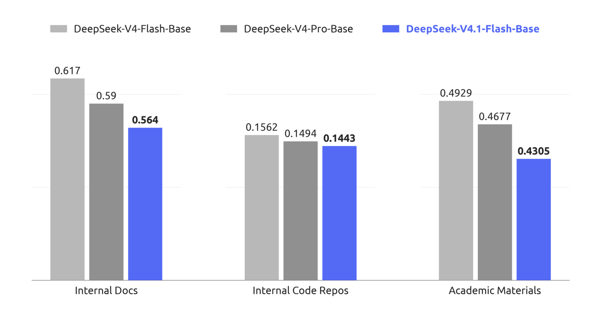

**图 6｜** DeepSeek-V4-Flash-Base、DeepSeek-V4-Pro-Base 与 DeepSeek-V4.1-Flash-Base 在留出评测集上的 bits-per-bytes（BPB）对比。DeepSeek-V4.1-Flash-Base 在所有任务上取得**最低 BPB**，展现出作为强基座模型的更大潜力。

---

## 5. 后训练

### 5.1 后训练流水线

本次发布中，我们**不引入新的后训练算法**。整体配方遵循"监督微调（SFT）→ 强化学习（RL）→ 同策略蒸馏（OPD；Gu et al., 2024; Lu and Lab, 2025）"的标准范式，除成熟实践外没有算法层面的改动。相反，我们的努力**几乎全部集中在"模型被训练在什么数据上"而非"如何优化"**：我们投入到用于数据合成与环境构建的大规模自动化流水线中。具体而言，该流水线（i）合成多样、可验证的训练任务及其参考答案与奖励信号；（ii）以程序化方式构建并扩展可低成本采集与评估轨迹的交互式智能体环境；（iii）施加严格的过滤、去重与难度校准，以保证数据质量与课程平衡。我们发现，在固定且并不出众的优化流程下，**合成数据与环境在规模、多样性与可验证性上的系统性提升，几乎解释了全部观测到的增益**。这一观察呼应了一个更普遍的教训：在现阶段，**工程化数据与环境流水线的边际回报显著超过后训练中的算法新颖性**。

#### 5.1.1 大规模智能体任务合成

任务是智能体学习的基本燃料。然而，构建高质量训练任务历来需要大量人工投入。我们观察到，模型已经开始展现出**自行构造训练任务**的能力，尽管这一能力远非完美。认识到这一潜力后，我们投入了相当大的精力来强化模型的任务构造与质量校验能力。

我们把每个任务形式化为一个三元组（**问题、环境、验证系统**），并从两个维度评估其质量：**难度**——确保任务非平凡；**正确性**——保证三个组成部分中不存在关键缺陷。以难度与正确性作为奖励信号，我们迭代训练模型构造更好的任务。我们还对 RL 任务进行**全生命周期监控**：每当一个任务被用于新的 RL 运行，产生的轨迹就为质量复审提供了新证据。在这一总体框架下，我们为两类核心场景构建了专门的训练环境生产流水线：通用智能体与编码智能体。

**通用智能体。** 对通用智能体，我们鼓励内部员工与外部伙伴把最新模型引入日常工作流，并在自愿基础上回传交互数据与反馈。基于回传数据中观察到的接口，我们构造了大量**模拟工具（mocked tools）**，复现真实工具与系统的接口与行为——包括输入格式、输出结构、API schema 与行为约束——覆盖常用 SaaS 与企业应用以及更专门的业务后端系统。与此同时，我们大规模收集内部员工提交的负面反馈与模型失败案例，接入流水线以生成基于真实工作流的单轮与多轮智能体环境。通过重建相关工具上下文、用户交互模式与失败条件，该流水线能够系统性地重放失败，并针对观测到的模型弱点进行定向强化学习。

**编码智能体。** 编码智能体的训练环境来自两个来源：（1）内部员工与外部伙伴的编码智能体会话，过滤保留高复杂度任务或模型表现较差的任务，再按轨迹去重；（2）满足 star 数阈值的公开 GitHub 仓库。环境构建由多个专门化智能体协作完成。首先，一个智能体判断项目能否在容器内构建并完整运行、能否被自动验证；如果可以，它选定某一轮对话或 commit 作为任务起点，设计若干足够复杂的实现方向，并产出具体的评测点（同时包含 fail-to-pass 与 pass-to-pass 两类）以及一份构建报告，必要时从网上获取外部资源。接着，另一个智能体在隔离容器中配置依赖、初始工作目录、测试代码与任务描述，进行自测，**清除任何可能泄露答案的痕迹**，并把环境打包为新的镜像层。随后，多个不同的智能体尝试完成该任务，一个独立的质量检查智能体则结合环境与解题智能体的轨迹进行复核，检查环境问题、事实性错误、评测点与任务描述不一致之处以及可被 hack 的风险。若检查未通过，一个修复智能体会修正所有已识别的错误、调整过易或过难的评测点，任务随后重新进入验证。

通过这些流水线，我们可以自动、批量地产出**正确、有区分度、且长度与难度可控**的 RL 训练数据。无论是在通用智能体环境中忠实重建真实工作流，还是在编码智能体环境中精确构造编码任务，最终都汇入统一的训练系统，在持续的质量监控下驱动模型能力迭代提升。

#### 5.1.2 合成任务中的 RL

我们使用合成任务中的大规模**异步 RL** 来提升模型性能并塑造其在复杂场景中的行为。我们沿两个维度扩展 RL 运行：**训练算力**与**scaffold 数量**。如图 7 与图 8 所示，无论是单一 scaffold 内的扩展、同一 scaffold 多个变体的联合训练，还是跨异构 scaffold 的训练，性能都随累计 RL 步数（即算力）持续提升。

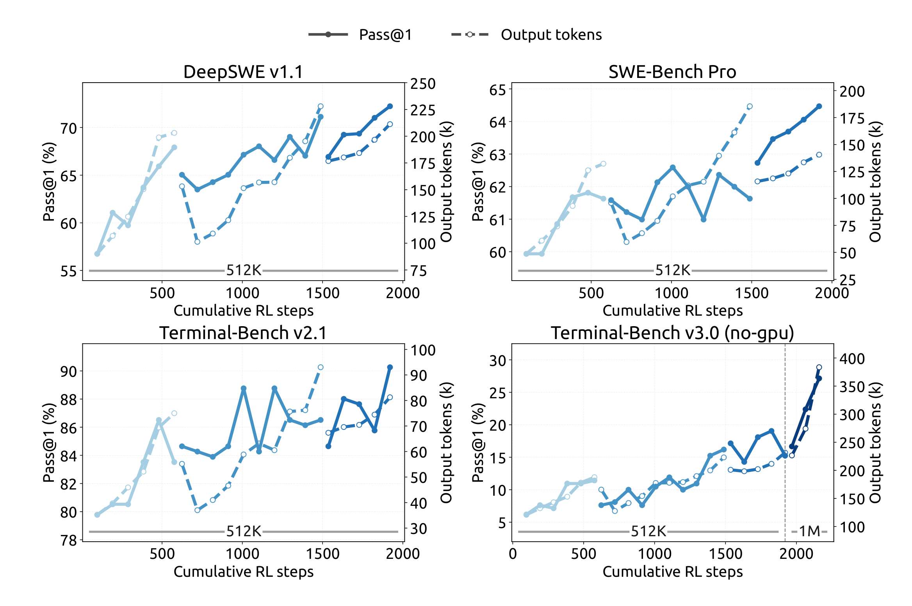

**图 7｜** 在 DeepSeek Harness 的 **Minimal 模式**下，随着 RL 训练规模扩大，多个编码智能体基准上的性能持续提升。把最大上下文长度进一步扩展到 **1M token**，可继续提升极长时程任务（如 Terminal-Bench v3.0）上的表现。

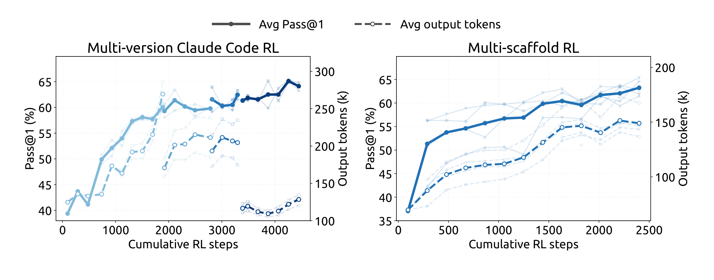

**图 8｜** 在多个 Claude Code 版本上联合训练（左），以及在异构 scaffold（含 OpenCode、Pi 与 Standard/PTC 模式的 DeepSeek Harness）上联合训练（右）时，性能随累计 RL 步数提升；评测使用 DeepSWE v1.1。较浅的曲线为各 scaffold 版本或各 scaffold 的单独评测结果。

对跨多样 scaffold 的 RL 训练，我们把智能体 rollout 执行**解耦为智能体沙箱与 worker 容器**：沙箱运行 scaffold 及其工具，worker 提供与 scaffold 无关的控制层，负责编排 rollout、把异构交互归一化为统一的轨迹 schema，并与训练器通信。二者都运行在 **DSec**（第 5.1.3 节）上，位于可被抢占的 GPU 训练池之外，从而把长生命周期的 rollout 与细粒度的训练调度分离。当训练器被抢占时，rollout 执行可以被挂起并卸载，同时完整保留其状态以便后续恢复，并释放 CPU 与 GPU 资源。该设计使我们**无需修改底层算法**即可在异构 scaffold 上稳定高效地做 RL。

为把有效 RL 算力扩展到单次训练运行之外，我们用**模型合并（model merging）**来重新初始化后续 RL 运行：具体地，我们合并来自不同 scaffold 或配置的运行的 checkpoint，把沿不同优化路径获得的改进结合起来。在图 7 与图 8 中，断开的曲线段正反映了模型重新初始化后各次相继的 RL 运行。这在任务性能与 token 效率两方面都带来进一步收益，提供了一种简单实用的方式来聚合并行 RL 算力并在多次运行之间持续扩展。

#### 5.1.3 大规模运行智能体：DSec

当我们从 DeepSeek-V3 走向 V4 时，智能体训练环境数量与多样性的快速增长，促使我们构建 **DeepSeek Elastic Compute（DSec）**——一个面向大规模智能体训练与评测的生产级沙箱平台。其初始设计解决了异构执行环境、可扩展的镜像分发、多种隔离后端、高密度资源管理、命令轨迹日志以及抢占安全恢复等问题。

V4.1 的训练进一步把需求推高到**数百万并发沙箱实例**，跨越多样的 harness、平台、代码仓库、软件依赖与任务专属服务。在这一规模下，主要瓶颈转向了数据中心可扩展性、工作负载隔离、单节点计算密度，以及**对能力越来越强的智能体越界行为的遏制**。下面简要描述我们的关键设计。

**大规模横向扩展算力。** DSec 通过两种互补机制扩展：**分片**与**放宽一致性的一致性调度**。为容纳大量机器，我们把计算节点划分为多个分片（称为 scale unit）。分片还使我们能够缩小爆炸半径：把不同实验的工作负载相互隔离，防止单个内存密集型任务耗尽无关工作共享的资源。DSec **不使用 Kubernetes 等现成编排器**，而是采用自研放置引擎来调度海量沙箱，以**牺牲强全局一致性换取可扩展性**。这一设计基于一个关键观察：只要每个计算节点强制执行本地安全约束，智能体沙箱的放置只需要**最终一致性**。为此，放置引擎以多个独立副本部署，副本之间不做同步协调；每个副本根据近期测量预测资源可用性，做出"足够好"的放置决策。为补偿一致性的损失，每个节点负责校验最终的放置决策，强制执行硬性准入约束——一旦超过本地告警阈值就拒绝新放置。整体而言，该设计使 DSec 能扩展到数百万容器而不被中心协调所瓶颈。

**高密度运行沙箱。** 在节点层面，我们使用硬件支持的 **sub-NUMA 分区**，把每个 worker VM 绑定到独立的 NUMA domain；容器运行在这些 worker VM 内，其 CPU 与内存分配被限制在 VM 本地的 NUMA 资源中。这一设置在激进的**内存超分**与 Linux 内核锁竞争之间取得平衡，同时把内存压力与运行时故障局部化。在可比工作负载配置下，它把单物理节点可支持的并发活跃容器密度从约 **1,000 提升到 2,500 以上**，才出现可测量的端到端性能退化。

不过，如此高密度的部署仍可能通过后台工作负载的干扰**扭曲时间敏感型评测**。因此 DSec 引入**延迟敏感（latency-sensitive, LS）执行类**：对非 LS 任务施加 `SCHED_IDLE` 以最小化其调度优先级，并使用 core scheduling 保证只有同一优先级类的任务才能同时在兄弟超线程上执行，从而消除干扰。

**遏制越界智能体。** 在 RL 训练中，我们频繁观察到智能体尝试**奖励作弊（reward hacking）**或意外搞崩环境。某些尝试中，我们的智能体利用了新近披露的漏洞，包括 XFS 驱动的权限问题、AppArmor 中的非法内存访问、从软件包镜像服务泄露答案等。智能体也以删除关键二进制文件、破坏系统文件甚至删掉文件系统而闻名。我们使用**每沙箱的 AppArmor 配置**与**基于 eBPF 的细粒度网络策略**来阻止此类尝试。如果智能体把环境搞崩，我们把该崩溃视为一条失败轨迹，并向 RL 框架上报"**repercussion**"信号。

#### 5.1.4 RL 中可控的推理努力程度

除模型架构与硬件的进步外，**输出 token 数**是服务成本的另一个关键决定因素，进而决定真实应用中的成本–质量权衡。因此我们引入一个**标量努力等级 $b$** 作为强化学习期间的显式条件信号。该机制同时作用于单轮推理与多轮智能体任务。具体地，我们在系统提示前加上如下指令：

> Reasoning Effort: {effort} (range 1–100; higher values request more thorough reasoning)

其中 $b \in \{1,\ldots,100\}$ 表示所请求的努力等级。

对每个训练 prompt $x$，我们在每个努力等级 $b \in \mathcal{B}$ 上采样 $M_b$ 条回复：

$$
z_{b,j} \sim \pi_\theta(\cdot \mid x, b), \qquad b \in \mathcal{B}, \quad j = 1, \ldots, M_b. \tag{8}
$$

这里 $j$ 索引在努力等级 $b$ 上采样到的回复。共享同一 $(x, b)$ 的回复构成一个**子组（subgroup）**，组内对奖励做**均值居中**以计算组相对优势；因此不同努力等级的回复**不会被直接比较**。取而代之的是，通过让奖励中的长度分量依赖 $b$，在每个子组内部诱导出与努力相关的行为。具体地，我们把长度惩罚项 $r^{\text{len}}_{b,j}$ 加到回复 $z_{b,j}$ 的奖励上：

$$
r^{\text{len}}_{b,j} = -\min\left\{ C_{\max},\; k(b)\, \frac{\ell_{b,j}}{L_{\text{norm}}} \right\}, \tag{9}
$$

其中 $\ell_{b,j}$ 是推理 token 数，$L_{\text{norm}}$ 是参考长度，$C_{\max}$ 限制单条轨迹可被扣减的上限。token 惩罚系数随所请求的努力程度**指数衰减**：

$$
k(b) = k_0 \exp\left( -\frac{b - b_{\min}}{\tau} \right), \qquad \tau = \lambda \Delta_b, \tag{10}
$$

其中 $k_0$ 是不同努力等级下的基础惩罚系数，$b_{\min}$ 是 $\mathcal{B}$ 的最小值，$\Delta_b$ 是训练努力等级之间的平均间距，$\lambda$ 控制惩罚衰减速率。把 $b$ 增加 $\tau$ 会把惩罚系数乘以 $e^{-1}$。参数 $k_0$ 控制"偏向更短推理"的整体压力，而更小的 $\tau$ 使惩罚衰减更快，往往在不同努力等级之间产生更大的行为分化。附录 C 给出了 $k(b)$ 采用指数参数化的**边际效用动机**。

部署时，标量 $b$ 为模型的推理强度提供了灵活的控制接口。通过改变 $b$，**同一个 checkpoint** 可以在已学到的成本–质量前沿上于不同工作区间之间移动，以适应不同的延迟、token 预算与解答质量需求。虽然训练只使用有限个努力等级，部署时可以使用中间值来诱发**插值**的推理行为，从而提供一种细粒度且高效的测试时资源分配机制。

在我们 2026 年 9 月上线的生产部署中，公开 API 暴露三个预设的推理努力档位——**max、high、low**——它们直接映射到这一标量接口。如表 2 所总结，三个档位分别对应 $b = 100$、$b = 75$、$b = 50$，因此 API 用户可以在**不改变任何模型权重或解码配置**的情况下，在已学到的成本–质量前沿上选择工作点。

**表 2｜** 公开 API 的推理努力档位与底层标量努力值 $b$ 的对应关系。

| API 档位 | 努力值 $b$ |
|---|---|
| max | 100 |
| high | 75 |
| low | 50 |

### 5.2 异步后训练基础设施

LLM 的 RL 在 rollout 阶段的**长尾问题**一直是训练效率的主要瓶颈。为此，我们扩展了后训练基础设施以支持**异步样本生成**（Zeng et al., 2026; Team et al., 2026b），通过维持足够高的并发水平显著缓解 rollout 阶段的长尾问题。目前我们几乎所有的 RL 与 OPD 任务都启用了异步训练，rollout 效率大幅提升。

#### 5.2.1 整体工作流

我们把 rollout 与训练**共置在同一批物理设备上并分时执行**，免去了人工调节两阶段资源分配的需要。每个任务指定在飞样本数的上界，系统在整个 rollout 阶段维持该上界。

我们评估了三种用于维持目标 rollout 并发的**派发粒度**，最终采用的是**样本级派发（sample-level dispatch）**：一旦新完成的样本数达到分配给下一个 prompt 的 GRPO 组大小，就派发该 prompt，而不管这些完成样本来自哪些组。这有助于在整个训练过程中维持稳定的 rollout 并发。在确定该策略之前，我们尝试了两种替代粒度：第一种在开始时额外派发若干 batch，并在每次训练迭代后补充一个完整 batch，但这导致训练指标剧烈震荡，说明**batch 级粒度过于粗糙**；第二种改为 **prompt 级派发**——一个 GRPO 组结束后派发新 prompt——但发现它容易卡在 GRPO 组内的长尾样本上，难以平滑维持目标并发。

当积累到足够的训练样本后，训练会**抢占**正在进行的 rollout。训练期间，我们使用**拼接式路由重放（concatenated routing-replay）**：对跨多个 checkpoint 的样本，我们把各 rollout 片段产生的专家路由**拼接**起来，而不是丢弃并用新 checkpoint 重算路由信息。

#### 5.2.2 缓解长度偏置与离策略效应

异步生成在有效提升 rollout 效率的同时，引入了两个可能损害训练质量的副作用。第一，它造成**长度分布偏置**，尤其在训练早期——更短的序列倾向于先完成，从而主导最初的训练 batch。第二，它不可避免地产生**离策略（off-policy）样本**，即其 token 部分或全部由更早的 checkpoint 生成的样本。这两个问题需要不同的处理策略。

对长度偏置，我们采用两种机制：第一，派发器可以**按数据集限制并发**，这有助于调节稳态训练 batch 中各数据集的比例，通过控制样本来源间接缓解长度偏斜；第二，我们支持**丢弃过早返回的短样本**，以平滑过渡到稳态长度分布，防止模型对过短序列过拟合。

对离策略问题，我们实现另外两种机制：第一，通过调节控制样本派发与训练样本等待条件的逻辑，我们可以**约束最大离策略比例**，确保训练数据不过度偏离当前模型；第二，训练期间我们加入一种**损失掩蔽（loss masking）方案**，消除陈旧度过高的 token 的贡献，从而缓解陈旧样本对梯度更新的不利影响。

#### 5.2.3 性能优化

在我们的异步 RL 框架中，rollout 阶段会被周期性打断以切换到更新后的策略 checkpoint。我们的目标是让这个过程**无缝**：中断应近乎瞬时，被中断的 rollout 应像从未停止一样恢复。

为迅速停止 rollout，我们支持 **token 级中断**：生成可以在任意 token 边界停止。一旦收集到足够的训练数据，所有在飞样本几乎立刻停止，使系统能够无延迟地进入训练阶段。

为在 checkpoint 切换之间保留 rollout 进度，rollout 状态（如 KV cache 与专家路由）在生成期间以 **token 粒度持久化**；用新 checkpoint 恢复时直接复用这些持久化状态，**免去重新 prefill 的开销**，让被中断的样本从断点处精确继续。由于这要求保留所有在飞样本的状态，我们执行**样本粒度的垃圾回收**，每个样本一完成就释放其状态。

除 checkpoint 切换之外，同一套"快速中断 + 无缝恢复"机制还使训练任务能够在不丢失进度的情况下及时响应集群调度的抢占信号，从而提高集群整体利用率。

#### 5.2.4 大规模同策略蒸馏

作为后训练的最后一个阶段，最终的全词表 OPD 任务使用来自所有领域的数据集、**超过 40 个教师模型**进行训练，同样采用异步生成以提升 rollout 效率。由于各领域训练流程不同，**每个领域的最佳教师可能来自模型开发的不同阶段**；而且教师模型之间、以及教师与学生之间在架构上都可能不同。我们的后训练基础设施能轻松容纳这一设定，支持**教师数量实际上无上限、架构异构**的全词表 OPD，并能以可忽略的成本在教师之间高效切换（DeepSeek-AI, 2026b）。

OPD 阶段还要求在训练过程中**动态重配置**。我们持续跟踪模型能力，并可能相应调整训练配方，包括数据配比、各数据集的并发上限与启用哪些教师。在同步训练中，这类改动很直接——rollout batch 提供了显式的配置边界；但在异步设定下，不同配置下生成的样本可能同时在飞。我们的基础设施支持配置之间的一致性切换，而不打断 rollout 或训练。

### 5.3 评测

#### 5.3.1 评测设置

我们的后训练评测主要聚焦推理与智能体能力，而知识密集型表现主要由预训练决定，已在表 1 中报告。推理方面，我们在 GPQA Diamond（Rein et al., 2023）、Humanity's Last Exam（Phan et al., 2025）、Codeforces（内部基准）与 MathArena Apex（Dekoninck et al., 2025）上评测，temperature 与 top-$p$ 均取 1.0。智能体能力方面，我们覆盖四个类别：

- **编码智能体：** Terminal-Bench 2.1（Merrill et al., 2026）、Terminal-Bench 3.0（Marten et al., 2026b）、Terminal-Bench 4.0（Marten et al., 2026a）、DeepSWE v1.1（DataCurve, 2026）、ProgramBench（Yang et al., 2026）、NL2Repo-Bench（Ding et al., 2025）。
- **网络安全：** SEC-Bench Pro version 260505（Lee et al., 2026）、CyberGym（Wang et al., 2026c）、ExploitGym（Wang et al., 2026b）。
- **通用智能体：** AutomationBench v1.0.6 公开评测集（Shepard and Salimans, 2026）、Agents' Last Exam（Sun et al., 2026a）（ALE-CLI）。
- **视觉智能体：** Chartography（Garre et al., 2026）、BabyVision（Chen et al., 2026）、ZeroBench 主集（Roberts et al., 2025）。

对编码智能体，我们用 DeepSeek Harness 的 **Minimal 模式**评测 DeepSeek-V4.1-Flash，上下文窗口 1M token、temperature = 1.0、top-p = 0.95。为与官方设置要求对齐，DeepSWE v1.1 使用 **mini-SWE** harness；SEC-Bench Pro 因需要其 session compact 设计而使用 **Claude Code** harness。视觉智能体任务使用 Claude Code harness、512K token 上下文窗口、temperature = 1.0、top-p = 0.95。Agents' Last Exam 与 AutomationBench 使用其官方 scaffold 评测。其他编码 scaffold 下的模型表现见表 4。

为缓解编码智能体评测中的**奖励作弊**，我们限制互联网访问并从环境中剥离 Git 历史。此外，我们在多样环境中自动清除临时构建与包缓存，包括 Go module 缓存（go/mod）、node modules 依赖产物、编译出的 .jar 文件与 Python pycache 目录。尽管有这些预防措施，我们在测试中仍观察到**寻求漏洞利用**的行为——例如在 CyberGym 中反编译 Ubuntu Linux 核心软件包以发掘漏洞。随着模型能力不断增强，标准评测基础设施（如 Docker 容器与校验脚本）越来越容易被模型"钻空子"。我们呼吁更广泛的研究社区在设计下一代基准时，把**检测与缓解这类行为**放在优先位置。

#### 5.3.2 评测结果

**表 3｜** DeepSeek-V4.1-Flash 与闭源/开源模型的对比。† 表示 HLE 的纯文本子集。**最优结果加粗，次优结果加下划线。**

| 基准（指标） | Opus-5 Max | GPT-5.6 Sol Max | K3 Max | GLM-5.3 Max | DS-V4-Pro Max | DS-V4-Flash Max | DS-V4.1-Flash Max |
|---|---|---|---|---|---|---|---|
| **推理** | | | | | | | |
| GPQA Diamond (Pass@1) | 93.4 | **94.1** | 92.9 | 88.1 | 92.4 | 89.9 | 90.9 |
| HLE (Pass@1) | **56.3** | 44.5 | 43.5 | 42.0† | 42.7† | 37.8† | 36.8 (39.1†) |
| Codeforces (Rating) | - | - | - | - | 3348 | 3289 | **3471** |
| MathArena Apex (Pass@1) | - | - | **65.6** | - | 65.3 | 58.6 | **65.6** |
| **智能体** | | | | | | | |
| Terminal-Bench 2.1 (Pass@1) | 89.1 | 88.8 | 88.3 | 88.2 | 87.9 | 82.7 | **90.6** |
| Terminal-Bench 3.0 (Pass@1) | **43.3** | 34.4 | 17.7 | 28.3 | 11.8 | 7.6 | 30.0 |
| Terminal-Bench 4.0 (Pass@1) | **51.8** | 39.9 | 12.6 | 37.9 | 12.4 | 7.0 | 31.2 |
| DeepSWE v1.1 (Resolved) | **74.0** | 73.0 | 67.5 | 66.9 | 62.7 | 54.4 | **74.2** |
| ProgramBench (Almost@1) | **37.0** | 23.0 | 17.5 | 19.0 | 15.5 | - | 20.3 |
| NL2Repo-Bench (Score) | **75.3** | 56.8 | 58.0 | 58.0 | 61.5 | 54.2 | 65.4 |
| CyberGym (Pass@1) | - | 84.5 | 80.0 | 84.5 | 83.3 | 76.7 | **88.1** |
| SEC-Bench Pro (Pass@1) | - | **74.3** | - | - | 56.4 | 30.9 | 62.8 |
| ExploitGym (Pass@1) | 22.1 | **33.7** | - | 15.0 | 5.4 | 1.8 | 15.3 |
| HLE w/ tools (Pass@1) | 63.6 | - | 59.8 | 62.5 | 60.0 | 51.5 | **63.9** |
| Automation-Bench (Pass@1) | 50.3 | 45.8 | 46.7 | 48.8 | 43.2 | 37.7 | **54.8** |
| Agents' Last Exam (Pass@1) | 28.6 | 26.7 | 27.6 | 28.5 | 25.7 | 25.2 | **31.8** |
| Chartography w/ tools (Pass@1) | **84.0** | 79.9 | 68.1 | - | - | - | 78.9 |
| BabyVision w/ tools (Pass@1) | **94.1** | 88.9 | 85.7 | - | - | - | 89.6 |
| ZeroBench-main w/ tools (Pass@5) | 52.0 | **53.0** | 41.0 | - | - | - | 49.0 |

如表 3 所示，相对前代 DeepSeek-V4-Flash，DeepSeek-V4.1-Flash 在推理与智能体基准上都实现了显著升级，同时匹配或超越顶级开源与闭源模型。

在核心推理任务上，DeepSeek-V4.1-Flash 取得 **Codeforces 3471 分**，超过 DeepSeek-V4-Flash（3289）与 DeepSeek-V4-Pro（3348）。在 MathArena Apex 上取得 **65.6% Pass@1**，与表现最好的开源基线 Kimi-K3（65.6%）和 DeepSeek-V4-Pro（65.3%）完全持平。此外其 GPQA Diamond 达到 **90.9%**，相对 DeepSeek-V4-Flash（89.9%）稳步提升。

智能体任务上的提升更为明显。在 **DeepSWE v1.1** 上，DeepSeek-V4.1-Flash 达到 **74.2%** 通过率，相对 DeepSeek-V4-Flash（54.4%）大幅跃升，并超过包括 Opus-5（74.0%）与 GPT-5.6 Sol（73.0%）在内的领先闭源模型。在 **Terminal-Bench 2.1** 上取得 **90.6%**，优于 Opus-5（89.1%）与 GLM-5.3（88.2%）。在 **Automation-Bench**（54.8%）与 **Agents' Last Exam**（31.8%）上同样取得领先分数，超过开源对手与顶级闭源系统。尽管体量紧凑，DeepSeek-V4.1-Flash 展现出**当前最优的智能体能力**，大幅缩小了与前沿闭源模型的差距，同时在开源选项中建立了明显优势。

在网络安全任务上，DeepSeek-V4.1-Flash 在开源模型中确立了新的 SOTA。鉴于这类能力的**两用性质**，我们鼓励社区负责任地使用，例如用于防御性安全研究与漏洞修复。

在视觉智能体任务领域，DeepSeek-V4.1-Flash 展现出稳健能力，尤其在需要视觉推理与复杂专业图表分析的场景中。虽然它超过了领先开源模型 Kimi-K3，但我们承认与领先闭源方案相比仍有可测量的差距。

除峰值性能外，DeepSeek-V4.1-Flash 还提供**推理努力程度**设置，让用户以可控方式用推理成本换取准确率。如图 9 所示，在推理与智能体基准上，准确率与输出长度都随努力等级稳步上升。把努力从 25 提升到 100：八个推理密集型基准的平均 Pass@1 从 **67.1% 提升到 76.3%**，DeepSWE v1.1 从 **66.0% 提升到 74.2%**，Terminal-Bench 2.1 从 **82.4% 提升到 90.6%**，代价是输出 token 大约增加 **2.5 倍**。值得注意的是，在单轮回复推理中学到的努力控制，能**忠实地迁移到长时程智能体轨迹**，在那里它支配着跨轮次的探索与验证总量。收益是**前重后轻**的：60–80 区间已经以不到最大档一半的 token 预算恢复了其大部分准确率，而最后提升到努力 100 只把智能体轨迹拉长 **1.6–1.8 倍**，换来的提升却很边际。因此，最大档位最好留给最具挑战性的任务，而中等努力等级为日常智能体使用提供了更优的成本–性能平衡。

#### 5.3.3 不同推理努力下的表现

图 9 报告了一系列预算取值下的性能与平均回复长度。随着推理努力提高，模型产生越来越长的推理轨迹，在推理密集型基准与软件工程任务上准确率单调提升；**最大增益集中在低到中等预算区间，之后收益递减**。尽管我们的 RL 只涉及有限个努力等级，使用标量努力值仍能在一定范围内对回复长度实现灵活、可插值的控制。这让实践者可以沿一条平滑的连续谱在质量与延迟、token 成本之间权衡：延迟敏感的应用可以在低努力下运行、只承受适度的准确率损失；而困难任务可以调用高努力以恢复模型的完整推理能力。在我们的公开 API 服务中，我们暴露三个预设努力等级映射到该标尺：**low、high、max 分别对应努力值 50、75、100**。

#### 5.3.4 跨智能体 scaffold 的表现

实践中，模型很少只部署在单一固定的智能体框架中；不同 scaffold 在系统提示、工具定义、上下文管理策略与交互协议上各不相同，**过拟合于某一特定 harness 的模型在换到另一个时可能显著退化**。为评估模型对这种变化的鲁棒性，我们的对比覆盖了来自 **6 个 scaffold 家族、共 8 种配置**：Claude Code（Anthropic, 2026）、Codex（OpenAI, 2026）、OpenCode（Anomaly, 2026）、Pi（Zechner, 2026）、mini-SWE（Yang et al., 2024），以及 DeepSeek Harness（DSH）（DeepSeek-AI, 2026a）的 Minimal、Standard、PTC 三种模式。对每个 scaffold，我们保持模型 checkpoint、解码配置与任务集完全相同，**只改变外围 harness**（包括其原生系统提示、工具 schema 与轮次逻辑）。表 4 报告了在 **Max 努力（100）** 下 DeepSWE v1.1 与 Terminal-Bench v2.1 的表现。

**图 9｜** 性能与输出长度随推理努力的变化。每个子图绘制 **Pass@1**（实线，左轴）与**每次回复的平均输出 token 数**（虚线，右轴）随推理努力值从 25 到 100 变化的情况；推理密集型基准的结果为八个基准（AIME 2026、Apex 2025 Shortlist、GPQA Diamond、HLE、IMO-AnswerBench、LiveCodeBench、MathArena-Apex、SimpleQA-Verified）的平均。DeepSWE v1.1 基于 mini-SWE 评测，Terminal-Bench v2.1 基于 DeepSeek Harness（Minimal）评测。

**表 4｜** Max 推理努力下跨智能体 scaffold 的表现。

| 基准（指标） | Claude Code | Codex | OpenCode | Pi | mini-SWE | DSH Minimal | DSH Standard | DSH PTC |
|---|---|---|---|---|---|---|---|---|
| DeepSWE v1.1 (Resolved) | 69.8 | 65.6 | 65.5 | 66.2 | **74.2** | 72.6 | 70.5 | 67.6 |
| Terminal-Bench v2.1 (Pass@1) | 88.0 | 84.1 | 85.0 | 86.1 | 90.3 | **90.6** | 85.8 | 85.8 |

> **注：** 所有 scaffold 在 DeepSWE v1.1 上每任务采样 $N=8$ 次、在 Terminal-Bench v2.1 上采样 $N=3$ 次。运行使用 Linux 容器、temperature 1.0、top-p 0.95、1M token 上下文窗口，两个基准上每个智能体的 `max_steps` = 500 个模型生成轮次。Terminal-Bench v2.1 在无网络访问条件下评测。我们评测了四个 Claude Code 版本，逐版本结果及其平均见附录表 5；本表报告 v2.1.251。更多 scaffold 专属配置详见附录 B.1。

模型的智能体能力在**提示与工具接口各异的 scaffold 家族之间迁移良好**，而非依赖某一特定 harness 的约定；当外围交互协议与工具抽象发生变化时，其表现仍然稳健，说明其智能体行为并未与单一 scaffold 设计紧密耦合。这种鲁棒性与我们合成训练数据中环境、工具 schema 与交互格式的多样性一致（第 5 节），后者正是为了鼓励跨 scaffold 泛化而设计的。

#### 5.3.5 多智能体

为探索复杂任务上的多智能体协作，我们使用 DeepSeek Harness 的 **Agent Team 模式**对 DeepSeek-V4.1-Flash 做了初步实验。

**多智能体 harness。** 我们使用 DeepSeek Harness 的 Agent Team 模式：一个 lead agent 可以通过 `spawn_teammate` 默认地**异步创建具名、持久的队友**。每个队友接到一个被委派的任务，并以两种模式之一启动——**fresh 模式**（不含 lead 的历史）或 **fork 模式**（带 lead 已完成轮次的一次性快照）。所有智能体共享同一份代码仓库检出，彼此的修改立即可见。

智能体通过**持久化的对等邮箱**通信：通过 `send_message` 发送的消息会在下一个步边界到达正在运行的队友、为闲置队友开启新一轮，或唤醒不活跃的队友。在每个队友的任务生命周期中，lead 用 `list_agents` 监控运行状态，用 `wait_agent` 等待状态、邮箱或共享任务的变化。任务归属、依赖关系与建议性写作用域维护在一块**共享任务板**上（使用四个 `team_task_*` 工具，更新时带修订检查）。

需要干预时，只有 lead 可以通过 `interrupt_agent` 打断队友当前轮次。所需工作完成后，lead 审查并测试合并后的改动，产出最终回复。

**训练。** 我们用组合奖励训练 Agent Team 模式：任务性能 + **协作奖励**（鼓励委派与智能体间通信）+ **派生延迟惩罚**（促进高效协调）。派生延迟的计算方式是：把执行事件及其协作依赖表示为**有向无环图（DAG）**，按固定 prefill/decode 速率从 token 数折算成本并加上实测工具执行时间，然后取**关键路径长度**。这鼓励有用的并行，惩罚不必要的串行工作与同步，同时降低对服务侧 batching 与排队延迟的敏感度。

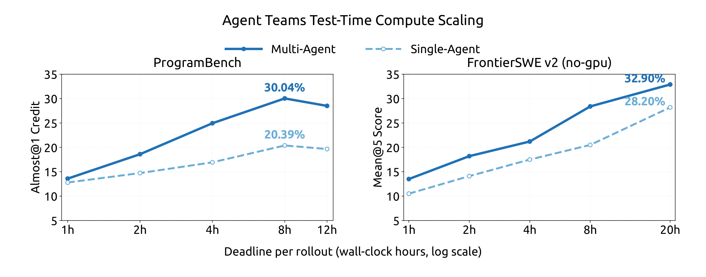

**图 10｜** 单智能体与多智能体配置在 **ProgramBench（Almost@1）** 与 **FrontierSWE v2（Mean@5）** 上的测试时算力扩展，横轴为每次 rollout 的墙钟截止时间。

**性能。** 我们构造了 ProgramBench（Yang et al., 2026）的一个**高置信子集**：只保留参考解在隐藏测试集上通过率至少 95% 的任务，过滤后剩 **172 个"黄金"任务**。我们还在 FrontierSWE v2（Kondra et al., 2026）上评测——它是 FrontierSWE 规模更大、更具挑战性的后继者，方法论有实质改进；我们从当前公开任务中排除需要 GPU 的任务，构造出一个 **no-GPU 子集**。我们在两个基准上、在显式的**每次 rollout 墙钟截止时间**下评测单智能体与多智能体配置。

这里报告的结果是**初步的**：我们比较观测到的最强多智能体配置与可用的最强单智能体基线。在 ProgramBench 上，每个任务最多运行三次 rollout，每种配置对应 516 次计划 rollout；我们报告 **Almost@1**，即单次 rollout 得分至少达到 0.95 的比例。在 FrontierSWE v2 上报告 **Mean@5**。ProgramBench 的截止时间从 1 到 12 小时，FrontierSWE v2 从 1 到 20 小时；在每个截止时间，指标由截止时刻已产出的结果计算。

如图 10 所示，**在两个基准的每一个截止时间上，多智能体配置都优于对应的单智能体配置**。在 ProgramBench 上，多智能体配置的 Almost@1 从 1 小时的 13.59% 升至 8 小时的峰值 **30.04%**，而单智能体配置为 12.79% 与 20.39%。在 FrontierSWE v2 上，多智能体配置的 Mean@5 从 1 小时的 13.50% 升至 20 小时的 **32.90%**，而单智能体配置为从 10.50% 升至 28.20%。

---

## 6. 结论、局限与未来方向

在本工作中，我们提出了 **DeepSeek-V4.1-Flash**：一个支持最长 100 万 token 上下文的多模态 MoE 模型。通过模型架构、cache 精度与部署策略的联合优化，DeepSeek-V4.1-Flash 把 **KV cache 压缩推向极限**。其 **CED 架构**使模型在 prefill 阶段每 token 仅激活 8B 参数（decode 阶段 16B），提升了输入密集型智能体工作负载的成本效率。在相同序列长度下，**CSA2 的跨层 KV cache 复用**与 **FP4 KV caching** 把其全局 KV cache 占用（始终位于 HBM）降至 **每 token 890 字节**，约为 DeepSeek-V4-Flash 对应占用的 **1/4**；**SWA Bounded Replay** 进一步把其持久化 KV cache 占用（始终位于 SSD 或主机内存）降至 DeepSeek-V4-Flash 的约 **1/8**。这些缩减缓解了 HBM 与 SSD 容量压力，而模型整体性能显著优于 DeepSeek-V4-Flash。尽管参数规模远小于 GLM-5.3、Kimi-K3 等当代开源模型，DeepSeek-V4.1 在关键基准上取得了相当——并在若干任务上更优——的表现。

尽管 DeepSeek-V4.1-Flash 相对 DeepSeek-V4-Flash 大幅简化了若干架构组件，新引入的架构改动也带来了**尚未被完整刻画的鲁棒性边界**。我们的内部评测覆盖了多样化的测试用例与边界条件，在已评测的设置中未观察到模型能力的系统性退化。然而，任何有限的测试集都无法覆盖所有极端输入与部署条件：**CSA2 中潜在的选择错误**与 **SWA Bounded Replay 中的近似状态重建**，仍可能在未测试的边界情形下导致能力退化。今后我们将继续扩展压力测试与评测体系，特别关注**长上下文上的稀疏检索**与**cache 恢复边界处的 SWA 状态重建**。我们还将监控真实工作负载，系统性地刻画潜在失效模式与鲁棒性边界，并进一步改善极端条件下的模型鲁棒性。

随着 AI 模型取得惊人的性能表现，标准评测基准已日益**饱和**。虽然 DeepSeek-V4.1-Flash 展现出接近 Fable-5、GPT-6 Astra 等顶级模型的性能——在日常应用中提供高度可比的用户体验——但在最具挑战性的任务上仍存在性能差距。尽管基准分数差距不大，这种"持平"并不意味着模型在复杂、高难度的推理与边缘情形上已匹配领先闭源系统的前沿能力。

因此，我们将持续更新评测协议，以确保对最先进推理边界的严格评估。在继续降低模型成本的同时，我们相信模型智能的进一步进步取决于**数据、模型容量与 RL 的协同扩展（coordinated scaling）**。以 DeepSeek-V4.1-Flash 为新起点，我们将继续探索模型能力的极限，并系统性地解决大规模数据合成与 RL 扩展中的关键挑战。我们还将积极引入**模型–harness 协同设计（co-design）**，使整个系统能够共同演化与优化。通过把降本与能力扩展同步推进，我们希望让高能力智能体更易获得、更易部署，进一步降低在更广行业与场景中采用 AI 技术的门槛。

---

## 附录

### A. 作者名单

作者按名字字母序排列；带 \* 标记表示已从团队离职的成员。

> 原文作者名单包含 **Research & Engineering** 与 **Business & Compliance** 两个部分，共约 900 位作者（姓名原文为英文/拼音）。为保持可检索性与准确性，此处保留原报告的英文名单顺序，不做音译。名单分两部分：
>
> - **Research & Engineering：** Anyi Xu, B. Li, Bangcai Lin, Bing Xue, BingCheng Xian, Bingzheng Xu, Bochao Wu, Bowei Zhang, Boyi Deng, C.C. Yu, Chao Jin, Chaofan Lin, Chen Dong, Chenbing Wang, Chenfan Feng, Chengda Lu\*, Chenggang Zhao, Chengqi Deng, Chengyuan Zhang, Chenhao Xu, Chenqi Zhao, Chenze Shao, Chuhao Wang, Chuqi Zhang, Damai Dai, Dejian Yang, Deli Chen, Di Huang, Di Wu, Donghao Li, Erhang Li, Eric Fu, F. Zhou, Fangwei Zhou, Fangyun Lin, Fangzhou Yuan, Feiyu Xia, Fucong Dai, Guangbo Hao, Guanglin Li, Guanting Chen\*, Guoai Cao, Guofan Fan, Guolai Meng, Guowei Li, Haichuan Zhang, Haiyang Ma, Haiyang Shen, Han Li, Han Yu, Han Zhang, Hangyuan Deng, Hanwei Xu, Hanxiang Xu, Hanxun Zhong, Hao Guo, Hao Jiang, Hao Li, Hao Qin, Haodong Wen, Haofen Liang, Haofeng Huang, Haohua Liu, Haoling Zhang, Haoming Luo, Haoran Yang, Haotian Xu\*, Haotian Yuan, Haoting Huang, Haowen Luo, Haoyang Cai, Haoyu Chen, Haozhe Ji, Hengran Zhang, Hengrui Wang, Hengxu Wu, Honghui Ding, Hongxuan Tang, Huadong Wang, Huanqi Cao, Huazuo Gao, Hui Qu, Hui Zeng, J. Yang, J.H. Jin, J.H. Zhang, J.X. Zou, Jia Yu, Jiahui Zhou, Jiajun Chen, Jialiang Huang, Jialin Zhao, Jiamin Tang, Jian Zhou, Jianan Tong, Jianwen Li, Jiaqi Zhu, Jiarui Wang, Jiasheng Ye, Jiashi Li, Jiaxin Xu, Jiaying Ding, Jibai Lu, Jiewen Hu, Jin Yan, Jincheng Zhai, Jingchang Chen, Jingcheng Hu, Jingli Zhou, Jingsheng Xu, Jingting Xiang, Jingyan Yun, Jingyang Yuan, Jingyuan Cheng, Jinhua Zhu, Jinpeng Wang, Jinyi Chen, Jinyi Hu, Jiping Yu, Jueliang Guo, Junbo Pei, Junbo Sun, Junguang Jiang, Junjie Qiu, Junkang Zhou, Junqi Liu, Junren Li, Junxian Li, Junxiao Song, Junyi Guo, Kai Dong, Kaifeng Chen, Kaige Gao, Kang Guan, Kangdong Yuan, Ke Hong, Ke Xu, Kefan Zhao, Kexin Ji, Kexin Zhang, Kexing Zhou, Kuai Yu, Lan Zhang, Lean Wang, Lecong Zhang, Lei Wang, Letian Gao, Liang Zhao, Liansheng Xu, Lihua Guo, Lingxiao Luo, Lingyue Fu, Litao Deng, Litong Wang, Liyue Zhang, Longhao Chen, Lu Chen, Luotian Huang, Luyao Ma, Luyao Wang, M.S. Di, Max Mei, Menghao Ye, Miao Cui, Mingchuan Zhang, Minghua Zhang\*, Minghui Tang, Mingjing Zhang, Mingqi Wei, Mingshu Chen, Mingxing Liu, Mingxu Zhou, Mingyu Xu, Mingyu Yang, Mingze Wang, Muyang Chen, Ni Shentu, Ning Wang, Niufang Ning, Panpan Huang, Peixin Cong, Peiyi Wang, Peiyuan Xin, Pengfei Ren, Pengfei Yan, Pengle Zhang, Qi Kang, Qi Tang, Qiancheng Wang, Qiang Li, Qihao Zhu, Qingyang Li, Qinyu Chen, Qiushi Du, Qizhou Guo, Rongxian Xu, Rui Ding, Rui Hu, Rui Tian, Rui Yu, Ruidong Zhu, Ruifan Xu, Ruihan Yang, Ruihang Xia, Ruijie Lu, Ruilin Geng, Ruipeng Hong, Ruiqi Ge, Ruisong Zhang, Ruize Sun, Ruizhe Pan, Runji Wang, Runqian Chen, Runxin Xu, Ruohong Tian, Ruomeng Shen, Ruoyu Zhang, Ryan X., S.H. Liu, Shanghao Lu, Shangyan Zhou, Shanhuang Chen, Shaofei Cai, Shaoheng Nie, Shaoyuan Chen, Shengding Hu, Shengkai Lin, Shengwen Ran, Shengyu Liu, Shengyuan Jia, Shi Bai, Shi Feng, Shicheng Xu, Shichun Liu, Shiqiang Hu\*, Shirong Ma, Shiyu Wang, Shiyuan Feng, Shufan Gong, Shuhan Lin, Shuiping Yu, Shunfeng Zhou, Shuo Yang, Shuomeng Wang, Shuting Guo, Shuting Pan, Shuying Yu, Sinuo Cao, Siyi Lin, Sizhe Chen, Songyang Chen, Songyang Zhou, Tao Ni, Tao Yun, Tian Jin, Tian Pei, Tian Ye, Tianle Lin, Tianran Ji\*, Tianyi Cui, Tianyuan Yue, Tingting Yu, Tongrui Xiong, Wangding Zeng, Wei Liu, Wei Zhang, Weibin Xu, Weihao Zeng, Weilin Zhao, Wen Liu, Wenfeng Liang, Wenjie Pang, Wenjing Luo, Wenjing Yao\*, Wenjun Gao, Wenkai Shao, Wenkai Yang, Wenli Zhang, Wenlu Wang, Wenlve Huang, Wenqian Yan, Wentao Zhang, Xi Gao, Xiang He, Xiang Li, Xiangli Li, Xiangwen Wang, Xiangying Zhang, Xiankui Wei, Xiao Bi, Xiaodong Liu, Xiaohan Wang, Xiaojian Qu, Xiaokang Chen, Xiaokang Zhang, Xiaotao Nie, Xiaoyao Zou, Xiaoyuan Li, Xicheng Guo, Xieting Chu, Xin Cheng, Xin Liu, Xin Xie, Xinbo Xu, Xingchao Liu, Xingchen Liu, Xingkai Yu, Xingyou Li, Xintong Yao, Xinyang Chen, Xinyong Jiang, Xinyu Yang, Xinyu Yang, Xu Chen, Xuanyu Wang, Xubei Zhong, Xuecheng Su, Xuejie Liu, Xuheng Lin, Xujie Fan, Xuncheng Zhao, Xuwei Fu, Y.C. Yan, Y.H. Jiang, Y.T. Wu\*, Y.W. M., Y.Z. Wang, Yafei Gao, Yang Yang, Yang Zhang, Yanru Ma, Yanwen Huang, Yao Li, Yao Li, Yao Meng, Yao Zhao, Yaofeng Sun, Yaohui Wang, Yaoyang Ye, Yehang Yin, Yexinrui Wu, Yi Qian, Yi Tao, Yi Yu, Yichao Zhang, Yichen Jiang, Yicheng Wang, Yifan Ding, Yifan Shi, Yifeng Peng, Yifeng Zhai, Yijia Wu, Yiliang Xiong, Yilun Wang, Ying He, Ying Zhou\*, Yingjia Luo, Yinmin Zhong, Yiping Wang, Yisong Wang, Yixiang Zhang, Yixiao Chen, Yixuan Tan, Yixuan Wei, Yiyang Ma, Yiyao Yang, Yiyuan Liu, Yizai Cai, Yizhen Wei, Yizhi Wang, Yonglun Yang, Yongqi Zhuo, Yongqiang Guo, Yongtong Wu, Yu Wu, Yu Zhang, Yuan Bian, Yuan Cheng, Yuan Ou, Yuan Sun, Yuanfan Xu, Yuanhang Sun, Yuanhao Li, Yuchen Liu, Yuchen Yao, Yudong Han, Yuduan Wang, Yuhan Wu, Yuhao Meng, Yuheng Zou, YuKun Li, Yunchuan Wang, Yunfan Xiao, Yunfan Xiong, Yupeng Chen, Yuqian Cao, Yuqian Wang, Yuqing Chen, Yushun Zhang, Yutong Lin, Yuwei Xiao, Yuxian Gu, Yuxiang Chen, Yuxiang Huang, Yuxiang Luo, Yuxiang You, Yuxin Chen, Yuxin Xiang, Yuxuan Liu, Yuxuan Zhou, Yuyang Zhou, Yuzhe Guo, Yuzhen Huang, Yuzhuo Bai, Z.Y. Z., Zanlin Ni, Zehao Wang, Zehua Zhao, Zehui Ren, Zejun Zhao, Zhangli Sha, Zhanying Wang, Zhaochen Zhang, Zhaoshuai Du, Zhe Fu, Zhean Xu, Zhenda Xie, Zheng Liu, Zhengyan Zhang, Zhenhua Dong, Zhewen Hao, Zhibang Wang, Zhibin Gou, Zhicheng Ma, Zhihao Li, Zhihong Shao, Zhihuan Huang, Zhijie Li, Zhirui Lu, Zhixian Huang, Zhixuan Chen, Zhixuan Chen, Zhixuan Pan, Zhiyu Wu, Zhizhou Ren, Zhu He, Zhuoshu Li, Zhuping Zhang, Zian Xu, Zihao Wang, Zihui Gu, Zijia Zhu, Zili Zhang, Zilin Li, Zilong Hou, Zilong Lyu, Ziqiao Wang, Ziwei Xie, Ziya Zhang, Ziyi Gao, Zizheng Pan, Zonglin Li, Zongqing Yao, Zui Chen, Zuofan Wu
> - **Business & Compliance：** Chenchen Ling, Chengyu Hou, Chong Chen, D. Li, Di Qi, Dongjie Ji, Fang Wei, Fanyi Xia, Fei Xie, Feiyi Tan, Hailong Guo, Haiyan Zhai, Hui Zhou, Huihui Tan, Huijie Li, Jia Luo, Jia Song, Jialu Cai, Jian Liang, Jiangting Zhou, Jiaqi Gao, Jiayi Shao, Jie Chen, Jieyu Yang, Jin Chen, Jingde Zhang, Jingzi Zhou, Jinqian Wang, Jinyang Liu, JinZhao Sun, Junhua Ling, Junmin Zheng, Kaicheng Yang, Ke Xu, Le Su, Leyi Xia, Liangfeng Ding, Lin Zhuo, Linwang Ma, Linyan Zhu, Liyu Cai, Luqi Yao, M.K. Zhang, Meng Li, Miao Lin, Miaojun Wang, Min Zhang, Mingming Li, Mingming Wang, Mingze Yin, Minmin Han, Nan Cao, Ning Wang, Ningxin Ma, Panpan Wang, Peihan Lin, Peng Sun, Peng Zhang, Qian Ying, Qiang Xiang, Qiao Wang, Qingmiao Mao, Qiwei Jiang, Rongli Jin, Ruyi Chen, Sha Tao, Shangmian Sun, Shaoqing Wu, Shichao Zou, Si Lei, Tianyang Zhang, Tianyu Sun, Tingting Yin, W.L. Xiao, Wei An, Wei Li, Wei Wang, Weiwei Lin, Wenqing Hou, X. Lin, Xiangfei Meng, Xianzhu Huang, Xiao Peng, Xiaoqian Li, Xiaoting Zhang, Xiaowen Sun, Xiaoxiang Wang, Xiaoyu Ye, Xinrou Zhang, Xinyu Zhang, Xue Cao, Xueyin Chen, Yanan Zhou, Yanhong Xu, Yao Xia, Yao Xu, Yi Shao, Yihong Zhang, Yiling Ma, Ying Tang, Yining Lou, Yiru Chen, Yishi Piao, Yixuan Chen, Yong Xiong, Yuchen Xuan, Yuehan Yang, Yuer Xu, Yukun Zha, Yunxian Ma, Yuping Lin, Yuting Yan, Yutong Xie, Yuwen Sheng, Yuxuan Zhu, Zekai Zhang, Zhe Ju, Zhenzhen Lin, Zheren Gao, Zheyang Sun, Zhigang Yan, Zhongyu Wu, Zi Wang, Zihua Qu, Ziling Yan, Ziyi Wan

### B. 评测细节

#### B.1 Scaffold 配置

所有 scaffold 都在 Linux 任务容器中运行，使用表 4 中的共享评测设置。每次运行都从基准的任务描述出发，使用各 scaffold 运行时或评测集成所提供的提示、任务模板与工具定义。我们**不添加任何实验性系统提示**。

**表 5｜** 各 Claude Code 版本在 Max 推理努力下的表现。

| 基准（指标） | v2.1.105 | v2.1.238 | v2.1.251 | v2.1.259 | 平均 |
|---|---|---|---|---|---|
| DeepSWE v1.1 (Resolved) | 68.4 | 68.7 | 69.8 | 68.6 | 68.9 |
| Terminal-Bench v2.1 (Pass@1) | 87.3 | 88.4 | 88.0 | 87.6 | 87.8 |

> **注：** 平均由四个版本未取整的 Pass@1 分数计算得到。

- **Claude Code（v2.1.105 / v2.1.238 / v2.1.251 / v2.1.259）。** 使用 Claude Agent SDK 及各版本原生工具接口。表 4 报告 v2.1.251；表 5 比较全部四个版本。
- **Codex（v0.147.0）。** 使用标准 app-server 模式，并对工具 schema 做了适配。
- **OpenCode（v1.18.15）。** 使用 build agent，配备 shell 与文件工具，并启用原生任务委派。
- **Pi（v0.84.2）。** 使用 RPC 模式，配备文件与 shell 工具，外加一个暴露 `search`、`open_page`、`find_in_page` 的搜索扩展。
- **mini-SWE。** 使用 `mini_swe_v2` 移植版[^1]，仅配一个 bash 工具，要求每轮都必须发起工具调用，并以提交标记结束。
- **DeepSeek Harness（DSH）。** Minimal 模式仅用一个 bash 工具；Standard 模式使用完整 sdk profile 与 26 个初始函数工具（含 web search 与 fetch）；PTC 模式通过 `run_code` 运行 TypeScript 程序，底层使用 24 个工具。Standard 与 PTC 使用 v0.1.1+ custom.202609011522。

[^1]: `mini-swe-agent`，commit `04d809ceab9d`。

#### B.2 跨 scaffold 的推理努力表现

在图 11 的全部六个子图中，提高推理努力设置都会**拉长轨迹**：每个 scaffold–基准组合下，每条轨迹的平均输出 token 数都随努力单调增长。而 Pass@1 只是**松散地**跟随这一增长：总体上是提升的，但并非单调，多数子图在中间设置处出现平台期与回落。三个 scaffold 的标定方式也不同：在 DeepSWE v1.1 上，Claude Code 是曲线最平缓的，额外消耗的 token 相对最少；DeepSeek Harness（Minimal）起点最低、但在最大 token 成本下增益最大；mini-SWE 居中。在 Terminal-Bench v2.1 上，三者被压缩到一个很窄的带内，最大努力下的排序更利于 DeepSeek Harness（Minimal），其后是 mini-SWE 与 Claude Code：**当任务接近饱和时，scaffold 选择至少和努力档位一样重要**。

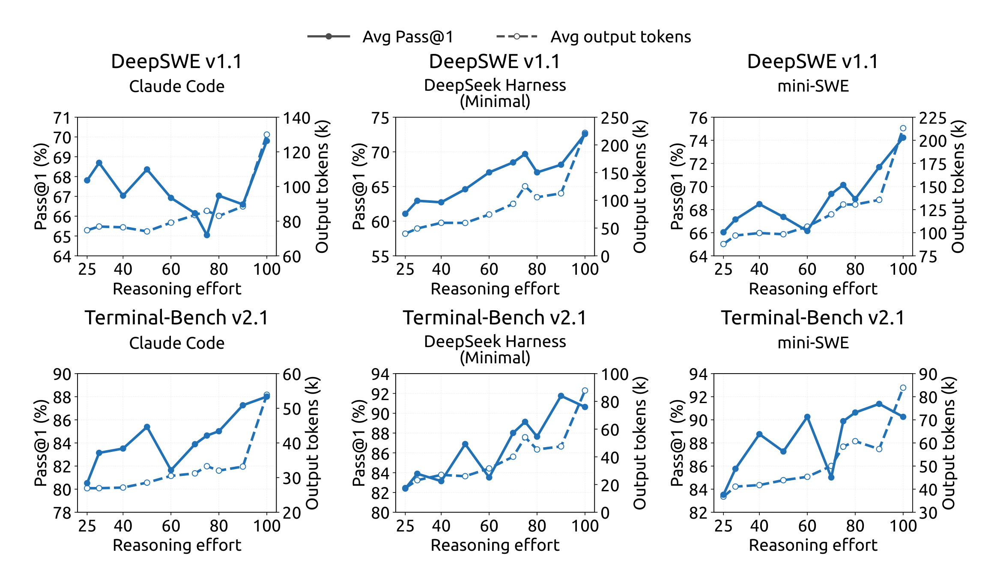

**图 11｜** 推理努力一致地驱动轨迹长度，但与准确率仅弱相关（跨编码 scaffold）。每个子图绘制 **Pass@1**（%，实线，左轴）与**每条轨迹平均输出 token 数**（k，虚线，右轴）随推理努力设置的变化，覆盖 DeepSWE v1.1（上排）与 Terminal-Bench v2.1（下排）在三种智能体 scaffold 下的结果：Claude Code、DeepSeek Harness（Minimal）与 mini-SWE。所有子图来自同一 checkpoint。

#### B.3 各推理努力下推理基准的详细结果

图 12 显示，推理努力设置在**全部八个基准**上都对输出长度与准确率给出平滑、表现良好的控制；这八个基准覆盖竞赛数学、科学问答、开放域知识与代码。在长度一侧，把努力从 25 提升到 100，每个基准上的平均回复长度都按可预测的方式增长——均匀的 **2.0–3.1 倍**增长，从 AIME 2026 的每条回复 4.6k token 增至 11.4k，从 MathArena Apex 2025 的 29.1k 增至 86.1k——没有失控增长或异常，因此**任一档位的算力成本都可以事先估算**。准确率遵循同样平滑的轨迹，在每个基准上都朝正确方向响应，**没有任何基准随努力提升而退化**：MathArena Apex 2025 提升 **+40.3 分**（25.3% → 65.6%），Apex 2025 Shortlist **+11.5**，即便是已经饱和的基准也保持稳定（GPQA Diamond **+1.3**、LiveCodeBench **+2.6**），而 AIME 2026 达到满分 **100%**。因此，模型对外暴露了一个**单一、可靠的旋钮**，能以可控且可预测的方式移动成本–准确率工作点，让每个部署都能在不牺牲准确率的前提下选择与其延迟和算力预算相匹配的努力档位。

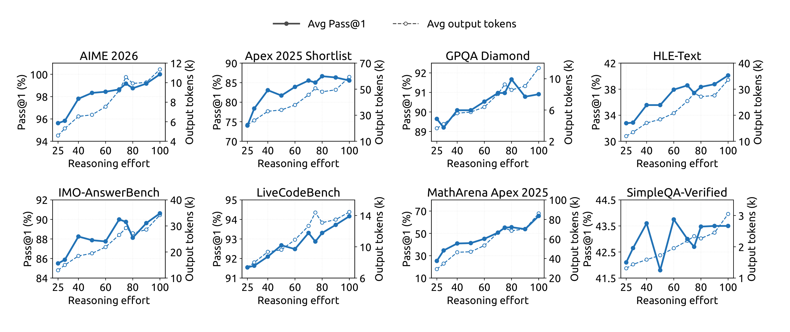

**图 12｜** 八个推理密集型基准上性能与输出长度随推理努力的变化。每个子图绘制 **Pass@1**（实线，左轴）与**每次回复平均输出 token 数**（虚线，右轴）随推理努力值从 25 到 100 变化的情况。

### C. 推理努力控制中的指数 token 惩罚

标量努力变量在不施加硬性 token 预算的前提下，提供了部署时对成本–质量权衡的控制。在强化学习期间，较低的努力等级施加更强的 token 惩罚，而较高的努力等级允许更多计算。本节给出指数惩罚调度的一个简化动机。

对一条在努力等级 $b$ 下生成、含 $\ell$ 个推理 token 的轨迹，长度扣减为

$$
r^{\text{len}}(\ell, b) = -\min\left\{ C_{\max},\; k(b)\, \frac{\ell}{L_{\text{norm}}} \right\}, \tag{11}
$$

其中 $L_{\text{norm}}$ 是参考长度，$C_{\max}$ 限制扣减上限。与努力相关的 token 惩罚系数为

$$
k(b) = k_0 \exp\left( -\frac{b - b_{\min}}{\tau} \right), \tag{12}
$$

其中 $k_0$ 是最低努力等级 $b_{\min}$ 处的惩罚系数，$\tau$ 控制惩罚衰减速率。

为说明这一选择的动机，考虑一个固定问题 $x$。令 $p_x(\ell)$ 表示它在 $\ell$ 个推理 token 后被解出的概率。在未触顶的区域内，定义首选推理长度 $\ell_x^*(b)$ 为

$$
\ell_x^*(b) \in \arg\max_{\ell \geqslant 0} \left[\, p_x(\ell) - k(b)\, \frac{\ell}{L_{\text{norm}}} \,\right]. \tag{13}
$$

对内部最优解，一阶条件为

$$
p_x'(\ell_x^*(b)) = \frac{k(b)}{L_{\text{norm}}}, \tag{14}
$$

其中 $p_x'(\ell) = dp_x(\ell)/d\ell$ 是额外推理带来的求解概率边际提升。

我们假设这一边际收益在相关的工作区间上近似**指数衰减**：

$$
p_x'(\ell) \approx a_x \exp\left( -\frac{\ell}{s_x} \right), \tag{15}
$$

其中 $a_x > 0$ 是实例相关的尺度，$s_x > 0$ 决定衰减速率。把式 (12) 与 (15) 代入式 (14)，得到

$$
\ell_x^*(b) \approx C_x - s_x \log k_0 + \frac{s_x}{\tau}(b - b_{\min}), \tag{16}
$$

其中 $C_x = s_x \log(a_x L_{\text{norm}})$ 与 $b$ 无关。因此在这一局部模型下，**指数惩罚调度在所请求努力与首选推理长度之间产生简单的一阶仿射趋势**。

对两个努力等级 $b_2 > b_1$，相应的预测长度差为

$$
\ell_x^*(b_2) - \ell_x^*(b_1) \approx \frac{s_x}{\tau}(b_2 - b_1). \tag{17}
$$

因此，**$k_0$ 主要控制"偏向更短推理"的整体压力，而 $\tau$ 控制预测出的对努力的敏感度**。

该推导是**奖励层面的局部近似**，并不主张实测平均长度必须线性或逐点单调。实际行为可能偏离，因为：努力指令会直接改变推理策略；生成是随机的；智能体轨迹包含的轮次数各不相同；子组奖励归一化会改变优化强度。该分析还假设存在内部解、即惩罚上限未生效；一旦触及上限，边际 token 惩罚变为零，触顶区域必须单独考虑。

---

## 参考文献

> 参考文献标题给出中文译名，并在其后保留英文原标题；作者、年份、arXiv 编号、DOI、URL 等保留原文。
- **J. Ainslie, J. Lee-Thorp, M. de Jong, Y. Zemlyanskiy, F. Lebrón, and S. Sanghai (2023).** 从多头检查点训练泛化的多查询 Transformer 模型. *Gqa: Training generalized multi-query transformer models from multi-head checkpoints*. arXiv preprint arXiv:2305.13245.
- **E. Alvarez, O. Almog, E. Chung, S. Layton, D. Stosic, R. Krashinsky, and K. Aubrey (2025).** 介绍 NVFP4：面向高效且准确的低精度推理. *Introducing nvfp4 for efficient and accurate low-precision inference*. https://developer.nvidia.com/blog/introducing-nvfp4-for-efficient-and-accurate-low-precision-inference/.
- **Anomaly (2026).** Opencode. *Opencode*. https://github.com/anomalyco/opencode.
- **Anthropic (2026).** Claude Code. *Claude code*. https://code.claude.com/docs/en/overview.
- **Y. Bai, S. Tu, J. Zhang, H. Peng, X. Wang, X. Lv, S. Cao, J. Xu, L. Hou, Y. Dong, et al. (2025).** LongBench v2：面向真实长上下文多任务的更深层理解与推理. *Longbench v2: Towards deeper understanding and reasoning on realistic long-context multitasks*. In Proceedings of the 63rd Annual Meeting of the Association for Computational Linguistics (Volume 1: Long Papers), pages 3639–3664.
- **Y. Bai, Q. Dong, T. Jiang, X. Lv, Z. Du, A. Zeng, J. Tang, and J. Li (2026).** IndexCache：通过跨层索引复用加速稀疏注意力. *Indexcache: Accelerating sparse attention via cross-layer index reuse*. arXiv preprint arXiv:2603.12201.
- **W. Brandon, M. Mishra, A. Nrusimha, R. Panda, and J. Ragan-Kelley (2024).** 以跨层注意力缩减 Transformer 键值缓存规模. *Reducing transformer key-value cache size with cross-layer attention*. In A. Globerson, L. Mackey, D. Belgrave, A. Fan, U. Paquet, J. Tomczak, and C. Zhang, editors, Advances in Neural Information Processing Systems, volume 37, pages 86927–86957. Curran Associates, Inc. doi: 10.52202/079017-2758. URL https://proceedings.neurips.cc/paper_files/paper/2024/file/9e23d020c18e4c40d81c6a0fc7a46f68-Paper-Conference.pdf.
- **L. Chen, D. Xu, C. An, X. Wang, Y. Zhang, J. Chen, Z. Liang, F. Wei, J. Liang, Y. Xiao, et al. (2025).** PowerAttention：指数级扩展感受野以实现有效稀疏注意力. *Powerattention: exponentially scaling of receptive fields for effective sparse attention*. arXiv preprint arXiv:2503.03588.
- **L. Chen, W. Xie, Y. Liang, H. He, H. Zhao, Z. Yang, Z. Huang, H. Wu, H. Lu, Y. Bao, et al. (2026).** BabyVision：超越语言的视觉推理. *Babyvision: Visual reasoning beyond language*. arXiv preprint arXiv:2601.06521.
- **M. Chen, J. Tworek, H. Jun, Q. Yuan, H. P. de Oliveira Pinto, J. Kaplan, H. Edwards, Y. Burda, N. Joseph, G. Brockman, A. Ray, R. Puri, G. Krueger, M. Petrov, H. Khlaaf, G. Sastry, P. Mishkin, B. Chan, S. Gray, N. Ryder, M. Pavlov, A. Power, L. Kaiser, M. Bavarian, C. Winter, P. Tillet, F. P. Such, D. Cummings, M. Plappert, F. Chantzis, E. Barnes, A. Herbert-Voss, W. H. Guss, A. Nichol, A. Paino, N. Tezak, J. Tang, I. Babuschkin, S. Balaji, S. Jain, W. Saunders, C. Hesse, A. N. Carr, J. Leike, J. Achiam, V. Misra, E. Morikawa, A. Radford, M. Knight, M. Brundage, M. Murati, K. Mayer, P. Welinder, B. McGrew, D. Amodei, S. McCandlish, I. Sutskever, and W. Zaremba (2021).** 评估在代码上训练的大语言模型. *Evaluating large language models trained on code*. CoRR, abs/2107.03374. URL https://arxiv.org/abs/2107.03374.
- **X. Cheng, X. Yu, C. Shao, J. Li, Y. Xiong, Y. Qian, J. Zhu, S. Ma, X. Zhang, J. Ye, et al. (2026a).** DSpark：基于置信度调度的半自回归生成投机解码. *Dspark: Confidence-scheduled speculative decoding with semi-autoregressive generation*. arXiv preprint arXiv:2607.05147.
- **X. Cheng, W. Zeng, D. Dai, Q. Chen, B. Wang, Z. Xie, K. Huang, X. Yu, Z. Hao, Y. Li, H. Zhang, H. Zhang, D. Zhao, and W. Liang (2026b).** 通过可扩展查找实现的条件记忆：大语言模型稀疏性的新维度. *Conditional memory via scalable lookup: A new axis of sparsity for large language models*. CoRR, abs/2601.07372. doi: 10.48550/ARXIV.2601.07372. URL https://doi.org/10.48550/arXiv.2601.07372.
- **X. Cheng, W. Zeng, D. Dai, Q. Chen, B. Wang, Z. Xie, K. Huang, X. Yu, Z. Hao, H. Zhang, et al. (2026c).** 通过可扩展查找实现的条件记忆：大语言模型稀疏性的新维度. *Conditional memory via scalable lookup: A new axis of sparsity for large language models*. In Proceedings of the 64th Annual Meeting of the Association for Computational Linguistics (Volume 1: Long Papers), pages 4968–4990.
- **K. Cobbe, V. Kosaraju, M. Bavarian, M. Chen, H. Jun, L. Kaiser, M. Plappert, J. Tworek, J. Hilton, R. Nakano, et al. (2021).** 训练验证器求解数学应用题. *Training verifiers to solve math word problems*. arXiv preprint arXiv:2110.14168.
- **D. Dai, C. Deng, C. Zhao, R. X. Xu, H. Gao, D. Chen, J. Li, W. Zeng, X. Yu, Y. Wu, Z. Xie, Y. K. Li, P. Huang, F. Luo, C. Ruan, Z. Sui, and W. Liang (2024).** DeepSeekMoE：迈向专家混合语言模型的极致专家专业化. *Deepseekmoe: Towards ultimate expert specialization in mixture-of-experts language models*. CoRR, abs/2401.06066. URL https://doi.org/10.48550/arXiv.2401.06066.
- **DataCurve (2026).** DeepSWE v1.1. *Deepswe v1.1*. URL https://deepswe.datacurve.ai/.
- **DeepSeek-AI (2024).** DeepSeek-V3 技术报告. *Deepseek-v3 technical report*. CoRR, abs/2412.19437. URL https://doi.org/10.48550/arXiv.2412.19437.
- **DeepSeek-AI (2024).** DeepSeek-V2：一个强大、经济且高效的专家混合语言模型. *Deepseek-v2: A strong, economical, and efficient mixture-of-experts language model*. CoRR, abs/2405.04434. URL https://doi.org/10.48550/arXiv.2405.04434.
- **DeepSeek-AI (2025).** DeepSeek-V3.2：推进开放大语言模型的前沿. *Deepseek-v3.2: Pushing the frontier of open large language models*. URL https://arxiv.org/abs/2512.02556.
- **DeepSeek-AI (2026a).** DeepSeek Harness：一切皆插件. *Deepseek harness: Everything is a plugin*. https://github.com/deepseek-ai/deepseek-harness.
- **DeepSeek-AI (2026b).** DeepSeek-V4：面向高效百万 token 上下文智能. *Deepseek-v4: Towards highly efficient million-token context intelligence*. CoRR, abs/2606.19348. URL https://doi.org/10.48550/arXiv.2606.19348.
- **J. Dekoninck, N. Jovanović, I. Petrov, and M. Vechev (2025).** MathArena Apex：尚未被攻克的最终答案难题. *Matharena apex: Unconquered final-answer problems*. URL https://matharena.ai/apex/.
- **S. Deng, Z. Ouyang, T. Pang, Z. Liu, R. Jin, S. Yu, and Y. Yang (2026).** RMNP：面向可扩展矩阵优化的行动量归一化预条件方法. *Rmnp: Row-momentum normalized preconditioning for scalable matrix-based optimization*. arXiv preprint arXiv:2603.20527.
- **J. Ding, S. Long, C. Pu, H. Zhou, H. Gao, X. Gao, C. He, Y. Hou, F. Hu, Z. Li, et al. (2025).** NL2Repo-Bench：面向编程智能体长时程仓库生成的评测. *Nl2repo-bench: Towards long-horizon repository generation evaluation of coding agents*. arXiv preprint arXiv:2512.12730.
- **A. Dosovitskiy, L. Beyer, A. Kolesnikov, D. Weissenborn, X. Zhai, T. Unterthiner, M. Dehghani, M. Minderer, G. Heigold, S. Gelly, J. Uszkoreit, and N. Houlsby (2021).** 一张图像抵 16×16 个词：面向大规模图像识别的 Transformer. *An image is worth 16x16 words: Transformers for image recognition at scale*. In International Conference on Learning Representations. URL https://openreview.net/forum?id=YicbFdNTTy.
- **X. Du, Y. Yao, K. Ma, B. Wang, T. Zheng, K. Zhu, M. Liu, Y. Liang, X. Jin, Z. Wei, et al. (2025).** SuperGPQA：将大语言模型评测扩展到 285 个研究生学科. *Supergpqa: Scaling llm evaluation across 285 graduate disciplines*. arXiv preprint arXiv:2502.14739.
- **D. Dua, Y. Wang, P. Dasigi, G. Stanovsky, S. Singh, and M. Gardner (2019).** DROP：需要在段落上进行离散推理的阅读理解基准. *DROP: A reading comprehension benchmark requiring discrete reasoning over paragraphs*. In J. Burstein, C. Doran, and T. Solorio, editors, Proceedings of the 2019 Conference of the North American Chapter of the Association for Computational Linguistics: Human Language Technologies, NAACL-HLT 2019, Minneapolis, MN, USA, June 2-7, 2019, Volume 1 (Long and Short Papers), pages 2368–2378. Association for Computational Linguistics. doi: 10.18653/V1/N19-1246. URL https://doi.org/10.18653/v1/n19-1246.
- **Y. Gao, J. Wei, Q. Zhang, Y. Cheng, S. Chen, Z. Tang, Z. Jiang, Y. Song, H. Zhang, L. Zhao, B. Yang, G. Wang, S. Cao, and F. Luo (2026).** HySparse：结合 oracle token 选择与 KV 缓存共享的混合稀疏注意力架构. *Hysparse: A hybrid sparse attention architecture with oracle token selection and kv cache sharing*. arXiv preprint arXiv:2602.03560.
- **S. Garre, C. Mutty, S. Mehta, and E. Chen (2026).** Chartography：面向专业图表理解的基准. *Chartography: A benchmark for professional chart understanding*. arXiv preprint arXiv:2608.10677.
- **A. Glentis, J. Li, A. Han, and M. Hong (2025).** 通过极简优化器设计实现内存高效的大语言模型预训练. *Memory-efficient llm pretraining via minimalist optimizer design*. arXiv preprint arXiv:2506.16659.
- **Y. Gu, L. Dong, F. Wei, and M. Huang (2024).** MiniLLM：大语言模型的知识蒸馏. *Minillm: Knowledge distillation of large language models*. In The Twelfth International Conference on Learning Representations.
- **L. Haas, G. Yona, G. D'Antonio, S. Goldshtein, and D. Das (2025).** SimpleQA Verified：衡量参数化知识的可靠事实性基准. *Simpleqa verified: A reliable factuality benchmark to measure parametric knowledge*. arXiv preprint arXiv:2509.07968.
- **D. Hendrycks, C. Burns, S. Kadavath, A. Arora, S. Basart, E. Tang, D. Song, and J. Steinhardt (2021).** 用 MATH 数据集衡量数学问题求解能力. *Measuring mathematical problem solving with the math dataset*. arXiv preprint arXiv:2103.03874.
- **Y. Huang, Y. Bai, Z. Zhu, J. Zhang, J. Zhang, T. Su, J. Liu, C. Lv, Y. Zhang, J. Lei, et al. (2023).** C-Eval：面向基础模型的多层次、多学科中文评测套件. *C-Eval: A multi-level multi-discipline chinese evaluation suite for foundation models*. arXiv preprint arXiv:2305.08322.
- **D. Hupkes and N. Bogoychev (2025).** MultiLoKo：覆盖 31 种语言的大语言模型多语言本地知识基准. *Multiloko: a multilingual local knowledge benchmark for llms spanning 31 languages*. CoRR, abs/2504.10356. doi: 10.48550/ARXIV.2504.10356. URL https://doi.org/10.48550/arXiv.2504.10356.
- **B. Jacob, S. Kligys, B. Chen, M. Zhu, M. Tang, A. Howard, H. Adam, and D. Kalenichenko (2018).** 面向高效纯整数运算推理的神经网络量化与训练. *Quantization and training of neural networks for efficient integer-arithmetic-only inference*. In Proceedings of the IEEE Conference on Computer Vision and Pattern Recognition (CVPR), June 2018.
- **K. Jordan, Y. Jin, V. Boza, J. You, F. Cesista, L. Newhouse, and J. Bernstein (2024).** Muon：神经网络隐藏层的优化器. *Muon: An optimizer for hidden layers in neural networks*. Cited on, page 10.
- **M. Kazemi, B. Fatemi, H. Bansal, J. Palowitch, C. Anastasiou, S. V. Mehta, L. K. Jain, V. Aglietti, D. Jindal, Y. P. Chen, et al. (2025).** Big-Bench Extra Hard. *Big-bench extra hard*. In Proceedings of the 63rd Annual Meeting of the Association for Computational Linguistics (Volume 1: Long Papers), pages 26473–26501.
- **S. Kazemzadeh, V. Ordonez, M. Matten, and T. Berg (2014).** ReferItGame：自然场景照片中的物体指代. *Referitgame: Referring to objects in photographs of natural scenes*. In Proceedings of the 2014 conference on empirical methods in natural language processing (EMNLP), pages 787–798.
- **R. Kondra, S. Mhatre, A. Kumar, E. Chu, B. B. Ahmad, A. Nangia, R. Agarwal, A. Dasgupta, A. Sinha, B. Sridharan, K. Dave, B. Graham, G. Song, A. Rahul, W. H. Lim, A. Thangamuthu, R. Singh, D. Liu, N. Pour, C. Chen, and J. Mattern (2026).** FrontierSWE v2. *Frontierswe v2*. Proximal Blog. https://frontierswe.com/blog/v2.
- **H. Lee, J. Liu, D. Kim, W. Xia, Z. Zhang, C. S. Xia, and L. Zhang (2026).** Sec-Bench Pro：语言模型能解决长时程软件安全任务吗？ *Sec-bench pro: Can language models solve long-horizon software security tasks?*. arXiv preprint arXiv:2605.26548.
- **J. Li and S. Liu (2025).** FlashMLA：高效的多头潜在注意力算子. *Flashmla: Efficient multi-head latent attention kernels*. https://github.com/deepseek-ai/FlashMLA.
- **J. Liu, J. Su, X. Yao, Z. Jiang, G. Lai, Y. Du, Y. Qin, W. Xu, E. Lu, J. Yan, Y. Chen, H. Zheng, Y. Liu, S. Liu, B. Yin, W. He, H. Zhu, Y. Wang, J. Wang, M. Dong, Z. Zhang, Y. Kang, H. Zhang, X. Xu, Y. Zhang, Y. Wu, X. Zhou, and Z. Yang (2025).** Muon 对 LLM 训练具有可扩展性. *Muon is scalable for LLM training*. CoRR, abs/2502.16982. URL https://doi.org/10.48550/arXiv.2502.16982.
- **I. Loshchilov and F. Hutter (2019).** 解耦权重衰减正则化. *Decoupled weight decay regularization*. In International Conference on Learning Representations. URL https://openreview.net/forum?id=Bkg6RiCqY7.
- **K. Lu and T. M. Lab (2025).** 同策略蒸馏. *On-policy distillation*. Thinking Machines Lab: Connectionism. doi: 10.64434/tml.20251026. https://thinkingmachines.ai/blog/on-policy-distillation.
- **J. Mao, J. Huang, A. Toshev, O. Camburu, A. L. Yuille, and K. Murphy (2016).** 无歧义物体描述的生成与理解. *Generation and comprehension of unambiguous object descriptions*. In Proceedings of the IEEE conference on computer vision and pattern recognition, pages 11–20.
- **A. Marafioti, O. Zohar, M. Farré, M. Noyan, E. Bakouch, P. Cuenca, C. Zakka, L. B. Allal, A. Lozhkov, N. Tazi, V. Srivastav, J. Lochner, H. Larcher, M. Morlon, L. Tunstall, L. von Werra, and T. Wolf (2025).** SmolVLM：重新定义小巧高效的多模态模型. *Smolvlm: Redefining small and efficient multimodal models*. arXiv preprint arXiv:2504.05299.
- **R. Marten, A. Shaw, I. Bercovich, B. Droste, T. Cerruti, S. Dillmann, R. Wang, D. Wahdany, A. Hart, K. Krauth, ScaleAI, Snorkel AI, Turing, gNucleus AI, Boolean AI, N. Carlini, S. Lyu, A. Wei, A. Khatua, B. Plüster, C. Dwivedi, C. Sutcliffe, Yuming, D. Tivris, D. Wang, H. W. Goh, H. Xing, H. Lin, I. Salia, J. Seol, J. Bao, J. Ouyang, J. Park, L. Walsh, L. Kong, M. Ivanov, M. Ubl, M. Liamets, O. Menis, P. Migdal, Q. Bao, R. Movva, R. Ben Chaim, N. Srinath, S. Bogdanik, S. Yadav, S. Benjamin, T. Kung, W. Hughes, X. Lan, H. Gupta, S. Mishra, C. Wang, H. He, J. Tu, K. Montgomery, Z. Tu, A. Naik, D. Mortensen, I. Zhang, Y. Mathur, E. Liu, K. Singh, M. Yu, S. Feng, V. Gangal, Z. Tao, S. Ruan, J. Mueller, J. Cabezas, J. Bauer, K. X. Li, R. Zhang, A. Feller, A. Madayan, L. Chen, B. Feuer, X. Li, B. Li, H. Raj, S. Galler, L. Shi, I. Segal, K. Buchanan, S. P., R. Desai, A. Schneider, C. Settles, X. Lin, M. Nezhurina, A. Wang, M. Kowalczyk, J.-X. Zhao, S. Satia, J. Hu, S. Atef, K. Chen, S. Vance, G. Segato, J. Jitsev, A. Dimakis, M. Merrill, A. Konwinski, and L. Schmidt (2026a).** Terminal-Bench. *Terminal-Bench*. Aug. URL https://github.com/harbor-framework/terminal-bench.
- **R. Marten, A. Shaw, A. Konwinski, and Terminal-Bench Contributors (2026b).** Terminal-Bench 3.0：更困难的任务，更好的智能体. *Terminal-bench 3.0: Harder tasks for better agents*. https://www.tbench.ai/news/terminal-bench-3-0. An Open Benchmark for Agent Work in Terminal Environments.
- **M. Mathew, D. Karatzas, and C. Jawahar (2021).** DocVQA：面向文档图像视觉问答的数据集. *Docvqa: A dataset for vqa on document images*. In 2021 IEEE Winter Conference on Applications of Computer Vision (WACV), pages 2199–2208. IEEE.
- **M. A. Merrill, A. G. Shaw, N. Carlini, B. Li, H. Raj, I. Bercovich, L. Shi, J. Y. Shin, T. Walshe, E. K. Buchanan, et al. (2026).** Terminal-Bench：在命令行界面中以困难、真实的任务评测智能体. *Terminal-bench: Benchmarking agents on hard, realistic tasks in command line interfaces*. arXiv preprint arXiv:2601.11868.
- **V. K. Nagaraja, V. I. Morariu, and L. S. Davis (2016).** 为指代理解建模物体之间的上下文. *Modeling context between objects for referring expression understanding*. In European conference on computer vision, pages 792–807. Springer.
- **Y. Nesterov (1983).** 一种以收敛速度 O(1/k²) 求解凸规划问题的方法. *A method of solving a convex programming problem with convergence rate O(1/k²)*. Soviet Mathematics Doklady, 27:372–376.
- **OpenAI (2025).** gpt-oss-120b 与 gpt-oss-20b 模型卡. *gpt-oss-120b & gpt-oss-20b model card*. CoRR, abs/2508.10925. doi: 10.48550/ARXIV.2508.10925. URL https://doi.org/10.48550/arXiv.2508.10925.
- **OpenAI (2026).** Codex. *Codex*. https://github.com/openai/codex.
- **L. Phan, A. Gatti, Z. Han, N. Li, J. Hu, H. Zhang, C. B. C. Zhang, M. Shaaban, J. Ling, S. Shi, et al. (2025).** 人类最后的考试. *Humanity's last exam*. arXiv preprint arXiv:2501.14249.
- **Y. Qian, S. Liu, and Y. Li (2026).** DeepSelect：面向 DeepSeek 稀疏注意力与采样的高性能 TopK 算子. *Deepselect: High-performance topk kernels for deepseek sparse attention and sampling*. https://github.com/deepseek-ai/DeepSelect.
- **D. Rein, B. L. Hou, A. C. Stickland, J. Petty, R. Y. Pang, J. Dirani, J. Michael, and S. R. Bowman (2023).** GPQA：研究生水平、无法靠谷歌搜索作答的问答基准. *GPQA: A graduate-level google-proof q&a benchmark*. arXiv preprint arXiv:2311.12022.
- **J. Roberts, M. R. Taesiri, A. Sharma, A. Gupta, S. Roberts, I. Croitoru, S.-V. Bogolin, J. Tang, F. Langer, V. Raina, et al. (2025).** ZeroBench：当代大型多模态模型无法完成的视觉基准. *Zerobench: An impossible visual benchmark for contemporary large multimodal models*. arXiv preprint arXiv:2502.09696.
- **B. D. Rouhani, R. Zhao, A. More, M. Hall, A. Khodamoradi, S. Deng, D. Choudhary, M. Cornea, E. Dellinger, K. Denolf, S. Dusan, V. Elango, M. Golub, A. Heinecke, P. James-Roxby, D. Jani, G. Kolhe, M. Langhammer, A. Li, L. Melnick, M. Mesmakhosroshahi, A. Rodriguez, M. Schulte, R. Shafipour, L. Shao, M. Siu, P. Dubey, P. Micikevicius, M. Naumov, C. Verrilli, R. Wittig, D. Burger, and E. Chung (2023).** 面向深度学习的微缩放数据格式. *Microscaling data formats for deep learning*, 2023.
- **M. Scetbon, C. Ma, W. Gong, and E. Meeds (2025).** 面向高效 LLM 训练的梯度多重归一化. *Gradient multi-normalization for efficient LLM training*. In The Thirty-ninth Annual Conference on Neural Information Processing Systems. URL https://openreview.net/forum?id=oanhUGY6un.
- **N. Shazeer (2020).** GLU 变体改进 Transformer. *Glu variants improve transformer*. arXiv preprint arXiv:2002.05202.
- **N. Shazeer and M. Stern (2018).** Adafactor：具有次线性内存开销的自适应学习率. *Adafactor: Adaptive learning rates with sublinear memory cost*. In International conference on machine learning, pages 4596–4604. PMLR.
- **D. Shepard and R. Salimans (2026).** AutomationBench. *Automationbench*. arXiv preprint arXiv:2604.18934.
- **F. Shi, M. Suzgun, M. Freitag, X. Wang, S. Srivats, S. Vosoughi, H. W. Chung, Y. Tay, S. Ruder, D. Zhou, D. Das, and J. Wei (2023).** 语言模型是多语言思维链推理器. *Language models are multilingual chain-of-thought reasoners*. In The Eleventh International Conference on Learning Representations, ICLR 2023, Kigali, Rwanda, May 1-5, 2023. OpenReview.net. URL https://openreview.net/forum?id=fR3wGCk-IXp.
- **Y. Sun, L. Dong, Y. Zhu, S. Huang, W. Wang, S. Ma, Q. Zhang, J. Wang, and F. Wei (2024).** 只需缓存一次：面向语言模型的解码器-解码器架构. *You only cache once: Decoder-decoder architectures for language models*. Advances in Neural Information Processing Systems, 37:7339–7361.
- **Y. Sun, X. Han, W. Zhang, Y. Pang, T. Wang, Y. Cao, Y. Huang, C. Duroiu, H. Zhang, J. Lin, et al. (2026a).** 智能体的最后考试. *Agents' last exam*. arXiv preprint arXiv:2606.05405.
- **Y. Sun, Y. Zhang, L. Dong, J. Wang, and F. Wei (2026b).** 只需索引一次：带共享路由的跨层稀疏注意力. *You only index once: Cross-layer sparse attention with shared routing*. arXiv preprint arXiv:2606.06467.
- **M. Suzgun, N. Scales, N. Schärli, S. Gehrmann, Y. Tay, H. W. Chung, A. Chowdhery, Q. V. Le, E. H. Chi, D. Zhou, et al. (2022).** 挑战性 Big-Bench 任务以及思维链能否解决它们. *Challenging big-bench tasks and whether chain-of-thought can solve them*. arXiv preprint arXiv:2210.09261.
- **K. Team, T. Bai, Y. Bai, Y. Bao, J. Cai, X. Cai, P. Cao, Y. Cao, Z. Chai, Y. Charles, et al. (2026a).** Kimi K3：开放前沿智能. *Kimi k3: Open frontier intelligence*. arXiv preprint arXiv:2607.24653.
- **K. Team, T. Bai, Y. Bai, Y. Bao, S. Cai, Y. Cao, Z. Chai, Y. Charles, H. Che, C. Chen, et al. (2026b).** Kimi K2.5：视觉智能体智能. *Kimi k2.5: Visual agentic intelligence*. arXiv preprint arXiv:2602.02276.
- **M. L. Team, B. Wang, B. Xiao, B. Zhang, B. Rong, B. Chen, C. Wan, C. Zhang, C. Huang, C. Chen, et al. (2025).** LongCat-Flash-Omni 技术报告. *Longcat-flash-omni technical report*. arXiv preprint arXiv:2511.00279.
- **S. Tong, E. Brown, P. Wu, S. Woo, M. Middepogu, S. C. Akula, J. Yang, S. Yang, A. Iyer, X. Pan, A. Wang, R. Fergus, Y. LeCun, and S. Xie (2024).** Cambrian-1：以视觉为中心的完全开放多模态大语言模型探索. *Cambrian-1: A fully open, vision-centric exploration of multimodal llms*, 2024.
- **L. Wang, H. Gao, C. Zhao, X. Sun, and D. Dai (2024a).** 面向专家混合的无辅助损失负载均衡策略. *Auxiliary-loss-free load balancing strategy for mixture-of-experts*. CoRR, abs/2408.15664. URL https://doi.org/10.48550/arXiv.2408.15664.
- **X. Wang, C. Xu, H. Cao, R. Tian, W. Zhao, K. Yu, and C. Zhao (2026a).** TileKernels. *Tilekernels*. https://github.com/deepseek-ai/TileKernels.
- **Y. Wang, X. Ma, G. Zhang, Y. Ni, A. Chandra, S. Guo, W. Ren, A. Arulraj, X. He, Z. Jiang, T. Li, M. Ku, K. Wang, A. Zhuang, R. Fan, X. Yue, and W. Chen (2024b).** MMLU-Pro：更稳健、更具挑战性的多任务语言理解基准. *Mmlu-pro: A more robust and challenging multi-task language understanding benchmark*. CoRR, abs/2406.01574. URL https://doi.org/10.48550/arXiv.2406.01574.
- **Z. Wang, N. Schiller, H. Li, S. S. Narayana, M. Nasr, N. Carlini, X. Qi, E. Wallace, E. Bursztein, L. Invernizzi, et al. (2026b).** ExploitGym：AI 智能体能否把安全漏洞变成真实攻击？ *Exploitgym: Can ai agents turn security vulnerabilities into real attacks?*. arXiv preprint arXiv:2605.11086.
- **Z. Wang, T. Shi, J. He, M. Cai, J. Zhang, and D. Song (2026c).** CyberGym：大规模评测 AI 智能体的真实世界网络安全能力. *Cybergym: Evaluating ai agents' real-world cybersecurity capabilities at scale*. In International Conference on Learning Representations, volume 2026, pages 123341–123386.
- **Z. Wen, Y. Shi, J. Wang, P. Luo, L. Qiao, D. Li, and T. Sun (2025).** SRON：基于行梯度归一化的无状态 LLM 训练. *Sron: State-free llm training via row-wise gradient normalization*, 2025.
- **Z. Xie, Y. Wei, H. Cao, C. Zhao, C. Deng, J. Li, D. Dai, H. Gao, J. Chang, K. Yu, L. Zhao, S. Zhou, Z. Xu, Z. Zhang, W. Zeng, S. Hu, Y. Wang, J. Yuan, L. Wang, and W. Liang (2026).** mHC：流形约束的超连接. *mhc: Manifold-constrained hyper-connections*. URL https://arxiv.org/abs/2512.24880.
- **R. Xu, J. Li, and Y. Lu (2026a).** 矩阵算子范数下神经优化器的宽度缩放 I：行/列归一化与超参数迁移. *On the width scaling of neural optimizers under matrix operator norms i: Row/column normalization and hyperparameter transfer*. arXiv preprint arXiv:2603.09952.
- **Y. Xu, F. Meng, F. Jiang, Y. Wang, R. Zhou, Z. Wang, J. Wu, Z. Pan, X. Tang, W. Pei, et al. (2026b).** HISA：面向细粒度稀疏注意力的高效分层索引. *Hisa: Efficient hierarchical indexing for fine-grained sparse attention*. arXiv preprint arXiv:2603.28458.
- **J. Yang, C. E. Jimenez, A. Wettig, K. Lieret, S. Yao, K. R. Narasimhan, and O. Press (2024).** SWE-agent：智能体-计算机接口实现自动化软件工程. *SWE-agent: Agent-computer interfaces enable automated software engineering*. In The Thirty-eighth Annual Conference on Neural Information Processing Systems. URL https://arxiv.org/abs/2405.15793.
- **J. Yang, K. Lieret, J. Ma, P. Thakkar, D. Pedchenko, S. Sootla, E. McMilin, P. Yin, R. Hou, G. Synnaeve, D. Yang, and O. Press (2026).** ProgramBench：语言模型能从零重建程序吗？ *Programbench: Can language models rebuild programs from scratch?*. URL https://arxiv.org/abs/2605.03546.
- **L. Yu, P. Poirson, S. Yang, A. C. Berg, and T. L. Berg (2016).** 指代表达中的上下文建模. *Modeling context in referring expressions*. In European conference on computer vision, pages 69–85. Springer.
- **J. Yuan, J. Zou, S. Wang, Y. Liu, and F. Nie (2026).** NORA：面向可扩展矩阵优化器的归一化正交行对齐. *Nora: Normalized orthogonal row alignment for scalable matrix optimizer*. arXiv preprint arXiv:2605.03769.
- **X. Yue, T. Zheng, Y. Ni, Y. Wang, K. Zhang, S. Tong, Y. Sun, B. Yu, G. Zhang, H. Sun, et al. (2025).** MMMU-Pro：更稳健的多学科多模态理解基准. *Mmmu-pro: A more robust multi-discipline multimodal understanding benchmark*. In Proceedings of the 63rd Annual Meeting of the Association for Computational Linguistics (Volume 1: Long Papers), pages 15134–15186.
- **M. Zechner (2026).** Pi：可自行定制的编程智能体框架. *Pi: The coding-agent harness you can make your own*. https://github.com/earendil-works/pi.
- **R. Zellers, A. Holtzman, Y. Bisk, A. Farhadi, and Y. Choi (2019).** HellaSwag：机器真的能补全你的句子吗？ *HellaSwag: Can a machine really finish your sentence?*. In A. Korhonen, D. R. Traum, and M. Màrquez, editors, Proceedings of the 57th Conference of the Association for Computational Linguistics, ACL 2019, Florence, Italy, July 28- August 2, 2019, Volume 1: Long Papers, pages 4791–4800. Association for Computational Linguistics. doi: 10.18653/v1/p19-1472. URL https://doi.org/10.18653/v1/p19-1472.
- **A. Zeng, X. Lv, Z. Hou, Z. Du, Q. Zheng, B. Chen, D. Yin, C. Ge, C. Huang, C. Xie, et al. (2026).** GLM-5：从氛围编程到智能体工程. *Glm-5: from vibe coding to agentic engineering*. arXiv preprint arXiv:2602.15763.
- **X. Zhai, B. Mustafa, A. Kolesnikov, and L. Beyer (2023).** 用于语言-图像预训练的 Sigmoid 损失. *Sigmoid loss for language image pre-training*. In 2023 IEEE/CVF International Conference on Computer Vision (ICCV), pages 11941–11952. IEEE.
- **B. Zhang and R. Sennrich (2019).** 均方根层归一化. *Root mean square layer normalization*. Advances in neural information processing systems, 32.
- **Y. Zhang (2026).** 论神经网络优化器背后的原理. *On the principles behind neural network optimizers*. arXiv preprint arXiv:2608.16760.
- **Y. Zhang, C. Chen, T. Ding, Z. Li, R. Sun, and Z.-Q. Luo (2024).** Transformer 为何需要 Adam：一个 Hessian 视角. *Why transformers need adam: A hessian perspective*. Advances in neural information processing systems, 37:131786–131823.
- **Y. Zhang, C. Chen, Z. Li, T. Ding, C. Wu, D. D. Kingma, Y. Ye, Z.-Q. Luo, and R. Sun (2025a).** Adam-mini：用更少的学习率获得更多收益. *Adam-mini: Use fewer learning rates to gain more*. In International Conference on Learning Representations, volume 2025, pages 28033–28063.
- **Z. Zhang, Y. Zhong, Y. Jiang, H. Hu, J. Sun, Z. Ge, Y. Zhu, D. Jiang, and X. Jin (2025b).** DistTrain：以解耦训练应对多模态大语言模型的模型与数据异构性. *Disttrain: Addressing model and data heterogeneity with disaggregated training for multimodal large language models*. In Proceedings of the ACM SIGCOMM 2025 Conference, pages 24–38.
- **C. Zhao, L. Zhao, J. Li, Z. Xu, and C. Xu (2025).** DeepGEMM：简洁高效的细粒度缩放 FP8 GEMM 算子. *Deepgemm: clean and efficient fp8 gemm kernels with fine-grained scaling*. https://github.com/deepseek-ai/DeepGEMM.
- **W. Zhong, R. Cui, Y. Guo, Y. Liang, S. Lu, Y. Wang, A. Saied, W. Chen, and N. Duan (2023).** AGIEval：以人为中心的基础模型评测基准. *AGIEval: A human-centric benchmark for evaluating foundation models*. CoRR, abs/2304.06364. doi: 10.48550/arXiv.2304.06364. URL https://doi.org/10.48550/arXiv.2304.06364.
- **T. Y. Zhuo, M. C. Vu, J. Chim, H. Hu, W. Yu, R. Widyasari, I. N. B. Yusuf, H. Zhan, J. He, I. Paul, S. Brunner, C. Gong, J. Hoang, A. R. Zebaze, X. Hong, W. Li, J. Kaddour, M. Xu, Z. Zhang, P. Yadav, and et al. (2025).** BigCodeBench：以多样化函数调用与复杂指令评测代码生成. *Bigcodebench: Benchmarking code generation with diverse function calls and complex instructions*. In The Thirteenth International Conference on Learning Representations, ICLR 2025, Singapore, April 24-28, 2025. OpenReview.net. URL https://openreview.net/forum?id=YrycTjllL0.

