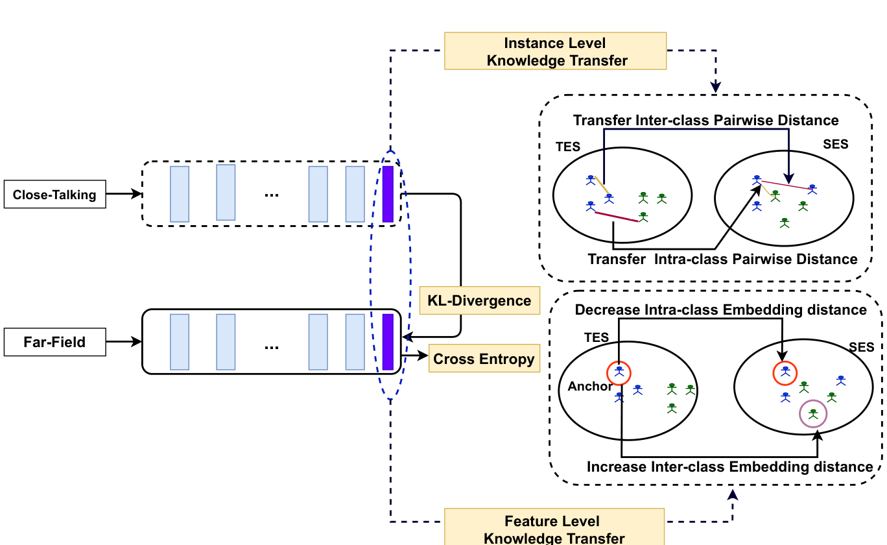
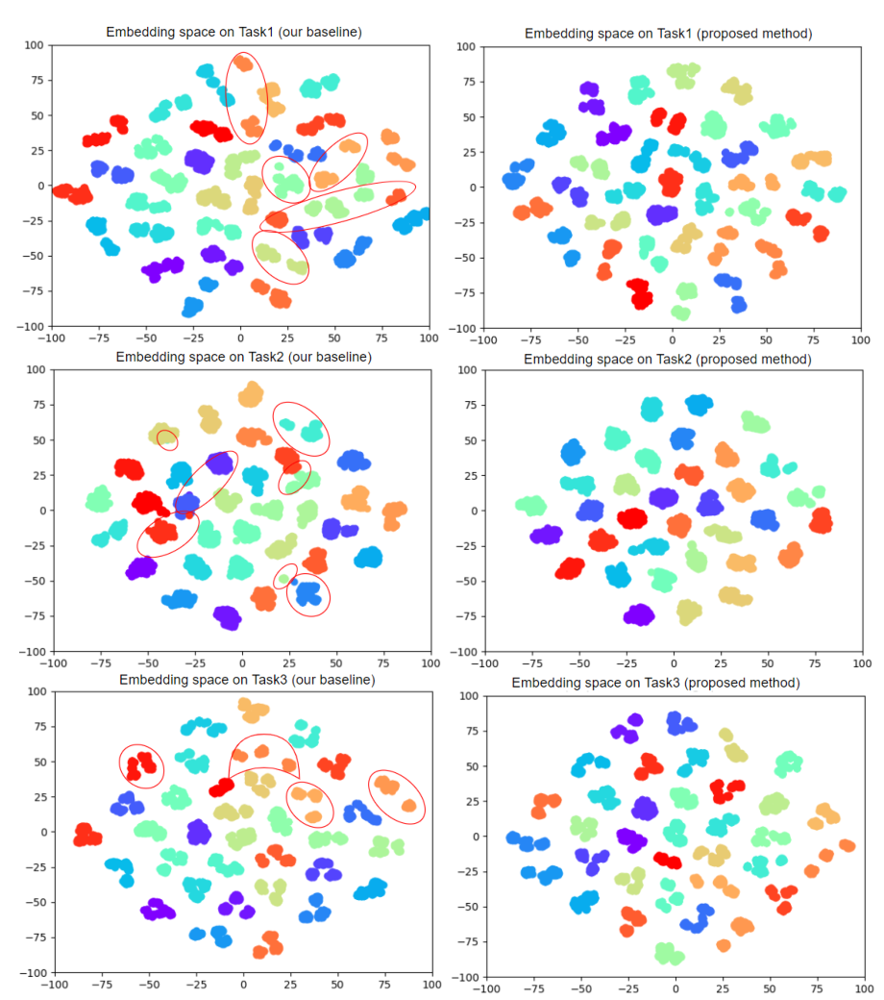

# 从近场到远场说话人验证的多层级迁移学习

> **原文标题:** Multi-Level Transfer Learning from Near-Field to Far-Field Speaker Verification
> **作者:** Li Zhang¹, Qing Wang¹, Kong Aik Lee², Lei Xie¹*, Haizhou Li³†
> **机构:**
> ¹ 陕西省西安市,西北工业大学计算机学院,音频、语音与语言处理组(ASLP@NPU)
> ² 新加坡,科技研究局(A⋆STAR)资讯通信研究院
> ³ 新加坡,新加坡国立大学电气与计算机工程系
> **邮箱:** lizhang.aslp.npu@gmail.com, lxie@nwpu.edu.cn
> **论文编号:** arXiv:2106.09320v1 [cs.SD],2021 年 6 月 17 日提交
> **来源:** <https://arxiv.org/abs/2106.09320>
> \* 通讯作者。† 本工作得到新加坡科技研究局(Agency of Science, Technology and Research)科学与工程研究理事会(Science and Engineering Research Council)通过国家机器人计划(National Robotics Program)的资助,资助号:192 25 00054。

## 摘要

在远场说话人验证中,当注册语音与测试语音的条件不匹配时,说话人嵌入(speaker embedding)的性能容易退化。为了解决这个问题,我们在教师-学生(teacher-student,T/S)框架下提出了特征层(feature-level)和实例层(instance-level)迁移学习方法,以学习一个域不变(domain-invariant)的嵌入空间。对于特征层知识迁移,我们设计了对比损失(contrastive loss)将知识从教师模型迁移到学生模型,它不但能减小类内距离,还能增大类间距离。此外,我们提出了实例层成对距离迁移方法,迫使学生模型保持教师模型在良好优化的嵌入空间中计算得到的实例成对距离。在 FFSVC 2020 评测集上,与 Task2 部分评测(Partial-eval)测试上融合系统的结果相比,我们在全量评测(Full-eval)测试上的 EER 相对降低了 13.9%。在 Task1 上,与冠军选手的 DenseNet 在 Partial-eval 测试上的结果相比,我们在 Full-eval 测试上的 minDCF 相对降低了 6.3%。在 Task3 上,我们方法在 Full-eval 测试上的 EER 和 minDCF 与融合系统在 Partial-eval 测试上的结果非常接近。我们的结果也优于其他有竞争力的域自适应方法。

**关键词:** 远场说话人验证,教师-学生,域不变,迁移学习

---

## 1 引言

说话人验证(speaker verification,SV)是根据注册语音(enrollment utterances)来决定接受还是拒绝测试语音的任务[1]。近年来,大多数基于深度学习的说话人验证方法在受控条件下(即干扰较少、失配较少的近讲(close-talk)场景)取得了优越的识别性能。然而,当语音是在真实环境中采集时(例如远场嘈杂场景或存在失配),它们的性能会显著下降。在远场场景中,用户通常通过近讲手机录制发音来完成声纹注册,然后在复杂远场的日常家居环境中进行身份验证。因此,智能音箱和各种语音物联网设备中的大多数说话人验证系统都需要处理注册语音与测试语音之间的域失配问题。

在最近的研究中,说话人验证任务中域自适应的解决方案可以分为三类。第一类是数据增强,它可以让说话人验证模型"看到"更多的声学环境变化,从而获得更鲁棒的说话人嵌入。在 2020 年远场说话人验证挑战赛(FFSVC 2020)[2]中,许多系统[2, 3, 4, 5]都将数据增强作为域自适应方案来提高系统性能。第二类是应用对抗学习,使源域与目标域的分布更加接近[6, 7, 8, 9, 10, 11]。第三类是采用教师-学生(T/S)模型进行知识迁移学习[12, 13, 14, 15]。教师-学生模型最初是被引入来减小模型规模的:将知识从训练良好的大型教师模型蒸馏到小型学生模型中[16]。此外,教师-学生模型可以通过将准确的知识从教师模型迁移到学生模型来处理域失配问题[17],这可以使学生模型在不同的失配场景下保持鲁棒[18]。除了在教师-学生模型中使用 Kullback-Leibler(KL)散度进行知识迁移学习外,最小化教师模型与学生模型提取的对应嵌入之间的距离也可以减小教师与学生之间的失配[19]。Liang 等人[20]和 Chen 等人[21]提出了基于余弦一致性嵌入训练的(噪声)不变表示学习。Jung 等人[22]提出了基于余弦的教师-学生方法,借助长语音来提升短语音的验证性能。

然而,以往所有语音处理中的教师-学生方法都只考虑了来自教师模型的分类精度指导和教师模型与学生模型之间的嵌入层映射。嵌入层映射旨在减小从教师和学生模型中提取的同类嵌入之间的距离,但忽略了扩大不同类之间的距离,而这同样至关重要。此外,上述方法主要关注训练集与测试集之间的失配,而我们要解决的是注册语音与测试语音之间的失配,这在远场说话人验证中极其常见。

在本文中,我们提出了从近场到远场的多层级迁移学习,以解决注册语音与测试语音之间的失配。在所提出的方法中,我们充分利用了近讲数据的域不变知识,来指导学生模型学习远场数据。受自监督学习[23, 24, 25]中对比损失的启发,我们开发了一种对比损失,用于在教师-学生模型中增大不同类之间的距离。除了嵌入层的特征层知识迁移外,我们还提出了一种实例层成对距离迁移方法,迫使学生模型保持由教师模型良好优化的嵌入空间计算得到的实例成对距离。在 FFSVC 2020 评测集上的实验结果表明,与几种有竞争力的方法相比,我们的方法取得了显著改进。

---

## 2 教师-学生框架

在教师-学生框架中,源域模型(教师)由近讲数据通过交叉熵损失训练而来,其目的是生成相应的后验概率作为软标签(soft label);这些软标签被用来替代由平行远场数据训练的目标域模型(学生)中导出的硬标签(hard label)。经典的教师-学生学习是在给定平行数据 $x_{t,i}$ 和 $x_{s,j}$ 的情况下,最小化教师网络与学生网络输出分布之间的 Kullback-Leibler(KL)散度[18]。温度取 1(即 $T=1$)时的 KL 散度可以写为:

$$
L_{KL}[p(c|x_{t,j};\theta_{t})||p(c|x_{s,i};\theta_{s})] = \sum_{i=1}^{N}\sum_{c=1}^{C} p(c|x_{t,j};\theta_{t})\log\left[\frac{p(c|x_{t,j};\theta_{t})}{p(c|x_{s,i};\theta_{s})}\right], \tag{1}
$$

其中 $x_{t,j}$ 是来自近讲数据集 $X_{t}=\{x_{t,1},x_{t,2},x_{t,3},...,x_{t,N}\}$ 的第 $j$ 条近讲语音;$x_{s,i}$ 是来自远场数据集 $X_{s}=\{x_{s,1},x_{s,2},x_{s,3},...,x_{s,M}\}$ 的第 $i$ 条远场语音。我们将 $x_{t,i}$ 与 $x_{s,j}$ 组成语音对 $(x_{t,j},x_{s,i})$,它们分别输入教师模型与学生模型,并且 $x_{t,i}$ 与 $x_{s,j}$ 具有相同的说话人标签。$c$ 是来自说话人标签集 $C=\{c_{1},c_{2},c_{3},...,c_{C}\}$ 的说话人身份,且 $|C|=C$。概率 $p(c|x_{t,j};\theta_{t})$ 与 $p(c|x_{s,i};\theta_{s})$ 分别是教师模型与学生模型的分类后验。当温度等于 1 时我们取得最佳结果,这与文献[18, 16, 26, 27, 28]报告的结论一致。交叉熵损失与 KL 散度结合,是模型压缩[16]和迁移学习[18]中知识蒸馏的常见损失形式。交叉熵的公式为:

$$
L_{CE}(\theta_{s}) = -\frac{1}{N}\sum_{i=1}^{N}\sum_{c=1}^{C} c'\log(p(c|x_{s,i};\theta_{s})), \tag{2}
$$

然而,通过分类后验迁移知识无法保证学生模型能像教师模型那样优化出一个良好的嵌入空间。因此,我们提出了一种多层级迁移学习方法,以提升失配问题上的迁移学习性能。

---

## 3 多层级迁移学习

### 3.1 特征层知识迁移

为了减小远场说话人验证中注册语音与测试语音之间的失配,我们提出了一种多层级知识迁移方法,它不仅能在特征层迁移知识,还能迁移实例层成对距离的结构信息。我们提出的方法总览如图 1 所示。我们方法的架构由四部分组成:教师模型、学生模型、特征层迁移学习与实例层迁移学习。特征层与实例层迁移学习部分作用于嵌入层。特征层迁移学习旨在增大类间距离,同时减小类内距离;实例层迁移学习则将教师模型提取的"锚(anchor)"嵌入与正嵌入(与"锚"嵌入具有相同说话人标签)及负嵌入(与"锚"嵌入具有不同说话人标签)进行比较,其中正、负嵌入均从学生模型中提取。在图 1 的右侧,TES 与 SES 分别是教师嵌入空间(Teacher Embedding Space)与学生嵌入空间(Student Embedding Space)的缩写。圆中不同颜色的说话人代表他们具有不同的说话人标签。

**图 1:教师-学生(T/S)框架中的多层级迁移学习方法**

在以往的工作中,人们引入各种度量距离损失来减小教师嵌入与学生嵌入之间的失配差异,以提高学生模型的泛化能力。不同距离损失的一般形式为:

$$
L_{F}=D(f_{\theta_{t}}(x_{t,i}), f_{\theta_{s}}(x_{s,j})), \tag{3}
$$

其中 $f(\cdot)$ 是说话人提取器输出的嵌入;$f_{\theta_{t}}(x_{t,i})$ 与 $f_{\theta_{s}}(x_{s,j})$ 分别是从教师模型和学生模型中提取的说话人嵌入;$D$ 是通用的距离度量公式,例如均方误差(MSE)损失[22]、最大均值差异(MMD)损失[19]或余弦相似度损失[22]。所有这些损失都在说话人提取器的嵌入层上计算,因此我们将这类方法称为特征层知识迁移。在本文中,我们对不同距离损失的性能进行了比较。

虽然上述嵌入映射方法将同一说话人的不变知识从教师模型迁移到了学生模型,但这些方法忽略了不同说话人之间的类间距离学习。因此,我们提出了一种基于自监督学习中对比损失的新的特征层知识迁移损失函数。自监督表示学习[24, 23, 25]中对比学习的主要思想是:在嵌入空间中将锚样本与"正(positive)"样本拉近,同时将锚样本与大量"负(negative)"样本推远,这与说话人验证的目标相似。

我们开发了对比损失以将知识从教师模型迁移到学生模型。在我们的任务中,该对比损失的锚是训练良好的教师模型提取的嵌入;正、负嵌入则从学生模型提取。由于我们的任务是有监督的,因此可以根据样本的标签来计算教师和学生之间的对比损失。我们开发的公式为:

$$
L_{F'} = -\frac{1}{N}\sum_{i\in N}\log\frac{\exp(<f_{\theta_{t}}(x_{t,i}), f_{\theta_{s}}(x_{s,j})>)}{\sum_{a\in A(i)}\exp(<f_{\theta_{t}}(x_{t,i}), f_{\theta_{s}}(x_{s,a})>)}, \tag{4}
$$

其中 $<,>$ 表示嵌入的内积,$f_{\theta_{t}}(\cdot)$ 与 $f_{\theta_{s}}(\cdot)$ 分别是教师模型和学生模型提取的嵌入;$f_{\theta_{t}}(x_{t,i})$ 与 $f_{\theta_{s}}(x_{s,j})$ 具有相同的说话人标签,而 $f_{\theta_{t}}(x_{t,i})$ 与 $f_{\theta_{s}}(x_{s,a})$ 具有不同的标签;$A(i)$ 是从教师模型中提取的嵌入的索引集合,且 $A(i)$ 中样本的说话人标签与 $f_{\theta_{t}}(x_{t,i})$ 的不同。该公式以从教师模型提取的嵌入作为锚,从两个方面优化学生模型的嵌入空间:第一方面由分子起作用,即减小同类嵌入之间的距离;另一方面是增大不同类嵌入之间的距离。这样一来,可靠的锚便来源于训练良好的教师模型。

### 3.2 实例层知识迁移

在教师模型训练良好后,教师模型生成的嵌入空间相较于学生模型具有更可靠的参考。理想情况下,如果教师模型与学生模型之间不存在失配,它们在嵌入空间中应当具有相同的分布。假设从教师模型提取的一个批次嵌入为

$$
F_{t}(\theta_{t}) = [f_{\theta_{t}}(x_{t,1}), f_{\theta_{t}}(x_{t,2}), f_{\theta_{t}}(x_{t,3}), ..., f_{\theta_{t}}(x_{t,B})],
$$

其大小为 $[B,F]$;从学生模型中提取的嵌入为

$$
F_{s}(\theta_{s}) = [f_{\theta_{s}}(x_{s,1}), f_{\theta_{s}}(x_{s,2}), f_{\theta_{s}}(x_{s,3}), ..., f_{\theta_{s}}(x_{s,B})],
$$

其中训练批次大小为 $B$,$F$ 是嵌入的维度。与以往的工作不同,我们提出在 $F_{s}(\theta_{s})$ 中保持由 $F_{t}(\theta_{t})$ 计算得到的实例成对距离。这种方法可以引导学生模型走向教师模型的嵌入空间。公式为:

$$
L_{I}=\frac{1}{B^{2}}\left\|(d^{s}-d^{t})\right\|_{2}, \tag{5}
$$

其中 $L_{I}$ 是两个相似度矩阵的 MSE 距离;$d^{s}$ 与 $d^{t}$ 分别是教师模型与学生模型生成的单个批次嵌入的成对相似度矩阵:

$$
d^{t}=F_{t}(\theta_{t})\cdot F_{t}(\theta_{t})^{T}, \tag{6}
$$

$$
d^{s}=F_{s}(\theta_{s})\cdot F_{s}(\theta_{s})^{T}. \tag{7}
$$

其中运算符 $\cdot$ 表示矩阵乘法,$T$ 表示矩阵转置。最小化式(5)中的损失可以使学生模型保持教师模型的实例层成对距离。该方法可以惩罚教师模型与学生模型成对相似度矩阵之间的差异,从而使我们能够优化学生模型的嵌入空间,使其更接近教师模型的嵌入空间。这一思想如图 1 的右上角所示。

---

## 4 实验

### 4.1 数据集

我们在 FFSVC 2020 数据集[2]上验证我们的方法。FFSVC 2020 数据集包含近讲 iPhone 录音与远场麦克风阵列录音。该挑战包括三个任务:

- **Task1:** 文本相关(Nihao,Miya)说话人验证,注册为近讲 iPhone 录音,测试为远场麦克风阵列录音;
- **Task2:** 文本无关说话人验证,注册为近讲 iPhone 录音,测试为远场麦克风阵列录音;
- **Task3:** 文本相关(Nihao,Miya)说话人验证,注册为近讲 iPhone 录音,测试为远场分布式麦克风阵列的录音。

每个任务在开发集测试(development trials)与评测集测试(evaluation trials)中都存在域失配。在 FFSVC 2020 中,组织方只发布了 30% 评测测试的结果,记为 Partial-eval(部分评测)。由于我们不知道哪 30% 是部分评测测试,我们在全部评测测试上进行评估,记为 Full-eval(全量评测),这应该更具挑战性。我们使用 openslr¹ 数据集(SLR33、SLR38、SLR47、SLR49、SLR62、SLR82、SLR85)对教师模型和学生模型进行预训练。预训练数据集按照 KALDI 食谱[31]使用 MUSAN[29]与房间冲激响应(RIR)[30]数据集进行增强。

> ¹ <http://www.openslr.org>

### 4.2 实验设置

我们采用小尺寸的 Thin ResNet-34[32]加 SE-block[33]作为说话人验证模型。SE-block 中的通道注意力采用 6 倍压缩比[32],以在减小参数量的同时保证模型的良好性能。我们采用注意力统计池化(ASP)[32]作为池化层,并采用网络的倒数第二层作为嵌入提取层。我们的教师模型与学生模型具有相同的结构,模型结构的细节如表 1 所示。模型大约有 800 万参数,我们基线系统的性能优于挑战赛的官方基线(该基线有 2100 万参数)[2]。在我们的工作中,我们采用 softmax 损失函数,最后一层的节点数为说话人数量(NumSpkrs)。提取 80 维梅尔滤波器组(mel-filter bank)特征作为模型输入,窗长 25ms,窗移 10ms。训练时,每次迭代的批次大小为 400,使用 2 块 GeForce RTX 3090。学习率初始化为 0.01,每 2 个 epoch 衰减为原来的 10%。优化器为 PyTorch 中的随机梯度下降(SGD)。

**表 1:教师-学生(T/S)模型结构**

| 层 | 卷积核大小 | 步长 | 输出形状 |
| --- | --- | --- | --- |
| Conv1 | 3 × 3 × 32 | 1 × 1 | L × 80 × 32 |
| Res1 | 3 × 3 × 32 | 1 × 1 | L × 80 × 32 |
| SE-Block | - | - | L × 80 × 32 |
| Res2 | 3 × 3 × 32 | 1 × 1 | L × 40 × 64 |
| SE-Block | - | - | L × 40 × 64 |
| Res3 | 3 × 3 × 64 | 2 × 2 | L/2 × 20 × 128 |
| SE-Block | - | - | L/2 × 20 × 128 |
| Res4 | 3 × 3 × 128 | 2 × 2 | L/4 × 10 × 256 |
| SE-Block | - | - | L/4 × 10 × 256 |
| Flatten | - | - | L/8 × 2560 |
| ASP | - | - | 5120 |
| Linear | 512 | - | 512 |
| Softmax | - | - | NumSpkrs |

### 4.3 训练策略

首先,我们使用 openslr 数据集预训练一个鲁棒的域外(out-of-domain)说话人验证模型。然后,我们使用 FFSVC 2020 训练集重新训练该域外模型,以构建我们的基线。之后,我们使用 FFSVC 中的 iPhone 录音重新训练域外模型,得到一个训练良好的教师模型。我们用基线模型的参数初始化学生模型。我们将近讲 iPhone 录音与 FFSVC 2020 训练集中对应的录音组成对,分别作为教师模型与学生模型的输入。每对语音具有相同的说话人标签。我们使用全部的 FFSVC 2020 训练集(而不只是远场麦克风录音数据)作为学生模型的输入,原因是我们希望学生模型同时对近讲与远场数据保持鲁棒。在验证每种知识迁移方法时,我们固定训练良好的教师模型的参数,只训练学生模型。在训练过程中,每种知识迁移损失都会与 softmax 损失结合,以保持学生模型的判别能力[22]。在我们的任务中,我们提出的方法与交叉熵损失结合后的形式为:

$$
L_{CE\_F'} = L_{CE} + \lambda_{1}\times L_{F'}, \tag{8}
$$

$$
L_{CE\_I} = L_{CE} + \lambda_{2}\times L_{I}, \tag{9}
$$

$$
L_{CE\_F'\_I} = L_{CE} + \lambda_{1}\times L_{F'} + \lambda_{2}\times L_{I}. \tag{10}
$$

我们用不同组的取值微调超参数 $\lambda_{1}$ 与 $\lambda_{2}$,但实验表明,当 $\lambda_{1}$ 与 $\lambda_{2}$ 分别设为 0.1 与 10 时,模型可以很好地优化。特征层知识迁移损失比实例层知识迁移损失大很多,因为负样本的数量远远超过正样本的数量。然而,对负样本的过度惩罚会使模型对正样本不友好,因此 $\lambda_{1}$ 比 $\lambda_{2}$ 小得多。

---

## 5 结果与分析

### 5.1 实验结果

为了检验注册语音与测试语音之间的失配程度,我们将 FFSVC 2020 Task1 开发集测试中的语音重组成另外两组测试:一组测试为"近讲 iPhone 录音注册 + 近讲 iPhone 录音测试";另一组测试为"远场麦克风录音注册 + 远场麦克风录音测试"。上述两组新测试在注册语音与测试语音之间没有失配,分别命名为 Close-talking 测试与 Far-field 测试。

我们将我们的方法与几种近期的教师-学生迁移学习方法进行比较,即 KL 散度[34]、余弦距离[22]与 MMD 损失[19]。为保持学生模型的判别能力,实验中每种知识迁移学习方法在训练时都与 softmax 损失协作。我们使用余弦距离进行打分。从表 2 可以看出,在 Task1 开发集测试上,我们提出的特征层迁移学习方法与基线结果相比,EER/minDCF 相对降低了 16.8%/17.3%;实例层迁移学习方法与基线相比,EER/minDCF 相对降低了 18.5%/15.9%;在特征层与实例层迁移学习的共同作用下,与基线相比,我们的 EER/minDCF 相对降低了 22.8%/27.8%。同时,我们的方法优于 FFSVC 2020 顶尖获胜团队公布的其他结果[3, 4]。

**表 2:Task1 开发集测试的实验结果**

| 方法 | Task1 测试 | | Close-talking 测试 | | Far-field 测试 | |
| --- | --- | --- | --- | --- | --- | --- |
| | EER (%) | minDCF | EER (%) | minDCF | EER (%) | minDCF |
| 官方基线 [2] | 6.30 | 0.640 | - | - | - | - |
| 我们的基线 | 5.18 | 0.669 | 4.04 | 0.391 | 7.51 | 0.646 |
| 教师模型 | - | - | 2.55 | 0.305 | - | - |
| 学生模型 | 5.18 | 0.669 | 4.04 | 0.392 | 7.51 | 0.646 |
| KL 散度 [34] | 4.92 | 0.551 | 2.77 | 0.315 | 4.96 | 0.485 |
| 余弦距离 [22] | 4.71 | 0.526 | 2.69 | 0.315 | 4.84 | 0.475 |
| MMD [19] | 4.69 | 0.530 | 2.36 | 0.329 | 4.26 | 0.449 |
| DenseNet [4] | 4.57 | 0.49 | - | - | - | - |
| STC 系统 [3] | 4.24 | 0.490 | - | - | - | - |
| 特征层知识迁移 (F) | 4.31 | 0.553 | 2.37 | 0.329 | 4.26 | 0.449 |
| 实例层知识迁移 (I) | 4.22 | 0.562 | 2.22 | 0.326 | 3.95 | 0.461 |
| **多层级迁移学习 (F&I)** | **4.00** | **0.483** | **2.01** | **0.281** | **3.89** | **0.426** |

表 3 中的实验结果表明,在 Task2 开发集测试上,与基线结果相比,我们的 EER/minDCF 相对降低了 38.6%/26.3%;在 Task3 上,与基线结果相比,EER/minDCF 相对降低了 32.8%/30.1%。与挑战赛顶尖获胜团队论文[3, 4]公布的结果相比,我们的结果优于 DenseNet[4]与 STC 系统[3]的结果。

**表 3:Task2 与 Task3 开发集测试的实验结果**

| 方法 | Task2 测试 | | Task3 测试 | |
| --- | --- | --- | --- | --- |
| | EER (%) | minDCF | EER (%) | minDCF |
| 官方基线 [2] | 6.23 | 0.650 | 5.82 | 0.710 |
| 我们的基线 | 6.80 | 0.745 | 4.71 | 0.617 |
| KL 散度 [34] | 6.60 | 0.735 | 4.30 | 0.509 |
| 余弦距离 [22] | 6.56 | 0.709 | 4.14 | 0.505 |
| MMD [19] | 6.55 | 0.704 | 4.10 | 0.504 |
| DenseNet [4] | 4.57 | 0.490 | 4.12 | 0.450 |
| STC 系统 [3] | 4.46 | 0.484 | 3.35 | 0.458 |
| 特征层知识迁移 (F) | 4.46 | 0.614 | 3.59 | 0.497 |
| 实例层知识迁移 (I) | 4.62 | 0.650 | 3.61 | 0.518 |
| **多层级迁移学习 (F&I)** | **4.17** | **0.549** | **3.16** | **0.426** |

FFSVC 2020 评测集上的实验结果如表 4 所示。Trials 列中的 Full-eval 表示全部评测测试,Partial-eval 表示 30% 的评测测试。与 DenseNet[4]在 Task1 Partial-eval 测试上的结果相比,虽然我们在 Full-eval 测试上的 EER 存在 0.14% 的差距,但 minDCF 相对降低了 6.3%。在 Task2 上,我们在 Full-eval 测试上的结果甚至优于融合系统[3]在 Partial-eval 测试上的结果。在 Task3 上,我们在 Full-eval 测试上的结果优于 DenseNet[4]在 Partial-eval 测试上的结果;此外,我们在 Task3 Full-eval 测试上的结果与融合系统[3]在 Partial-eval 测试上的结果非常接近。

**表 4:评测集测试的实验结果**

| 方法 | Task1 测试 EER (%) | minDCF | Task2 测试 EER (%) | minDCF | Task3 测试 EER (%) | minDCF | 测试集合 |
| --- | --- | --- | --- | --- | --- | --- | --- |
| 官方基线 [2] | 9.93 | 0.870 | 11.87 | 0.950 | 10.68 | 0.860 | Partial-eval |
| 我们的基线 | 6.51 | 0.662 | 7.85 | 0.793 | 6.71 | 0.610 | Full-eval |
| DenseNet [4] | 5.78 | 0.570 | - | - | 6.02 | 0.530 | Partial-eval |
| 融合系统 [3] | 5.08 | 0.500 | 5.39 | 0.541 | 5.53 | 0.458 | Partial-eval |
| **多层级迁移学习 (F&I)** | **5.92** | **0.534** | **4.64** | **0.547** | **5.64** | **0.492** | **Full-eval** |

### 5.2 分析

我们从评测集中随机选取 35 位说话人进行进一步分析。我们为每位说话人随机选取 500 个嵌入,并使用 TSNE[35]对嵌入分布进行可视化。图 2 中的左侧三张图展示了未使用我们所提出方法时的嵌入分布。可以观察到,左侧可视化的嵌入空间更加混乱,图中红色圆环标示了被错误分类的类别。右侧三张图展示了使用我们所提出的多层级迁移学习方法后的嵌入分布。很明显,右侧不同类别的嵌入分布边界更加清晰、准确,尤其在 Task2 上。

**图 2:嵌入分布的可视化**

---

## 6 结论

在本文中,我们提出了一种多层级迁移学习方法,以消除注册语音与测试语音之间的失配。具体而言,我们开发了对比损失,同时减小类内距离与增大类间距离。此外,我们提出了实例层迁移学习,使学生模型保持教师模型嵌入空间中实例的成对距离。采用我们提出的方法,在 FFSVC 2020 开发集上的实验结果表明,与基线结果相比,Task1、Task2 与 Task3 的 EER 分别相对降低了 22.8%、38.6% 与 32.8%。在 FFSVC 2020 评测集上,我们在 Task2 的 Full-eval 测试结果甚至优于挑战赛顶尖获胜者在 Partial-eval 测试上公布的融合系统结果。

---

## 参考文献

> 参考文献按惯例保留英文原文,未做翻译。

[1] F. Bimbot, J.-F. Bonastre, C. Fredouille, G. Gravier, I. Magrin-Chagnolleau, S. Meignier, T. Merlin, J. Ortega-García, D. Petrovska-Delacrétaz, and D. A. Reynolds, "A tutorial on text-independent speaker verification," *EURASIP Journal on Advances in Signal Processing*, vol. 2004, no. 4, pp. 1–22, 2004.

[2] X. Qin, M. Li, H. Bu, W. Rao, R. K. Das, S. Narayanan, and H. Li, "The interspeech 2020 far-field speaker verification challenge," *Proc. Interspeech*, pp. 3456–3460, 2020.

[3] S. Novoselov, A. Gusev, A. Ivanov, T. Pekhovsky, A. Shulipa, G. Lavrentyeva, V. Volokhov, and A. Kozlov, "Stc speaker recognition systems for the voices from a distance challenge," *Proc. Interspeech*, pp. 2443–2447, 2019.

[4] P. Zhang, P. Hu, and X. Zhang, "Deep embedding learning for text-dependent speaker verification," *Proc. Interspeech 2020*, pp. 3461–3465, 2020.

[5] L. Zhang, J. Wu, and L. Xie, "Npu speaker verification system for interspeech 2020 far-field speaker verification challenge," *Proc. Interspeech*, pp. 3471–3475, 2020.

[6] Q. Wang, W. Rao, S. Sun, L. Xie, E. S. Chng, and H. Li, "Unsupervised domain adaptation via domain adversarial training for speaker recognition," in *ICASSP 2018-2018 IEEE International Conference on Acoustics, Speech and Signal Processing (ICASSP)*. IEEE, 2018, pp. 4889–4893.

[7] J. Rohdin, T. Stafylakis, A. Silnova, H. Zeinali, L. Burget, and O. Plchot, "Speaker verification using end-to-end adversarial language adaptation," in *ICASSP 2019-2019 IEEE International Conference on Acoustics, Speech and Signal Processing (ICASSP)*. IEEE, 2019, pp. 6006–6010.

[8] W. Xia, J. Huang, and J. H. Hansen, "Cross-lingual text-independent speaker verification using unsupervised adversarial discriminative domain adaptation," in *ICASSP 2019-2019 IEEE International Conference on Acoustics, Speech and Signal Processing (ICASSP)*. IEEE, 2019, pp. 5816–5820.

[9] Z. Meng, Y. Zhao, J. Li, and Y. Gong, "Adversarial speaker verification," in *ICASSP 2019-2019 IEEE International Conference on Acoustics, Speech and Signal Processing (ICASSP)*. IEEE, 2019, pp. 6216–6220.

[10] C. Luu, P. Bell, and S. Renals, "Channel adversarial training for speaker verification and diarization," in *ICASSP 2020-2020 IEEE International Conference on Acoustics, Speech and Signal Processing (ICASSP)*. IEEE, 2020, pp. 7094–7098.

[11] H. Li, M. Tu, J. Huang, S. Narayanan, and P. Georgiou, "Speaker-invariant affective representation learning via adversarial training," in *ICASSP 2020-2020 IEEE International Conference on Acoustics, Speech and Signal Processing (ICASSP)*. IEEE, 2020, pp. 7144–7148.

[12] L. Torrey and J. Shavlik, "Transfer learning," in *Handbook of research on machine learning applications and trends: algorithms, methods, and techniques*. IGI global, 2010, pp. 242–264.

[13] G. Hinton, O. Vinyals, and J. Dean, "Distilling the knowledge in a neural network," *arXiv preprint arXiv:1503.02531*, 2015.

[14] Y. Chebotar and A. Waters, "Distilling knowledge from ensembles of neural networks for speech recognition." ISCA, 2016, pp. 3439–3443.

[15] M. Sang, W. Xia, and J. H. Hansen, "Open-set short utterance forensic speaker verification using teacher-student network with explicit inductive bias," *Proc. Interspeech*, pp. 2262–2266, 2020.

[16] L. Lu, M. Guo, and S. Renals, "Knowledge distillation for small-footprint highway networks," in *ICASSP 2017-2017 IEEE International Conference on Acoustics, Speech and Signal Processing (ICASSP)*. IEEE, 2017, pp. 4820–4824.

[17] L. Mošner, M. Wu, A. Raju, S. H. K. Parthasarathi, K. Kumatani, S. Sundaram, R. Maas, and B. Hoffmeister, "Improving noise robustness of automatic speech recognition via parallel data and teacher-student learning," in *ICASSP 2019-2019 IEEE International Conference on Acoustics, Speech and Signal Processing (ICASSP)*. IEEE, 2019, pp. 6475–6479.

[18] Z. Meng, J. Li, Y. Zhao, and Y. Gong, "Conditional teacher-student learning," in *ICASSP 2019-2019 IEEE International Conference on Acoustics, Speech and Signal Processing (ICASSP)*. IEEE, 2019, pp. 6445–6449.

[19] W. Lin, M.-M. Mak, N. Li, D. Su, and D. Yu, "Multi-level deep neural network adaptation for speaker verification using mmd and consistency regularization," in *ICASSP 2020-2020 IEEE International Conference on Acoustics, Speech and Signal Processing (ICASSP)*. IEEE, 2020, pp. 6839–6843.

[20] D. Liang, Z. Huang, and Z. C. Lipton, "Learning noise-invariant representations for robust speech recognition," in *2018 IEEE Spoken Language Technology Workshop (SLT)*. IEEE, 2018, pp. 56–63.

[21] W. Chen, J. Huang, and T. Bocklet, "Length-and noise-aware training techniques for short-utterance speaker recognition," *Proc. Interspeech*, pp. 3835–3839, 2020.

[22] J.-w. Jung, H.-S. Heo, H.-j. Shim, and H.-J. Yu, "Short utterance compensation in speaker verification via cosine-based teacher-student learning of speaker embeddings," in *2019 IEEE Automatic Speech Recognition and Understanding Workshop (ASRU)*. IEEE, 2019, pp. 335–341.

[23] K. He, H. Fan, Y. Wu, S. Xie, and R. Girshick, "Momentum contrast for unsupervised visual representation learning," in *Proc. the IEEE/CVF Conference on Computer Vision and Pattern Recognition (CVPR)*, 2020, pp. 9729–9738.

[24] T. Chen, S. Kornblith, M. Norouzi, and G. Hinton, "A simple framework for contrastive learning of visual representations," in *International conference on machine learning*. PMLR, 2020.

[25] R. D. Hjelm, A. Fedorov, S. Lavoie-Marchildon, K. Grewal, P. Bachman, A. Trischler, and Y. Bengio, "Learning deep representations by mutual information estimation and maximization," 2019.

[26] N. Jaitly, P. Nguyen, A. Senior, and V. Vanhoucke, "Application of pretrained deep neural networks to large vocabulary speech recognition," *Proc. Interspeech 2012*, 2012.

[27] T. Tan, Y. Qian, and D. Yu, "Knowledge transfer in permutation invariant training for single-channel multi-talker speech recognition," in *2018 IEEE International Conference on Acoustics, Speech and Signal Processing (ICASSP)*. IEEE, 2018, pp. 571–5718.

[28] S. Watanabe, T. Hori, J. Le Roux, and J. R. Hershey, "Student-teacher network learning with enhanced features," in *ICASSP 2017-2017 IEEE International Conference on Acoustics, Speech and Signal Processing (ICASSP)*. IEEE, 2017, pp. 5275–5279.

[29] D. Snyder, G. Chen, and D. Povey, "Musan: A music, speech, and noise corpus," *arXiv preprint arXiv:1510.08484*, 2015.

[30] J. Alien and D. Berkley, "Image method for efficiently simulating small-room acoustics," *The Journal of the Acoustical Society of America*, vol. 60, no. S1, pp. S9–S9, 1976.

[31] D. Snyder, D. Garcia-Romero, G. Sell, D. Povey, and S. Khudanpur, "X-vectors: Robust dnn embeddings for speaker recognition," in *2018 IEEE International Conference on Acoustics, Speech and Signal Processing (ICASSP)*. IEEE, 2018, pp. 5329–5333.

[32] H. S. Heo, B.-J. Lee, J. Huh, and J. S. Chung, "Clova baseline system for the VoxCeleb speaker recognition challenge 2020," *arXiv preprint arXiv:2009.14153*, 2020.

[33] J. Zhou, T. Jiang, Z. Li, L. Li, and Q. Hong, "Deep speaker embedding extraction with channel-wise feature responses and additive supervision softmax loss function." in *Proc. Interspeech*. ISCA, 2019, pp. 2883–2887.

[34] H.-S. Heo, J.-w. Jung, H.-j. Shim, and H.-J. Yu, "Acoustic scene classification using teacher-student learning with soft-labels," *Proc. Interspeech*, 2019.

[35] L. Van der Maaten and G. Hinton, "Visualizing data using t-sne," *Journal of machine learning research*, vol. 9, no. 11, pp. 2579–2605, 2008.

---

*中文版由 DeepSeek Harness 依据 arXiv:2106.09320v1 翻译整理;公式、图表与参考文献保留原文。*
