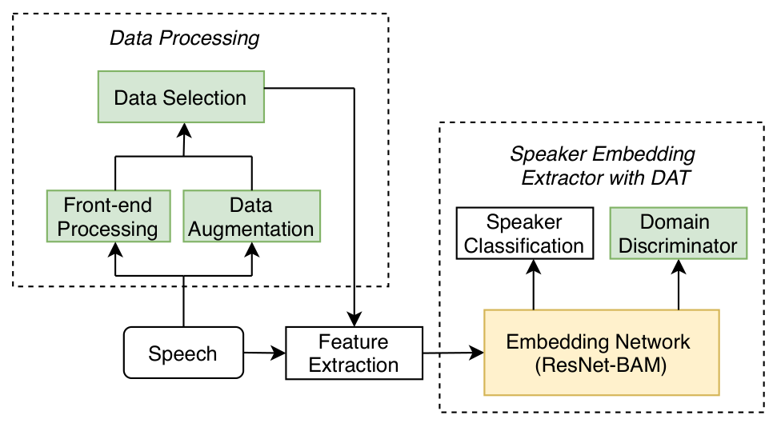
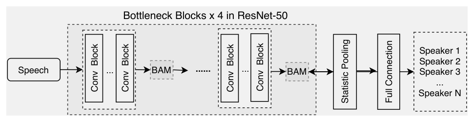
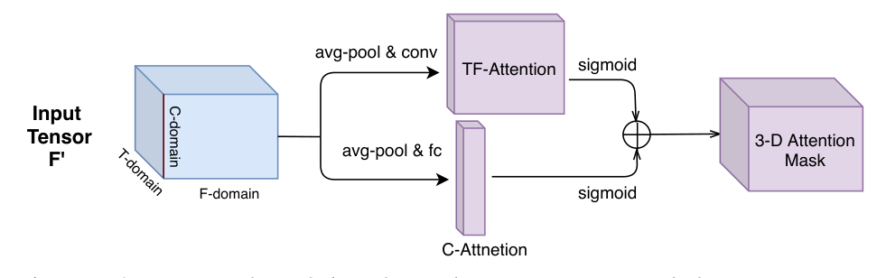
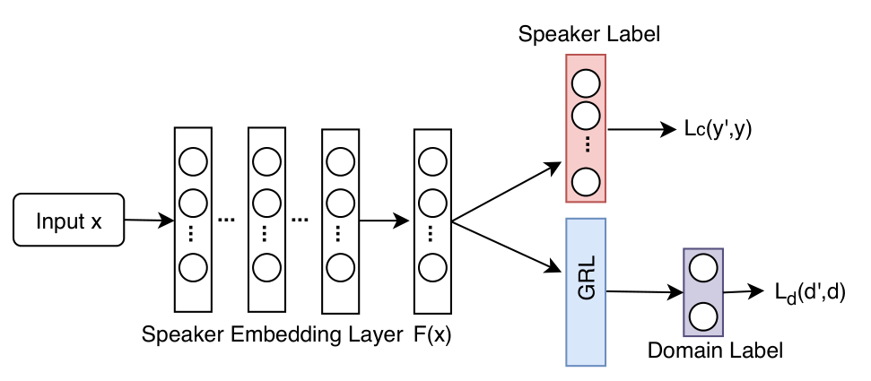
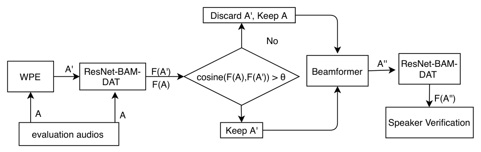

# 面向 INTERSPEECH 2020 远场说话人验证挑战赛的 NPU 说话人验证系统

> **原文标题:** NPU Speaker Verification System for INTERSPEECH 2020 Far-Field Speaker Verification Challenge
> **作者:** Li Zhang, Jian Wu, Lei Xie*
> **机构:** 中国西安,西北工业大学计算机学院,音频、语音与语言处理组(ASLP@NPU)
> **邮箱:** lizhang.aslp.npu@gmail.com, lxie@nwpu.edu.cn
> **论文编号:** Proc. Interspeech 2020,pp. 3471–3475(2020 年 10 月 25–29 日,中国上海),DOI: http://dx.doi.org/10.21437/Interspeech.2020-2688
> **来源:** <https://www.isca-archive.org/interspeech_2020/zhang20ca_interspeech.pdf>
> \* 通讯作者。

## 摘要

本文描述了 NPU 提交给 Interspeech 2020 远场说话人验证挑战赛(FFSVC)的系统,我们重点关注来自单个麦克风阵列(任务 1)与多个麦克风阵列(任务 3)的远场文本相关说话人验证(SV)。该场景下的主要挑战是语音短,以及注册与测试之间存在的跨通道与距离失配。基于"更好的说话人嵌入可以缓解短语音带来的影响"这一信念,我们提出了一种新的说话人嵌入架构——ResNet-BAM,它以简单高效的方式将瓶颈注意力模块(BAM)集成到 ResNet 中,以进一步提升 ResNet 的表示能力。这一贡献带来了最高 1% 的 EER 下降。我们进一步从三个方向解决失配问题:第一,领域对抗训练(domain adversarial training),旨在学习领域不变的特征,可以带来 0.8% 的 EER 下降;第二,前端信号处理,包括 WPE 与波束成形,本身没有明显的贡献,但与数据选择及领域对抗训练结合之后可以进一步贡献 0.5% 的 EER 下降;最后,数据增强配合专门设计的数据选择策略,可以带来 2% 的 EER 下降。综合上述贡献,在中期挑战结果中,我们的单一提交系统(未做多系统融合)在任务 1 与任务 3 上分别获得了第一名与第二名。

**关键词:** 说话人验证,远场,领域对抗训练,数据增强

---

## 1 引言

近年来,随着深度神经网络(DNN)的兴起,以及计算资源与海量数据的易得性,说话人验证(SV)的性能在过去几年里得到了显著提升。然而,这些进展主要是在干扰较少的近讲(close-talk)场景下取得的。随着智能音箱与各种支持语音的物联网设备等智能设备的快速普及,远场语音交互的需求将持续增长。识别说话人身份是这些智能设备提供定制化服务的关键。远场语音任务(包括说话人识别)仍然具有挑战性,因为存在语音信号衰减、噪声干扰以及房间混响。特别地,对智能设备而言,用户更方便在近讲便携设备(如手机)上以短语音(例如唤醒词)完成注册,却要在较远的距离上与智能设备对话来完成身份认证。这显然会引出其他问题——短语音验证,以及注册与测试在通道与距离上的数据失配。Interspeech 2020 远场说话人验证挑战赛(FFSVC)[1]为研究者提供了一个公共测试平台,以应对上述问题——信号劣化、语音短与数据失配。

在本文中,我们介绍了我们的 FFSVC 提交系统为应对上述问题所做的努力。我们特别介绍了两个文本相关任务,即来自单个阵列(任务 1)与多个阵列(任务 3)的远场文本相关 SV。我们提出了一种表示能力更强的说话人嵌入架构,它建立在带注意力模块的 ResNet 之上。与基线 ResNet 模型相比,新架构 ResNet-BAM 实现了 1% 的绝对等错误率(EER)下降。我们进一步通过前端处理与领域对抗训练(DAT)来应对信号劣化与失配问题,这两种方法分别可以带来 0.5% 与 0.8% 的绝对 EER 下降。最后,数据增强配合专门设计的数据选择策略,可以带来 2% 的绝对 EER 下降。凭借上述贡献,我们的单一提交系统(未做多系统融合)在任务 1 与任务 3 上分别获得了第一名与第二名。

本文其余部分组织如下:第 2 节介绍相关工作,第 3 节描述系统总览,第 4 节详细阐述我们提出的用于获取更好说话人嵌入的 ResNet-BAM 模型,并用实验验证其有效性,第 5 节聚焦领域对抗训练及其评估,第 6 节分析前端处理、数据增强与数据选择的效果,第 7 节总结官方评测结果并给出本文结论。

---

## 2 相关工作

绝大多数解决短语音 SV 任务的方法都聚焦于改进说话人嵌入网络,使其具备更强的提取能力。有些工作改进了基于 x-vector 的模型[2],另一些则在各种数据集上研究最先进的卷积神经网络(CNN)[3, 4]。Li 等人[5]报道 CNN 网络甚至可以通过咳嗽或笑声录音[6]识别说话人,而这些都是极短的"语音片段"。Wang 等人[7]将深度判别分析(deep discriminant analysis)集成到基于 CNN 的结构中,在短语音 SV 上取得了良好的性能。[8]的研究证实,无论对长时还是短时语音,ResNet 架构在 SV 质量上都优于标准的 x-vector 方法。自此,ResNet 成为说话人嵌入提取最流行的网络结构。由于损失函数对于网络的学习能力同样至关重要,研究者们也在这一方向上进行了大量探索[9]。

训练-测试或注册-测试失配是一个被研究多年的问题。模型自适应,或更正式地称为域自适应(domain adaptation),即把源模型迁移到目标域,已被广泛研究[10, 11]。领域对抗训练(DAT)是借助 DNN 强大而灵活的建模能力发展起来的最新方法。作为专门设计的多任务学习框架,领域对抗神经网络(DANN)注入一个域分类器作为辅助任务,并通过梯度反转层(GRL)学习域不变特征[12]。Wang 等人[13]最近将 DANN 应用于消除跨数据集差异,把不同数据集的数据投影到同一个子空间中,并在 2013 年域自适应挑战赛(DAC)数据上报道了优越的 SV 性能。沿着这一方向的许多后续工作还研究了多语言[14, 15]与多通道自适应[16, 17]。

来自跨通道(与距离)的注册与测试失配,通常可以通过所谓的前端处理来补偿,它利用传统的信号处理技术。去混响模块(例如采用加权预测误差(WPE)[18]算法的模块)通常用于去除远场采集语音信号中的混响,以匹配近讲信号。此外,波束成形器[19]被用来处理麦克风阵列采集的多通道信号,得到单通道增强语音信号。前端还有一些新进展,如神经去混响[20]与神经波束成形[21, 22]。Yang 等人[23]提出了神经波束成形与去混响结合 x-vector 的联合优化,用于鲁棒的说话人验证。

数据增强[24]是另一种常用且简单有效的缓解数据失配的技巧。例如,VOiCES 挑战赛[18, 25, 26]上的许多方法都考虑了这一技巧并取得了提升。对训练数据进行增强,可以让模型"看到"更多样的声学环境,从而得到更鲁棒的说话人嵌入[27]。同时,对注册与测试进行增强,不仅能补偿注册与测试之间的失配,还能弥补评测过程中短语音时长带来的负面影响。到目前为止,数据增强通过提升数据多样性,已成为鲁棒建模的一种有效而直观的方法。但还有一个根本性问题:是否所有增强数据都有效?如何选择更有效的数据?本文尝试用一种简单的数据选择策略来回答这个问题。

---

## 3 系统概述

图 1 展示了我们在 FFSVC 中的系统基本框图。它主要由两个子模块构成。为缓解数据失配问题,数据处理模块由前端处理与数据增强组成,且两者都经过数据选择得到最终的"高质量"增强数据。另一个核心模块是说话人嵌入提取器,由我们提出的 ResNet-BAM 网络用于提取更好的说话人嵌入,并在嵌入网络之上构建深度对抗训练,以学习域不变且具有说话人判别性的特征。

**图 1:我们说话人验证系统的总体概述**

---

## 4 ResNet-BAM 模型

我们的说话人嵌入提取器是一个基于 CNN 的 ResNet-50 模型。我们将 ResNet-50[28]的平均池化层替换为与 x-vector[27]相同的统计池化层,并在统计池化层之后添加一个全连接层,作为我们的基线模型。我们提出使用注意力增强的 ResNet 结构来进一步提升基线嵌入提取器的能力,该结构在若干图像分类与检测任务中展现了优越的性能[29]。具体而言,我们在瓶颈层(ResNet-BAM)之后添加瓶颈注意力模块(BAM)[29]来提取更好的说话人嵌入。BAM 能够强调卷积生成的 3D 特征图中的重要元素。在语音中,3D 特征图具有通道维(卷积的滤波器数)、时间维与频率维。有两个分支用于计算注意力掩码:通道注意力用于学习哪些通道对最终的分类任务更重要,而时频注意力旨在学习时频域中哪些点对分类任务更有效。这两个分支(通道与时频)显式地学习在频谱图上应当关注"什么(what)"与"哪里(where)"。ResNet-BAM 的结构如图 2 所示。

**图 2:ResNet-BAM 的结构**

### 4.1 注意力模块

ResNet-BAM 中瓶颈注意力模块的细节如图 3 所示。输入 x 经过若干层卷积之后,我们在瓶颈层之后得到 3D 特征图 $F' \in R^{C \times T \times F}$。随后,一个注意力模块推断出 3D 注意力图 $M(F) \in R^{H \times T \times F}$。注意力模块之后精炼后的特征图 $F''$ 计算如下:

$$
F'' = F' + F' \cdot M(F'), \tag{1}
$$

其中 $\cdot$ 表示逐元素相乘。$M(F')$ 由两个注意力掩码组合而成——通道注意力掩码 $M_C(F') \in R^{C}$ 与时频注意力掩码 $M_{tf}(F') \in R^{T \times F}$。两个注意力分支并行计算。在原始的 ResNet-BAM[29]中,$M(F')$ 是 $M_{tf}(F')$ 与 $M_{tf}(F')$ 的直接相加,再经 sigmoid 函数归一化为取值范围 (0,1) 的 3D 注意力掩码(注:原论文此处两处均写为 $M_{tf}$,按语义应为 $M_C$ 与 $M_{tf}$ 相加)。但根据我们的经验实验,当两个注意力掩码的对应元素符号不同时,会存在偏移(offset)问题,而且我们无法判断注意力掩码正负值与最终识别结果之间的直接关系。因此我们调换了这两步的顺序:先对两个掩码做 sigmoid,再相加。最终,注意力掩码 $M(F')$ 计算如下:

$$
M(F') = (\text{Sigmoid}(M_C(F')) + \text{Sigmoid}(M_{tf}(F')))/2. \tag{2}
$$

虽然每个通道(卷积中的滤波器)都包含特定的特征表示,但不同的通道元素对最终识别任务的作用并不相同。学习每个通道元素的重要性掩码,不仅能够引导模型聚焦到更有效的点上,还能加速模型收敛。给定一个 3D 特征图 $F'$,我们使用全局平均池化在通道维上得到一个向量。随后用多层感知机(MLP)来估计跨通道的注意力,经批归一化之后产生输出。简言之,通道注意力计算如下:

$$
M_C(F') = \text{BN}(\text{MLP}(\text{AvgPool}(F')^{C \times 1 \times 1})) \tag{3}
$$

时频(TF)分支旨在学习一个注意力图,以强调或抑制频谱图上的不同点。$M_{tf}(F')$ 在时频域中计算。首先在通道维上进行平均池化,然后用卷积学习 TF 域的 2D 掩码,再对时频掩码做归一化。TF 掩码计算如下:

$$
M_{tf}(F') = \text{BN}(f'(\text{AvgPool}(F')^{1 \times T \times F})) \tag{4}
$$

其中 $f'$ 表示对 3D 输入特征做平均池化之后的卷积操作。

最后,通道注意力与 TF 注意力掩码通过式 (2) 组合。

**图 3:ResNet-BAM 中瓶颈注意力模块(BAM)的细节。F′ 是若干卷积操作的瓶颈输出。**

### 4.2 ResNet-BAM 实验

挑战赛只允许使用 OpenSLR 上共享的数据集进行模型训练。我们团队选择了五个数据集(SLR 33、38、62、82 与 85),连同 FFSVC 官方数据(FFSVC20)一起作为基础训练数据,其中说话人总数为 3,211,普通话语音约 2,100 小时。官方开发集包含 35 位说话人。任务 1 与任务 3 的测试对(trials)均为 53,996 对。注册数据由 iPhone 录制。任务 1 的测试数据来自随机选取的一个四通道麦克风阵列,而任务 3 的测试数据来自 2–4 个随机选取的麦克风阵列,每个阵列四个通道[1]。

我们所有实验均使用 PyTorch 完成。声学特征为 30 维 MFCC,事先用 kaldi[30]能量 VAD 去除静音帧。批次大小设为 64,输入张量大小为 [1,256,30]。我们对每段语音进行随机截断;如果音频不足 256 帧,则重复原音频并再次随机截断。初始学习率为 0.1,每 5 个 epoch 衰减为原来的 10%。优化器为 PyTorch 中的随机梯度下降(SGD)。挑战赛的核心指标是等错误率(EER)与最小检测代价函数(minDCF)。本文所有分数均基于余弦距离计算。

任务 1 与任务 3 在开发数据上的结果汇总于表 1。可以看到,我们提出的 ResNet-BAM 模型在任务 1 与任务 3 上都带来了约 1% 的 EER 下降。我们认为性能增益主要来自所设计的注意力模块带来的说话人表示能力的提升,该模块可以引导模型为说话人验证任务更有效地学习判别性嵌入。

**表 1:开发集上两种嵌入网络(ResNet 与 ResNet-BAM)在有无 DAT 情况下的结果**

| 模型 | Task1 EER (%) | Task1 minDCF | Task3 EER (%) | Task3 minDCF |
| --- | --- | --- | --- | --- |
| ResNet | 8.34 | 0.8539 | 7.98 | 0.8231 |
| ResNet-BAM | 7.43 | 0.7707 | 6.89 | 0.7312 |
| ResNet-DAT | 7.59 | 0.7921 | 7.05 | 0.7230 |
| ResNet-BAM-DAT | 6.71 | 0.7507 | 6.19 | 0.7023 |

---

## 5 领域对抗训练

为缓解域失配,一个直观的想法是把两个不同的域投影到一个公共空间中做说话人识别。这可以通过带梯度反转层(GRL)的领域对抗训练(DAT)来实现,目的是学习域不变且具有说话人判别力的嵌入[13]。

### 5.1 基于 DAT 的不变特征学习

如图 4 所示,DAT 模块建立在预训练的 ResNet-BAM 模型之上,构成一个多任务学习(MTL)问题,其中主任务是说话人识别,辅助任务是域判别。具体而言,我们任务中的域判别器子网络被设计用于区分近讲语音与远场语音。两个分支从一个共享的特征提取器子网络获取输入,该子网络旨在学习能够捕获说话人潜在判别信息、且与语音域无关的表示。与常规 MTL 不同,插入梯度反转层对学习域无关特征至关重要。

给定输入 x、其说话人标签 y 与域标签 d,预测的说话人与域标签分别为 y′ 与 d′。两个任务的损失合并为:

$$
L(\theta_f, \theta_y, \theta_d) = \frac{1}{n}\sum_{i=1}^{n} L_y^i(\theta_f, \theta_y) - \lambda\frac{1}{n}\sum_{i=1}^{n} L_y^i(\theta_f, \theta_d) \tag{5}
$$

其中 $\theta_f$、$\theta_y$、$\theta_d$ 分别是共享特征提取器与两个分类器的参数,$L_y$ 与 $L_d$ 分别是说话人预测损失与域分类损失,$n$ 是训练样本数(注:原论文式 (5) 第二个求和项的下标为 $L_y^i$,按文义应为域分类损失 $L_d^i$)。联合损失在最小化说话人分类损失的同时最大化域判别器损失,这是通过 GRL 在域判别器之前反转梯度符号实现的。通过这种方式,特征提取器便能够学习到域不变且具有说话人判别力的特征。

**图 4:说话人嵌入网络中的 DAT。GRL 是梯度反转层。**

### 5.2 DAT 实验

我们的 DAT 方法建立在第 4 节中预训练的 ResNet 与 ResNet-BAM 模型之上。回想一下,这两个模型是使用第 4.2 节介绍的数据集训练的。然后,我们为这两个模型配接 DAT 结构,并使用官方的 FFSVC20 数据微调。这里,iPhone 录制的数据视为源域,麦克风阵列录制的数据视为目标域。表 1 的结果显示,借助 DAT,两个任务的 EER 都下降了约 0.8%。这一性能增益在 ResNet 与 ResNet-BAM 模型上都能观察到。使用这种 DAT 方法,我们能够最小化源域与目标域特征分布之间的差距,因此学到的嵌入对域偏移的依赖更小。

---

## 6 前端处理与数据增强

### 6.1 前端处理

在评测阶段,我们使用 WPE 算法[31]处理混响问题。由于测试数据提供多通道语音信号,我们采用最小方差无失真响应(MVDR)波束成形器来抑制干扰噪声,该方法此前已被证明有益于其他语音任务,例如语音识别。MVDR 中的协方差矩阵使用由两个分量的复高斯混合模型[32]生成的时频掩码来估计。给定测试音频 $a_j \in A = \{a_1, a_2, ...a_M\}$,对语音 $a_j$ 执行 WPE 与 MVDR 后,我们得到增强音频集 $A' = \{a'_1, a'_2, ...a'_M\}$。然后从 $A'$ 中提取 30 维 MFCC 特征,并送入训练良好的嵌入提取器 F(x),得到用于验证的新嵌入。实验结果见表 2。

**表 2:ResNet-BAM-DAT 配合前端方法在开发集上的实验结果**

| WPE | 波束成形 | DAT | 数据选择 | Task1 EER (%) | Task1 minDCF | Task3 EER (%) | Task3 minDCF |
| --- | --- | --- | --- | --- | --- | --- | --- |
| ✓ | × | × | × | 7.12 | 0.7820 | 6.83 | 0.7216 |
| × | ✓ | × | × | 7.21 | 0.8177 | 6.92 | 0.7541 |
| ✓ | × | × | ✓ | 6.46 | 0.6901 | 5.97 | 0.6728 |
| × | ✓ | ✓ | × | 6.39 | 0.6873 | 5.89 | 0.6538 |
| ✓ | ✓ | ✓ | ✓ | **6.22** | **0.6518** | **5.86** | **0.6006** |

我们发现使用前端处理流程并没有带来改进,反而结果变差。因此我们复查了实验设置,发现增强处理之后,由于原始麦克风通道失效,部分音频被更强的噪声污染,约占整个开发集的 10%。为解决这个问题,我们提出一种数据选择策略,把处理数据中的失效语音排除在外。我们比较原始嵌入与增强嵌入之间的余弦距离,并丢弃分数低于阈值 θ 的增强数据(实验中经验设为 0.7)。这样可以确保处理之后的数据不过分离谱,避免性能下降。

由波束成形处理后的数据与 iPhone 录制的数据配对,用于再次微调 ResNet-BAM-DAT 模型。注意,对抗训练的两个域是近讲语音与远场语音。评测流程如图 5 所示。经过数据选择与另一轮模型微调,我们在开发集上取得了合理的结果,如表 2 所示。借助 WPE 与 MVDR 波束成形,我们实现了 0.5% 的绝对 EER 下降。

**图 5:带前端技术的评测流程。**

### 6.2 数据增强与选择

数据增强是提高数据覆盖率的常用策略。我们使用开源的 MUSAN[33]噪声与文献[34]的房间冲激响应(RIR)数据库进行训练数据增强,使用 Kaldi 提供的官方脚本。

同时,我们对开发集与评测集的注册与测试数据做了语音变速增强。

此外,为匹配远场条件,我们使用人工生成的 RIR 模拟注册数据的多通道版本。我们从 200 种不同的房间配置中生成了总共 40,000 条 RIR,麦克风阵列的配置与文献[1]描述相同,旨在覆盖挑战数据的录音环境。模拟流程之后,我们采用了与第 6.1 节不同的选择策略,以挑选质量好的模拟远场语音。我们确定超参数 θ 的策略很巧妙:它不是固定的经验数值,而是依赖于开发数据。带标签的开发集测试与无标签的评测集测试[1]在相同的房间与设备中录制,远场场景带来的声学特性是相同的。我们使用模拟的开发数据与对应说话人的(远场)测试数据做余弦距离,得到一系列合适的 RIR 生成参数与一个好的超参数 θ。我们用拟合的 RIR 参数模拟评测数据的注册数据,再用合适的 θ 选择高质量模拟数据用于测试。这样能够找到更有利的 RIR 参数来拟合测试数据的真实录音环境,从而减小模拟注册与测试数据之间的失配。

数据增强的效果如表 3 所示。训练数据上的增强带来了 1% 的 EER 下降。同时,对注册集与测试集做数据增强时,EER 下降最多,甚至可达 2%。

**表 3:ResNet-BAM 在开发集上进行数据增强的实验结果**

| Aug. 训练 | Aug. 注册 | Aug. 测试 | Task1 EER (%) | Task1 minDCF | Task3 EER (%) | Task3 minDCF |
| --- | --- | --- | --- | --- | --- | --- |
| ✓ | × | × | 6.37 | 0.6911 | 5.45 | 0.5622 |
| ✓ | ✓ | × | 4.81 | 0.5009 | 3.55 | 0.3977 |
| ✓ | ✓ | ✓ | 4.22 | 0.4213 | 3.39 | 0.3728 |

---

## 7 评测结果与结论

在中期截止时,我们提交的系统是由增强(且经过选择)数据训练的 ResNet-BAM。任务 1 与任务 3 在 FFSVC 官方网站排行榜上的评测结果如表 4 所示。我们的提交分别在任务 1 与任务 3 上获得了第一名与第二名。我们提交系统的分数加粗并标红显示。

**表 4:截止中期,排行榜上排名前 3 的队伍在评测集上的结果**

| 排名 | Task1 EER (%) | Task1 minDCF | Task3 EER (%) | Task3 minDCF |
| --- | --- | --- | --- | --- |
| 1 | **5.39** | **0.4636** | 5.53 | 0.4584 |
| 2 | 5.08 | 0.5002 | **6.44** | **0.4585** |
| 3 | 4.72 | 0.5200 | 5.14 | 0.4708 |

> 注:加粗单元格为本文提交系统的结果(原论文中以红色标注)。

本文介绍了我们提交给 FFSVC 的系统所采用的几种主要方法:专门设计的说话人嵌入网络 ResNet-BAM、领域对抗训练、前端处理,以及数据增强与选择。其中收益最大的方法是带数据选择的数据增强。远场 SV 仍有提升空间。例如,我们期望前端处理能在解决失配问题中发挥关键作用。特别是,我们计划探索最新的神经前端方法,如神经去混响[35]与神经波束成形[21, 36]。此外,我们希望通过前端与说话人嵌入网络的联合训练,进一步推动远场 SV 的性能提升。

---

## 参考文献

> 参考文献按惯例保留英文原文,未做翻译。

[1] X. Qin, M. Li, H. Bu, R. K. Das, W. Rao, S. Narayanan, and H. Li, "The ffsvc 2020 evaluation plan," arXiv preprint arXiv:2002.00387, 2020.

[2] A. Kanagasundaram, S. Sridharan, S. Ganapathy, P. Singh, and C. B. Fookes, "A study of x-vector based speaker recognition on short utterances," 2019.

[3] S. Yadav and A. Rai, "Frequency and temporal convolutional attention for text-independent speaker recognition," arXiv preprint arXiv:1910.07364, 2019.

[4] T. Zhou, Y. Zhao, J. Li, Y. Gong, and J. Wu, "Cnn with phonetic attention for text-independent speaker verification," in 2019 IEEE Automatic Speech Recognition and Understanding Workshop (ASRU). IEEE, 2019, pp. 718–725.

[5] L. Li, Y. Chen, Y. Shi, Z. Tang, and D. Wang, "Deep speaker feature learning for text-independent speaker verification," arXiv preprint arXiv:1705.03670, 2017.

[6] M. Zhang, Y. Chen, L. Li, and D. Wang, "Speaker recognition with cough, laugh and 'wei'," in 2017 Asia-Pacific Signal and Information Processing Association Annual Summit and Conference (APSIPA ASC). IEEE, 2017, pp. 497–501.

[7] S. Wang, Z. Huang, Y. Qian, and K. Yu, "Discriminative neural embedding learning for short-duration text-independent speaker verification," IEEE/ACM Transactions on Audio, Speech, and Language Processing, vol. 27, no. 11, pp. 1686–1696, 2019.

[8] A. Gusev, V. Volokhov, T. Andzhukaev, S. Novoselov, G. Lavrentyeva, M. Volkova, A. Gazizullina, A. Shulipa, A. Gorlanov, A. Avdeeva et al., "Deep speaker embeddings for far-field speaker recognition on short utterances," arXiv preprint arXiv:2002.06033, 2020.

[9] J. M. Coria, H. Bredin, S. Ghannay, and S. Rosset, "A comparison of metric learning loss functions for end-to-end speaker verification," arXiv preprint arXiv:2003.14021, 2020.

[10] M. J. Alam, G. Bhattacharya, and P. Kenny, "Speaker verification in mismatched conditions with frustratingly easy domain adaptation." in Odyssey, 2018, pp. 176–180.

[11] Y. Tu, M.-W. Mak, and J.-T. Chien, "Variational domain adversarial learning for speaker verification," Proc. Interspeech 2019, pp. 4315–4319, 2019.

[12] S. Sun, B. Zhang, L. Xie, and Y. Zhang, "An unsupervised deep domain adaptation approach for robust speech recognition," Neurocomputing, vol. 257, pp. 79–87, 2017.

[13] Q. Wang, W. Rao, S. Sun, L. Xie, E. S. Chng, and H. Li, "Unsupervised domain adaptation via domain adversarial training for speaker recognition," in 2018 IEEE International Conference on Acoustics, Speech and Signal Processing (ICASSP). IEEE, 2018, pp. 4889–4893.

[14] J. Rohdin, T. Stafylakis, A. Silnova, H. Zeinali, L. Burget, and O. Plchot, "Speaker verification using end-to-end adversarial language adaptation," in ICASSP 2019-2019 IEEE International Conference on Acoustics, Speech and Signal Processing (ICASSP). IEEE, 2019, pp. 6006–6010.

[15] W. Xia, J. Huang, and J. H. Hansen, "Cross-lingual text-independent speaker verification using unsupervised adversarial discriminative domain adaptation," in ICASSP 2019-2019 IEEE International Conference on Acoustics, Speech and Signal Processing (ICASSP). IEEE, 2019, pp. 5816–5820.

[16] S. Shon, S. Mun, W. Kim, and H. Ko, "Autoencoder based domain adaptation for speaker recognition under insufficient channel information," arXiv preprint arXiv:1708.01227, 2017.

[17] C. Luu, P. Bell, and S. Renals, "Channel adversarial training for speaker verification and diarization," in ICASSP 2020-2020 IEEE International Conference on Acoustics, Speech and Signal Processing (ICASSP). IEEE, 2020, pp. 7094–7098.

[18] D. Cai, X. Qin, W. Cai, and M. Li, "The dku system for the speaker recognition task of the 2019 voices from a distance challenge," arXiv preprint arXiv:1907.02194, 2019.

[19] H. Taherian, Z.-Q. Wang, and D. Wang, "Deep learning based multi-channel speaker recognition in noisy and reverberant environments," Proc. Interspeech 2019, pp. 4070–4074, 2019.

[20] K. Kinoshita, M. Delcroix, H. Kwon, T. Mori, and T. Nakatani, "Neural network-based spectrum estimation for online wpe dereverberation." in Interspeech, 2017, pp. 384–388.

[21] B. Li, T. N. Sainath, R. J. Weiss, K. W. Wilson, and M. Bacchiani, "Neural network adaptive beamforming for robust multichannel speech recognition," 2016.

[22] L. Drude, C. Boeddeker, J. Heymann, R. Haeb-Umbach, K. Kinoshita, M. Delcroix, and T. Nakatani, "Integrating neural network based beamforming and weighted prediction error dereverberation." in Interspeech, 2018, pp. 3043–3047.

[23] J.-Y. Yang and J.-H. Chang, "Joint optimization of neural acoustic beamforming and dereverberation with x-vectors for robust speaker verification," in Proceedings of the Annual Conference of the International Speech Communication Association, INTERSPEECH, vol. 2019, 2019, pp. 4075–4079.

[24] D. D. Dummy, "The interspeech 2020 far-field speaker verification challenge," Qin, Xiaoyi and Li, Ming and Bu, Hui and Rao, Wei and Das, Rohan Kumar and Narayanan, Shrikanth and Li, Haizhou, submitted to Interspeech 2020.

[25] S. Novoselov, A. Gusev, A. Ivanov, T. Pekhovsky, A. Shulipa, G. Lavrentyeva, V. Volokhov, and A. Kozlov, "Stc speaker recognition systems for the voices from a distance challenge," arXiv preprint arXiv:1904.06093, 2019.

[26] L. Burget, O. Novotný, and O. Glembek, "Analysis of but submission in far-field scenarios of voices 2019 challenge," 2019.

[27] D. Snyder, D. Garcia-Romero, G. Sell, D. Povey, and S. Khudanpur, "X-vectors: Robust dnn embeddings for speaker recognition," in 2018 IEEE International Conference on Acoustics, Speech and Signal Processing (ICASSP). IEEE, 2018, pp. 5329–5333.

[28] K. He, X. Zhang, S. Ren, and J. Sun, "Deep residual learning for image recognition," in Proceedings of the IEEE conference on computer vision and pattern recognition, 2016, pp. 770–778.

[29] J. Park, S. Woo, J.-Y. Lee, and I. S. Kweon, "Bam: Bottleneck attention module," arXiv preprint arXiv:1807.06514, 2018.

[30] D. Povey, A. Ghoshal, G. Boulianne, L. Burget, O. Glembek, N. Goel, M. Hannemann, P. Motlicek, Y. Qian, P. Schwarz, J. Silovsky, G. Stemmer, and K. Vesely, "The kaldi speech recognition toolkit," in IEEE 2011 Workshop on Automatic Speech Recognition and Understanding. IEEE Signal Processing Society, Dec. 2011, iEEE Catalog No.: CFP11SRW-USB.

[31] T. Nakatani, T. Yoshioka, K. Kinoshita, M. Miyoshi, and B.-H. Juang, "Speech dereverberation based on variance-normalized delayed linear prediction," IEEE Transactions on Audio, Speech, and Language Processing, vol. 18, no. 7, pp. 1717–1731, 2010.

[32] T. Higuchi, N. Ito, T. Yoshioka, and T. Nakatani, "Robust mvdr beamforming using time-frequency masks for online/offline asr in noise," in 2016 IEEE International Conference on Acoustics, Speech and Signal Processing (ICASSP). IEEE, 2016, pp. 5210–5214.

[33] D. Snyder, G. Chen, and D. Povey, "Musan: A music, speech, and noise corpus," arXiv preprint arXiv:1510.08484, 2015.

[34] J. B. Allen and D. A. Berkley, "Image method for efficiently simulating small-room acoustics," The Journal of the Acoustical Society of America, vol. 65, no. 4, pp. 943–950, 1979.

[35] K. Wang, J. Zhang, S. Sun, Y. Wang, F. Xiang, and L. Xie, "Investigating generative adversarial networks based speech dereverberation for robust speech recognition," arXiv preprint arXiv:1803.10132, 2018.

[36] M. Wu, K. Kumatani, S. Sundaram, N. Ström, and B. Hoffmeister, "Frequency domain multi-channel acoustic modeling for distant speech recognition," in 2019 IEEE International Conference on Acoustics, Speech and Signal Processing (ICASSP). IEEE, 2019.

---

*中文版由 DeepSeek Harness 依据 ISCA Archive 公开的 PDF 翻译整理;公式、图表与参考文献保留原文。*
