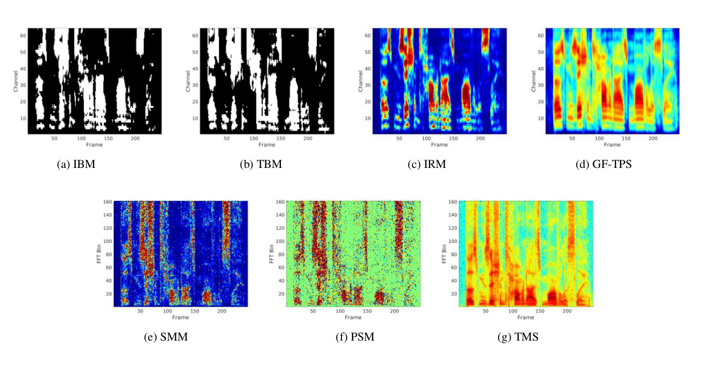
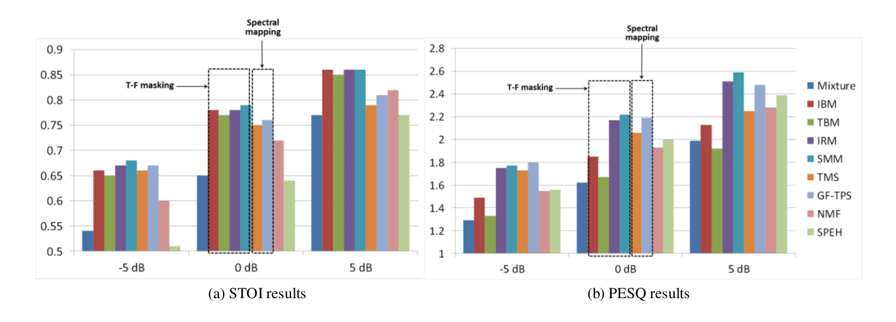
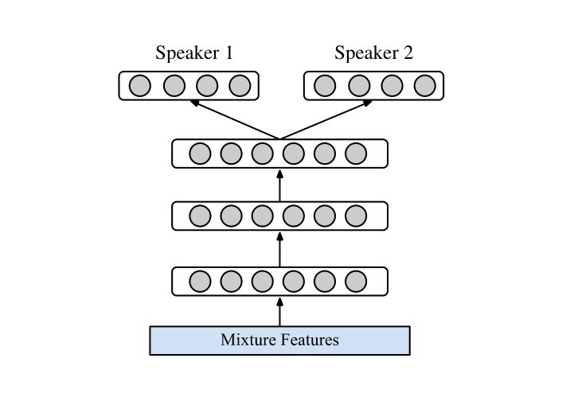

# 基于深度学习的监督式语音分离:综述

> **原文标题:** Supervised Speech Separation Based on Deep Learning: An Overview
> **作者:** DeLiang Wang(Fellow, IEEE)、Jitong Chen
> **机构:** ¹ 美国俄亥俄州立大学计算机科学与工程系、认知与脑科学中心(D. L. Wang);² 美国百度研究院硅谷人工智能实验室(J. Chen,曾任俄亥俄州立大学计算机科学与工程系)
> **邮箱:** dwang@cse.ohio-state.edu, chen.2593@osu.edu
> **论文编号:** IEEE/ACM Transactions on Audio, Speech, and Language Processing(TASLP), vol. 26, no. 10, pp. 1702–1726, Oct. 2018,DOI: 10.1109/TASLP.2018.2842159
> **免费版:** <https://arxiv.org/abs/1708.07524>
> \* D. L. Wang 同时兼任中国西安西北工业大学智能声学与沉浸式通信中心(Center of Intelligent Acoustics and Immersive Communications)访问教授。

## 摘要

语音分离的任务是把目标语音从背景干扰中分离出来。传统上,语音分离被作为信号处理问题来研究。较新的方法把语音分离表述为一个监督学习问题,即从训练数据中学习语音、说话人与背景噪声的判别性模式。在过去十年中,人们提出了许多监督式分离算法。特别是深度学习近来被引入监督式语音分离,极大地加速了研究进展并提升了分离性能。本文对近年来基于深度学习的监督式语音分离研究进行了全面综述。我们首先介绍语音分离的背景与监督式分离的表述方式,然后讨论监督式分离的三个主要组成部分:学习机、训练目标与声学特征。综述的很大篇幅用于讨论分离算法,我们回顾了单通道方法,包括语音增强(语音-非语音分离)、说话人分离(多说话人分离)与语音去混响,以及多麦克风技术。我们还讨论了监督学习特有的重要问题——泛化。本综述从历史视角展现了相关进展是如何取得的。此外,我们讨论了若干概念性问题,包括什么构成了目标源。

**关键词:** 语音分离,说话人分离,语音增强,监督式语音分离,深度学习,深度神经网络,语音去混响,时频掩蔽,阵列分离,波束成形

---

## I 引言

语音分离的目标是把目标语音从背景干扰中分离出来。语音分离是信号处理中的一项基础任务,应用范围广泛,包括听觉假体、移动通信以及鲁棒的自动语音与说话人识别。人类听觉系统具有从多个声源的混合信号中提取出某一个声源的非凡能力。在诸如鸡尾酒会这样的声学环境中,我们似乎能够在存在其他说话人和背景噪声的情况下毫不费力地跟随某一个说话人。语音分离通常被称为“鸡尾酒会问题”,这一术语由 Cherry 在其 1953 年的著名论文[26]中提出。

语音分离是声源分离的一个特例。在感知上,声源分离对应于听觉流分离,后者是听觉感知领域中一个得到广泛研究的课题。关于流分离的第一项系统性研究由 Miller 和 Heise[124]完成,他们注意到听者会把由两个交替正弦波音构成的信号分成两个流。Bregman 及其同事围绕这一主题开展了一系列研究,并在其奠基性著作[15]中引入了术语听觉场景分析(ASA),用以指称把声学混合信号分离开、并将源自同一声源的信号归为一组的感知过程。听觉场景分析分为同时性组织与序列性组织。同时性组织(或称分组)整合同时出现的声音,而序列性组织整合跨时间的声音。当听觉模式以频谱图等时频表示呈现时,构成 ASA 的主要组织原则包括:频率与时间上的邻近性、谐和性、共同的幅度与频率调制、起始与终止同步、共同位置以及先验知识(参见[163] [15] [29] [11] [30] [32]等)。这些分组原则同样支配着语音分离[201] [154] [31] [4] [49] [93]。从 ASA 研究来看,人们似乎已形成共识:人类听觉系统会对目标声音进行分离并加以注意,而该目标声音可以是一段音调序列、一段旋律或某个人的嗓音。更具争议的是听觉注意在流分离中的作用[17] [151] [148] [120]。在本综述中,我们用语音分离(separation,或 segregation)主要来指代把目标语音信号从含噪混合信号中分离出来的计算任务。

我们在语音分离上的表现如何?量化噪声中语音感知性能的一种方法是测量语音接受阈(speech reception threshold),即达到 50%可懂度得分所需的信噪比(SNR)水平。Miller[123]综述了人类在受到各种音调、宽带噪声和其他人声干扰时的可懂度得分。听者接受了单词可懂度得分测试,结果如图 1 所示。

![图 1:不同种类干扰下的 SNR(引自[172],重绘自[123])。虚线表示 50%可懂度。对于语音干扰,给出了 1、2 和 8 个干扰说话人的得分。](./images/fig01.png)

**图 1:不同种类干扰下的 SNR(引自[172],重绘自[123])。虚线表示 50%可懂度。对于语音干扰,给出了 1、2 和 8 个干扰说话人的得分。**

总体而言,音调的干扰性不如宽带噪声。例如,即使与强度高出 20 dB 的复杂滑音混合,语音仍然可懂(纯音的干扰性更弱)。宽带噪声对语音感知的干扰最强,相应的 SRT 约为 2 dB。当干扰由其他人声构成时,SRT 取决于存在多少个干扰说话人。如图 1 所示,单个干扰者时 SRT 约为–10 dB,但两个干扰者时迅速升高到–2 dB。当干扰包含四个或更多个人声时,SRT 基本保持不变(约为–1 dB)。不同种类干扰之间的 SRT 差距高达 23 dB!此外应当指出,有听力损失的听者表现出明显高于听力正常听者的 SRT,从宽带平稳噪声时的几个分贝到语音干扰时高达 10-15 dB[44] [127],这表明其语音分离能力更差。

由于语音是人类最重要的交流手段,把语音从背景干扰中分离出来的能力至关重要,因为感兴趣的语音(即目标语音)通常会被来自其他声源的加性噪声以及表面反射产生的混响所破坏。尽管人类完成语音分离看似轻而易举,但要构建一个在这一基本任务上可与人类听觉系统匹敌的自动系统却被证明极具挑战性。Cherry 在其 1957 年的著作[27]中提出这样一个观察:“迄今尚未构建出任何机器来完成这件事[解决鸡尾酒会问题]。”不幸的是,对我们这个领域而言,他的结论在此后的 60 年里大体上依然成立,尽管本文所综述的最新进展已开始破解这一问题。

鉴于其重要性,数十年来语音分离在信号处理领域得到了广泛研究。根据传感器或麦克风的数量,可以把分离方法分为单通道(单麦克风)和基于阵列的(多麦克风)两类。单通道分离的两种传统方法是语音增强[113]和计算听觉场景分析(CASA)[172]。语音增强分析语音与噪声的一般统计特性,然后借助噪声估计从含噪语音中估计出干净语音[40] [113]。最简单且应用最广泛的增强方法是谱减法(spectral subtraction)[13],它从含噪语音的功率谱中减去估计噪声的功率谱。为了估计背景噪声,语音增强技术通常假设背景噪声是平稳的,即其谱特性不随时间变化,或至少比语音更平稳。CASA 基于听觉场景分析的感知原理[15],并利用基频、起始等分组线索。例如,tandem 算法通过交替进行基频估计与基于基频的分组来分离浊音语音[78]。

具有两个或更多麦克风的阵列采用另一种原理来实现语音分离。波束成形,即空间滤波,通过适当的阵列配置增强从特定方向到达的信号,从而衰减来自其他方向的干扰[164] [14] [9] [88]。最简单的波束成形器是延迟求和(delay-and-sum)技术,它把来自目标方向的多个麦克风信号同相相加,并利用相位差衰减来自其他方向的信号。噪声衰减量取决于阵列的间距、尺寸和配置——通常衰减量随麦克风数量和阵列长度的增加而增大。显然,当目标声源与干扰声源共址或彼此靠近时,空间滤波无法应用。此外,在混响条件下,波束成形的效用大大降低,因为混响会使声源的方向性变得模糊。

一种更晚近的方法把语音分离视为监督学习问题。监督式语音分离的最初构想受到 CASA 中时频(T-F)掩蔽概念的启发。作为一种分离手段,时频掩蔽对源混合信号的时频表示施加二维掩蔽(加权),从而分离出目标源[117] [172] [170]。CASA 的一个主要目标是理想二值掩蔽(IBM)[76],它表示在混合信号的时频表示中目标信号是否在某个时频单元中占主导。听音实验表明,理想二值掩蔽在噪声条件下能显著提升听力正常(NH)与听障(HI)听者的语音可懂度[16] [1] [109] [173]。以 IBM 为计算目标,语音分离就变成了二值分类,这是监督学习的一种基本形式。在这种情况下,训练时把 IBM 用作期望信号,即目标函数。在测试时,学习机的目标是估计 IBM。尽管 IBM 在监督式语音分离中充当了第一个训练目标,但它绝不是唯一的训练目标,第 III 节给出了一系列训练目标,其中许多被证明更为有效。

自从把语音分离表述为分类问题以来,数据驱动方法在语音处理界得到了广泛研究。在过去十年中,监督式语音分离借助大规模训练数据和不断增长的计算资源,大幅提升了当前最佳性能[21]。监督式分离尤其受益于深度学习的迅速崛起——这正是本综述的主题。监督式语音分离算法可以大致分为以下组成部分:学习机、训练目标和声学特征。本文将首先综述这三个组成部分,随后介绍代表性算法,其中单通道算法与基于阵列的算法将在不同章节中讨论。由于泛化是监督式语音分离特有的问题,本综述将专门讨论该问题。

为避免可能的混淆,我们先澄清本综述中使用的几个相关术语。我们把语音分离(separation 或 segregation)称为把目标语音从其背景干扰中分离出来的一般任务,背景干扰可能包括非语音噪声、干扰语音或两者兼有,还可能包括房间混响。此外,我们把语音分离与鸡尾酒会问题等同起来,后者已超出 Cherry[26]最初所实验的两段语音的分离。我们用语音增强(或去噪)指代语音与非语音噪声的分离。如果仅限于多个人声的分离,我们就使用说话人分离这一术语。

本综述的组织结构如下。我们首先在第 II、III 和 IV 节分别综述监督式语音分离的三个主要方面,即学习机、训练目标和特征。第 V 节专门讨论单通道分离算法,第 VI 节讨论基于阵列的算法。第 VII 节对本综述作出总结,并讨论若干附加问题,例如应当把什么信号视为目标,以及鸡尾酒会问题的解决方案可能是什么样子。

## II 分类器与学习机

在过去十年中,深度神经网络(DNN)显著提升了众多监督学习任务的性能,例如图像分类[28]、手写识别[53]、自动语音识别[73]、语言建模[156]与机器翻译[157]。DNN 同样大幅提升了监督式语音分离的性能。本节简要介绍用于监督式语音分离的 DNN 类型:前馈多层感知机(multilayer perceptrons, MLPs)、卷积神经网络(convolutional neural networks, CNNs)、循环神经网络(recurrent neural networks, RNNs)与生成对抗网络(generative adversarial networks, GANs)。

神经网络中最流行的模型是 MLP,它从输入层到输出层逐层具有前馈连接,且相邻层之间全连接。MLP 是 Rosenblatt 感知机[142]的扩展,它在输入层与输出层之间引入了隐藏层。MLP 用经典的反向传播算法[143]训练,通过梯度下降调整网络权重以最小化预测误差。预测误差由预测输出与期望输出之间的代价(损失)函数度量,期望输出由用户作为监督的一部分提供。例如,当 MLP 用于分类时,一种常用的代价函数是交叉熵:

$$-\frac{1}{N}\sum_{i=1}^{N}\sum_{c=1}^{C}I_{i,c}\log(p_{i,c})$$

其中$i$索引一个输出模型神经元,$p_{i,c}$表示$i$属于类别$c$的预测概率。$N$与$C$分别表示输出神经元的个数与类别的个数。$I_{i,c}$是二值指示变量,当神经元$i$的期望类别为$c$时取 1,否则取 0。对于函数逼近或回归,一种常用的代价函数是均方误差(MSE):

$$MSE=\frac{1}{N}\sum_{i=1}^{N}(y_i-\hat{y}_i)^2$$

其中$\hat{y}_i$与$y_i$分别是神经元$i$的预测输出与期望输出。

随着层数的增加,MLP 的表示能力也随之增强[142],尽管从理论上讲,具有两个隐藏层的 MLP 就能逼近任意函数[70]。反向传播算法适用于任意深度的 MLP。然而,具有许多隐藏层的深度神经网络(DNN)很难从连接权重与偏置的随机初始化开始训练,原因在于所谓的梯度消失问题,它指的是这样一种现象:在较低层(靠近输入端),由上层反向传播的误差信号计算出的梯度会逐渐变小乃至消失。由于梯度消失,低层的连接权重几乎不被修改,因此低层在训练中学到的东西很少。这解释了为什么在 DNN 出现之前,单隐藏层 MLP 是使用最广泛的神经网络。

DNN 训练的一项突破由 Hinton 等人[74]取得。其核心思想是先用无标注数据进行逐层无监督预训练,以便在对 DNN 进行有标注数据的监督学习(或微调)之前对其进行恰当的初始化。更具体地说,Hinton 等人[74]提出受限玻尔兹曼机(RBM)来逐层预训练 DNN,并发现 RBM 预训练能够改善随后的监督学习。后来的一种补救措施是使用修正线性单元(ReLU)[128]替代传统的 sigmoid 激活函数,后者把模型神经元输入的加权和转换为该神经元的输出。近期的实践表明,使用 ReLU 的中等深度 MLP 无需无监督预训练,就可以用大规模训练数据有效训练。最近,跳跃连接被引入以促进极深 MLP 的训练[153] [62]。

一类被称为卷积神经网络(CNN)的前馈网络[106] [10]已被证明非常适合模式识别,尤其是在视觉领域。CNN 纳入了模式识别中已被充分记载的各种不变性,例如平移(位移)不变性。典型的 CNN 结构是卷积层与下采样层成对级联。一个卷积层由多个特征图构成,每个特征图通过权重共享学习提取局部特征,而与该特征在前一层中的位置无关:同一模块内的神经元尽管感受野不同,却被约束为具有相同的连接权重。这里的神经元感受野是指前一层中与该神经元相连的局部区域,其加权求和操作类似于卷积 1。每个卷积层之后是一个下采样层,后者对卷积层中神经元的感受野进行局部平均或取最大。下采样用于降低分辨率以及对局部变化的敏感性。CNN 中权重共享的使用还具有减少可训练参数数量的好处。由于 CNN 通过网络结构把模式识别中的领域知识融入其中,尽管 CNN 是深度网络,它也能由反向传播算法较好地训练。

RNN 允许循环(反馈)连接,通常存在于隐单元之间。与独立处理每个输入样本的前馈网络不同,RNN 把输入样本视为序列并对其随时间的变化建模。语音信号表现出很强的时间结构,当前帧内的信号受到先前各帧信号的影响。因此,RNN 是学习语音时间动态特性的自然选择。我们注意到,RNN 通过其循环连接引入了时间维度,该维度灵活且可无限扩展,这是无论多深的前馈网络都不具备的特性[169];在某种意义上,RNN 可以看作具有无限深度的 DNN[146]。循环连接通常用沿时间反向传播算法训练[187]。然而,这类 RNN 训练容易受到梯度消失或梯度爆炸问题的影响[137]。为缓解该问题,带有长短期记忆(LSTM)的 RNN 引入了带门的记忆单元,以促进信息随时间的流动[75]。具体而言,一个记忆单元有三个门:输入门、遗忘门与输出门。遗忘门控制应当保留多少先前的信息,输入门控制应当向记忆单元中加入多少当前信息。借助这些门控功能,LSTM 使相关的上下文信息得以保存在记忆单元中,从而改善 RNN 的训练。

生成对抗网络(GAN)是最近提出的,它同时训练两个模型:生成模型 G 与判别模型 D[52]。生成器 G 学习对标注数据建模,例如从含噪语音样本到其干净对应样本的映射;而判别器——通常是一个二值分类器——学习区分生成的样本与来自训练数据的目标样本。该框架类似于双人对抗博弈,其中极小极大是一种被证明有效的策略[144]。在训练期间,G 旨在学习准确的映射,使生成的数据能很好地模仿真实数据,从而骗过 D;另一方面,D 学习更好地区分真实数据与 G 生成的合成数据。这场博弈中的竞争,即对抗学习,促使两个模型不断提高准确度,直到生成的样本与真实样本无法区分。GAN 的核心思想是用判别器来塑造生成器的损失函数。GAN 最近已被用于语音增强(见第 V.A 节)。

在本综述中,DNN 指任何具有至少两个隐藏层的神经网络[10] [73],以区别于仅有单个隐藏层的常见学习机,如常用的 MLP、带核函数的支持向量机(SVM)与高斯混合模型(GMM)。随着实践中 DNN 变得更深,实际使用的网络已超过 100 个隐藏层,一个神经网络被视为 DNN 所需的深度可以是一个定性而非定量的区分问题。此外,我们用 DNN 这一术语指代任何具有深层结构的神经网络,无论它是前馈的还是循环的。

应当指出,DNN 并不是用于语音分离的唯一一类学习机。用于监督式语音分离的其他学习机包括 GMM[147] [97]、SVM[55]以及仅有一个隐藏层的神经网络[91]。由于本综述的主题是基于 DNN 的语音分离,这些研究将不再进一步讨论。

## III 训练目标

在监督式语音分离中,定义合适的训练目标对学习与泛化很重要。训练目标主要分为两组,即基于掩蔽的目标与基于映射的目标。基于掩蔽的目标描述干净语音与背景干扰之间的时频关系,而基于映射的目标对应于干净语音的谱表示。本节综述该领域提出的若干训练目标。

在评述训练目标之前,我们先介绍语音分离中常用的评价指标。文献中已提出多种指标,具体取决于各研究的目标。这些指标可分为两类:信号级与感知级。在信号级,指标旨在量化信号增强或干扰抑制的程度。除传统的信噪比(SNR)之外,分离信号中的语音失真(损失)与噪声残留可以分别度量[77] [113]。一组重要的评价指标包括信号失真比(SDR)、信号干扰比(SIR)与信号伪影比(SAR)[165]。

由于语音分离系统的输出常常由人类听者聆听,人们已投入大量精力来定量预测听者如何感知分离后的信号。由于可懂度与质量是语音感知中两个主要但不同的方面,研究者已提出客观指标来分别评价语音可懂度与语音质量。鉴于 IBM 能够提升人类语音可懂度,且它与清晰度指数(AI)[114]——语音感知的经典模型——存在联系,人们建议以 IBM 为参考,把命中率减虚警率(HIT−FA)用作评价指标[97]。HIT 表示 IBM 中被正确分类的语音主导时频单元所占百分比,而 FA(false-alarm,虚警)指被错误分类的噪声主导单元所占百分比。研究发现,HIT−FA 率与语音可懂度有很好的相关性[97]。近年来最常用的可懂度指标是短时客观可懂度(STOI),它度量参考(干净)语音与分离语音的短时时间包络之间的相关性[158] [89]。STOI 的取值范围通常在 0 到 1 之间,可解释为正确百分比。尽管 STOI 倾向于高估可懂度得分[64] [102],但尚未有替代指标被证明与人类可懂度的相关性稳定地更好。对于语音质量,感知语音质量评价(PESQ)是标准指标[140],并由国际电信联盟(ITU)推荐[87]。PESQ 应用听觉变换得到响度谱,并比较干净参考信号与分离信号的响度谱,给出-0.5 到 4.5 范围内的得分,对应于感知 MOS(平均意见得分)的预测。

### 理想二值掩蔽

监督式语音分离中使用的第一个训练目标是理想二值掩蔽(IBM)[76] [141] [77] [168],其灵感来自听觉中的听觉掩蔽现象[126]以及听觉场景分析中的排他性分配原则[15]。IBM 定义在含噪信号的二维时频(T-F)表示(如耳蜗图或频谱图)上:

$$IBM=\begin{cases}1, & \text{if } SNR(t,f)>LC \\ 0, & \text{otherwise}\end{cases} \qquad (1)$$

其中$t$与$f$分别表示时间与频率。如果某个时频单元内的信噪比超过局部准则(LC)或阈值,IBM 就给该单元赋值 1,否则赋值 0。图 2(a)给出了 IBM 的一个示例,它定义在 64 通道耳蜗图上。如第 I 节所述,IBM 掩蔽能显著提高听力正常与听障听者在噪声中的语音可懂度。IBM 把每个时频单元标注为目标主导或干扰主导。因此,IBM 估计自然可以被视为一个监督分类问题。如第 II 节所述,IBM 估计常用的代价函数是交叉熵。

### 目标二值掩蔽

与 IBM 类似,目标二值掩蔽(TBM)用二值标签对所有时频单元进行分类。与 IBM 不同的是,TBM 通过把每个时频单元中的目标语音能量与一种固定的干扰——语音形状噪声(speech-shaped noise)——相比较来得到标签,后者是对应于所有语音信号平均的平稳信号。图 2(b)给出了 TBM 的一个示例。目标二值掩蔽同样能在噪声中显著改善语音可懂度[99],TBM 已被用作训练目标[51] [112]。

### 理想比值掩蔽

理想比值掩蔽(IRM)不是在每个时频单元上给出硬标签,而可以看作 IBM 的软版本[152] [130] [178] [84]:

$$IRM=\left(\frac{S(t,f)^2}{S(t,f)^2+N(t,f)^2}\right)^{\beta} \qquad (2)$$

其中$S(t,f)^2$与$N(t,f)^2$分别表示一个时频单元内的语音能量与噪声能量。可调参数$\beta$用于缩放掩蔽值,通常取 0.5。在$S(t,f)$与$N(t,f)$不相关的假设下,取平方根后 IRM 能够保持每个时频单元的语音能量。该假设对加性噪声成立得很好,但对房间混响情形下的卷积性干扰并不成立(不过,晚期混响可以合理地视为不相关的干扰)。若不取根,式(2)中的 IRM 与经典维纳滤波器相似,后者是功率谱域中目标语音的最优估计器。IRM 估计通常使用 MSE 作为代价函数。图 2(c)给出了 IRM 的一个示例。

**图 2:一个与工厂噪声在-5 dB SNR 下混合的 TIMIT 语音的各种训练目标图示。**

### 谱幅度掩蔽

谱幅度掩蔽(SMM)(在[178]中称为 FFT-MASK)定义在干净语音与含噪语音的 STFT(短时傅里叶变换)幅度上:

$$SMM(t,f)=\frac{|S(t,f)|}{|Y(t,f)|} \qquad (3)$$

其中$|S(t,f)|$与$|Y(t,f)|$分别表示干净语音与含噪语音的谱幅度。与 IRM 不同,SMM 不以 1 为上界。为了得到分离语音,我们把 SMM 或其估计值作用于含噪语音的谱幅度,并用含噪语音的相位(或干净语音相位的估计)重新合成分离语音。图 2(e)展示了 SMM。

### 相位敏感掩蔽

相位敏感掩蔽(PSM)通过引入相位的度量扩展了 SMM[41]:

$$PSM(t,f)=\frac{|S(t,f)|}{|Y(t,f)|}\cos\theta \qquad (4)$$

其中$\theta$表示时频单元内干净语音相位与含噪语音相位之差。在 PSM 中引入相位差可获得更高的信噪比,并且往往比 SMM 给出更好的干净语音估计[41]。图 2(f)给出了 PSM 的一个示例。

### 复数理想比值掩蔽

复数理想比值掩蔽(cIRM)是复数域中的理想掩蔽。与上述掩蔽不同,它可以从含噪语音中完美重建干净语音[188]:

$$S=cIRM\ast Y \qquad (5)$$

其中$S$与$Y$分别表示干净语音与含噪语音的 STFT,“∗”表示复数乘法。

求解掩蔽的各分量得到如下定义:

$$cIRM=\frac{Y_rS_r+Y_iS_i}{Y_r^2+Y_i^2}+i\frac{Y_rS_i-Y_iS_r}{Y_r^2+Y_i^2} \qquad (6)$$

其中$Y_r$与$Y_i$分别表示含噪语音的实部与虚部,$S_r$与$S_i$分别表示干净语音的实部与虚部。虚数单位记为“i”。因此 cIRM 有一个实部和一个虚部,二者可以在实数域中分别估计。由于涉及复数域计算,掩蔽值会变为无界。因此应当使用某种形式的压缩来限制掩蔽值,例如双曲正切函数或 S 形函数[188] [184]。

Williamson 等人[188]观察到,在笛卡尔坐标下,cIRM 的实部与虚部都存在结构;而在极坐标下,幅度谱图存在结构,相位谱图却没有。若没有清晰的结构,直接进行相位估计很难通过监督学习实现,不过我们应当提到最近的一篇论文,它使用复数域 DNN 来估计复数 STFT 系数[107]。另一方面,cIRM 的估计可以提供相位估计,这是 PSM 估计所不具备的性质。

### 目标幅度谱

干净语音的目标幅度谱(TMS),即$|S(t,f)|$,是一种基于映射的训练目标[116] [196] [57] [197]。在这种情况下,监督学习旨在从含噪语音的幅度谱图估计干净语音的幅度谱图。可以用功率谱或其他形式的谱(如梅尔谱)代替幅度谱,并且通常施加对数运算以压缩动态范围、便于训练。TMS 的一种重要形式是归一化到零均值与单位方差的对数功率谱[197]。随后把估计得到的语音幅度与含噪相位结合,产生分离语音波形。在代价函数方面,TMS 估计通常使用 MSE。或者,也可以采用最大似然来训练 TMS 估计器,从而显式地对输出相关性建模[175]。图 2(g)给出了 TMS 的一个示例。

### 伽马通频率目标功率谱

另一种密切相关的基于映射的目标是伽马通频率目标功率谱(GF-TPS)[178]。与定义在频谱图上的 TMS 不同,该目标定义在基于伽马通滤波器组的耳蜗图上。具体而言,该目标定义为耳蜗图对干净语音响应的功率。GF-TPS 的估计可以很容易地通过耳蜗图反变换转换为分离语音波形[172]。图 2(d)展示了该目标。

**图 3:训练目标的比较。(a)以 STOI 衡量。(b)以 PESQ 衡量。干净语音与工厂噪声在-5 dB、0 dB 与 5 dB SNR 下混合。对 0 dB 混合信号,突出显示了不同训练目标以及一种语音增强(SPEH)算法和一种 NMF 方法的结果。注意,本图中的结果与数据可从 http://web.cse.ohio-state.edu/pnl/DNN_toolbox/ 的 Matlab 工具箱获得。**

### 信号逼近

信号逼近(SA)的思想是训练一个比值掩蔽估计器,使干净语音的谱幅度与估计语音的谱幅度之间的差异最小[186] [81]:

$$SA(t,f)=\left[RM(t,f)|Y(t,f)|-|S(t,f)|\right]^2 \qquad (7)$$

$RM(t,f)$指的是 SMM 的一个估计。因此,SA 可以解释为一种结合了比值掩蔽与谱映射的目标,力求最大化信噪比[186]。一个相关的、更早的目标是在 IBM 估计的背景下追求最大信噪比[91]。对于 SA 目标,采用两阶段训练可以获得更好的分离性能[186]。在第一阶段,以 SMM 为目标训练一个学习机。在第二阶段,通过最小化式(7)的损失函数对学习机进行微调。

若干训练目标已在固定的、具有三个隐藏层的前馈 DNN 上使用同一组输入特征进行了比较[178]。使用不同训练目标得到的分离语音分别用 STOI 与 PESQ 评价,以衡量预测的语音可懂度与语音质量。此外,还评价了一个有代表性的语音增强算法[66]与一个监督式非负矩阵分解(NMF)算法[166]作为基准。评价结果见图 3。从这项研究中可以得到若干结论。第一,在客观可懂度方面,基于掩蔽的目标作为一组优于基于映射的目标,尽管最近的一项研究[155]表明,掩蔽只有在较高的输入信噪比下才有优势,而在较低的信噪比下映射更有优势 2。在语音质量方面,比值掩蔽优于二值掩蔽。特别有启发性的是 SMM 与 TMS 之间的对比:除 SMM 的分母中使用了$|Y(t,f)|$之外(见式(3)),二者完全相同。SMM 估计得更好,这可能归因于目标幅度谱对干扰信号与信噪比不敏感,而 SMM 则对二者敏感。TMS 中的多对一映射使其估计可能比 SMM 估计更困难。此外,对无界谱幅度的估计往往会放大估计误差[178]。总体而言,IRM 与 SMM 成为更受青睐的目标。此外,基于 DNN 的比值掩蔽明显优于监督式 NMF 与无监督语音增强。

上面列出的训练目标并非穷尽性的,文献中还使用过其他目标。也许最直接的目标是干净语音的波形(时域)信号。这确实在一项早期研究中被使用,该研究训练 MLP 从一帧含噪语音波形映射到一帧干净语音波形,可称之为时间映射[160]。虽然简单,但即使使用 DNN 代替浅层网络,这种直接映射的表现也不好[182] [34]。在[182]中,目标定义在时域,但用于目标估计的 DNN 包含比值掩蔽模块以及带含噪相位的逆傅里叶变换模块。该目标与 PSM 密切相关 3。最近的一项研究评估了若干理想掩蔽的理想结果,并额外引入了所谓理想增益掩蔽(IGM)[184],它是用传统语音增强中常用的先验信噪比与后验信噪比定义的[113]。在[192]中,所谓最优比值掩蔽考虑了目标语音与背景噪声之间的相关性[110],该研究对它进行了评估,并发现它是基于 DNN 的语音分离的一个有效目标。

## IV 特征

作为输入的特征与学习机在监督学习中扮演互补的角色。当特征具有判别性时,它们为成功完成一项任务而对学习机的要求较低。另一方面,强大的学习机对特征的要求较低。在一个极端,当特征使分类任务线性可分时,所需的只是一个线性分类器,如 Rosenblatt 的感知机。在另一个极端,如果分类器能够学习到合适的特征,那么不做任何特征提取的原始形式输入(例如音频中的波形)就已足够。介于两者之间的是大多数任务,其中特征提取与学习都很重要。

监督式语音分离的早期研究只使用少数几个特征,例如双耳分离中的双耳时间差(ITD)与双耳强度级(强度)差(IID) [141],以及单通道分离中基于音高(pitch)的特征 [91] [78] [55] 与幅度调制频谱图(AMS) [97]。随后的一项研究 [177] 探索了更多单通道特征,包括梅尔频率倒谱系数(MFCC)、伽马通频率倒谱系数(GFCC) [150]、感知线性预测(PLP) [67] 与相对谱变换 PLP(RASTA-PLP) [68]。该研究通过使用 group Lasso 进行特征选择,推荐了一个互补特征集,包含 AMS、RASTA-PLP 与 MFCC(以及若能被可靠估计的音高),此后该特征集已被许多研究采用。

我们开展了一项研究,以考察用于低 SNR 下监督式语音分离的大量声学特征 [22]。这些特征此前已被用于鲁棒自动语音识别与基于分类的语音分离。该特征列表包含梅尔域、线性预测、伽马通域、过零、自相关、中时滤波、调制以及基于音高的特征。梅尔域特征为 MFCC 与 delta 谱倒谱系数(DSCC) [104],后者与 MFCC 类似,区别在于对梅尔谱施加了 delta 运算。线性预测特征为 PLP 与 RASTA-PLP。三个伽马通域特征为伽马通特征(GF)、GFCC 与伽马通频率调制系数(GFMC) [119]。GF 的计算方式是将输入信号送入伽马通滤波器组,并对子带信号施加抽取操作。一种称为带峰值幅度的过零(ZCPA) [96] 的过零特征,从利用伽马通滤波器组导出的子带信号中计算过零间隔与相应的峰值幅度。

自相关特征为相对自相关序列 MFCC(RAS-MFCC) [204]、自相关序列 MFCC(AC-MFCC) [149] 与相位自相关 MFCC(PAC-MFCC) [86],它们都在自相关域中应用 MFCC 流程。中时滤波特征为功率归一化倒谱系数(PNCC) [95] 与慢变分量及功率包络下降沿抑制(SSF) [94]。调制域特征为 Gabor 滤波器组(GFB) [145] 与 AMS 特征。基于音高的特征(PITCH)基于音高跟踪计算时频单元级特征,并利用周期性与瞬时频率来区分语音主导的时频单元与噪声主导的时频单元。除已有特征之外,我们还提出了一种称为多分辨率耳蜗图(MRCG) [22] 的新特征,它计算四种不同频谱时间分辨率的耳蜗图,以同时提供局部信息与更宽的上下文。

这些特征用自回归滑动平均(ARMA)滤波器 [19] 进行后处理,并用一个固定的基于 MLP 的 IBM 掩蔽估计器进行评估。估计出的掩蔽按分类准确率与 HIT−FA 率进行评估。HIT−FA 结果如表 1 所示。如表所示,伽马通域特征(MRCG、GF 与 GFCC)在准确率和 HIT−FA 率两方面都一致优于其他特征,其中 MRCG 表现最好。通过离散余弦变换(DCT)进行的倒谱压缩并不有效,比较 GF 与 GFCC 特征即可看出这一点。调制提取同样无效,比较 GFCC 与 GMFC 即可看出,后者由前者计算得到。值得注意的是,基于音高的特征表现不佳,很大程度上是由于低 SNR 下估计不准确,因为音高的真值被证明具有相当强的判别性。

最近,Delfarah 和 Wang [34] 进行了另一项特征研究,该研究考虑了房间混响,以及语音去噪与说话人分离。他们的研究使用一个训练用于估计 IRM 的固定 DNN,评估结果以相对于未处理的含噪混响语音的 STOI 提升给出。该研究中新增的特征包括对数谱幅度(LOG-MAG)与对数梅尔谱特征(LOG-MEL),二者都常用于监督式分离 [196] [82]。此外还包括不做任何特征提取的波形信号(WAV)。对于混响,模拟的房间冲激响应(RIR)与录制的 RIR 都被使用,混响时间最长为 0.9 秒。对于去噪,评估分别针对匹配噪声与非匹配噪声进行:前者把每个非平稳噪声的前一半用于训练、后一半用于测试,后者则用全新的噪声进行测试。对于同信道(双说话人)分离,目标说话人为男性,而干扰说话人为女性或男性。表 2 给出了所评估的各个特征的 STOI 提升。在无回声、匹配噪声的情况下,STOI 结果与表 1 大体一致。使用模拟 RIR 与录制 RIR 时,特征结果也大致一致。然而,在匹配噪声、非匹配噪声与说话人分离这几种情况下,表现最好的特征并不相同。除 MRCG 之外,PNCC 与 GFCC 分别在非匹配噪声与同信道条件下取得最好的结果。在特征组合方面,该研究得出结论:对语音增强而言最有效的特征集由 PNCC、GF 与 LOG-MEL 组成,对说话人分离而言则由 PNCC、GFCC 与 LOG-MEL 组成。

表 1 与表 2 中由特征引起的大幅性能差异,表明了特征对监督式语音分离的重要性。表 2 中纳入原始波形信号还表明,如果不做特征提取,分离结果很差。但应当注意,[34] 中使用的前馈 DNN 可能与波形信号耦合不佳,而 CNN 与 RNN 可能更适合所谓的端到端分离。我们稍后会讨论这个问题。

**表 1:一组声学特征在六种噪声、-5 dB SNR 下的 HIT−FA(in %)分类性能,其中 FA 在括号中给出(引自 [22])。粗体表示最佳得分。**
| 特征 | 工厂 | 嘈杂人声 | 发动机 | 驾驶舱 | 车辆 | 坦克 | 平均 |
| --- | --- | --- | --- | --- | --- | --- | --- |
| MRCG | **63 (7)** | **49 (13)** | **77 (4)** | **73 (4)** | **80 (10)** | **77 (6)** | **70 (7)** |
| GF | 61 (7) | 45 (15) | 75 (4) | 71 (3) | **80 (10)** | 76 (6) | 68 (8) |
| GFCC | 61 (6) | 46 (14) | 73 (4) | 70 (3) | 78 (11) | 74 (6) | 67 (7) |
| DSCC | 56 (7) | 42 (14) | 70 (5) | 66 (3) | 77 (11) | 73 (6) | 64 (8) |
| MFCC | 57 (7) | 43 (14) | 69 (5) | 67 (4) | 77 (11) | 72 (7) | 64 (8) |
| PNCC | 56 (6) | 44 (14) | 69 (5) | 66 (4) | 77 (11) | 71 (7) | 64 (8) |
| PLP | 56 (6) | 41 (12) | 68 (5) | 66 (4) | 77 (11) | 71 (7) | 63 (8) |
| AC-MFCC | 56 (6) | 42 (14) | 67 (5) | 65 (4) | 77 (11) | 71 (7) | 63 (8) |
| RAS-MFCC | 57 (6) | 41 (14) | 68 (5) | 66 (4) | 76 (11) | 71 (7) | 63 (8) |
| GFB | 57 (7) | 41 (18) | 67 (5) | 66 (4) | 75 (12) | 70 (7) | 63 (9) |
| ZCPA | 55 (8) | 40 (16) | 68 (5) | 65 (4) | 75 (13) | 70 (8) | 62 (9) |
| SSF | 54 (7) | 39 (15) | 67 (5) | 60 (4) | 76 (11) | 69 (7) | 61 (8) |
| RASTA-PLP | 52 (6) | 38 (15) | 64 (5) | 61 (4) | 76 (12) | 67 (7) | 60 (8) |
| GFMC | 48 (7) | 35 (15) | 61 (6) | 60 (5) | 67 (17) | 59 (9) | 55 (10) |
| PITCH | 46 (3) | 29 (22) | 50 (5) | 50 (2) | 59 (16) | 53 (7) | 48 (9) |
| AMS | 40 (6) | 27 (9) | 49 (5) | 52 (4) | 50 (31) | 45 (11) | 44 (11) |
| PAC-MFCC | 17 (5) | 11 (8) | 30 (9) | 29 (7) | 40 (48) | 21 (17) | 25 (16) |

> 表头英文依次为 Factory、Babble、Engine、Cockpit、Vehicle、Tank、Average(原表为图片,此处按原表转录)。

## V 单通道分离算法

本节讨论用于语音增强、语音去混响、去混响加去噪以及说话人分离的单通道算法。我们介绍代表性算法,并讨论监督式语音分离的泛化。

### 语音增强

据我们所知,深度学习最早由 Wang 和 Wang 于 2012 年在两篇会议论文中引入语音分离 [179] [180],这两篇论文后来于 2013 年扩展为期刊版本 [181]。他们使用 DNN 进行子带分类以估计 IBM。在会议版本中,带 RBM 预训练的前馈 DNN 被用作二值分类器,同时也被用作结构化感知机 [179] 和条件随机场 [180] 的特征编码器。他们报告了在所有使用 DNN 的情形下都获得很强的分离结果,其中 DNN 用于特征学习时结果更好,因为结构化预测中融入了时间动态。

在期刊版本 [181] 中,输入信号通过一个 64 通道伽马通滤波器组以得到子带信号,并在每个时频单元内从中提取声学特征。这些特征构成子带 DNN(共 64 个)的输入,以学习更具判别性的特征。这种将 DNN 用于语音分离的方式如图 4 所示。DNN 训练完成后,输入特征与最后一个隐藏层学到的特征被拼接起来,送入线性 SVM 以高效地估计子带 IBM。该算法进一步扩展为两级 DNN [65],其中第一级像通常那样被训练来估计子带 IBM,第二级则按以下方式显式地融入时频上下文。第一级 DNN 训练完成后,二值化之前的单元级输出可以解释为语音在该时频单元中占主导的后验概率。因此第一级 DNN 的输出被视为后验掩蔽。在第二级中,一个时频单元以该单元为中心的后验掩蔽局部窗口作为输入。两级 DNN 如图 5 所示。这种第二级结构让人联想到 CNN 中的卷积层,但不进行权重共享。这种利用上下文信息的方式被证明能显著提高分类准确率。主观测试表明,该 DNN 对听障与听力正常听者都带来了大幅可懂度提升,其中听障听者获益更多 [65]。这是首个能在背景噪声中为听障听者带来实质性语音可懂度提升的单通道算法,以至于使用分离的听障被试超过了不使用分离的听力正常被试。

**表 2:一组特征在一组测试噪声上平均得到的 STOI 提升(单位:%)(引自 [34])。“Sim.” 和 “Rec.” 分别表示仿真的与录制的房间冲激响应。粗体表示每种条件下的最佳得分。在同信道(双说话人)情况下,对于男性目标说话人,性能分别针对女性干扰者和男性干扰者(在括号中)给出。**
| 特征 | 匹配噪声 | | | 非匹配噪声 | | | 同信道 | | | 平均 |
| --- | --- | --- | --- | --- | --- | --- | --- | --- | --- | --- |
| | 无回声 | 模拟 RIR | 实录 RIR | 无回声 | 模拟 RIR | 实录 RIR | 无回声 | 模拟 RIR | 实录 RIR | |
| MRCG | **7.12** | **14.25** | **12.15** | **7.00** | 7.28 | 8.99 | 21.25 (13.00) | 22.93 (12.31) | 21.29 (12.81) | **12.92** |
| GF | 6.19 | 13.10 | 11.37 | 6.71 | 7.87 | 8.24 | 22.56 (11.87) | **23.95 (12.31)** | 22.35 (12.87) | 12.71 |
| GFCC | 5.33 | 12.56 | 10.99 | 6.32 | 6.92 | 7.01 | **23.53 (14.34)** | **23.95 (14.01)** | **22.76 (13.90)** | 12.50 |
| LOG-MEL | 5.14 | 12.07 | 10.28 | 6.00 | 6.98 | 7.52 | 21.18 (13.88) | 22.75 (13.54) | 21.71 (13.18) | 12.08 |
| LOG-MAG | 4.86 | 12.13 | 9.69 | 5.75 | 6.64 | 7.19 | 20.82 (13.84) | 22.57 (13.40) | 21.82 (13.55) | 11.91 |
| GFB | 4.99 | 12.47 | 11.51 | 6.22 | 7.01 | 7.86 | 19.61 (13.34) | 20.86 (11.97) | 19.97 (11.60) | 11.75 |
| PNCC | 1.74 | 8.88 | 10.76 | 2.18 | **8.68** | **10.52** | 19.97 (10.73) | 19.47 (10.03) | 19.35 (9.56) | 10.78 |
| MFCC | 4.49 | 11.03 | 9.69 | 5.36 | 5.96 | 6.26 | 19.82 (11.98) | 20.32 (11.47) | 19.66 (11.54) | 10.72 |
| RAS-MFCC | 2.61 | 10.47 | 9.56 | 3.08 | 6.74 | 7.37 | 18.12 (11.38) | 19.07 (11.19) | 17.87 (10.30) | 10.44 |
| AC-MFCC | 2.89 | 9.63 | 8.89 | 3.31 | 5.61 | 5.91 | 18.66 (12.50) | 18.64 (11.59) | 17.73 (11.27) | 9.87 |
| PLP | 3.71 | 10.36 | 9.10 | 4.39 | 5.03 | 5.81 | 16.84 (11.29) | 16.73 (10.92) | 15.46 (9.50) | 9.46 |
| SSF-II | 3.41 | 8.57 | 8.68 | 4.18 | 5.45 | 6.00 | 16.76 (10.07) | 17.72 (9.18) | 18.07 (8.93) | 9.09 |
| SSF-I | 3.31 | 8.35 | 8.53 | 4.09 | 5.17 | 5.77 | 16.25 (10.44) | 17.70 (9.40) | 18.04 (9.35) | 8.97 |
| RASTA-PLP | 1.79 | 7.27 | 8.56 | 1.97 | 6.62 | 7.92 | 11.03 (6.76) | 10.96 (6.06) | 10.27 (6.28) | 7.46 |
| PITCH | 2.35 | 4.62 | 4.79 | 3.36 | 3.36 | 4.61 | 19.71 (9.37) | 17.82 (8.45) | 16.87 (6.72) | 7.03 |
| GFMC | −0.68 | 7.05 | 5.00 | −0.54 | 4.44 | 4.16 | 5.04 (−0.07) | 6.01 (0.33) | 4.97 (0.28) | 4.40 |
| WAV | 0.94 | 2.32 | 2.68 | 0.02 | 0.99 | 1.63 | 11.62 (4.81) | 11.92 (6.25) | 10.54 (1.05) | 3.89 |
| AMS | 0.31 | 0.30 | −1.38 | 0.19 | −2.99 | −3.40 | 11.73 (5.96) | 10.97 (6.76) | 10.20 (4.90) | 1.71 |
| PAC-MFCC | 0.00 | −0.33 | −0.82 | 0.18 | −0.92 | −0.67 | 0.95 (0.15) | 1.25 (0.26) | 1.17 (0.09) | −0.17 |

![图 4:用于特征学习的 DNN 示意图,学到的特征随后被线性 SVM 用于 IBM 估计(引自 [181])](./images/fig04.png)

**图 4:用于特征学习的 DNN 示意图,学到的特征随后被线性 SVM 用于 IBM 估计(引自 [181])**

2013 年,Lu 等人 [116] 发表了一篇 Interspeech 论文,使用深度自编码器(DAE)进行语音增强。基本的自编码器(AE)是一种无监督学习机,通常具有对称结构,含一个绑定权重的隐藏层,学习把输入信号映射到其自身。多个训练好的 AE 可以堆叠成一个 DAE,随后对其施加传统的监督式微调,例如使用反向传播算法。换言之,自编码是 RBM 预训练的一种替代方案。[116] 中的算法学习从含噪语音的梅尔频率功率谱映射到干净语音的梅尔频率功率谱,因此它可被视为第一种基于映射的方法 4。

随后,Xu 等人 [196] 发表了一项独立于 [116] 的研究,使用带 RBM 预训练的 DNN 从含噪语音的对数功率谱映射到干净语音的对数功率谱,如图 6 所示。与 [116] 不同,[196] 中使用的 DNN 是带 RBM 预训练的标准前馈 MLP。训练之后,DNN 从含噪输入估计干净语音的频谱。他们的实验结果表明,训练好的 DNN 在未训练过的噪声上相对于含噪语音获得约 0.4 至 0.5 的 PESQ 提升,高于一种有代表性的传统增强方法所获得的提升。

此后,沿时频掩蔽与谱映射这两条路线发表了许多后续研究。在 [186] [185] 中,带 LSTM 的 RNN 被用于语音增强及其在鲁棒 ASR 中的应用,其训练以信号逼近为目标(见第 III.I 节)。[41] 也使用 RNN 来估计 PSM。在 [132] [210] 中,提出了一种深度堆叠网络用于 IBM 估计,随后把掩蔽估计用于音高估计。在两个模块迭代若干轮之后,掩蔽估计与音高估计的准确率都有所提高。有研究使用 DNN 同时估计 cIRM 的实部与虚部,其语音质量优于 IRM 估计 [188]。最近有研究考察了音素级的语音增强 [183] [18]。在 [59] 中,DNN 借助分段增益函数考虑了感知掩蔽。在 [198] 中,多目标学习被证明能改善增强性能。已有研究表明,执行子带谱映射的分层 DNN 比执行全带映射的单个 DNN 获得更好的增强效果 [39]。在 [161] 中,向 DNN 加入非相邻层之间的跳跃连接以改善增强性能。研究发现,同时使用基于掩蔽和基于映射的目标进行多目标训练,其效果优于单目标训练 [205]。CNN 也已被用于 IRM 估计 [83] 和谱映射 [46] [136, 138]。

![图 6:用于语音增强的基于 DNN 的谱映射方法框图(引自 [196])。特征提取与波形重建模块在图中给出了更详细的说明。](./images/fig06.png)

**图 6:用于语音增强的基于 DNN 的谱映射方法框图(引自 [196])。特征提取与波形重建模块在图中给出了更详细的说明。**

![图 5:用于语音分离的两级 DNN 示意图(引自 [65])](./images/fig05.png)

**图 5:用于语音分离的两级 DNN 示意图(引自 [65])**

除基于掩蔽和基于映射的方法之外,近期人们关注使用深度学习进行端到端分离,即不借助时频表示的时间映射。这种方法的一个潜在优势是避免了在重建增强语音时使用含噪语音的相位,而这一点会拖累语音质量,尤其是在输入信噪比较低时。最近,Fu 等人 [47] 开发了一种用于语音增强的全卷积网络(即去掉全连接层的 CNN)。他们观察到,全连接使得难以同时映射波形信号的高频与低频成分,而将其去掉后增强结果有所改善。由于卷积算子等同于滤波器或特征提取器,CNN 似乎是时间映射的自然选择。

最近一项研究采用 GAN 进行时间映射 [138]。在所谓的语音增强 GAN(SEGAN)中,生成器是一个全卷积网络,执行增强或去噪。判别器遵循与 G 相同的卷积结构,它把生成的波形信号相对于干净信号的信息回传给 G。D 可被视为为 G 提供可训练的损失函数。SEGAN 在未训练过的含噪条件下进行了评估,但结果尚无定论,且比掩蔽或映射方法更差。在另一项 GAN 研究 [122] 中,G 试图增强含噪语音的频谱图,而 D 试图区分增强后的频谱图与干净语音的频谱图。[122] 中的比较表明,该 GAN 的增强结果与 DNN 所取得的结果相当。

并非所有基于深度学习的语音增强方法都建立在 DNN 之上。例如,Le Roux 等人 [105] 提出了深度 NMF,它展开 NMF 运算并把乘性更新纳入反向传播。Vu 等人 [167] 提出了一个 NMF 框架,其中训练一个 DNN 把含噪语音的 NMF 激活系数映射到其干净版本。

### 语音增强算法的泛化

对于任何监督学习任务,对未训练条件的泛化都是一个关键问题。就语音增强而言,数据驱动算法在泛化性上负有举证责任,因为该问题在极少使用监督训练的传统语音增强和 CASA 算法中并不存在。监督式增强的泛化有三个方面:噪声、说话人和信噪比。关于信噪比泛化,只需在训练集中纳入更多的信噪比水平,实践经验表明监督式增强对训练中所用的具体信噪比并不敏感。部分原因在于,即使训练中只包含少数几个混合信号信噪比,帧级和时频单元级的局部信噪比通常也在很大范围内变化,这为学习机良好泛化提供了必要的多样性。另一种策略是采用隐藏层数量递增的渐进式训练来处理更低的信噪比条件 [48]。

![图 7:用于语音增强的 DNN 架构,其中自编码器用于无监督自适应(引自 [98])。叠加在 DNN 之上的 AE 充当对来自底部 DNN 的估计干净语音的纯度检查器。S(1) 表示语音信号的频谱,S(2) 表示噪声信号的频谱,而 S(1)̃ 是 S(1) 的估计。](./images/fig07.png)

**图 7:用于语音增强的 DNN 架构,其中自编码器用于无监督自适应(引自 [98])。叠加在 DNN 之上的 AE 充当对来自底部 DNN 的估计干净语音的纯度检查器。S(1) 表示语音信号的频谱,S(2) 表示噪声信号的频谱,而 S(1)̃ 是 S(1) 的估计。**

为解决训练与测试条件之间的失配,Kim 和 Smaragdis [98] 提出了一种两级 DNN,其中第一级是执行谱映射的标准 DNN,第二级是在测试阶段执行无监督自适应的自编码器。该 AE 被训练为把干净语音的幅度谱映射到其自身,与 [115] 十分类似,因此其训练不需要标注数据。随后把 AE 叠加在 DNN 之上,充当纯度检查器,如图 7 所示。其原理是,增强得好的语音往往会在 AE 的输入与输出之间产生较小的差异(误差),而增强得差的语音应产生较大的误差。给定一个测试混合信号,已训练好的 DNN 会用来自 AE 的误差信号进行微调。引入 AE 模块提供了一种对与训练条件差别很大的测试条件进行无监督自适应的途径,并被证明能提升语音增强的性能。

噪声泛化从根本上具有挑战性,因为各种平稳与非平稳噪声都可能干扰语音信号。当可用的训练噪声有限时,一种技术是通过噪声扰动来扩充训练噪声,尤其是频率扰动 [23];具体而言,对原始噪声样本的频谱图进行扰动以生成新的噪声样本。为使 Xu 等人 [196] 的基于 DNN 的映射算法对新噪声更鲁棒,Xu 等人 [195] 引入了噪声感知训练,即输入特征向量包含一个显式的噪声估计。在通过二值掩蔽估计噪声的情况下,采用噪声感知训练的 DNN 对未训练噪声的泛化更好。

[24] 系统地研究了噪声泛化。该研究中的 DNN 被训练用来在帧级估计 IRM。此外,IRM 在若干连续帧上被同时估计,同一帧的不同估计值被平均,以产生更平滑、更准确的掩蔽(另见 [178])。该 DNN 有五个隐藏层,每层有 2048 个 ReLU。每一帧的输入特征是耳蜗图响应能量(表 1 和表 2 中的 GF 特征)。训练集包含 640,000 个混合信号,由 560 个 IEEE 句子与来自音效库(www.sound-ideas.com)的 10,000(10K)种噪声在固定信噪比 -2 dB 下生成。噪声总时长约 125 小时,训练混合信号总时长约 380 小时。为评估训练噪声数量对噪声泛化的影响,还用 100 种噪声(如 [181] 所做的那样)训练了同一个 DNN。测试集使用 160 个 IEEE 句子与非平稳噪声在不同信噪比下生成。训练中既未使用测试句子,也未使用测试噪声。以 STOI 度量的分离结果如表 3 所示,10K 噪声模型获得了很大的 STOI 提升。此外,10K 噪声模型大幅优于 100 噪声模型,其平均性能与用前一半训练噪声训练、用后一半测试的噪声相关模型相当。主观测试表明,大规模训练得到的噪声无关模型在未见噪声中显著提高了听力正常与听障听者的语音可懂度。这项研究有力地表明,使用种类繁多的噪声进行大规模训练是解决噪声泛化问题的一条有前景的途径。

**表 3:在 -2 dB 信噪比下的语音增强结果,以 STOI 度量(引自 [24])。**
| 模型 | Babble1 | Cafeteria | Factory | Babble2 | 平均 |
| --- | --- | --- | --- | --- | --- |
| 未处理 | 0.612 | 0.596 | 0.611 | 0.611 | 0.608 |
| 100 噪声模型 | 0.683 | 0.704 | 0.750 | 0.688 | 0.706 |
| 10K 噪声模型 | 0.792 | 0.783 | 0.807 | 0.786 | 0.792 |
| 噪声相关模型 | 0.833 | 0.770 | 0.802 | 0.762 | 0.792 |

![图 8:基于 LSTM 的语音分离系统框图(引自 [20])](./images/fig08.png)

**图 8:基于 LSTM 的语音分离系统框图(引自 [20])**

至于说话人泛化,在特定说话人上训练的分离系统对不同说话人的效果不佳。说话人泛化的一种直接尝试是使用大量说话人进行训练。然而,实验结果 [20] [100] 表明,前馈 DNN 似乎无法对大量说话人建模。这类 DNN 通常取一个声学特征窗口进行掩蔽估计,而不使用长期上下文。由于无法跟踪目标说话人,前馈网络倾向于把噪声片段误认为目标语音。RNN 天然地对时间依赖关系建模,因此有望比前馈 DNN 更适合说话人泛化。

我们最近采用带 LSTM 的 RNN 来解决噪声无关模型的说话人泛化问题 [20]。该模型如图 8 所示,在 3,200,000 个混合信号上训练,这些混合信号由 10,000 种噪声分别与 6、10、20、40 和 77 个说话人混合生成。当使用已训练的说话人测试时,如图 9(a) 所示,随着训练集中加入更多训练说话人,DNN 的性能下降,而 LSTM 则从更多的训练说话人中获益。对于未训练的测试说话人,如图 9(b) 所示,LSTM 在 STOI 上大幅优于 DNN。在训练中接触大量说话人之后,LSTM 似乎能够随时间跟踪目标说话人。通过使用大量说话人和众多噪声进行大规模训练,带 LSTM 的 RNN 是实现说话人与噪声无关的语音增强的一种有效途径。

![图 9:前馈 DNN 与带 LSTM 的 RNN 的 STOI 提升(引自 [20])](./images/fig09.png)

**图 9:前馈 DNN 与带 LSTM 的 RNN 的 STOI 提升(引自 [20])**

![图 10:基于谱映射的语音去混响 DNN 框图(引自 [57])](./images/fig10.png)

**图 10:基于谱映射的语音去混响 DNN 框图(引自 [57])**

### 语音去混响与去噪

在实际环境中,语音通常会因来自表面反射的混响而受到干扰。房间混响对应直达声信号与 RIR 的卷积,它会在时间与频率两个方面使语音信号发生失真。混响是语音处理中公认的难题,尤其是当它与背景噪声叠加时。因此,去混响长期以来一直得到积极研究 [5] [191] [131] [61]。

Han 等人 [57] 提出了首个基于 DNN 的语音去混响方法。该方法在耳蜗图上进行谱映射(spectral mapping)。换言之,训练一个 DNN 把混响语音帧的一个窗口映射为无混响语音(anechoic speech)的一帧,如图 10 所示。训练好的 DNN 能以惊人的高质量重构无混响语音的耳蜗图。在他们后续的工作 [58] 中,他们把谱映射应用于频谱图,并把该方法扩展为同时执行去混响与去噪。

Wu 等人 [190] 最近提出了一个更精巧的系统,他们观察到,当帧长与帧移根据混响时间(T60)选取不同值时,去混响性能会得到改善。基于这一观察,他们的系统把 T60 作为特征提取与 DNN 训练中的一个控制参数。在去混响阶段,先估计 T60,再用它来选择适合特征提取的帧长与帧移。这一所谓的混响时间感知(reverberation-time-aware)模型如图 11 所示。

他们的比较表明,相对于 [58] 中的 DNN,该模型在去混响性能上有提升。

为了改进从混响含噪语音中估计无混响语音的效果,Xiao 等人 [194] 提出训练一个 DNN 同时预测静态特征、delta 特征与加速度特征。静态特征是干净语音的对数幅度,delta 特征与加速度特征则由静态特征导出。他们认为,能很好地预测静态特征的 DNN 也应当能很好地预测 delta 特征与加速度特征。在 DNN 结构中引入动态特征有助于改进去混响中对静态特征的估计。

Zhao 等人 [211] 观察到,对于去混响,谱映射比时频掩蔽更有效,而对于去噪,掩蔽比映射效果更好。因此,他们构造了一个两阶段 DNN,其中第一阶段执行比值掩蔽以去噪,第二阶段执行谱映射以去混响。此外,为了减轻在重合成增强语音的波形信号时使用混响含噪语音相位所带来的不利影响,这项研究扩展了 [182] 中的时域信号重构技术。这里训练目标定义在时域中,但与 [182] 使用含噪相位不同,训练时使用的是干净相位。两个阶段先分别训练,然后再联合训练。[211] 的结果表明,对于映射或掩蔽中的任何一种,该两阶段 DNN 模型都显著优于单阶段模型。

### 说话人分离

说话人分离的目标是从包含两个或更多说话人声音的混合信号中提取多路语音信号,每个说话人一路。在深度学习被证明能够胜任语音增强之后,DNN 已在类似的框架下成功应用于说话人分离;对于双说话人或同信道分离的情形,该框架如图 12 所示。

根据我们的文献调研,Huang 等人 [81] 最先为这一任务引入 DNN。这项研究使用前馈 DNN 与 RNN 来完成双说话人分离。作者指出,帧 t 处两个估计源 $\hat{\mathbf{S}}_1(t)$ 与 $\hat{\mathbf{S}}_2(t)$ 的频谱之和并不保证等于混合信号的频谱。因此,网络中增加了一个掩蔽层,它产生下式给出的两个最终输出:

$$\tilde{\mathbf{S}}_1(t) = \frac{|\hat{\mathbf{S}}_1(t)|}{|\hat{\mathbf{S}}_1(t)| + |\hat{\mathbf{S}}_2(t)|} \odot \mathbf{Y}(t) \tag{8}$$

$$\tilde{\mathbf{S}}_2(t) = \frac{|\hat{\mathbf{S}}_2(t)|}{|\hat{\mathbf{S}}_1(t)| + |\hat{\mathbf{S}}_2(t)|} \odot \mathbf{Y}(t) \tag{9}$$

其中 $\mathbf{Y}(t)$ 表示 t 处的混合信号频谱。这相当于第 III.I 节中引入的信号逼近训练目标。二值掩蔽与比值掩蔽都被发现是有效的。此外,还应用判别式训练来最大化一个说话人与另一个说话人的估计结果之间的差异。

![图 11:混响时间感知的语音去混响 DNN 示意图(重绘自 [190])](./images/fig11.png)

**图 11:混响时间感知的语音去混响 DNN 示意图(重绘自 [190])**

训练时最小化如下代价:

$$\frac{1}{2}\sum_{t}\left(\|\mathbf{S}_1(t) - \tilde{\mathbf{S}}_1(t)\|^2 + \|\mathbf{S}_2(t) - \tilde{\mathbf{S}}_2(t)\|^2 - \gamma\|\mathbf{S}_1(t) - \tilde{\mathbf{S}}_2(t)\|^2 - \gamma\|\mathbf{S}_2(t) - \tilde{\mathbf{S}}_1(t)\|^2\right) \tag{10}$$

其中 $\mathbf{S}_1(t)$ 与 $\mathbf{S}_2(t)$ 分别表示说话人 1 与说话人 2 的真值频谱,$\gamma$ 是一个可调参数。实验结果表明,掩蔽层与判别式训练都能改进说话人分离 [82]。

几个月后,Du 等人 [38] 似乎独立地提出了一个与 [81] 类似的用于说话人分离的 DNN。在这项研究 [38] 中,训练 DNN 从同信道混合信号的功率谱估计目标说话人的对数功率谱。在另一篇论文 [162] 中,他们训练一个 DNN 把同信道信号映射到目标说话人的频谱以及干扰说话人的频谱,如图 12 所示(扩展版本见 [37])。与 [81] 相比,一个值得注意的扩展是,这些论文还处理了训练与测试之间只有目标说话人相同、而干扰说话人不同的情形。

在说话人分离中,如果底层说话人不允许在训练到测试之间发生变化,这就是说话人相关(speaker-dependent)的情形。如果允许干扰说话人变化,但目标说话人固定,则称为目标相关的说话人分离。在约束最少的情形下,即不要求任何说话人在训练与测试之间相同,则称为说话人无关(speaker-independent)。从这个角度看,Huang 等人的方法是说话人相关的 [81] [82],而 [38] [162] 中的研究同时处理说话人相关与目标相关的分离。他们放宽对干扰说话人约束的方式很简单,即用目标说话人与许多干扰者的同信道混合信号来训练。

Zhang 和 Wang 提出了一个深度集成网络来处理说话人相关以及目标相关的分离 [206]。他们采用多上下文网络来整合不同分辨率上的时间信息。集成通过堆叠多个模块来构造,每个模块执行多上下文掩蔽或映射。这项研究考察了若干训练目标。对于说话人相关分离,信号逼近被证明最为有效;对于目标相关分离,比值掩蔽与信号逼近的组合最为有效。此外,目标相关分离的性能接近说话人相关分离。最近,Wang 等人 [174] 在放宽说话人分离中的说话人依赖性方面又前进了一步。他们的方法把每个说话人聚类到四个簇之一(男性两个、女性两个),然后训练一个基于 DNN 的性别混合检测器来确定混合信号中两个底层说话人所属的簇。尽管只在每个簇内的一部分说话人上进行训练,他们的评估结果表明,该说话人分离方法对每个簇内其他未训练的说话人也有良好效果;换言之,这种说话人分离方法表现出一定程度的说话人无关性。

**图 12:基于 DNN 的双说话人分离示意图**

Healy 等人 [63] 最近把 DNN 用于说话人相关的同信道分离,并用听障(HI)与听力正常(NH)听者对该 DNN 进行了语音可懂度评估。该 DNN 被训练来估计 IRM 及其补集,分别对应目标说话人与干扰说话人。与早期基于 DNN 的同信道分离研究相比,[63] 中的算法使用了更多样的特征集,并预测多个 IRM 帧,从而获得更好的分离效果。可懂度结果如图 13 所示。

![图 13:听障(HI)与听力正常(NH)被试聆听与干扰语句混合的目标语句以及分离后的目标语句时的平均可懂度得分与标准误(引自 [63])。百分比正确率结果在四种不同的目标干扰比下给出。](./images/fig13.png)

**图 13:听障(HI)与听力正常(NH)被试聆听与干扰语句混合的目标语句以及分离后的目标语句时的平均可懂度得分与标准误(引自 [63])。百分比正确率结果在四种不同的目标干扰比下给出。**

对 HI 组,基于 DNN 的分离带来的可懂度提升在 -3 dB、-6 dB 与 -9 dB 的目标干扰比(TIR)下分别为 42.5、49.2 与 58.7 个百分点。对 NH 组,提升在统计上显著,但幅度较小。值得注意的是,HI 听者获得的大幅可懂度提升使他们在常见的 -6 dB 与 -9 dB TIR 下能够达到与 NH 听者(在没有算法帮助时)相当的表现。

说话人无关的分离可以视为无监督聚类,其中时频单元被聚类为由各个说话人主导的不同类别 [6] [79]。就待分离的说话人数量而言,聚类是一个灵活的框架,但它不能像监督式训练中那样从充分利用的判别信息中获益那么多。Hershey 等人最先在 DNN 框架下处理说话人无关的多说话人分离 [69]。他们的方法称为深度聚类(deep clustering),它把基于 DNN 的特征学习与谱聚类(spectral clustering)结合起来。在给定时频单元真值划分的情况下,亲和矩阵(affinity matrix)$\mathbf{A}$ 可以按下式计算:

$$\mathbf{A} = \mathbf{Y}\mathbf{Y}^{T} \tag{11}$$

其中 $\mathbf{Y}$ 是由 IBM 构造的指示矩阵。若单元 i 属于(或由)说话人 c 主导,则 $Y_{i,c}$ 置为 1,否则置为 0。DNN 被训练来对每个时频单元进行嵌入(embedding)。估计的亲和矩阵 $\hat{\mathbf{A}}$ 可以由嵌入导出。DNN 通过最小化如下代价函数,学会为来自同一说话人的时频单元输出相似的嵌入:

$$C_{\mathbf{Y}}(\mathbf{V}) = \|\hat{\mathbf{A}} - \mathbf{A}\|_F^2 = \|\mathbf{V}\mathbf{V}^{T} - \mathbf{Y}\mathbf{Y}^{T}\|_F^2 \tag{12}$$

其中 $\mathbf{V}$ 是时频单元的嵌入矩阵。$\mathbf{V}$ 的每一行表示一个时频单元。$\|\cdot\|_F^2$ 表示平方 Frobenius 范数。可以采用低秩形式来高效计算该代价函数及其导数。在推断时,把混合信号分段,并为每一段计算嵌入矩阵 $\mathbf{V}$。然后,把所有段的嵌入矩阵拼接起来。最后,应用 K-means 算法把所有段的时频单元聚类为说话人簇。片段级聚类比语音级聚类更准确,但由于聚类结果只针对各个片段,还必须解决序列组织(sequential organization)问题。深度聚类被证明能产生高质量的说话人分离,明显优于一种 CASA 方法 [79] 以及一种用于说话人无关分离的 NMF 方法。

深度聚类最近的一个扩展是深度吸引子网络(deep attractor network)[25],它同样为时频单元学习高维嵌入。与深度聚类不同,这个深度网络创建类似聚类中心的吸引子点,以便把由不同说话人主导的时频单元拉到各自对应的吸引子上。随后通过比较嵌入点与每个吸引子,把说话人分离作为掩蔽估计来执行。[25] 的结果表明,深度吸引子网络得到的结果优于深度聚类。

基于聚类的方法自然导向说话人无关的模型,而基于 DNN 的掩蔽/映射方法把 DNN 的每个输出绑定到特定说话人,从而导向说话人相关的模型。例如,基于映射的方法最小化如下代价函数:

$$J = \sum_{k,t}\left\| |\tilde{\mathbf{S}}_k(t)| - |\mathbf{S}_k(t)| \right\|^2 \tag{13}$$

其中 $|\tilde{\mathbf{S}}_k(t)|$ 与 $|\mathbf{S}_k(t)|$ 分别表示说话人 k 的估计谱幅度与实际谱幅度,t 表示时间帧。为了把 DNN 的输出与说话人解绑,并使用掩蔽或映射技术训练说话人无关的模型,Yu 等人 [202] 最近提出了置换不变训练(PIT),如图 14 所示。对于双说话人分离,训练 DNN 输出两个掩蔽,每个掩蔽都作用于含噪语音以产生一个源估计。在 DNN 训练期间,代价函数是动态计算的。如果我们把每个输出分配给训练数据中的一个参考说话人 $|\mathbf{S}_k(t)|$,则存在两种可能的分配,每种分配都对应一个均方误差(MSE)。选择 MSE 较小的那种分配,并训练 DNN 最小化相应的 MSE。在训练与推断期间,DNN 都接收一个片段或多帧特征,并为该片段估计两个源。由于 DNN 的两个输出不与任何说话人绑定,同一个说话人可能在连续的片段之间从一个输出切换到另一个输出。

![图 14:采用置换不变训练的双说话人分离(引自 [202])](./images/fig14.png)

**图 14:采用置换不变训练的双说话人分离(引自 [202])**

因此,除非片段与整句一样长,估计出的片段级源需要做序列组织。尽管简单得多,结果表明其说话人分离效果与深度聚类相当 [202] [101]。

应当指出,尽管说话人分离的评估通常聚焦于双说话人混合信号,但该分离框架可以推广到分离两个以上的说话人。例如,图 12 与图 14 中的示意图都可以直接扩展以处理比如说三说话人的混合信号。人们也可以使用多说话人混合信号来训练目标无关的模型。对于说话人无关的分离,深度聚类 [69] 与置换不变训练 [101] 都是针对多说话人混合信号来形式化的,并在这类数据上进行了评估。把深度聚类从两个说话人的混合信号扩展到两个以上,比把置换不变训练做同样的扩展更为直接。

从本说话人分离小节所综述的一系列工作中可以得到一个洞见:用许多对不同说话人训练出的 DNN 模型能够分离一对从未出现在训练中的说话人,这属于说话人无关分离的情形,但只能在帧级做到。对于说话人无关的分离,关键问题是如何在时间上把各个帧(或片段)中分离良好的语音信号分组。这正是序列组织问题,它在 CASA 中得到了大量研究 [172]。置换不变训练可以被视为在 DNN 训练期间施加序列分组约束。另一方面,典型的 CASA 方法利用基频轮廓、声道特征、节奏或韵律,以及在多个传感器可用时的共同空间方向,这些通常不涉及监督学习。在我们看来,把传统 CASA 技术与深度学习结合起来是未来研究的一片沃土。

## VI 阵列分离算法

麦克风阵列提供多路单通道录音,其中包含指示声源空间来源的信息。当声源在空间上分离时,借助传感器阵列输入,人们可以定位声源,然后从目标位置或方向提取该声源。基于空间信息的传统声源分离方法包括波束成形(如第 I 节所述)和独立成分分析 [8] [85] [3]。

声音定位与基于位置的分组属于听觉感知与 CASA 中的经典课题 [12] [15] [172]。

### 基于空间特征提取的分离

监督式语音分离的第一项研究由 Roman 等人 [141] 在双耳域中开展。这项研究执行监督式分类以估计 IBM,所用的是两个双耳特征:ITD 与 ILD,二者均从左耳与右耳耳蜗图上的各个时频单元对中提取。注意,在这种情况下,IBM 是在单只耳朵(参考通道)的含噪语音上定义的。分类基于最大后验(MAP)概率,其中似然由一种密度估计技术给出。另一项经典的双传感器分离技术 DUET(Degenerate Unmixing Estimation Technique)由 Yilmaz 和 Rickard [199] 在大约同一时期发表。DUET 基于无监督聚类,所使用的空间特征是两麦克风之间的相位差与幅度差。这些研究中分类与聚类的对立是一个贯穿始终的主题,并预示了后续研究中类似的对立,例如波束成形中的二值掩蔽 [71] 与聚类 [72](见第 VI.B 节),以及与说话人无关的说话人分离中的深度聚类 [69] 与掩蔽估计 [101](见第 V.D 节)。

把阵列所提供的空间信息用作深度学习中的特征,是对早期将 DNN 用于单通道分离的直接扩展;只需用空间特征替换单通道特征即可。确实,这种利用空间信息的方式为融合单通道特征与空间特征以进行声源分离提供了一个自然的框架,这一点值得强调,因为传统研究往往追求阵列分离而不考虑单通道分组。值得注意的是,人类听觉场景分析以无缝的方式整合单通道分析与双耳分析,利用特定环境中存在的任何判别信息 [15] [172] [30]。

第一项采用 DNN 进行双耳分离的研究由 Jiang 等人 [90] 发表。在这项研究中,来自两只耳朵(或两个麦克风)的信号被送入两个对应的听觉滤波器组。从时频单元对中提取 ITD 与 ILD 特征,并送入一个子带 DNN 进行 IBM 估计,每个频率通道一个 DNN。此外,还从左耳输入中提取一个单通道特征(GFCC,见表 1)。从这项研究可以得出若干结论。其中或许最重要的是观察到:训练好的

![图 15:双耳分离算法的示意图(引自 [208])](./images/fig15.png)

**图 15:双耳分离算法的示意图(引自 [208])**

DNN 能很好地泛化到未训练过的声源空间配置。空间配置指的是声源与传感器在声学环境中的特定布置。这对使用监督学习而言至关重要,因为配置是无穷的,而训练集不可能枚举各种配置。研究发现,基于 DNN 的双耳分离能很好地泛化到不同的 RIR 与混响时间。研究还观察到,引入单通道特征能改善分离性能,尤其是当目标声源与干扰声源位于同一位置或彼此靠近时。

Araki 等人 [2] 随后采用 DNN 进行谱映射,其输入除单通道输入外,还包括 ILD、双耳相位差(IPD)等空间特征,以及用由位置信息得到的初始掩蔽所增强的特征。他们以 ASR 相关指标所做的评估表明,单通道特征与增强特征相结合时获得最佳的增强性能。Fan 等人 [43] 提出了一种同时利用双耳与单通道输入的谱映射方法。对于双耳特征,这项研究使用子带 ILD,发现其比全频带 ILD 更有效。随后这些特征与左耳的帧级对数功率谱拼接,构成 DNN 的输入,该 DNN 被训练为映射到干净语音的频谱。与 [90] 的定量比较表明,他们的系统对分离后的语音产生更好的 PESQ 分数,但 STOI 数值相近。

Yu 等人 [203] 提出了一种更复杂的双耳分离算法。所使用的空间特征包括 IPD、ILD,以及一种所谓的混合向量,它是单元对的 STFT 值的一种组合形式。所用的 DNN 是 DAE,先以自编码器方式进行无监督训练,随后堆叠成 DNN 并接受监督式微调。提取出的空间特征首先通过无监督 DAE 训练被映射为指示空间方向的高层特征。对于分离,则训练一个分类器,把高层空间特征映射到离散化的声源方向范围。该算法在子带上运行,每个子带覆盖一个连续频率通道块。

最近,Zhang 和 Wang [208] 开发了一个用于 IRM 估计的 DNN,使用了一组更复杂的空间与谱特征。他们的算法如图 15 所示,其中左耳与右耳输入被送入两个不同的模块,分别进行谱(单通道)分析与空间(双耳)分析。

与在单只耳朵上进行单通道分析 [90] [43] 不同,[208] 中的谱分析是在一个固定波束成形器的输出上进行的,该波束成形器本身通过提取一组互补的单通道特征去除了部分背景干扰(见第 IV 节)。对于空间分析,提取的是以互相关函数形式表示的 ITD 以及 ILD。谱特征与空间特征被拼接起来,构成 DNN 的输入,以在帧级进行 IRM 估计。该算法在混响多声源环境中产生的分离结果

显著优于传统波束成形器,包括 MVDR(最小方差无失真响应)与 MWF(多通道维纳滤波器)。他们分析中一个有趣的观察是:在谱特征提取之前使用波束成形器所带来的大部分收益,仅通过拼接两只耳朵的单通道特征就能获得。

尽管上述方法都是双耳的、只涉及两个传感器,但从两个传感器扩展到具有 N 个传感器(其中 N > 2)的阵列通常很直接。以图 15 中的系统为例。使用 N 个麦克风时,谱特征提取不需要任何改变,因为传统波束成形器本来就是针对任意数量的麦克风来构造的。对于空间特征提取,当可用的传感器多于两个时就需要扩展特征空间:或者是指定一个麦克风作为参考以导出一组"双耳"特征,或者是在互相关或协方差分析中考虑由所有传感器对构成的矩阵。输出是对应于目标语音的时频掩蔽或谱包络,可以将其视为单通道的。由于使用阵列的传统波束成形也产生对应于目标声源的"单通道"输出,基于空间特征的时频掩蔽可以被视为波束成形,或者更准确地说,可以被视为非线性波束成形 [125],这与线性的传统波束成形相对。

### 面向波束成形的时频掩蔽

波束成形,顾名思义,是调谐来自以给定角度为中心的到达角区域的信号,同时抑制该区域之外的信号。为了能够适用,波束成形器需要知道目标方向以便对波束成形器进行导向。这样的导向矢量通常通过估计目标声源的到达方向(DOA)来提供,或者更宽泛地说,通过声音定位来提供。

![图 16:一种基于 DNN 的阵列声源分离方法示意图(引自 [133])](./images/fig16.png)

**图 16:一种基于 DNN 的阵列声源分离方法示意图(引自 [133])**

在混响的多声源环境中,定位目标声音远非易事。CASA 领域普遍认为,定位与分离是两个密切相关的功能([172],第 5 章)。对于人类听觉而言,有证据表明声音定位在很大程度上依赖于声源分离 [60] [30]。

在面向鲁棒 ASR 的 CHiME-3 挑战赛的推动下,两项独立研究首次把基于 DNN 的单通道语音增强与传统波束成形结合使用,二者均发表于 ICASSP 2016 [71] [72]。CHiME-3 挑战赛提供了由安装在平板上的 6 个麦克风录制的单个说话人的含噪语音数据 [7]。在这两项研究中,单通道语音分离为计算导向矢量提供了基础,巧妙地绕过了通过 DOA 估计本来需要完成的两个任务:定位多个声源以及选择目标(语音)声源。为解释他们的思路,让我们首先把 MVDR 作为一种有代表性的波束成形器加以描述。

MVDR 的目标是在施加线性约束以保持来自目标方向的能量的同时,最小化来自非目标方向的噪声能量 [45]。阵列在 STFT 域中捕获的信号可以写成:

$$
\mathbf{y}(t,f)=\mathbf{c}(f)s(t,f)+\mathbf{n}(t,f) \qquad (14)
$$

其中 $\mathbf{y}(t, f)$ 与 $\mathbf{n}(t, f)$ 分别表示含噪语音信号与噪声在帧 $t$ 和频率 $f$ 处的 STFT 空间矢量,而 $s(t, f)$ 表示语音声源的 STFT。项 $\mathbf{c}(f)s(t, f)$ 表示阵列接收到的语音信号,$\mathbf{c}(f)$ 是阵列的导向矢量。

在频率 f 处,MVDR 波束成形器确定一个权重向量 $\mathbf{w}(f)$,它使波束成形器的平均输出功率最小,同时保持沿注视(目标)方向的能量。为简洁起见省略 $f$,该优化问题可以表述为

$$
\mathbf{w}_{opt}=\underset{\mathbf{w}}{\operatorname{argmin}}\left\{\mathbf{w}^{H}\mathbf{\Phi}_{n}\mathbf{w}\right\},\quad \text{subject to } \mathbf{w}^{H}\mathbf{c}=1 \qquad (15)
$$

其中 $H$ 表示共轭转置,$\mathbf{\Phi}_{n}$ 是噪声的空间协方差矩阵。注意,输出功率的最小化等价于噪声功率的最小化。该二次优化问题的解为:

$$
\mathbf{w}_{opt}=\frac{\mathbf{\Phi}_{n}^{-1}\mathbf{c}}{\mathbf{c}^{H}\mathbf{\Phi}_{n}^{-1}\mathbf{c}} \qquad (16)
$$

增强后的语音信号由下式给出

$$
\tilde{s}(t)=\mathbf{w}_{opt}^{H}\mathbf{y}(t) \qquad (17)
$$

因此,准确估计 $\mathbf{c}$ 与 $\mathbf{\Phi}_{n}$ 是 MVDR 波束成形的关键。此外,$\mathbf{c}$ 对应于 $\mathbf{\Phi}_{x}$(语音的空间协方差矩阵)的主成分(具有最大特征值的特征向量)。在语音与噪声不相关的条件下,我们有

$$
\mathbf{\Phi}_{x}=\mathbf{\Phi}_{y}-\mathbf{\Phi}_{n} \qquad (18)
$$

因此,噪声估计对波束成形性能至关重要,正如它对传统语音增强那样。

在 [71] 中,使用一个带双向 LSTM 的 RNN 进行 IBM 估计。一个通用的神经网络在来自每个传感器的数据上以单通道方式训练。随后,训练好的网络被用于为每路麦克风录音产生一个二值掩蔽,多个掩蔽通过中值操作合并为一个掩蔽。该单一掩蔽被用于估计语音与噪声的协方差矩阵,并由此获得波束成形器系数。他们的结果表明,MVDR 的效果不如 GEV(广义特征向量)波束成形器。在 [72] 中,提出了一种基于空间聚类的方法来计算比值掩蔽。该方法使用一个复数域 GMM(cGMM)来描述由噪声主导的时频单元的分布,并另用一个 cGMM 来描述同时包含语音与噪声的单元的分布。参数估计之后,这两个 cGMM 被用于计算含噪语音与噪声的协方差矩阵,这些矩阵被送入一个 MVDR 波束成形器进行语音分离。这两种算法都表现很好,并且 Higuchi 等人的方法被用于 CHiME-3 挑战赛中性能最佳的系统 [200]。一种类似的方法,即基于 DNN 的 IRM 估计与波束成形器相结合,也是最近 CHiME-4 挑战赛中获胜系统的基础 [36]。

Nugraha 等人 [133] 给出了一种不同于上述两项研究的方法,他们使用 DNN 进行单通道分离,并使用复数多元高斯分布来建模空间信息。这项研究中的 DNN 用于建模声源谱,即谱映射。语音与噪声的功率谱密度(PSD)以及空间协方差矩阵被迭代地估计与更新。图 16 展示了处理流程。首先,阵列信号基于到达时间差(TDOA)被重新对齐并取平均,以形成单通道信号。随后用 DNN 产生噪声与语音 PSD 的初始估计。在 PSD 与空间协方差矩阵的迭代估计过程中,使用 DNN 进一步改进由多通道

![图 17:带单通道掩蔽估计的 MVDR 波束成形器(引自 [42])](./images/fig17.png)

**图 17:带单通道掩蔽估计的 MVDR 波束成形器(引自 [42])**

维纳滤波器估计出的 PSD。最后,来自多个麦克风的估计语音信号被取平均,以产生用于 ASR 评估的单一语音估计。这项研究考察了若干设计选择,他们的算法在分离与 ASR 结果上优于基于 DNN 的单通道分离以及基于 NMF 的分离的阵列版本。

Higuchi 等人 [72] 与 Heymann 等人 [71] 在 CHiME-3 挑战赛中通过使用 DNN 估计的掩蔽进行波束成形所取得的成功,激发了许多近期研究,探索整合时频掩蔽与波束成形的不同方式。Erdogan 等人 [42] 训练了一个 RNN 用于单通道语音增强,并由此计算比值掩蔽,以便为 MVDR 波束成形器提供系数。如图 17 所示,首先为每个麦克风估计一个比值掩蔽。然后,来自阵列的多个掩蔽通过最大值算子合并为一个掩蔽,研究发现这比不合并而使用多个掩蔽产生更好的结果。应当指出,他们在 CHiME-3 数据上的 ASR 结果并不令人信服。与 MVDR 这类固定波束成形器不同,波束成形系数可以由 DNN 动态预测。Li 等人 [108] 使用一个深度网络从含噪语音的阵列输入中预测空间滤波器,以实现自适应波束成形。波形信号被送入一个共享的 RNN,其输出被送入两个独立的 RNN,以预测两个麦克风的波束成形滤波器。

Zhang 等人 [209] 训练了一个 DNN,从一组互补的单通道特征中估计 IRM,然后用最大值算子把来自阵列的多个比值掩蔽合并为一个。该比值掩蔽用于为 MVDR 波束成形器计算时间 t 处的噪声空间协方差矩阵,如下所示,

$$
\mathbf{\Phi}_{n}(t,f)=\frac{\sum_{l=t-L}^{t+L}(1-RM(l,f))\mathbf{y}(l,f)\mathbf{y}(l,f)^{H}}{\sum_{l=t-L}^{t+L}(1-RM(l,f))} \qquad (19)
$$

其中 $RM(l, f)$ 表示 DNN 在帧 l 和频率 f 处估计出的 IRM。噪声协方差矩阵的一个元素是按帧通过对相邻的 2L+1 帧的窗口进行积分来计算的。他们发现,这种自适应估计噪声协方差矩阵的方式,比在整个语音或某个信号段上估计的效果好得多。随后,来自波束成形器的增强语音信号被送入 DNN 以细化 IRM 估计,掩蔽估计与波束成形迭代若干次以产生最终输出。他们在 CHiME-3 真实评估数据上 5.05 的 WER(词错误率)相对于此前的最佳结果 [200] 代表了 13.34% 的相对改进。独立地,Xiao 等人 [193] 也提出迭代进行比值掩蔽与波束成形。他们使用一个 RNN 来估计语音掩蔽与噪声掩蔽。掩蔽细化基于 ASR 损失,以便直接有益于 ASR 性能。他们表明,与使用传统 MVDR 相比,该方法带来了可观的 WER 降低,尽管识别准确率不如 [200] 高。

其他相关研究包括 Pfeifenberger 等人 [139],他们使用含噪语音连续帧的主成分之间的余弦距离作为 DNN 掩蔽估计的特征。Meng 等人 [121] 使用 RNN 进行自适应

波束成形器系数的估计。他们在 CHiME-3 数据上的 ASR 结果优于基线分数,但远不及最佳分数。Nakatani 等人 [129] 把 DNN 掩蔽估计与基于 cGMM 聚类的估计整合起来,以进一步提高掩蔽估计的质量。他们在 CHiME-3 数据上的结果优于由 RNN 或 cGMM 生成的掩蔽所得到的结果。

## VII 讨论与结论

本文对基于 DNN 的监督式语音分离进行了全面综述。我们总结了监督式分离的关键组成部分,即学习机、训练目标和声学特征,说明了代表性算法,并回顾了大量相关研究。随着分离问题被表述为监督学习,基于 DNN 的分离在短短几年内就大幅提升了众多语音分离任务的最先进水平,这些任务包括单通道语音增强、语音去混响和说话人分离,以及基于阵列的语音分离。随着领域知识与数据驱动框架更紧密地融合,以及深度学习自身的进展,这种快速进步很可能会持续下去。

下面我们讨论与本综述相关的若干概念性问题。

### 特征 vs. 学习机

如第 IV 节所讨论的,特征对语音分离很重要。然而,深度学习的一个主要吸引力在于为任务学习合适的特征,而不是去设计这类特征。那么,在深度学习时代,特征提取还有用武之地吗?我们认为答案是肯定的。所谓的没有免费午餐定理[189]指出,没有任何学习算法,包括 DNN 在内,能在所有任务上都取得优越性能。除了理论上的论据之外,特征提取是一种从问题领域传递知识的方式,而且有理由认为以这种方式融入领域知识是有用的(近期的一个例子见[176])。例如,CNN 在视觉模式识别中的成功,部分归因于其结构中使用了共享权重和池化(采样)层,这有助于构建对特征位置微小变化保持不变的表示[10]。

为一个问题领域学习有用的特征是有可能的,但这样做在计算上可能并不高效,尤其是当通过领域研究已经知道某些特征具有判别性时。以音高为例。听觉场景分析中的大量研究表明,音高是听觉组织的主要线索[15] [30],而 CASA 的研究表明,仅凭音高就能在分离浊音语音方面取得很大成效[78]。也许可以训练 DNN 去“发现”谐和性是一个显著特征,近期的研究[24]对此有一些提示,但把音高提取为输入特征似乎是在语音分离中融入音高的最直接方式。

上述讨论并非要贬低学习机的重要性(本综述已充分表明这种重要性),而是要主张:尽管深度学习威力强大,特征提取依然有其意义。如第 V.A 节所述,CNN 中的卷积层实际上就是特征提取。尽管 CNN 的权重是训练得到的,但使用某种特定的 CNN 结构反映了其使用者的设计选择。

### 时频域 vs. 时域

绝大多数监督式语音分离研究都在时频域进行,这反映在第 III 节所回顾的各种训练目标上。另一种可能是,语音分离可以在时域进行,而不必借助频率表示。如第 V.A 节所指出的,通过时域映射,幅度和相位都有可能被一次性净化。端到端分离代表着伴随 CNN 和 GAN 的使用而出现的一种新兴趋势。

有几点需要说明。第一,时域映射是对监督式分离方法清单的一个有益补充,并为相位增强提供了独特的视角[50] [103]。第二,同一信号可以在其时域表示与其时频域表示之间来回变换。第三,人类听觉系统在听觉通路的起始处,即耳蜗处,就具有频率维度。值得注意的是 Licklider 经典的音高感知双工理论,该理论假设存在两种音高分析过程:一种是对应于耳蜗中频率维度的空间过程,另一种是对应于每个频率通道时间响应的时间过程[111]。音高估计的计算模型分为三类:谱方法、时域方法和谱时域方法[33]。在这个意义上,具有耳蜗滤波器组各通道响应[118] [172]的耳蜗图是一种双工表示。

### 目标是什么?

当声学环境中存在多个声音时,在某一特定时刻应把哪一个当作目标声音?理想掩蔽的定义假定目标声源是已知的,而在语音分离应用中情况往往如此。对于语音增强,语音信号被视为目标,而非语音信号被视为干扰。对于多说话人分离,情况就变得棘手了。一般而言,这是听觉注意与听觉意图的问题。这是一个复杂的问题,因为即便输入场景相同,被注意的对象也会从一个时刻到下一个时刻发生变化,而且它不一定非得是语音信号。不过,存在一些实用的解决方案。例如,指向性助听器通过假定目标位于注视方向来绕开这一问题,即借助视觉[170] [35]。在声源已被分离的情况下,目标定义还有其他合理的备选方案,例如最响的声源、先前被注意的声源(即跟踪),或最熟悉的声源(如多说话人情形)。然而,完整的说明将需要一个精细的听觉注意模型(见[172] [118])。

### 鸡尾酒会问题的解决方案是什么样子?

CASA 把鸡尾酒会问题的解决方案定义为一个在所有聆听条件下都能达到人类分离性能的系统([172],第 28 页)。但是,究竟如何比较机器与人类听者的分离性能呢?也许一种直接的方式是比较各种聆听条件下的 ASR 得分与人类语音可懂度得分。这是一个很高的要求,因为尽管得益于深度学习,ASR 近年来取得了巨大进步,但其性能在真实条件下仍然不足。ASR 评估的一个缺点是它依赖于 ASR 以及 ASR 自身的种种特性。

在此我们提出一种不同的、具体的衡量标准:鸡尾酒会问题的解决方案是一种分离系统,它能在所有聆听情境下把听障听者的语音可懂度提升到听力正常听者的水平。它不像 CASA 所定义的那样宽泛,但这一定义的好处在于,它与语音分离研究的一个主要驱动力紧密相关,即消除数百万听力受损听者的语音理解障碍[171]。按这一定义,上文所述的基于 DNN 的语音增强在有限条件下已满足该标准(一个例子见图 13),但显然并非在所有条件下都满足。通用性是人类智能的标志,也是当今监督式语音分离研究面临的主要挑战。

在结束之前,我们指出:监督学习和 DNN 在信号处理中的应用并不局限于语音分离,也不局限于自动语音识别和说话人识别。相关主题包括多音高跟踪[80] [56]、语音活动检测[207],甚至还有像 SNR 估计这样在信号处理中很基础的任务[134]。无论是什么任务,一旦它被表述为数据驱动问题,使用各种深度学习模型和适当构建的训练集往往就会带来进步;还应当提到,这些进步是以训练过程中(以及常常在运行训练好的 DNN 模型时)的高计算复杂度为代价的。把信号处理视为学习的一个相当大的好处在于,信号处理可以受益于机器学习这一快速发展领域的进步。

最后,我们指出,人类解决鸡尾酒会问题的能力似乎与我们长期暴露于各种噪声环境有很大关系(另见[24])。研究表明,儿童在噪声中识别语音的能力比成人差[54] [92],音乐家比非音乐家更善于感知噪声中的语音[135],这大概是由于音乐家长期接触多音信号。与单语者相比,双语者在噪声中的语音感知方面存在不足,尽管两组人在安静条件下同样熟练[159]。所有这些效应都支持这样一种观点:大量的训练(经验)是正常听觉系统对声学干扰具有显著鲁棒性的部分原因。

**致谢**:本综述的撰写部分得到 AFOSR 基金(FA9550-12-1-0130)、NIDCD 基金(R01 DC012048)和 NSF 基金(IIS-1409431)的资助。我们感谢 Masood Delfarah 在稿件准备方面的帮助,并感谢 Jun Du、Yu Tsao、Yuxuan Wang、Yong Xu 和 Xueliang Zhang 对早期版本提出的有益评论。

---

## 参考文献

> 参考文献按惯例保留英文原文,未做翻译(共 211 条)。

[1] M.C. Anzalone, L. Calandruccio, K.A. Doherty, and L.H. Carney, "Determination of the potential benefit of time-frequency gain manipulation," Ear Hear., vol. 27, pp. 480-492, 2006.

[2] S. Araki, et al., "Exploring multi-channel features for denoising-autoencoder-based speech enhancement," in Proceedings of ICASSP, pp. 116-120, 2015.

[3] S. Araki, H. Sawada, R. Mukai, and S. Makino, "Underdetermined blind sparse source separation for arbitrarily arranged multiple sensors," Sig. Proc., vol. 87, pp. 1833-1847, 2007.

[4] P. Assmann and A.Q. Summerfield, "The perception of speech under adverse conditions," in Speech processing in the auditory system, S. Greenberg, W.A. Ainsworth, A.N. Popper, and R.R. Fay, Ed., New York: Springer, pp. 231-308, 2004.

[5] C. Avendano and H. Hermansky, "Study on the dereverberation of speech based on temporal envelope filtering," in Proceedings of ICSLP, pp. 889-892, 1996.

[6] F.R. Bach and M.I. Jordan, "Learning spectral clustering, with application to speech separation," J. Mach. Learn. Res., vol. 7, pp. 1963-2001, 2006.

[7] J. Barker, R. Marxer, E. Vincent, and A. Watanabe, "The third CHiME speech separation and recognition challenge: dataset, task and baselines," in Proceedings of IEEE ASRU, pp. 5210-5214, 2015.

[8] A.J. Bell and T.J. Sejnowski, "An information-maximization approach to blind separation and blind deconvolution," Neural Comp., vol. 7, pp. 1129-1159, 1995.

[9] J. Benesty, J. Chen, and Y. Huang, Microphone array signal processing. Berlin: Springer, 2008.

[10] Y. Bengio and Y. LeCun, "Scaling learning algorithms towards AI," in Large-scale kernel machines, L. Bottou, O. Chapelle, D. DeCoste, and J. Weston, Ed., Cambridge M.A.: MIT Press, pp. 321-359, 2007.

[11] C. Bey and S. McAdams, "Schema-based processing in auditory scene analysis," Percept. Psychophys., vol. 64, pp. 844-854, 2002.

[12] J. Blauert, Spatial Hearing: The psychophysics of human sound localization. Cambridge, MA: MIT Press, 1983.

[13] S.F. Boll, "Suppression of acoustic noise in speech using spectral subtraction," IEEE Trans. Acoust. Speech Sig. Process., vol. 27, pp. 113-120, 1979.

[14] M.S. Brandstein and D.B. Ward, Ed., Microphone arrays: Signal processing techniques and applications. New York: Springer, 2001.

[15] A.S. Bregman, Auditory scene analysis. Cambridge MA: MIT Press, 1990.

[16] D.S. Brungart, P.S. Chang, B.D. Simpson, and D.L. Wang, "Isolating the energetic component of speech-on-speech masking with ideal time-frequency segregation," J. Acoust. Soc. Am., vol. 120, pp. 4007-4018, 2006.

[17] R.P. Carlyon, R. Cusack, J.M. Foxton, and I.H. Robertson, "Effects of attention and unilateral neglect on auditory stream segregation," Journal of Experimental Psychology: Human Perception and Performance, vol. 27, pp. 115-127, 2001.

[18] S.E. Chazan, S. Gannot, and J. Goldberger, "A phoneme-based pre-training approach for deep neural network with application to speech enhancement," in Proceedings of IWAENC, 2016.

[19] C. Chen and J.A. Bilmes, "MVA processing of speech features," IEEE Trans. Audio Speech Lang. Proc., vol. 15, pp. 257-270, 2007.

[20] J. Chen and D.L. Wang, "Long short-term memory for speaker generalization in supervised speech separation," in Proceedings of Interspeech, pp. 3314-3318, 2016.

[21] J. Chen and D.L. Wang, "DNN-based mask estimation for supervised speech separation," in Audio source separation, S. Makino, Ed., Berlin: Springer, pp. 207-235, 2018.

[22] J. Chen, Y. Wang, and D.L. Wang, "A feature study for classification-based speech separation at low signal-to-noise ratios," IEEE/ACM Trans. Audio Speech Lang. Proc., vol. 22, pp. 1993-2002, 2014.

[23] J. Chen, Y. Wang, and D.L. Wang, "Noise perturbation for supervised speech separation," Speech Comm., vol. 78, pp. 1-10, 2016.

[24] J. Chen, Y. Wang, S.E. Yoho, D.L. Wang, and E.W. Healy, "Large-scale training to increase speech intelligibility for hearing-imparied listeners in novel noises," J. Acoust. Soc. Am., vol. 139, pp. 2604-2612, 2016.

[25] Z. Chen, Y. Luo, and N. Mesgarani, "Deep attractor network for single-microphone speaker separation," in Proceedings of ICASSP. pp. 246-250, 2017.

[26] E.C. Cherry, "Some experiments on the recognition of speech, with one and with two ears," J. Acoust. Soc. Am., vol. 25, pp. 975-979, 1953.

[27] E.C. Cherry, On human communication. Cambridge MA: MIT Press, 1957.

[28] D.C. Ciresan, U. Meier, and J. Schmidhuber, "Multi-column deep neural networks for image classification," in Proceedings of CVPR, pp. 3642-3649, 2012.

[29] C.J. Darwin, "Auditory grouping," Trends in Cognitive Sciences, vol. 1, pp. 327-333, 1997.

[30] C.J. Darwin, "Listening to speech in the presence of other sounds," Phil. Trans. Roy. Soc. B, vol. 363, pp. 1011-1021, 2008.

[31] C.J. Darwin and R.W. Hukin, "Effectiveness of spatial cues, prosody, and talker characteristics in selective attention," J. Acoust. Soc. Am., vol. 107, pp. 970-977, 2000.

[32] M. David, M. Lavandier, N. Grimault, and A. Oxenham, "Sequential stream segregation of voiced and unvoiced speech sounds based on fundamental frequency," Hearing Research, vol. 344, pp. 235-243, 2017.

[33] A. de Cheveigne, "Multiple F0 estimation," in Computational auditory scene analysis: Principles, algorithms, and Applications, D.L. Wang and G.J. Brown, Ed., Hoboken NJ: Wiley & IEEE Press, pp. 45-79, 2006.

[34] M. Delfarah and D.L. Wang, "Features for masking-based monaural speech separation in reverberant conditions," IEEE/ACM Trans. Audio Speech Lang. Proc., vol. 25, pp. 1085-1094, 2017.

[35] H. Dillon, Hearing aids. 2nd ed., Turramurra, Australia: Boomerang, 2012.

[36] J. Du, et al., "The USTC-iFlyteck system for the CHiME4 challenge," in Proceedings of the CHiME-4 Workshop, 2016.

[37] J. Du, Y. Tu, L.-R. Dai, and C.-H. Lee, "A regression approach to single-channel speech separation via high-resolution deep neural networks," IEEE/ACM Trans. Audio Speech Lang. Proc., vol. 24, pp. 1424-1437, 2016.

[38] J. Du, Y. Tu, Y. Xu, L.-R. Dai, and C.-H. Lee, "Speech separation of a target speaker based on deep neural networks," in Proceedings of ICSP, pp. 65-68, 2014.

[39] J. Du and Y. Xu, "Hierarchical deep neural network for multivariate regresss," Pattern Recognition, vol. 63, pp. 149-157, 2017.

[40] Y. Ephraim and D. Malah, "Speech enhancement using a minimum mean-square error short-time spectral amplitude estimator," IEEE Trans. Acoust. Speech Sig. Process., vol. 32, pp. 1109-1121, 1984.

[41] H. Erdogan, J. Hershey, S. Watanabe, and J. Le Roux, "Phase-sensitive and recognition-boosted speech separation using deep recurrent neural networks," in Proceedings of ICASSP, pp. 708-712, 2015.

[42] H. Erdogan, J.R. Hershey, S. Watanabe, M. Mandel, and J.L. Roux, "Improved MVDR beamforming using single-channel mask prediction networks," in Proceedings of Interspeech, pp. 1981-1985, 2016.

[43] N. Fan, J. Du, and L.-R. Dai, "A regression approach to binaural speech segregation via deep neural network," in Proceedings of ISCSLP, pp. 116-120, 2016.

[44] J.M. Festen and R. Plomp, "Effects of fluctuating noise and interfering speech on the speech-reception threshold for impaired and normal hearing," J. Acoust. Soc. Am., vol. 88, pp. 1725-1736, 1990.

[45] O.L. Frost, "An algorithm for linearly constrained adaptive array processing," Proc. IEEE, vol. 60, pp. 926-935, 1972.

[46] S.-W. Fu, Y. Tsao, and X. Lu, "SNR-aware convolutional neural network modeling for speech enhancement," in Proceedings of Interspeech, pp. 3678-3772, 2016.

[47] S.-W. Fu, Y. Tsao, X. Lu, and H. Kawai, "Raw waveform-based speech enhancement by fully convolutional networks," arXiv:1703.02205v3, 2017.

[48] T. Gao, J. Du, L.-R. Dai, and C.-H. Lee, "SNR-based progressive learning of deep neural network for speech enhancement," in Proceedings of Interspeech, pp. 3713-3717, 2016.

[49] E. Gaudrian, N. Grimault, E.W. Healy, and J.-C. Béra, "The relationship between concurrent stream segregation, pitch-based streaming of vowel sequences, and frequency selectivity," Acta Acoustica United with Acustica, vol. 98, pp. 317-327, 2012.

[50] T. Gerkmann, M. Krawczyk-Becker, and J. Le Roux, "Phase processing for single-channel speech enhancement: History and recent advances," IEEE Sig. Proc. Mag., vol. 32, pp. 55-66, 2015.

[51] S. Gonzalez and M. Brookes, "Mask-based enhancement for very low quality speech," in Proceedings of ICASSP, pp. 7029–7033, 2014.

[52] I.J. Goodfellow, et al., "Generative adversarial nets," in Proceedings of NIPS, pp. 2672-2680, 2014.

[53] A. Graves, et al., "A novel connectionist system for unconstrained handwriting recognition," IEEE Trans. Pattern Anal. Machine Intell., vol. 31, pp. 855–868, 2009.

[54] J.W. Hall, J.H. Grose, E. Buss, and M.B. Dev, "Spondee recognition in a two-talker and a speech-shaped noise masker in adults and children," Ear Hear., vol. 23, pp. 159-165, 2002.

[55] K. Han and D.L. Wang, "A classification based approach to speech separation," J. Acoust. Soc. Am., vol. 132, pp. 3475-3483, 2012.

[56] K. Han and D.L. Wang, "Neural network based pitch tracking in very noisy speech," IEEE/ACM Trans. Audio Speech Lang. Proc., vol. 22, pp. 2158-2168, 2014.

[57] K. Han, Y. Wang, and D.L. Wang, "Learning spectral mapping for speech dereverebaration," in Proceedings of ICASSP, pp. 4661-4665, 2014.

[58] K. Han, et al., "Learning spectral mapping for speech dereverberation and denoising," IEEE/ACM Trans. Audio Speech Lang. Proc., vol. 23, pp. 982-992, 2015.

[59] W. Han, et al., "Perceptual improvement of deep neural networks for monaural speech enhancement," in Proceedings of IWAENC, 2016.

[60] W.M. Hartmann, "How we localize sounds," Physics Today, 24-29, November 1999.

[61] O. Hazrati, J. Lee, and P.C. Loizou, "Blind binary masking for reverberation suppression in cochlear implants," J. Acoust. Soc. Am., vol. 133, pp. 1607-1614, 2013.

[62] K. He, X. Zhang, S. Ren, and J. Sun, "Deep residual learning for image recognition," in Proceedings of CVPR, pp. 770– 778, 2016.

[63] E.W. Healy, M. Delfarah, J.L. Vasko, B.L. Carter, and D.L. Wang, "An algorithm to increase intelligibility for hearing-impaired listeners in the presence of a competing talker," J. Acoust. Soc. Am., vol. 141, pp. 4230-4239, 2017.

[64] E.W. Healy, S.E. Yoho, J. Chen, Y. Wang, and D.L. Wang, "An algorithm to increase speech intelligibility for hearing-impaired listeners in novel segments of the same noise type," J. Acoust. Soc. Am., vol. 138, pp. 1660-1669, 2015.

[65] E.W. Healy, S.E. Yoho, Y. Wang, and D.L. Wang, "An algorithm to improve speech recognition in noise for hearing-impaired listeners," J. Acoust. Soc. Am., vol. 134, pp. 3029-3038, 2013.

[66] R.C. Hendriks, R. Heusdens, and J. Jensen, "MMSE based noise PSD tracking with low complexity," in Proceedings of ICASSP, pp. 4266-4269, 2010.

[67] H. Hermansky, "Perceptual linear predictive (PLP) analysis of speech," J. Acoust. Soc. Am., vol. 87, pp. 1738-1752, 1990.

[68] H. Hermansky and N. Morgan, "RASTA processing of speech," IEEE Trans. Speech Audio Proc., vol. 2, pp. 578-589, 1994.

[69] J. Hershey, Z. Chen, J. Le Roux, and S. Watanabe, "Deep clustering: Discriminative embeddings for segmentation and separation," in Proceedings of ICASSP, pp. 31-35, 2016.

[70] H. Hertz, A. Krogh, and R.G. Palmer, Introduction to the theory of neural computation. Redwood City, CA: Addison-Wesley, 1991.

[71] J. Heymann, L. Drude, and R. Haeb-Umbach, "Neural network based spectral mask estimation for acoustic beamforming," in Proceedings of ICASSP, pp. 196-200, 2016.

[72] T. Higuchi, N. Ito, T. Yoshioka, and e. al., "Robust MVDR beamforming using time-frequency masks for online/offline ASR in noise," in Proceedings of ICASSP, pp. 5210-5214, 2016.

[73] G. Hinton, et al., "Deep neural networks for acoustic modeling in speech recognition," IEEE Sig. Proc. Mag., 82-97, November 2012.

[74] G.E. Hinton, S. Osindero, and Y.-W. Teh, "A fast learning algorithm for deep belief nets," Neural Comp., vol. 18, pp. 1527-1554, 2006.

[75] S. Hochreiter and J. Schmidhuber, "Long short-term memory," Neural Comp., vol. 9, pp. 1735-1780, 1997.

[76] G. Hu and D.L. Wang, "Speech segregation based on pitch tracking and amplitude modulation," in Proceedings of IEEE WASPAA, pp. 79-82, 2001.

[77] G. Hu and D.L. Wang, "Monaural speech segregation based on pitch tracking and amplitude modulation," IEEE Trans. Neural Net., vol. 15, pp. 1135-1150, 2004.

[78] G. Hu and D.L. Wang, "A tandem algorithm for pitch estimation and voiced speech segregation," IEEE Trans. Audio Speech Lang. Proc., vol. 18, pp. 2067-2079, 2010.

[79] K. Hu and D.L. Wang, "An unsupervised approach to cochannel speech separation," IEEE Trans. Audio Speech Lang. Proc., vol. 21, pp. 120-129, 2013.

[80] F. Huang and T. Lee, "Pitch estimation in noisy speech using accumulated peak spectrum and sparse estimation technique," IEEE Trans. Speech Audio Proc., vol. 21, pp. 99–109, 2013.

[81] P.-S. Huang, M. Kim, M. Hasegawa-Johnson, and P. Smaragdis, "Deep learning for monaural speech separation," in Proceedings of ICASSP, pp. 1581-1585, 2014.

[82] P.-S. Huang, M. Kim, M. Hasegawa-Johnson, and P. Smaragdis, "Joint optimization of masks and deep recurrent neural networks for monaural source separation," IEEE/ACM Trans. Audio Speech Lang. Proc., vol. 23, pp. 2136-2147, 2015.

[83] L. Hui, et al., "Convolutional maxout neural networks for speech separation," in Proceedings of ISSPIT, pp. 24-27, 2015.

[84] C. Hummersone, T. Stokes, and T. Brooks, "On the ideal ratio mask as the goal of computational auditory scene analysis," in Blind Source Separation, G.R. Naik and W. Wang, Ed., Berlin: Springer, pp. 349-368, 2014.

[85] A. Hyvärinen and E. Oja, "Independent component analysis: Algorithms and applications," Neural Netw., vol. 13, pp. 411-430, 2000.

[86] S. Ikbal, H. Misra, and H.A. Bourlard, "Phase autocorrelation (PAC) derived robust speech features," in Proceedings of ICASSP, pp. II.133-136, 2003.

[87] ITU, "Perceptual evaluation of speech quality (PESQ) , and objective method for end-to-end speech quality assessment of narrowband telephone networks and speech codecs," ITU-T Recommendation P. 862, 2000.

[88] D.P. Jarrett, E. Habets, and P.A. Naylor, Theory and applications of spherical microphone array processing. Switzerland: Springer, 2016.

[89] J. Jensen and C.H. Taal, "An algorithm for predicting the intelligibility of speech masked by modulated noise maskers," IEEE/ACM Trans. Audio Speech Lang. Proc., vol. 24, pp. 2009-2022, 2016.

[90] Y. Jiang, D.L. Wang, R.S. Liu, and Z.M. Feng, "Binaural classification for reverberant speech segregation using deep neural networks," IEEE/ACM Trans. Audio Speech Lang. Proc., vol. 22, pp. 2112-2121, 2014.

[91] Z. Jin and D.L. Wang, "A supervised learning approach to monaural segregation of reverberant speech," IEEE Trans. Audio Speech Lang. Proc., vol. 17, pp. 625-638, 2009.

[92] P.M. Johnstone and R.Y. Litovsky, "Effect of masker type and age on speech intelligibility and spatial release from masking in children and adults," J. Acoust. Soc. Am., vol. 120, pp. 2177–2189, 2006.

[93] G. Kidd, et al., "Determining the energetic and informational components of speech-on-speech masking," J. Acoust. Soc. Am., vol. 140, pp. 132-144, 2016.

[94] C. Kim and R.M. Stern, "Nonlinear enhancement of onset for robust speech recognition," in Proceedings of Interspeech. pp. 2058-2061, 2010.

[95] C. Kim and R.M. Stern, "Power-normalized cepstral coefficients (PNCC) for robust speech recognition," in Proceedings of ICASSP, pp. 4101-4104, 2012.

[96] D. Kim, S.H. Lee, and R.M. Kil, "Auditory processing of speech signals for robust speech recognition in real-world noisy environments," IEEE Trans. Speech Audio Proc., vol. 7, pp. 55-69, 1999.

[97] G. Kim, Y. Lu, Y. Hu, and P.C. Loizou, "An algorithm that improves speech intelligibility in noise for normal-hearing listeners," J. Acoust. Soc. Am., vol. 126, pp. 1486-1494, 2009.

[98] M. Kim and P. Smaragdis, "Adaptive denoising autoencoders: a fine-tuning scheme to learn from test mixtures," in Proceedings of LVA/ICA, pp. 100-107, 2015.

[99] U. Kjems, J.B. Boldt, M.S. Pedersen, T. Lunner, and D.L. Wang, "Role of mask pattern in intelligibility of ideal binary-masked noisy speech," J. Acoust. Soc. Am., vol. 126, pp. 1415-1426, 2009.

[100] M. Kolbak, Z.H. Tan, and J. Jensen, "Speech intelligibility potential of general and specialized deep neural network based speech enhancement systems," IEEE/ACM Trans. Audio Speech Lang. Proc., vol. 25, pp. 153-167, 2017.

[101] M. Kolbak, D. Yu, Z.-H. Tan, and J. Jensen, "Multi-talker speech separation with utternance-level permutation invariant training of deep recurrent neural networks " IEEE/ACM Trans. Audio Speech Lang. Proc., vol. 25, pp. 1901-1913, 2017.

[102] A.A. Kressner, T. May, and C.J. Rozell, "Outcome measures based on classification performance fail to predict the intelligibility of binary-masked speech," J. Acoust. Soc. Am., vol. 139, pp. 3033-3036, 2016.

[103] J. Kulmer and P. Mowlaee, "Phase estimation in single channel speech enhancement using phase decomposition," IEEE Sig. Proc. Lett., vol. 22, pp. 598-602, 2014.

[104] K. Kumar, C. Kim, and R.M. Stern, "Delta-spectral cepstral coefficients for robust speech recognition," in Proceedings of ICASSP. pp. 4784-4787, 2011.

[105] J. Le Roux, J. Hershey, and F. Weninger, "Deep NMF for speech separation," in Proceedings of ICASSP, pp. 66-70, 2015.

[106] Y. LeCun, et al., "Backpropagation applied to handwritten zip code recognition," Neural Comp., vol. 1, pp. 541-551, 1989.

[107] Y.-S. Lee, C.-Y. Yang, S.-F. Wang, J.-C. Wang, and C.-H. Wu, "Fully complex deep neural network for phase-incorporating monaural source separation," in Proceedings of ICASSP, pp. 281-285, 2017.

[108] B. Li, T.N. Sainath, R.J. Weiss, K.W. Wilson, and M. Bacchiani, "Neural network adaptive beamforming for robust multichannel speech recognition " in Proceedings of Interspeech, pp. 1976-1980, 2016.

[109] N. Li and P.C. Loizou, "Factors influencing intelligibility of ideal binary-masked speech: Implications for noise reduction," J. Acoust. Soc. Am., vol. 123, pp. 1673-1682, 2008.

[110] S. Liang, W. Liu, W. Jiang, and W. Xue, "The optimal ratio time-frequency mask for speech separation in terms of the signal-to-noise ratio," J. Acoust. Soc. Am., vol. 134, pp. 452-458, 2013.

[111] J.C.R. Licklider, "A duplex theory of pitch perception," Experientia, vol. 7, pp. 128-134, 1951.

[112] L. Lightburn and M. Brookes, "SOBM - a binary mask for noisy speech that optimises an objective intelligibility metric," in Proceedings of ICASSP, pp. 661-665, 2015.

[113] P.C. Loizou, Speech enhancement: Theory and practice. 2nd ed., Boca Raton FL: CRC Press, 2013.

[114] P.C. Loizou and G. Kim, "Reasons why current speech-enhancement algorithms do not improve speech intelligibility and suggested solutions," IEEE Trans. Audio Speech Lang. Proc., vol. 19, pp. 47-56, 2011.

[115] X. Lu, S. Matsuda, C. Hori, and H. Kashioka, "Speech restoration based on deep learning autoencoder with layer-wised pretraining," in Proceedings of Interspeech, pp. 1504-1507, 2012.

[116] X. Lu, Y. Tsao, S. Matsuda, and C. Hori, "Speech enhancement based on deep denoising autoencoder," in Proceedings of Interspeech, pp. 555-559, 2013.

[117] R.F. Lyon, "A computational model of binaural localization and separation," in Proceedings of ICASSP, pp. 1148-1151, 1983.

[118] R.F. Lyon, Human and machine hearing. New York: Cambridge University Press, 2017.

[119] H.K. Maganti and M. Matassoni, "An auditory based modulation spectral feature for reverberant speech recognition," in Proceedings of Interspeech. pp. 570-573, 2010.

[120] K. Masutomi, N. Barascud, M. Kashino, J.H. McDermott, and M. Chait, "Sound segregation via embedded repetition is robust to inattention," Journal of Experimenal Psychology: Human Perception and Performance, vol. 42, pp. 386-400, 2016.

[121] Z. Meng, S. Watanabe, J. Hershey, and H. Erdogan, "Deep long short-term memory adaptive beamforming networks for multichannel robust speech recognition," in Proceedings of ICASSP, pp. 271-275, 2017.

[122] D. Michelsanti and Z.-H. Tan, "Conditional generative adversarial networks for speech enhancement and noise-robust speaker verification," in Proceedings of Interspeech. pp. 2008-2012, 2017.

[123] G.A. Miller, "The masking of speech," Psychological Bulletin, vol. 44, pp. 105-129, 1947.

[124] G.A. Miller and G.A. Heise, "The trill threshold," J. Acoust. Soc. Am., vol. 22, pp. 637-638, 1950.

[125] A.R. Moghimi and R.M. Stern, "An analysis of binaural spectro-temporal masking as nonlinear beamforming," in Proceedings of ICASSP, pp. 835-839, 2014.

[126] B.C.J. Moore, An introduction to the psychology of hearing. 5th ed., San Diego CA: Academic Press, 2003.

[127] B.C.J. Moore, Cochlear hearing loss. 2nd ed., Chichester UK: Wiley, 2007.

[128] V. Nair and G.E. Hinton, "Rectified linear units improve restricted Boltzmann machines," in Proceedings of ICML, pp. 807–814, 2010.

[129] T. Nakatani, M. Ito, T. Higuchi, S. Araki, and K. Kinoshita, "Integrating DNN-based and spatial clustering-based mask estimation for robust MVDR beamforming," in Proceedings of ICASSP, pp. 286-290, 2017.

[130] A. Narayanan and D.L. Wang, "Ideal ratio mask estimation using deep neural networks for robust speech recognition," in Proceedings of ICASSP, pp. 7092-7096, 2013.

[131] P.A. Naylor and N.D. Gaubitch, Ed., Speech dereverberation. London: Springer, 2010.

[132] S. Nie, H. Zhang, X. Zhang, and W. Liu, "Deep stacking networks with time series for speech separation," in Proceedings of ICASSP, pp. 6717-6721, 2014.

[133] A.A. Nugraha, A. Liutkus, and E. Vincent, "Multichannel audio source separation with deep neural networks," IEEE/ACM Trans. Audio Speech Lang. Proc., vol. 24, pp. 1652-1664, 2016.

[134] P. Papadopoulos, A. Tsiartas, and S. Narayanan, "Long-term SNR estimation of speech signals in known and unknown channel conditions," IEEE/ACM Trans. Audio Speech Lang. Proc., vol. 24, pp. 2495-2506, 2016.

[135] A. Parbery-Clark, E. Skoe, C. Lam, and N. Kraus, "Musician enhancement for speech-in-noise," Ear Hear., vol. 30, pp. 653-661, 2009.

[136] S.R. Park and J.W. Lee, "A fully convolutional neural network for speech enhancement," arXiv:1609.07132v1, 2016.

[137] R. Pascanu, T. Mikolov, and Y. Bengio, "On the difficulty of training recurrent neural networks," in Proceedings of ICML, pp. 1310–1318, 2013.

[138] S. Pascual, A. Bonafonte, and J. Serra, "SEGAN: Speech enhancement generative adversarial network," in Proceedings of Interspeech. pp. 3642-3646, 2017.

[139] L. Pfeifenberger, Zohrer, and F. Pernkopf, "DNN-based speech mask estimation for eigenvector beamforming," in Proceedings of ICASSP, pp. 66-70, 2017.

[140] A. Rix, J. Beerends, M. Hollier, and A. Hekstra, "Perceptual evaluation of speech quality (PESQ) - a new method for speech quality assessment of telephone networks and codecs," in Proceedings of ICASSP, pp. 749-752, 2001.

[141] N. Roman, D.L. Wang, and G.J. Brown, "Speech segregation based on sound localization," J. Acoust. Soc. Am., vol. 114, pp. 2236-2252, 2003.

[142] F. Rosenblatt, Principles of neural dynamics. New York: Spartan, 1962.

[143] D.E. Rumelhart, G.E. Hinton, and R.J. Williams, "Learning internal representations by error propagation," in Parallel distributed processing, D.E. Rumelhart and J.L. McClelland, Ed., Cambridge, MA: MIT Press, pp. 318-362, 1986.

[144] S. Russell and P. Norvig, Artificial intelligence: A modern approach. 3rd ed., Upper Saddle River, NJ: Prentice Hall, 2010.

[145] M.R. Schadler, B.T. Meyer, and B. Kollmeier, "Spectro-temporal modulation subspace-spanning filter bank features for robust automatic speech recognition," J. Acoust. Soc. Am., vol. 131, pp. 4134-4151, 2012.

[146] J. Schmidhuber, "Deep learning in neural networks: An overview," Neural Netw., vol. 61, pp. 85-117, 2015.

[147] M.L. Seltzer, B. Raj, and R.M. Stern, "A Bayesian classifier for spectrographic mask estimation for missing feature speech recognition," Speech Comm., vol. 43, pp. 379-393, 2004.

[148] S. Shamma, M. Elhilali, and C. Micheyl, "Temporal coherence and attention in auditory scene analysis," Trends in Neuroscience, vol. 34, pp. 114-123, 2011.

[149] B.J. Shannon and K.K. Paliwal, "Feature extraction from higher-order autocorrelation coefficients for robust speech recognition," Speech Comm., vol. 48, pp. 1458-1485, 2006.

[150] Y. Shao, S. Srinivasan, and D.L. Wang, "Robust speaker identification using auditory features and computational auditory scene analysis," in Proceedings of ICASSP, pp. 1589-1592, 2008.

[151] B. Shinn-Cunningham, "Object-based auditory and visual attention," Trends in Cognitive Sciences, vol. 12, pp. 182-186, 2008.

[152] S. Srinivasan, N. Roman, and D.L. Wang, "Binary and ratio time-frequency masks for robust speech recognition," Speech Comm., vol. 48, pp. 1486-1501, 2006.

[153] R.K. Srivastava, K. Greff, and J. Schmidhuber, "Highway networks," arXiv1505.00387, 2015.

[154] V. Summers and M.R. Leek, "F0 processing and the separation of competing speech signals by listeners with normal hearing and with hearing loss," Journal of Speech, Language, and Hearing Research, vol. 41, pp. 1294-1306, 1998.

[155] L. Sun, J. Du, L.-R. Dai, and C.-H. Lee, "Multiple-target deep learning for LSTM-RNN based speech enhancement," in Proceedings of the Workshop on Hands-free Speech Communication and Microphone Arrays, pp. 136-140, 2017.

[156] M. Sundermeyer, H. Ney, and R. Schluter, "From feedforward to recurrent LSTM neural networks for language modeling," IEEE/ACM Trans. Audio Speech Lang. Proc., vol. 23, pp. 517–529, 2015.

[157] I. Sutskever, O. Vinyals, and Q.V. Le, "Sequence to sequence learning with neural networks," in Proceedings of NIPS, pp. 3104–3112, 2014.

[158] C.H. Taal, R.C. Hendriks, R. Heusdens, and J. Jensen, "An algorithm for intelligibility prediction of time-frequency weighted noisy speech," IEEE Trans. Audio Speech Lang. Proc., vol. 19, pp. 2125-2136, 2011.

[159] D. Tabri, K.M. Chacra, and T. Pring, "Speech perception in noise by monolingual, bilingual and trilingual listeners," International Journal of Language and Communication Disorders, vol. 46, pp. 411-422, 2011.

[160] S. Tamura and A. Waibel, "Noise reduction using connectionist models," in Proceedings of ICASSP, pp. 553-556, 1988.

[161] M. Tu and X. Zhang, "Speech enhancement based on deep neural networks with skip connections," in Proceedings of ICASSP, pp. 5565-5569, 2017.

[162] Y. Tu, J. Du, Y. Xu, L.-R. Dai, and C.-H. Lee, "Speech separation based on improved deep neural networks with dual outputs of speech features for both target and interfering speakers," in Proceedings of ISCSLP, pp. 250-254, 2014.

[163] L.P.A.S. van Noorden, Temporal coherence in the perception of tone sequences. Ph.D. Dissertation, Eindhoven University of Technology, 1975.

[164] B.D. van Veen and K.M. Buckley, "Beamforming: A versatile approach to spatial filtering," IEEE ASSP Magazine, 4-24, April 1988.

[165] E. Vincent, R. Gribonval, and C. Fevotte, "Performance measurement in blind audio source separation," IEEE Trans. Audio Speech Lang. Proc., vol. 14, pp. 1462-1469, 2006.

[166] T. Virtanen, J.F. Gemmeke, and B. Raj, "Active-set Newton algorithm for overcomplete non-negative representations of audio," IEEE/ACM Trans. Audio Speech Lang. Proc., vol. 21, pp. 2277-2289, 2013.

[167] T.T. Vu, B. Bigot, and E.S. Chng, "Combining non-negative matrix factorization and deep neural networks for speech enhancement and automatic speech recognition," in Proceedings of ICASSP, pp. 499-503, 2016.

[168] D.L. Wang, "On ideal binary mask as the computational goal of auditory scene analysis," in Speech separation by humans and machines, P. Divenyi, Ed., Norwell MA: Kluwer Academic, pp. 181-197, 2005.

[169] D.L. Wang, "The time dimension for scene analysis," IEEE Trans. Neural Net., vol. 16, pp. 1401-1426, 2005.

[170] D.L. Wang, "Time-frequency masking for speech separation and its potential for hearing aid design," Trend. Amplif., vol. 12, pp. 332-353, 2008.

[171] D.L. Wang, "Deep learning reinvents the hearing aid," IEEE Spectrum, 32-37, March 2017.

[172] D.L. Wang and G.J. Brown, Ed., Computational auditory scene analysis: Principles, algorithms, and applications. Hoboken NJ: Wiley & IEEE Press, 2006.

[173] D.L. Wang, U. Kjems, M.S. Pedersen, J.B. Boldt, and T. Lunner, "Speech intelligibility in background noise with ideal binary time-frequency masking," J. Acoust. Soc. Am., vol. 125, pp. 2336-2347, 2009.

[174] Y. Wang, J. Du, L.-R. Dai, and C.-H. Lee, "A gender mixture detection approach to unsupervised single-channel speech separation based on deep neural networks," IEEE/ACM Trans. Audio Speech Lang. Proc., vol. 25, pp. 1535-1546, 2017.

[175] Y. Wang, J. Du, L.-R. Dai, and C.-H. Lee, "A maximum likelihood approach to deep neural network based nonlinear spectral mapping for single-channel speech separation," in Proceedings of Interspeech, pp. 1178-1182, 2017.

[176] Y. Wang, P. Getreuer, T. Hughes, R.F. Lyon, and R.A. Saurous, "Trainable frontend for robust and far-field keyword spotting," in Proceedings of ICASSP, pp. 5670-5674, 2017.

[177] Y. Wang, K. Han, and D.L. Wang, "Exploring monaural features for classification-based speech segregation," IEEE Trans. Audio Speech Lang. Proc., vol. 21, pp. 270-279, 2013.

[178] Y. Wang, A. Narayanan, and D.L. Wang, "On training targets for supervised speech separation," IEEE/ACM Trans. Audio Speech Lang. Proc., vol. 22, pp. 1849-1858, 2014.

[179] Y. Wang and D.L. Wang, "Boosting classification based speech separation using temporal dynamics," in Proceedings of Interspeech, pp. 1528-1531, 2012.

[180] Y. Wang and D.L. Wang, "Cocktail party processing via structured prediction," in Proceedings of NIPS, pp. 224-232, 2012.

[181] Y. Wang and D.L. Wang, "Towards scaling up classification-based speech separation," IEEE Trans. Audio Speech Lang. Proc., vol. 21, pp. 1381-1390, 2013.

[182] Y. Wang and D.L. Wang, "A deep neural network for time-domain signal reconstruction," in Proceedings of ICASSP, pp. 4390-4394, 2015.

[183] Z.-Q. Wang and D.L. Wang, "Phoneme-specific speech separation," in Proceedings of ICASSP, pp. 146-150, 2016.

[184] Z. Wang, X. Wang, X. Li, Q. Fu, and Y. Yan, "Oracle performance investigation of the ideal masks," in Proceedings of IWAENC, 2016.

[185] F. Weninger, et al., "Speech enhancement with LSTM recurrent neural networks and its application to noise-robust ASR," in Proceedings of LVA/ICA, pp. 91–99, 2015.

[186] F. Weninger, J. Hershey, J. Le Roux, and B. Schuller, "Discriminatively trained recurrent neural networks for single-channel speech separation," in Proceedings of GlobalSIP, pp. 740-744, 2014.

[187] P.J. Werbos, "Backpropagation through time: What it does and how to do it," Proc. IEEE, vol. 78, pp. 1550-1560, 1990.

[188] D.S. Williamson, Y. Wang, and D.L. Wang, "Complex ratio masking for monaural speech separation," IEEE/ACM Trans. Audio Speech Lang. Proc., vol. 24, pp. 483–492, 2016.

[189] D.H. Wolpert, "The lack of a priori distinction between learning algorithms," Neural Comp., vol. 8, pp. 1341-1390, 1996.

[190] B. Wu, K. Li, M. Yang, and C.-H. Lee, "A reverberation-time-aware approach to speech dereverberation based on deep neural networks," IEEE/ACM Trans. Audio Speech Lang. Proc., vol. 25, pp. 102-111, 2017.

[191] M. Wu and D.L. Wang, "A two-stage algorithm for one-microphone reverberant speech enhancement," IEEE Trans. Audio Speech Lang. Proc., vol. 14, pp. 774-784, 2006.

[192] S. Xia, H. Li, and X. Zhang, "Using optimal ratio mask as training target for supervised speech separation," in Proceedings of APSIPA, 2017.

[193] X. Xiao, S. Zhao, D.L. Jones, E.S. Chng, and H. Li, "On time-frequency mask estimation for MVDR beamforming with application in robust speech recognition," in Proceedings of ICASSP, pp. 3246-3250, 2017.

[194] X. Xiao, et al., "Speech dereverberation for enhancement and recognition using dynamic features constrained deep neural networks and feature adaptation," EURASIP J. Adv. Sig. Proc., vol. 2016, pp. 1-18, 2016.

[195] Y. Xu, J. Du, L.-R. Dai, and C.-H. Lee, "Dynamic noise aware training for speech enhancement based on deep neural networks," in Proceedings of Interspeech, pp. 2670-2674, 2014.

[196] Y. Xu, J. Du, L.-R. Dai, and C.-H. Lee, "An experimental study on speech enhancement based on deep neural networks," IEEE Sig. Proc. Lett., vol. 21, pp. 65-68, 2014.

[197] Y. Xu, J. Du, L.-R. Dai, and C.-H. Lee, "A regression approach to speech enhancement based on deep neural networks," IEEE/ACM Trans. Audio Speech Lang. Proc., vol. 23, pp. 7-19, 2015.

[198] Y. Xu, J. Du, Z. Huang, L.-R. Dai, and C.-H. Lee, "Multi-objective learning and mask-based post-processing for deep neural network based speech enhancement," in Proceedings of Interspeech, pp. 1508-1512, 2015.

[199] O. Yilmaz and S. Rickard, "Blind separation of speech mixtures via time-frequency masking," IEEE Trans. Sig. Proc., vol. 52, pp. 1830-1847, 2004.

[200] T. Yoshioka, M. Ito, M. Delcroix, and e. al., "The NTT CHiME-3 system: advances in speech enhancement and recognition for mobile multi-microphone devices," in Proceedings of IEEE ASRU, 2015.

[201] W.A. Yost, "The cocktail party problem: Forty years later," in Binaural and spatial hearing in real and virtual environments, R.H. Gilkey and T.R. Anderson, Ed., Mahwah, NJ: Lawrence Erlbaum, pp. 329-347, 1997.

[202] D. Yu, M. Kolbak, Z.-H. Tan, and J. Jensen, "Permutation invariant training of deep models for speaker-independent multi-talker speech separation," in Proceedings of ICASSP, pp. 241-245, 2017.

[203] Y. Yu, W. Wang, and P. Han, "Localization based stereo speech source separation using probabilistic time-frequency masking and deep neural networks," EURASIP J. Audio Speech Music Proc., vol. 2016, pp. 1-18, 2016.

[204] K.-H. Yuo and H.-C. Wang, "Robust features for noisy speech recognition based on temporal trajectory filtering of short-time autocorrelation sequences," Speech Comm., vol. 28, pp. 13-24, 1999.

[205] H. Zhang, X. Zhang, and G. Gao, "Multi-target ensemble learning for monaural speech separation," in Proceedings of Interspeech, pp. 1958-1962, 2017.

[206] X.-L. Zhang and D.L. Wang, "A deep ensemble learning method for monaural speech separation," IEEE/ACM Trans. Audio Speech Lang. Proc., vol. 24, pp. 967-977, 2016.

[207] X.-L. Zhang and J. Wu, "Deep belief networks based voice activity detection," IEEE Trans. Audio Speech Lang. Proc., vol. 21, pp. 697-710, 2013.

[208] X. Zhang and D.L. Wang, "Deep learning based binaural speech separation in reverberant environments," IEEE/ACM Trans. Audio Speech Lang. Proc., vol. 25, pp. 1075-1084, 2017.

[209] X. Zhang, Z.-Q. Wang, and D.L. Wang, "A speech enhancement algorithm by iterating single- and multi-microphone processing and its application to robust ASR," in Proceedings of ICASSP, pp. 276-280, 2017.

[210] X. Zhang, H. Zhang, S. Nie, G. Gao, and W. Liu, "A pairwise algorithm using the deep stacking network for speech separation and pitch estimation," IEEE/ACM Trans. Audio Speech Lang. Proc., vol. 24, pp. 1066-1078, 2016.

[211] Y. Zhao, Z.-Q. Wang, and D.L. Wang, "A two-stage algorithm for noisy and reverberant speech enhancement," in Proceedings of ICASSP, pp. 5580-5584, 2017.

---

*中文版由 DeepSeek Harness 依据 arXiv:1708.07524v2(与 IEEE/ACM TASLP 2018 正式版内容一致)翻译整理;公式、图表与参考文献保留原文。*
