# 语音算法工程师教学（全图重制版）

> VS Code 预览版：正文、教学插图和公式均使用本地相对路径。
>
> 建议在 VS Code 中打开本文件后按 `Ctrl+Shift+V` 预览。图片源位于 `voice_book/figures/`，公式源位于 `voice_book/math/assets/`。

# 导读：岗位要求不是技术清单

这本书从五份语音和音频算法工程师岗位要求出发。岗位名称不同，有的偏 ASR（Automatic Speech Recognition，自动语音识别，把声音转成文字），有的偏 3A（回声消除、噪声抑制、自动增益控制这三类音频处理）和麦克风阵列（多个麦克风按已知位置排列、一起收音），有的偏端侧部署（让程序在手机、音箱等本地设备上运行），有的偏会议转录；但它们最终都在问同一件事：你能不能把一段不干净、没有边界、会变化的声音，变成一个可以解释、可以测量、可以部署的结果。

书的主线只有一句话：**可落地的语音系统 = 证据 + 模型 + 约束 + 评测**。证据是原始音频、参考信号、时间戳和标注；模型是 DSP、神经网络和解码器；约束是实时率、内存、功耗、设备和合规边界；评测则把“听起来更好”变成能复现的判断。

这里先把几个基础词说清楚。**信号**就是随时间变化、可以记录的量，录音里通常是一串振幅数字；**标注**是人为或其他方法给出的参考答案，例如录音对应的文字。**DSP（Digital Signal Processing，数字信号处理）**是对这些数字进行滤波、变换等运算；**神经网络**是通过数据学习参数的模型。**训练**是用样本调整参数，**推理**是用训练好的参数处理新输入；**解码器**则把模型给出的候选分数整理成最终文字。**时间戳**标明内容对应录音中的哪一时刻，例如“这个词从第 2.1 秒开始”。

$$\text{Evidence} + \text{Model} + \text{Constraints} + \text{Evaluation}$$

直觉层可以把它记成“耳朵 + 大脑 + 手脚 + 尺子”：耳朵保留证据，大脑做推断，手脚把推断放进系统，尺子检查系统是否真的变好。这个类比有边界：真实的音频前端不只是耳朵，约束也不只是手脚；它们还包括同步、缓存、线程、驱动和版本链。类比只负责降低门槛，后面的实现和指标才负责承诺。

这五类能力不是五门互不相干的课。信号与声学决定输入能否保留，识别与理解决定输出形式，数据与评测决定结论是否可信，模型与训练决定能力上限，工程与落地决定用户是否能在规定的时间内得到结果。任何一类缺席，系统都可能在演示时成功、在真实场景里失败。第 1 章会用一张能力图把它们放到同一条链上，这里先记住主线，不重复铺图。

## 怎么读

全书采用“概念 → 实验 → 问题”的学习节奏：先用直觉和正式定义建立概念，再用最小实验让概念留下可观察证据，最后用边界与思考题检查自己是否真的理解。它不是固定模板；有些章节会先从一个失败样例开始，有些实验也只能给出工程设计，但每章都要从“知道名词”走到“能提出可验收的问题”。

看到“官方文档未明确”“需要自己实测”“版本可能变化”时，不要把它们删掉；语音工程的可靠性很大一部分来自知道哪些话不能说得太满。

书中的数字分为三类：论文或官方资料明确给出的事实、用于解释的玩具数值、以及必须在目标设备上重新测量的工程目标。第三类不会伪装成通用结论。岗位要求本身也是 2026-08-07 看到的快照，不代表某家公司今天仍使用同一套筛选标准。

### 阅读提示
第一遍只跟着“音频证据、模型推断、系统约束、评测闭环”四个词走。第二遍再补公式、解码器和部署工具。每章末尾的问题都可以改写成面试中的追问。

正文按“**它是什么 → 输入和输出 → 为什么有用 → 例子 → 局限**”展开重点概念。英文全称只是方便查资料，不是需要背下来的答案。第 1 章是一张全书地图，遇到成组的模型名称，先看下面的中文用途和章节入口；后面各章再讲它们怎样工作。

导读思考题中的 **CER（Character Error Rate，字错误率）**，可以先理解为“识别文字相对参考答案错了多少”，通常越低越好，第 10 章会计算。**首字延迟**是从约定的语音起点到界面出现第一个字的等待时间。**PyTorch**是训练和运行神经网络的工具；**Cortex-M**是 Arm 的一类微控制器处理器内核，常用于内存和算力较小的设备。所以“在电脑上会用训练工具”和“能让小设备及时出结果”是两种能力。

> 实验文件说明：当前 `not_mind` 文件夹下没有正文引用的 `python_examples/` 目录。这些实验的输入、观察目标和思考方式仍可阅读，但对应脚本尚未随本文件提供；运行前需要取得或实现脚本。遇到“找不到文件”不表示你没理解概念。

## 本章小结

- 语音算法工程师的共同产物不是一个模型文件，而是一条可回放、可解释、可部署的链路。
- 直觉、实现和学术术语可以互相翻译，但不能互相替代。
- 招聘要求里的每个名词都应该对应一个输入、一个输出和一个验收指标。

## 思考题

1. 如果一个 ASR 模型 CER 下降了，但首字延迟和内存都翻倍，你会把它称为改进吗？需要补哪些证据？
2. 为什么“熟悉 PyTorch”不能直接推出“能在 Cortex-M 上落地”？
3. 从五份岗位中各挑一个要求，写出它对应的最小可复现实验。

---

# 第 1 章 从岗位反推能力地图

岗位描述常常把几十个名词放在同一段里：C/C++、声学、ASR、AEC、声源定位、Transformer、量化、TensorRT、专利。初学者容易把它读成一张待背诵的清单。更有用的读法是追问：这个名词解决哪一种失败？它的输入是什么？它由哪个模块负责？最后用什么数字验收？

## 1.1 五份岗位的共同骨架

### 先把岗位里的名字翻译成人话

下面的名字属于不同层次：有的是任务，有的是算法，有的是软件或硬件。先分清它们负责什么，就不必把它们当成一串同类名词硬背。

| 名字与中文含义 | 先理解到什么程度 | 展开位置 |
| --- | --- | --- |
| AEC（Acoustic Echo Cancellation，声学回声消除） | 尽量去掉麦克风录到的扬声器回放声 | 3.1 |
| ANS（常指 Automatic Noise Suppression，自动噪声抑制）、AGC（Automatic Gain Control，自动增益控制） | 一个减噪声，一个调音量；ANS 的具体命名依项目而定 | 3.2 |
| VAD（Voice Activity Detection，语音活动检测） | 判断某一小段中有没有人在说话 | 3.3 |
| DNN-HMM、GMM-HMM | 神经网络或高斯混合模型与隐马尔可夫模型组合的传统识别路线 | 5.1 |
| WFST（Weighted Finite-State Transducer，加权有限状态转换器） | 用带分数的图组织发音、词典和词序列约束 | 5.2 |
| CTC、AED、RNN-T | 三种处理“长串声音如何对应短串文字”的训练或建模路线，分别是连接时序分类、注意力编码器－解码器、循环神经网络转换器 | 第 6 章 |
| Transformer、Conformer | 处理序列的神经网络架构；后者把注意力和卷积结合起来 | 6.3 |
| LID（Language Identification，语种识别） | 判断说的是中文、英文还是其他语言 | 7.4 |
| Whisper、FunASR、WeNet | 已有的语音模型或工具体系，帮助搭建识别系统，不是三个基础数学概念 | 第 6、13 章及附录 B |
| 量化、ONNX、TensorRT、Triton | 分别涉及数值压缩、模型交换格式、推理优化工具、推理服务管理 | 第 11 章 |
| Arm（岗位中也常写 ARM）、NPU | 前者涉及处理器架构与内核家族；后者是 Neural Processing Unit，神经网络处理单元，用来加速适合它的模型运算 | 11.4 |

**全双工**指系统播放声音时仍能同时接收和处理用户声音，例如音箱播报途中还能听到“停一下”。**云端推理**指把模型运算放在远程服务器上；**端侧移植**指让模型和配套处理在本地目标设备上正确运行。

移远的要求把 DNN-HMM、CTC、RNN-T、Conformer、WFST、端侧移植放在一条 ASR 主线上；涂鸦和淘天把 AEC、ANS、AGC、VAD、全双工交互、ARM 适配放在前端和设备约束上；海康把音频检测、声纹、语音合成和阵列作为更宽的音频算法入口；办公场景岗位则强调 Whisper、FunASR、LID、说话人分离、会议转录和云端推理。表面上是不同业务，底层仍是同一条链：输入先被测量和整理，算法再作推断，系统最后兑现时间和资源承诺。

| 能力层 | 典型问题 | 交付证据 |
| --- | --- | --- |
| 声学与信号 | 回声、噪声、混响、空间混叠 | 波形、频谱、ERLE、SNR、方向误差 |
| 识别与理解 | 说了什么、是否唤醒、哪种语言、谁在说 | CER/WER、FAR/FRR、DER、混淆样例 |
| 数据与训练 | 标签错在哪里，数据覆盖了哪些场景 | 数据版本、切分规则、失败切片、训练日志 |
| 工程与部署 | 能否在目标设备按时输出 | 内存峰值、RTF、P95 延迟、功耗、回退策略 |
| 研究与协作 | 为什么选这个方法，如何让别人复现 | 技术方案、论文复现、专利草案、评审记录 |

这里的“交付证据”比“会用某个框架”更重要。框架可以换，证据链不能换。比如熟悉 WeNet 的价值不只是会运行脚本，而是能解释 chunk、右上下文、两遍解码和量化后延迟如何影响最终产品。

上表中的指标先记用途：**SNR（Signal-to-Noise Ratio，信噪比）**比较目标声音和噪声有多强；**ERLE（Echo Return Loss Enhancement，回声返回损耗增强）**衡量回声被压低多少。**WER（Word Error Rate，词错误率）**按词计算转写错误，**DER（Diarization Error Rate，说话人分段错误率）**衡量“谁在何时说话”标错了多少。**FAR/FRR**在验证任务里通常是误接受率/误拒绝率，在唤醒任务里需另外说明误触发和漏唤醒的统计方式。**RTF（Real-Time Factor，实时因子）**是处理耗时除以音频时长；**P95**是第 95 百分位，例如 P95 延迟为 800 ms，表示约 95% 的测量值不超过 800 ms。

**chunk（音频块）**是一次送进系统的一小段音频；**右上下文**是判断当前内容时还要等到的后续音频；**两遍解码**是先快速出候选，再用更完整的信息复核。**切片**指按远场、噪声、口音等条件分组看结果，不一定真的把文件切开。

## 1.2 三种语言描述同一件事

对初学者，我们说“耳朵听到声音，大脑推断内容，手脚把动作做出来，尺子检查结果”。在实现层，它们对应音频前端、声学或端到端模型、解码和服务运行时、评测与监控。在更正式的语言里，输入是观测序列，模型给出条件概率或状态估计，解码器在约束下搜索路径，评测估计系统在一组分布上的误差。

三层之间不能跳步。直接从“Conformer 在论文上很强”跳到“所以端侧应该用 Conformer”，中间缺了设备算力、流式边界、数据分布和指标定义。反过来，只讲“机器耳朵”也会掩盖 CTC 的 blank、RNN-T 的标签历史和 WFST 的词典约束。

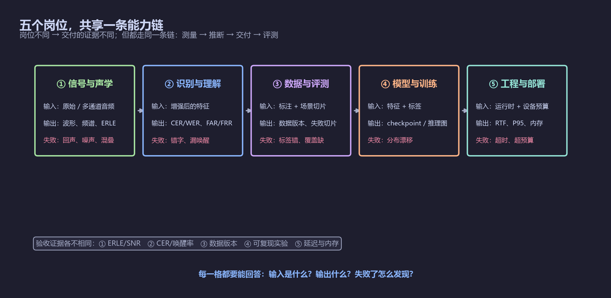

## 1.3 把要求改写成可验收任务

这里的 **checkpoint（训练检查点）**是保存下来的模型参数等训练状态；**FP32**是 32 位浮点数，**INT8**是 8 位整数。比较这两种数值格式，是在检查节省存储和计算后是否仍识别正确。**算子**是模型的一种基本运算，例如矩阵乘法；芯片支持某个模型，往往先取决于它是否支持模型用到的算子。

“熟悉 AEC”可以改写成：给定远端参考和近端麦克风，能够构造一段带时变回声的音频，说明双讲时为什么会失效，报告 ERLE、残余回声和语音损伤。“了解量化”可以改写成：把一个固定 checkpoint 导出为 ONNX，比较 FP32、动态 INT8 和静态 INT8 的内存、P95 延迟和 CER，并指出哪一层误差发生了变化。

这个改写动作还有一个好处：它会暴露岗位描述里没有写出的前置条件。要做说话人分离，先要有重叠语音或多通道数据；要做云端 Triton 优化，先要有固定请求形状、并发模型和测量起点；要做 NPU 算子优化，先要知道算子是否被编译器支持。

### 动手实验：岗位要求转验收表
建立一个四列表格：岗位名词、输入、输出、指标。先填“VAD、CTC、AEC、量化、Triton”五行，再为每行写一个失败样例。不要先写解决方案，先写“什么现象会证明它没有工作”。

## 1.4 作品集应该留下什么

一份能打动面试官的语音项目通常不靠模型名称取胜，而靠四类材料：固定输入和版本；可重复运行的脚本；按场景切片的指标；失败案例和下一步计划。把一段会议音频上传到某个 Demo 得到一份转写，只能证明你会调用接口，不能证明你理解系统。

如果项目有端侧部分，再加两张表：一张是内存和计算预算，一张是“模型输出时间”与“用户看到时间”的时间轴。把云端结果和设备结果放在同一份评测中，明确哪些差异来自模型，哪些来自音频前端或调度。

## 本章小结

- 阅读岗位要求时，要把名词还原成失败现象、输入输出和验收指标。
- 五类岗位共享同一能力链，但对时间、资源和输出的边界不同。
- 作品集的核心是可回放、可比较、可解释，而不是堆叠框架名称。

## 思考题

1. 把“熟悉 Kaldi/K2、WeNet、ESPnet、SpeechBrain 至少一种”改写成三条可观察的能力证据。
2. 为什么一个离线 CER 很低的系统，仍可能不适合“快速打断”的语音助手？
3. 如果岗位要求没有写测试集，你会如何判断项目是否真的完成？

---

# 第 2 章 声音的数字地基：从采样到 Fbank

模型不会直接听到“一个字”。它接收的是按时间排列的数字，通常来自麦克风、声卡或文件。只要采样率、通道交错、时间戳或归一化有一处含糊，后面所有模型都可能在错误的输入上表现得很有说服力。

## 2.1 采样、量化与时间锚点

**振幅**描述某一时刻信号的大小；**采样**是隔一小段固定时间记录一次振幅。Hz（赫兹）表示每秒多少次，kHz 是千赫兹，ms 是毫秒；因此 16 kHz 表示每秒采 16000 个点。**量化**把连续的振幅近似成有限的数字等级，16-bit 表示用 16 位二进制存一个样本。这是音频采样的量化，第 11 章还会讲模型参数的量化，两者处理的对象不同。

采样率回答“每秒记录多少个振幅”，位深回答“每个振幅用多少种离散等级表示”，通道数回答“同时记录多少条空间路径”。16 kHz、16-bit、单声道是三个独立坐标轴，不是一个模糊的音质等级。16 kHz 下 10 ms 有 160 个采样点；这个换算会贯穿 VAD、阵列同步、分块和端点检测。

双声道 PCM 往往交错存储为 L0、R0、L1、R1。按块处理时应该按“帧”切，而不是把一长串整数平均分成两半。多通道数据如果在入口被拍平，后面的 TDOA 和波束形成就失去通道身份，模型再大也救不回来。

**PCM（Pulse-Code Modulation，脉冲编码调制）**在这里指按采样顺序保存振幅的数字音频表示。L0、R0 是左右通道同一时刻的样本，L1、R1 是下一时刻的样本；这里一个 PCM 帧包含同一时刻各通道的样本，与后面包含一小段时间的“分析帧”不同。**WAV（Waveform Audio File Format，波形音频文件格式）**是文件容器，常装 PCM，还记录采样率和通道数等信息。**TDOA（Time Difference of Arrival，到达时间差）**比较同一个声音到达两支麦克风的先后差；**波束形成**则组合多个通道，让某些方向的声音更突出，第 4 章会详细解释。

采样还带来第一个边界：高于奈奎斯特频率的成分会折叠到低频。抗混叠低通滤波不是可有可无的“音质增强”，而是保证数字信号仍然对应原始物理信号的前提。

**奈奎斯特频率**等于采样率的一半，16 kHz 采样对应 8 kHz。**混叠**是采样后不同频率变得无法区分，例如理想条件下，16 kHz 采样会把一个 10 kHz 正弦波呈现为 6 kHz 的成分。**低通滤波**是让低频通过、压低高频；采样或降采样前先去掉过高频率，可以减少这种误认。

## 2.2 振幅、RMS、dBFS 与 SNR

**RMS（Root Mean Square，均方根）**是把一段样本先平方、求平均、再开平方，得到一个总体幅度；这样正负振幅不会互相抵消。**dB（decibel，分贝）**用对数表示比值；**dBFS（decibels relative to Full Scale，相对于数字满刻度的分贝值）**把数字系统可表示的最大幅度作为参照。**SNR（信噪比）**比较想保留的信号功率与噪声功率。**削波**则是振幅超过可表示范围，被截在上限或下限，波峰会变平。

峰值适合发现削波，RMS 适合描述一小段的能量，dBFS 把数字幅度放到满刻度坐标里，SNR 则比较信号和噪声的功率。它们回答不同问题：峰值告诉你有没有撞墙，RMS 告诉 VAD 这一帧有多响，SNR 告诉你增强前后相对难度是否变化。

$$\text{RMS} = \sqrt{\frac{1}{N}\sum_{n} x_n^2}$$

$$\text{dBFS} = 20 \log_{10}(\text{RMS})$$

$$\text{SNR} = 10 \log_{10}\left(\frac{P_{\text{signal}}}{P_{\text{noise}}}\right)$$

公式里，`x_n` 是第 n 个样本，`N` 是样本总数，`P_signal` 和 `P_noise` 分别是信号、噪声的平均功率。这里的 dBFS 公式假设幅度已按满刻度归一化到约 `[-1, 1]`，以满刻度幅度 1 为参考：RMS 为 0.5 时约为 -6 dBFS；信号功率是噪声的 10 倍时，SNR 为 10 dB。RMS 为 0 时不能直接取对数，程序需单独处理静音。RMS 只是幅度线索，不等同于人耳感到的响度，也不能单靠它确认有语音。

这些式子只在定义清楚时才有意义。RMS 的窗口长度、静音段是否参与、dBFS 的参考满刻度、噪声功率的估计区间都必须写进实验记录。把不同窗口和不同归一化规则下的数字直接比较，是音频项目里很常见的假改进。

## 2.3 为什么一张频谱不够

**时域**是按时间看振幅，例如录音波形；**频域**是按频率看组成，例如声音中 100 Hz、1000 Hz 的成分各有多强。**FFT（Fast Fourier Transform，快速傅里叶变换）**是快速计算离散傅里叶变换的算法，能把一段样本变成各频率成分的表示。每个频率成分既有幅度，也有**相位**：幅度表示这个成分有多强，相位表示它在周期中走到了哪一步。两个形状相同但出现时间不同的波，相位通常不同，这也是第 4 章估计时延的线索。

先把问题想简单一点：**一整段 FFT 像把一部电影的所有画面叠成一张海报**。你能看出电影里大概有什么颜色，却看不出“先发生了什么、后发生了什么”。

声音也一样。只看一整段 FFT 的幅度或功率谱，可以看出“这段录音里哪些频率较强”，却无法直接读出“这个频率是在开头出现，还是在结尾出现”。这里说的是常用的频谱图；完整的复数 FFT 结果还保存相位，可以逆变换恢复原序列，不能说 FFT 本身丢掉了全部时间信息。而语音恰恰靠先后顺序表达信息：爆破音很短，元音会持续，噪声可能只在某个瞬间出现。

所以我们把声音切成一小格一小格，加窗后每格单独做 FFT，再把结果按时间排起来，这就是**STFT（Short-Time Fourier Transform，短时傅里叶变换）**。读这里的 STFT 幅度或功率图时只记三件事：横轴是时间，纵轴是频率，颜色越亮表示对应成分越强。

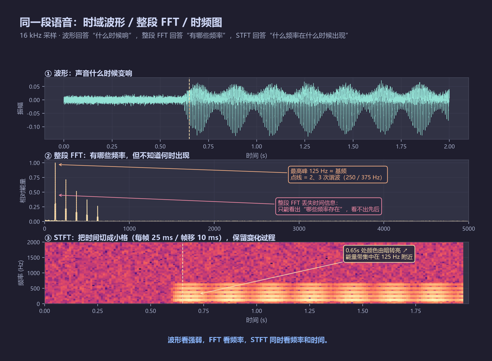

上图的波形适合看“声音什么时候变响、什么时候变安静”；下图的时频图适合看“哪些频率在什么时候出现”。两张图放在一起，才既看得到强弱，也看得到音高和变化过程。

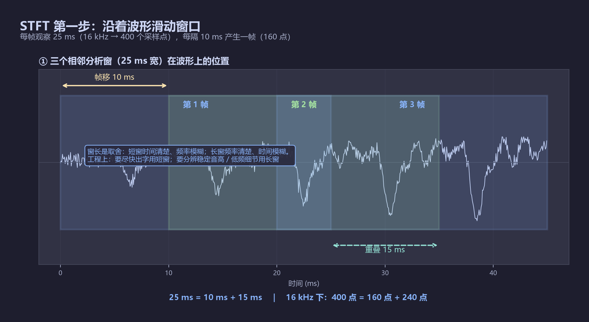

STFT 不是一次处理整段录音，而是让一个固定长度的窗口沿波形向前滑动。图中每帧观察 25 ms 的声音，每隔 10 ms 产生一帧，因此相邻两帧共享 15 ms。标准关系是 `重叠 = 帧长 - 帧移`，等价于 `帧长 = 帧移 + 重叠`。在 16 kHz 采样率下，25 ms、10 ms 和 15 ms 分别对应 400、160 和 240 个采样点。

窗长仍然是一种取舍：短窗像快速抓拍，能看清变化发生在什么时候，但频率看得没那么细；长窗像曝光更久，频率轮廓更清楚，却可能把一个很短的变化抹到前后多帧里。没有“永远正确”的窗长，只有针对任务的取舍。

工程上通常这样选：要判定语音是否开始、要尽快出字，偏向短窗；要分辨稳定音高或低频细节，可以用长窗。最后还要把窗长、hop（每次向前移动多少）、右侧上下文和调度时间一起算进延迟预算。这个边界很重要：**图上看起来更清楚，不代表系统会更快。**

## 2.4 Fbank、MFCC 与 CMVN

先把**特征**理解成“从原始声音里整理出、方便模型使用的一组数字”。一帧可能有几百个频谱数值；我们可以把附近频率分组，汇总每组能量，再让模型读取这些摘要。

**Mel**是一种近似描述人耳音高感知的频率刻度，低频区域分得较细，高频较粗；不是一个需要展开的英文缩写。**Fbank（Filter Bank，滤波器组特征）**把频谱通过一组覆盖不同频段的滤波器，得到每个频段的能量。语音识别中常用 **log Mel Fbank（取对数的 Mel 滤波器组能量）**，本文后续的 Fbank 主要指这种表示。比如 80 维 Fbank，就是一帧用 80 个频带数值表示，而不是 80 个音符。

**MFCC（Mel-Frequency Cepstral Coefficients，梅尔频率倒谱系数）**在 log Mel 能量上做 **DCT（Discrete Cosine Transform，离散余弦变换）**，再常常保留一部分系数。可以把 DCT 理解成把相邻频带的整体变化重新组合成一组摘要，使表示通常更紧凑、相关性更小。现代端到端模型常直接使用 log Mel/Fbank；MFCC 仍适合一些小模型和传统基线。

**CMVN（Cepstral Mean and Variance Normalization，倒谱均值方差归一化）**这个名称来自倒谱特征，也常用于 Fbank：逐维减去均值、除以标准差，使各维数值尺度更稳定。它调整的是特征数值，不是在波形上直接去除噪声；均值和标准差来自整句、训练集还是滑动窗口，也会影响是否适合流式处理。

$$m = 2595 \log_{10}\left(1 + \frac{f}{700}\right)$$

这里 `f` 是以 Hz 表示的频率，`m` 是转换后的 Mel 刻度；公式用于确定滤波器在频率轴上的布局，不是直接把声音变成文字。

预加重、中心补零、窗函数、滤波器数量和 CMVN 都会改变输入分布。岗位里写“熟悉 Fbank/MFCC、CMVN”，真正想知道的是你能否解释这些开关如何改变频谱、特征均值和模型稳定性，而不是能否背出函数名。

这些开关分别做什么？**预加重**是相对提高高频成分的一种滤波；**中心补零**是在信号边缘补样本，使分析帧能以给定时刻为中心，具体补零或其他填充方式取决于实现；**窗函数**让每帧两端逐渐变小，缓和硬截断造成的频谱扩散。这里的**输入分布**指模型实际看到的数值范围和统计规律。训练时开了某个处理，推理时忘了开，模型就可能收到不熟悉的输入。

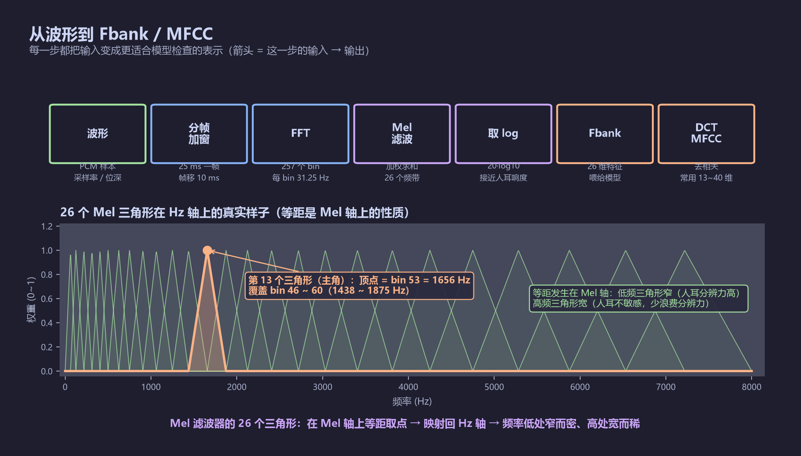

### 动手实验：固定一段音频做特征对照
先运行 `python_examples/01_wav_pcm_chunks.py` 和 `python_examples/02_fft_stft.py`，固定采样率、信号和 FFT 点数，只改变窗长。再运行 `python_examples/13_mel_fbank_mfcc.py`，一次只关闭中心补零或只换窗函数，记录差异从哪一步开始。

## 本章小结

- 音频入口必须明确采样率、通道交错、归一化和时间锚点。
- STFT 是时间和频率分辨率之间的工程取舍，不是一个固定参数。
- Fbank、MFCC 和 CMVN 的价值在于可解释的输入分布，而不是术语本身。

## 思考题

1. 为什么把双声道 PCM 随意拍平会让阵列算法失效？
2. 如果两个实验的 dBFS 不同，哪些额外信息能让它们仍可比较？
3. 窗长从 20 ms 改成 80 ms 时，实时 ASR 的哪几个延迟项会一起变化？

---

# 第 3 章 3A 前端：回声、噪声、增益与判停

**音频前端**指声音进入识别模型之前的处理。这里的 3A 通常是 AEC、ANS、AGC；VAD 常和它们一起使用，但不算其中一个 A。先分清：**回声**是扬声器播放的内容又被麦克风收到；**噪声**是当前任务不想要的声音，例如风扇声；**混响**是声音经墙面等多次反射、到达时间错开后形成的拖尾。三者可能同时存在，却不该用同一个处理来概括。

全双工语音交互最容易让人误判：麦克风录到的不是“用户声音”，而是用户声音、扬声器回放、房间反射、风扇和设备自身噪声的混合。AEC、ANS、AGC 和 VAD 不是四个可随意排列的按钮，它们共同决定 ASR 看到的证据，以及系统什么时候敢打断或结束一次交互。

## 3.1 AEC 先问“回声从哪里来”

Acoustic Echo Cancellation（声学回声消除）。回声消除需要两条输入：扬声器播放的参考信号，以及麦克风采到的近端信号。算法估计一个随时间变化的回声路径，再从麦克风信号中减去预测的回声。设备移动、音量变化、扬声器非线性和双讲都会让路径估计失配，因此“开了 AEC”不等于回声已经消失。

例如音箱正在播“今天晴”，你同时说“停一下”。麦克风会同时录到这两句话；AEC 利用已知的“今天晴”播放信号，估计它经过扬声器、空气和房间反射后变成什么样，再尽量减掉它，留下你的话。**远端参考**在这里就是准备播放或已经送往播放链的信号，不一定来自远处的人；**近端**指本机麦克风这一侧；**双讲**指本地用户讲话和播放声同时存在。

**回声路径**描述播放信号如何经过延迟、衰减和多次反射到达麦克风；算法通常用会持续调整参数的**自适应滤波器**来近似它。**非线性**表示播放音量变大时，输出不只是同比例变大，还可能产生失真；**失配**表示算法当前估计和真实路径对不上。双讲时如果把用户的话也当成回声学习，就可能误消掉用户声音。

工程上常用 ERLE 观察回声路径是否被压低，但它只是诊断量，不能代替近端语音损伤、双讲保持和主观听感。一个只让 ERLE 变大的算法，可能把用户的高频辅音也一起削掉。

$$\text{ERLE} = 10 \log_{10}\left(\frac{P_{\text{echo}}}{P_{\text{residual}}}\right)$$

ERLE 的全称是 **Echo Return Loss Enhancement（回声返回损耗增强）**。`P_echo` 是处理前的回声功率，`P_residual` 是处理后剩余回声的功率；剩余功率降到原来的 1/100，ERLE 就是 20 dB。真实混音里不能直接把“包含用户语音的输出功率”当剩余回声功率；通常在只有播放声的区间评估，或用可分离参考的受控实验。**残余回声**就是没消干净的回放声。

WebRTC 的 Audio Processing Module 把 AEC、噪声抑制和自动增益控制作为语音增强效果的典型组成，并允许作为完整通话管线的一部分或独立模块使用。官方文档没有替你的设备定义最佳参数；采样率、通道数、声学结构和线程调度仍需实测。

**WebRTC（Web Real-Time Communication，网页实时通信）**是支持实时音视频通信的一套技术和开源实现；**APM（Audio Processing Module，音频处理模块）**是其中负责这些音频处理的模块。

## 3.2 ANS 与 AGC 的边界

Noise Suppression（噪声抑制/降噪）。ANS 的目标是降低非语音噪声，不是把所有频谱都“磨平”。稳定的风扇声、突发键盘声、混响尾巴和另一个人的语音并不是同一种噪声，单一强度旋钮无法同时处理它们。评测至少要拆成语音保真、残余噪声和下游识别三组指标。

**NS**是 Noise Suppression 的缩写；**ANS**常写作 Automatic Noise Suppression（自动噪声抑制），也有项目使用其他展开方式，应以项目定义为准。与 AEC 的关键区别是：降噪通常没有一条完整、已知的“风扇参考录音”可减，必须从混合声音中估计哪些部分属于噪声。**语音保真**就是处理后是否仍保留原来的发音细节。

Automatic Gain Control（自动增益控制）。AGC 调整信号幅度，避免输入过小，并减少后续放大造成的削波。它会改变 RMS、VAD 的判定结果和模型输入分布，所以应该在固定的增益策略下比较 ASR，而不是每次实验手动把音频调到“听起来差不多”。已经在采集阶段发生的削波，不能靠后续调小增益撤销。

**增益**就是把信号放大或缩小的倍数。离麦克风远时声音小，AGC 可以适当放大；突然大声说话时则压低增益。但把信号放大两倍，也会把其中的噪声一起放大，所以 AGC 不是降噪算法。对已经削波的波形，算法最多估计可能的原形，不能保证还原已丢失的真实样本。

## 3.3 VAD、判停与快速打断

Voice Activity Detection（语音活动检测）。VAD 在问“这一帧像不像语音”，endpoint 在问“这一轮话是否可以结束”。两者不是同一个分类器。短暂静音、呼吸、犹豫词、远场衰减和双讲都会让“无语音”与“句子结束”混淆。语音助手的快速打断还要同时监听唤醒词、用户语音和系统播报，必须给每条状态规定优先级和回退条件。

**endpoint（端点检测或判停）**综合静音持续时间、识别结果等判断一轮发言是否结束。比如“帮我订……明天的票”中间停顿了 300 ms，VAD 可以把这段标成无语音，但判停模块不一定应该提交整句。**阈值**就是触发决策的分界，例如语音分数超过 0.6 才算有语音；这个数要用数据调，不能当成通用推荐。**KWS（Keyword Spotting，关键词检测）**则判断有没有出现“你好小助手”等目标词，不是检测任意讲话。

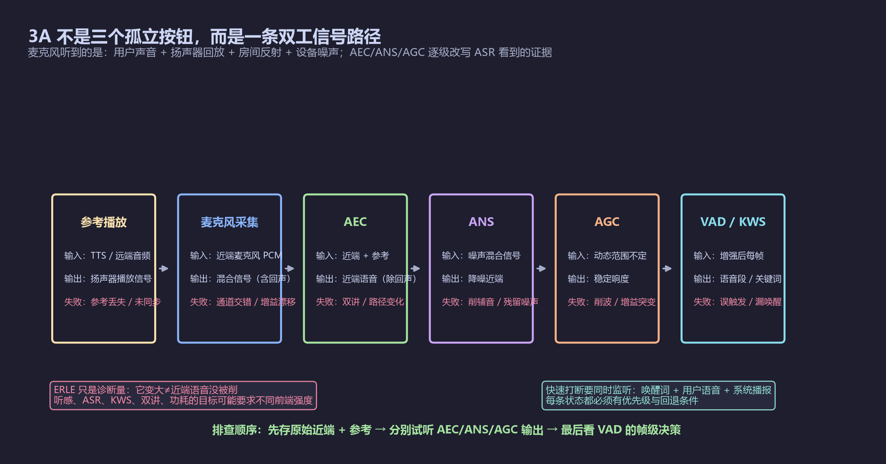

一个实用的排查顺序是：先保存原始近端和参考信号，再分别试听 AEC 输出、ANS 输出、AGC 输出，最后看 VAD 的帧级决策。只看最终转写，很难知道是回声残留、噪声抑制过强，还是判停提前切断了尾音。

:::warn 常见误区
把“更干净”当成“CER 一定更低”。增强的目标要写清楚：是听感、ASR、KWS、通话双讲，还是功耗和延迟。不同目标可能要求不同的前端强度。

### 动手实验：做一段可控的回声与噪声
生成一段近端语音和一个延迟、衰减后的参考信号，把两者相加。分别改变回声延迟、回声增益和噪声类型，记录波形、SNR、VAD 段数和 ASR 输出。不要把 AEC 的诊断数字直接当成识别质量。

## 本章小结

- AEC 需要参考信号，ANS 处理噪声，AGC 控制幅度，VAD/endpoint 负责状态边界。
- ERLE、SNR、听感和 CER 观察的是不同层次，不能用一个数字代表全部。
- 全双工系统的核心难点是双讲、回声路径变化和判停优先级。

## 思考题

1. 为什么双讲时 AEC 更容易失效？你会记录哪些中间信号来证明原因？
2. AGC 放在 ANS 前后会影响哪些指标？如何设计 A/B 实验？
3. 如何区分“模型没听到尾音”和“endpoint 提前结束”？

---

# 第 4 章 麦克风阵列、方向与分离

阵列算法把“不同麦克风听到同一个声源的时间和相位略有不同”变成可利用的空间证据。它能帮助系统抑制某个方向的噪声、估计声源到达方向、把多个说话人分开一些，但不能凭空创造新的物理观测，也不能单独告诉你一个人的真实姓名或距离。

## 4.1 先确认通道真的独立

一支麦克风对应一个**阵元**，一条独立录音数据对应一个**通道**。两支麦克风相隔 10 cm 时，来自侧面的声音通常先到其中一支，再到另一支；这点先后差就是空间线索。如果两路各自的采样时钟不一致，设备造成的错位会混进真实传播时差，所以必须先确认同步。

阵列的第一项工作不是跑 GCC-PHAT，而是检查设备。多个通道必须同步、时间戳可对齐、增益和极性可解释。把一路 PCM 复制到八路容器里，通道数会变大，空间自由度却不会增加；采样率从 8 kHz 重采样到 16 kHz，也不会产生新的空间信息。

这里的 **GCC-PHAT**是下一节要讲的“两路声音时差估计算法”，先不必背名字。**极性**是波形正负方向，某路接线或处理反相会让波峰变波谷；**重采样**是把已有数字音频换成另一采样率；**空间自由度**在这里指不同物理位置提供的独立观测能力。复制数据只增加文件里的列数，没有增加观察位置。

阵元间距决定可观测的空间频率范围。一个常用的简化上界是：当信号频率超过由声速和阵元间距决定的范围时，空间混叠会让多个方向产生相似的相位差。它是设计检查的起点，不是对真实房间和宽带语音的完整保证。

$$f < \frac{c}{2d}$$

`f` 是声音频率，`c` 是声速，室温空气中可近似取 343 m/s；`d` 是相邻阵元间距。若 `d = 0.1 m`，这个简化界限约为 1715 Hz。**空间混叠**是不同来向产生了难以区分的阵列采样结果，类似“两个方向给出了同一个线索”。这个界限针对简化的空间采样条件，不表示超过它的整段语音必然无法定位。

远场假设也有边界。声源足够远时，波前可近似为平面；近场声源需要考虑曲率。Fraunhofer 条件常用来估计“多远才可以这样近似”，但阵列尺寸、频率和房间反射会让实际有效范围不同。

$$r > \frac{2D^2}{\lambda}$$

**波前**是同一传播阶段的点组成的面；近处声源的波前有明显弯曲，远处看起来近似平面。这里 `r` 是声源到阵列的距离，`D` 是整个阵列的尺寸，`λ`（lambda）是波长，即一个振动周期在空间里走过的距离，`λ = c/f`。**Fraunhofer（夫琅禾费）条件**是估计这种远场近似何时合理的一种尺度判断；可以先记住“阵列越大、频率越高，通常要离得更远才能近似平面波”。

## 4.2 GCC-PHAT、DOA 与波束形成

### 第一步：TDOA 问“哪支麦克风先听到，差多久”

**TDOA（Time Difference of Arrival，到达时间差）**是一种要估计的物理量，不是算法名字。输入是两支同步麦克风的录音，输出是同一声音到达它们的时间差，例如“第 2 路比第 1 路晚 0.125 ms”。

沿用间距 10 cm 的两支麦克风：在 16 kHz 采样下，一个采样间隔是 0.0625 ms，晚 2 个采样点就是 0.125 ms。声音这段时间多走了约 `343 × 0.000125 = 0.043 m`，即 4.3 cm。这是**两条传播路径的长度差**，不是说话人离麦克风只有 4.3 cm。

### 第二步：GCC-PHAT 是估计这个时间差的一种方法

**GCC-PHAT（Generalized Cross-Correlation with Phase Transform，带相位变换加权的广义互相关）**用两路录音来估计 TDOA。先理解**互相关**：把一路波形相对另一路向前、向后挪，每挪一次算两路有多像；最相似的位置就是候选时差。比如第 2 路晚了 2 个点，把它向前挪 2 个点后更像第 1 路，就找到了一个时差线索。

名字中的 GCC 指广义互相关，PHAT 指一种频域加权。**“在频域中保留相位关系”**可以拆成下面几步：

1. 对两路短音频分别做 FFT，得到各频率的幅度和相位。
2. 计算两路的互功率谱，即把一路频谱乘以另一路频谱的复共轭；这里先把它理解为记录两路在各频率上的相对关系。
3. 用互功率谱除以它的幅度，减少“哪个频率特别响”对结果的支配，主要保留两路的相位差。幅度接近零时要加很小的保护值，避免除零或数值不稳定。
4. 做逆 FFT，也就是从频域回到各个候选时差的得分；找到相关峰值，把对应位移换成秒。

为什么相位差能帮忙？同一个声音晚到一些时，各频率成分的周期位置会相应错开；组合多个频率的线索，就能寻找一个共同解释它们的时延。PHAT 不是“消除一切噪声”：弱信号频段的噪声也可能被放大，反射声或单一频率的声音还可能制造多个峰。

### 第三步：DOA 问“声音大概从哪个方向来”

**DOA（Direction of Arrival，到达方向）**描述声音相对阵列坐标系的来向，例如“相对阵列正前方偏右约 25°”。它是估计目标或结果，不是与 GCC-PHAT 并列的某个固定算法。把 TDOA 和麦克风的位置、间距、声速结合起来，就可以在一定假设下估计 DOA。

以两支麦克风水平排列、声源在远场为例，规定 0° 为阵列正前方，并令朝右的角度与正时差对应，则有 `τ = d × sin(θ) / c`。其中 `τ` 是按此约定定义的到达时差，`θ` 是方向角。刚才的例子得到 `sin(θ) ≈ 0.043/0.1 = 0.43`，所以约为 25°。交换通道顺序会改变时差符号；角度的正负必须跟坐标约定一起解释。

两支麦克风通常**不能唯一确定三维位置**：多个位置甚至前后不同来向可能产生同一时差。更多阵元与合适布局能减少歧义，但 DOA 本身仍不等于距离，也不等于真实身份。

### 第四步：SRP-PHAT 让多对麦克风一起给方向打分

**SRP-PHAT（Steered Response Power with Phase Transform，带相位变换加权的可控响应功率）**是一类扫描候选方向或位置的定位方法。Steered 表示朝某个候选方向对准，Response Power 表示对这个候选计算响应得分，PHAT 是前面讲的相位加权。

假设有 4 支麦克风，可以组成 6 对。算法试一个方向，例如 25°：根据阵列几何算出声音从这个方向来时，每一对应该相差多久，再读取各对 PHAT 加权互相关在这些时差处的得分，并把它们汇总。对 0°、5°、10° 等候选重复计算，得分最高的方向就是当前候选 DOA。网格间隔是速度和精细程度的取舍，5° 只是示例，不是标准参数。

所以“多个通道可以合并成 SRP-PHAT”更准确的意思是：**利用多对通道的相关信息，按每个候选方向预测的时差联合打分**，不是直接平均各对的时差，也不是把几个方向角随意相加。

### 第五步：为什么方向不能代替声纹

**方向轨迹**是把连续短时间窗的 DOA 按时间连起来。一个人从左走到右，方向本来就会变；即使人没动，遮挡、混响反射或另一个人插话也可能让算法选到不同的峰。前者是真实移动，后者可能是估计误差，不能都解释成“换了一个人”。

**声纹**是用声音中与说话人有关的特征建立的统计表示；**声纹注册**是先保存已知人的语音特征，供后续比较。例如“刚才左边那段话与现在右边这段话是否像同一个人的声音”。**辅助关联**就是把方向、时间连续性等当作补充线索。两个人换座位后，位置变了但身份没变；因此 DOA 只能辅助关联，不能独立替代声纹注册或其他身份凭据。

### 第六步：波束形成把“找方向”变成“突出这个方向的声音”

**波束形成（beamforming）**组合多路录音，使目标方向的声音相对更突出。**Delay-and-Sum（延时求和）**是最基本的方法之一：按选定方向应有的时差对齐各路声音，再加权相加。输出是一条新音频，不是一个角度。它可以使用估计的 DOA，也可以直接使用预设方向。

例如第 2 路中的目标语音晚了 2 个点，可把第 1 路延迟 2 个点与它对齐，再求平均；实时实现通常通过延迟和缓存来对齐，而不能读取尚未到达的未来音频。目标波形的波峰对上波峰，就是**相干叠加**；其他方向未必对齐，因而目标相对更突出，但不保证其他声音全部消失。**导向角（steering angle）**就是想对准的方向。导向角错了，可能连目标语音也被削弱。

一个最小模型可以写成：

$$y(t) = \sum_{m=1}^{M} w_m \, x_m(t - \tau_m)$$

`M` 是麦克风数量，`x_m` 是第 m 路录音，`τ_m` 是用于对齐的延迟，`w_m` 是该路权重，`y` 是输出。`Σ` 表示把各路相加；最简单的平均可令每路权重为 `1/M`。实现中的延迟符号和共同缓冲量要与坐标、通道顺序保持一致。

| 概念 | 输入 | 输出 | 回答的问题 |
| --- | --- | --- | --- |
| GCC-PHAT | 两路同步音频 | 时差估计及相关得分 | 两路相差多久？ |
| TDOA | 同一声音在两路中的到达时刻 | 一个时间差 | 先后差这个量是什么？ |
| DOA 估计 | 时差或空间特征、阵列几何 | 方向角 | 声音从哪里来？ |
| SRP-PHAT | 多路音频、阵列几何、候选方向或位置 | 扫描得分与定位结果 | 哪个候选最符合多对通道的证据？ |
| Delay-and-Sum | 多路音频、目标方向或延迟 | 一路合成音频 | 怎样突出目标方向的声音？ |

**到这里先检查自己：**GCC-PHAT 得到“晚了 2 个点”，这不是人名；用几何关系换成“约 25°”，这不是距离；再用这个方向合成一路音频，才是波束形成。三步分别产生时差、方向和音频，不能互相替代。

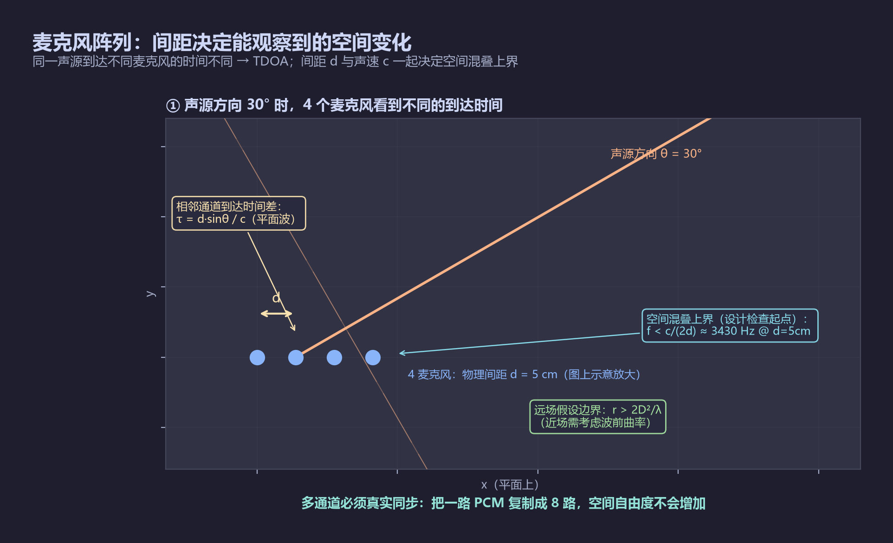

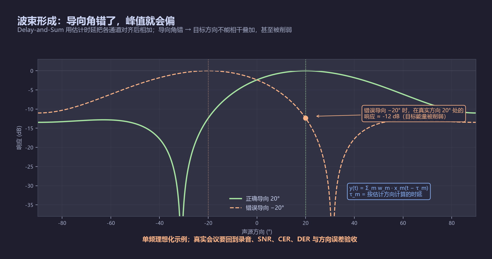

图里的方向响应是理想化的单频示例。真实会议里有宽带语音、混响、阵列误差和多个声源，所以波束形成的验收应该回到录音、SNR、CER、DER 和方向误差，而不是只看一条漂亮的极坐标曲线。

## 4.3 分离不是“把人名分出来”

例如甲、乙同时说话：**语音分离（speech separation）**想得到“只含甲”和“只含乙”的两条波形；**说话人分段（speaker diarization，也常称说话人日志）**想得到“0-2 秒甲、2-4 秒乙”的时间表，重叠时可同时标两个人；**说话人识别（speaker identification）**在有候选身份资料时判断“这一段更可能属于谁”。本书的“分段”不只是检测切换点，还包括把属于同一个人的片段归到同一匿名标签下。

语音分离关注“把混合信号拆成几个源”，说话人分段关注“谁在何时说话”，说话人识别关注“这个人叫什么”。三者可以组合，但证据和标签不同。没有注册声纹时，系统最多可靠地给出匿名标签；有视觉、座位或签到信息时，才可能做跨模态映射。

阵列输出也可能被下游模型误用：一个虚拟波束不是一个新的物理麦克风，一个方向峰值不是一张房间地图。文档中要明确写出哪些结论来自独立同步通道，哪些只是模型生成的中间表示。

### 动手实验：交换通道，观察方向是否反转
运行 `python_examples/09_gcc_phat_doa.py`，记录估计时延和方向角。只交换 channel_0 与 channel_1，检查符号是否反转；再运行 `python_examples/10_delay_sum_beamforming.py`，只改变 steering 角度，比较输出 SNR 和下游 CER/DER。

## 本章小结

- 阵列能力首先取决于真实、同步、独立的物理通道。
- GCC-PHAT 和波束形成提供空间证据，但 DOA 不是身份或距离。
- 分离、分段、识别是不同任务，不能用一个标签或一个指标混在一起。

## 思考题

1. 八路完全相同的 PCM 还能支持哪些空间结论？哪些结论不可信？
2. 为什么近场说话人会让平面波假设失效？
3. 阵列输出 CER 变好但 DER 变坏，可能有哪些原因？

---

# 第 5 章 DNN-HMM 与 WFST：经典路线仍在教你解码

先认识名字：**DNN（Deep Neural Network，深度神经网络）**是具有多层计算结构的神经网络；**GMM（Gaussian Mixture Model，高斯混合模型）**用多个钟形概率分布的组合描述数据；**HMM（Hidden Markov Model，隐马尔可夫模型）**描述看不见的状态如何沿时间变化。DNN-HMM、GMM-HMM 中的连字符表示两种模型分工合作。**WFST（Weighted Finite-State Transducer，加权有限状态转换器）**把发音、词和分数组成可搜索的图。

**声学模型**根据声音给发音候选打分；**词典**描述一个词有哪些发音；**语言模型**根据文字上下文给词序列打分。例如听到“shi jie”时，声音可能支持多个同音词，词典给出候选，上下文帮助区分“世界”和“时节”。**解码**就是把这些分数和约束结合起来选文字，不是把一个确定答案从音频文件里读出来。

端到端模型很容易成为第一印象，但岗位要求仍然反复出现 GMM-HMM、DNN-HMM、语言模型和 WFST。原因不是旧方法永远优于新方法，而是经典路线把“声学证据、词典约束、语言先验和搜索代价”拆开了，特别适合学习一个识别系统为什么会错。

## 5.1 HMM 解决的是时间结构

**音素**是区分发音的基本单位，例如不同的辅音、元音；**子词**是文本切分单位，可以是一个字或一个词的一部分，二者不是同一层面的概念。**隐状态**是模型假设正在发生、但无法直接从录音读出的状态，例如某个音素的开始或中间阶段；**观测**则是实际得到的每帧声学特征。

**转移概率**表示从一个状态走到下一个状态的可能性，例如继续当前发音或进入下一个发音；**发射概率**表示“如果处于这个状态，出现眼前特征的可能性”。**先验**是不看当前声音时某状态本来有多常见，**后验**是结合当前声音后对状态的判断。例如“看到这一帧后，它属于某个发音状态的概率”是后验，不能直接当成“该状态生成这一帧的概率”。HMM 的简化假设是：下一状态主要由当前状态决定，当前观测的分布由当前状态决定。

HMM 用隐状态描述音素或子词的演化，用转移概率表达“通常如何从一个状态走到另一个状态”，用发射概率表达当前帧像哪个状态。GMM 可以估计发射分布；DNN 则把每帧特征映射到状态后验，再结合先验得到用于解码的分数。

生活化地说，模型不是直接听出一句话，而是在一条时间轴上不断排除“不可能的走法”。这个比喻的边界是：真实的 HMM 状态、上下文相关音素和发射概率都有明确的统计定义，不能把它简化成“每帧选一个字”。

## 5.2 WFST 把约束放进搜索图

**有限状态**可以想成一张由有限个节点组成的路线图；**弧**是连接两个节点的有向边。转换器的弧带有输入符号和输出符号，例如把发音单位映射到文字；**加权**表示走这条边有分数或代价。解码器根据音频分数和图上的约束搜索路线，路线上的输出符号连起来成为候选文本。实现中若存的是负对数概率，就寻找代价较低的路线；若存的是分数，就寻找较高的路线，两种约定不要混用。

词典把音素序列映射到词，语言模型给词序列打分，发音和上下文相关的转换把这些关系组合成一个加权有限状态图。解码器在图上寻找总分较高的路径。这样做的工程价值是可解释：当识别错了，可以分别检查声学分数、词典、语言模型和 beam pruning。

WFST 不是“把所有可能句子列出来”。状态和弧的组织方式决定搜索复杂度，beam 太窄会丢掉正确路径，太宽会让延迟和内存增长。词表、热词和领域语言模型的变化也会改变图的大小和行为。

**beam search（束搜索）**是一边扩展候选、一边保留较好部分的搜索方法；**beam pruning（束剪枝）**是丢掉落后太多的候选。beam 在不同实现中可能表示分数差阈值，也可能表示保留的候选数，应查具体接口。**n-best**是得分靠前的 n 条候选结果，例如前 5 句；**热词**是希望特别关注的词，如产品名；**领域语言模型**是更熟悉医疗、会议等特定文本的语言模型。把词设为热词只是调整候选偏好，不保证音频里真的说了它。

## 5.3 为什么工程团队仍需要这条路线

第一，它能把语言模型和领域词典作为可替换组件，适合需要热词、专名和强约束的业务。第二，它能提供解码轨迹，帮助建立错误分析工具。第三，许多历史系统、车载设备和嵌入式栈仍以它为基线，理解它有助于和现有工程团队协作。

但经典路线也有边界：声学和语言模块之间的接口会限制联合优化；复杂的图编译和版本管理容易成为维护负担；面对多语种、口音和开放领域，显式词典不一定是最省事的表示。学习它的目的不是回到过去，而是获得一套能拆问题的坐标系。

### 动手实验：把一个错误拆成四层
拿一条错误转写，分别问：声学上是否听错？词典是否没有这个读法？语言模型是否偏爱了另一个词？beam 是否把正确路径剪掉？先写假设，再用 n-best、对齐或替换词典做一次小规模验证。

## 本章小结

- HMM 提供时间结构，DNN 改善发射分数，WFST 组织词典和语言约束。
- 解码器的 beam、词表和语言模型会直接改变延迟、内存和错误类型。
- 经典系统最重要的教学价值是可拆解、可追踪、可替换。

## 思考题

1. 为什么同一声学模型换一个领域语言模型后，CER 可能明显变化？
2. 如果 beam 变大，准确率和延迟分别可能怎样变化？如何实测？
3. 在一个开放词汇的多语种系统中，你会保留哪些显式约束？为什么？

---

# 第 6 章 CTC、AED、RNN-T 与 Conformer：端到端不是一种模型

**端到端（End-to-End，E2E）**在这里指把从声学输入到文本的主要环节放进一个可训练的系统。**对齐**是找到声音与文字的对应关系：例如一秒音频可能有 100 帧特征，却只说了三个字，哪些帧对应哪个字？**标签**是训练时的参考答案；只有整句文字时，模型需要自己处理这种长短不一致。

| 名称 | 英文全称或名称来源 | 先抓住的作用 |
| --- | --- | --- |
| CTC | Connectionist Temporal Classification，连接时序分类 | 把多种帧到文字的对应路径合起来训练 |
| AED | Attention-based Encoder-Decoder，基于注意力的编码器－解码器 | 根据声音表示和已有文字逐个预测后续符号 |
| RNN-T | Recurrent Neural Network Transducer，循环神经网络转换器 | 在音频向前推进和输出符号之间作选择 |
| Conformer | Convolution-augmented Transformer，卷积增强的 Transformer | 构建理解音频特征的网络结构，可与 CTC、RNN-T 等组合 |

前三项主要涉及输出和训练方式，Conformer 主要涉及网络结构，所以“用 Conformer 编码器训练 CTC 模型”完全成立。

端到端 ASR 把特征到文本的更多环节放进一个可训练系统，但“端到端”只描述训练边界，不描述对齐方式、历史依赖或流式能力。CTC、AED、RNN-T 和 Conformer 常被放在同一张表里比较，真正需要先问的是：模型如何知道一段帧对应哪些输出？输出时能看到多少未来？错误如何被解码器修订？

## 6.1 CTC 用路径求和隐藏对齐

**blank（空白符）**表示“这个输出位置暂时不产生文字”，它不等于空格，也不等于静音：有人说话的帧也可能输出 blank。**路径**是一连串帧级输出；**坍缩**是把这条长路径变成短文本的规则。

CTC 在标签表中加入 blank，允许模型在每一帧输出 blank 或字符。连续重复先合并，再去掉 blank，多条帧级路径可以坍缩成同一文本。训练时不需要逐帧标签，而是把所有能坍缩到目标文本的路径概率求和。

用 `_` 表示 blank：路径 `你 你 _ 好 好` 先合并成 `你 _ 好`，再去掉 `_` 得到“你好”；路径 `_ 你 _ 好 _` 也得到“你好”。若真的要输出“哈哈”，中间需要 blank 把两个相同标签隔开，例如 `哈 _ 哈`。规则顺序很重要，先去 blank 再合并会误删真实重复字。

$$P(y|x) = \sum_{\pi \in B^{-1}(y)}\ \prod_{t} P(\pi_t | x)$$

这条公式读成一句话：给定音频 `x`，目标文本 `y` 的概率，等于所有能坍缩为 `y` 的合法路径概率之和。`π`（pi）是一条路径，`B` 是坍缩操作，`B⁻¹(y)` 表示所有能得到 `y` 的路径；`∏` 把一条路径上各时刻的概率相乘，`Σ` 再把不同路径相加。训练时只需要知道“这句是你好”，不需要人工指定“你”从第几帧开始。

这个机制让 CTC 的解码相对直接，也让它很适合做流式基线；代价是条件独立假设限制了帧间文本历史，语言模型或更复杂的解码器常被用来补足它。CTC 的尖峰并不等于真实词边界，时间戳仍需单独验证。

**条件独立假设**在这里是：给定编码后的输入后，路径概率按各时刻输出概率相乘，CTC 输出层没有像 AED 那样显式依赖之前生成的文本。编码器本身仍能利用音频上下文。**尖峰**指某个字的高概率集中在少量帧上。CTC 是否真能流式，还取决于编码器是否要看未来音频，不能只凭训练方法判断。

## 6.2 AED 用注意力建模文本历史

**编码器（encoder）**把输入音频特征变成更适合识别的内部表示；**解码器（decoder）**利用这些表示生成文字。**注意力（attention）**给不同输入位置分配权重，让当前输出更关注相关部分；**自回归（autoregressive）**表示生成下一个符号时依赖之前已经生成的符号。例如先生成“今”，再结合声音和“今”预测“天”。模型处理的 **token（符号单元）**可能是字、子词或特殊符号，不必总是一个汉字。

AED 先把整段输入编码成表示，再由自回归解码器按历史输出下一个符号。它可以利用更丰富的文本上下文，生成质量常常很好，但需要等待更多右侧音频，天然流式化更困难。一个抽象的条件概率是：

$$P(y_i \mid y_1, \dots, y_{i-1}, H)$$

`H` 是编码器输出的音频表示，`y_i` 是第 i 个输出符号，竖线右边表示“在这些条件已知的情况下”。这项概率就是“听到这些音频、已经写出前面的字后，下一个字是什么”。上面描述的是常见离线 AED；也有专门限制注意力范围的流式变体，不能把“先看完整段”当成所有 AED 的定义。

注意力不是“自动看全局就没有延迟”。当系统限制右上下文、使用 chunk 或双遍策略时，注意力范围和修订机制都必须写出来。否则论文里的离线结果不能直接当成实时产品承诺。

## 6.3 RNN-T 与 Conformer 的工程位置

先看 **RNN-T** 的两个推进方向：输出 blank 时推进音频位置，输出一个文字 token 时更新文字历史，在典型定义中音频位置暂时不变。**单调**表示沿时间向前走，不退回过去的音频位置重新走路径；一个音频位置可以产生多个 token。其核心通常分成音频编码器、处理已输出文字的预测网络、把两者合起来给下一步打分的联合网络。名称来自早期循环神经网络，但现代实现的编码器也可以用 Conformer。

再看网络结构：**Transformer**通过注意力让序列中的位置交换信息，名字通常不翻译；**卷积（convolution）**在这里像一个沿时间滑动的小探测器，捕捉相邻帧里的短时模式。**Conformer**把两者结合：卷积看局部声音细节，注意力联系较远的上下文。所谓“全局交互”描述不受限制时的能力；实际流式模型会限制它可看的范围。

RNN-T 在声学时间和标签历史的二维网格上单调前进，适合边听边输出，但训练、缓存、beam search 和空白处理的实现复杂度更高。Conformer 把 Transformer 的全局交互与卷积的局部模式结合起来，论文在 LibriSpeech 上报告了很强的结果；这证明了架构的潜力，不证明任意中文远场设备都能复现同样的数字。

WeNet 的论文把生产导向写得很直接：通过动态 chunk 注意力和两遍解码，在一个框架里统一流式与非流式，并用 chunk 大小控制推理延迟。这个例子说明“模型选择”本身就是产品接口：右上下文、缓存和重打分策略会改变用户看到的结果。

**缓存（cache）**保存已经算过、下一块仍会用到的信息，避免每来一块声音都从头计算。**动态 chunk 注意力**在训练中使用变化的音频块设置，让模型学习在不同可见范围下工作。**重打分（rescoring）**是对第一遍保留下来的候选再次评分，例如利用更完整上下文从多个同音词候选中重新选择；正确结果若没进入候选集，单纯重打分也无法把它选出来。

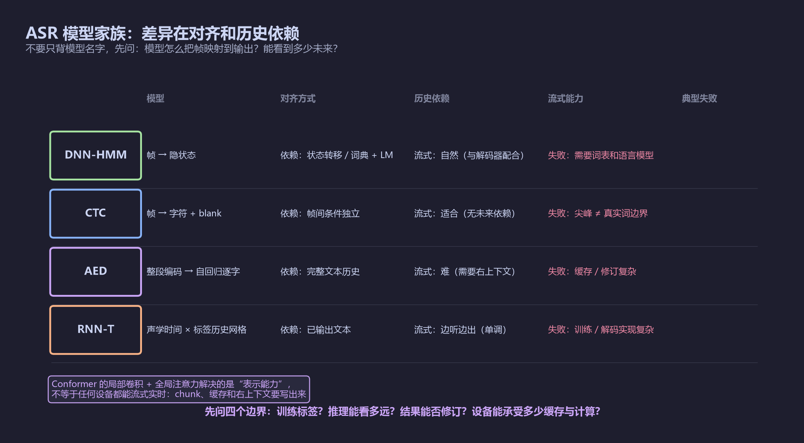

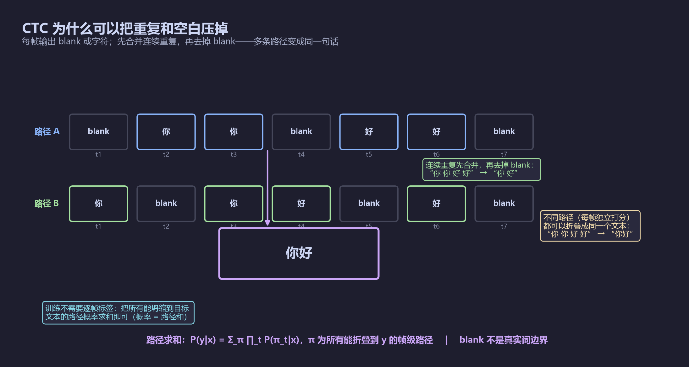

:::key 核心判断
不要问“哪个模型最先进”，先问四个边界：训练标签需要什么、推理能看多远、结果能否修订、目标设备能承受多少缓存和计算。四个答案比模型名更能决定系统形状。

### 动手实验：观察路径和延迟的取舍
运行 `python_examples/14_ctc_alignment.py`，记录合法路径数和 blank 概率变化。再用一个固定音频，把离线整段推理改成固定 chunk，记录首字、句尾和最终文本变化。不要只比较最终一句话。

## 本章小结

- CTC、AED、RNN-T 的核心差异在对齐和文本历史依赖，不在“是否端到端”四个字。
- Conformer 的局部卷积和全局注意力解决的是表示能力问题，流式仍需要额外的缓存和右上下文设计。
- 论文结果必须经过数据、设备、解码和指标边界的重新验证。

## 思考题

1. 为什么 CTC 的 blank 让训练不需要逐帧对齐？
2. 如果 AED 的离线 CER 更好，什么场景仍可能选择 RNN-T？
3. chunk 变大时，准确率、缓存、首字延迟和句尾延迟可能怎样联动？

---

# 第 7 章 流式识别：结果一边出来，一边被修订

“实时”不是把离线模型每 20 ms 调一次。真实流式系统必须在不知道未来的情况下做决定，还要允许后来的音频推翻早先的猜测。它同时面对三个用户边界：首字什么时候出现，句子什么时候定稿，会后重算什么时候覆盖临时结果。

## 7.1 三种结果和一条时间轴

先把这些接口名当作状态标签：**partial（临时结果）**还可以改，**final（某阶段定稿）**表示约定音频段已提交，**text final（文本最终版）**在本文指标点、说话人等后处理后的版本。它们不是所有工具统一采用的标准名称，接入时要确认含义。**revision（修订号）**记录更新了几次，例如同一片段从第 1 版“明天见”修订为第 2 版“明天见面”。

partial 是当前窗口下的暂时猜测，final 是某个音频范围已经不再接受普通回改的结果，text final 则可能还经过标点、说话人映射或业务纠错。它们必须有明确的 revision、时间范围和来源版本，否则前端只能靠字符串 diff 猜测发生了什么。

系统墙钟可能因为网络或调度抖动，但样本序号和音频时间不能倒退。每个音频块至少要带 sequence、sample_start、sample_count、采样率和通道信息；事件到达顺序不能替代音频发生顺序。

**墙钟时间**是现实中的时间读数，例如 10:30:05；**音频时间**是某个样本相对录音起点的位置。`sequence` 是块序号，`sample_start` 是起始采样帧序号，`sample_count` 是该块每通道的样本数量。例如 16 kHz 音频从序号 16000 开始的一块，对应录音第 1 秒。**diff**是比较两个版本哪里发生变化；只比较文字无法判断一句重复的话是修改旧结果，还是新的发言。

## 7.2 延迟预算要拆开

从用户说出一个音到看到稳定文字，中间至少有设备采集缓冲、凑帧或右上下文、前端、模型、解码、队列调度、网络、结果稳定和界面呈现。把总延迟只写成“模型推理耗时”会漏掉最容易优化或最容易失控的部分。

$$L_{\text{e2e}} = L_{\text{capture}} + L_{\text{frame}} + L_{\text{frontend}} + L_{\text{model}} + L_{\text{decode}} + L_{\text{queue}} + L_{\text{network}} + L_{\text{stabilize}} + L_{\text{present}}$$

这里的起点和终点必须随数字一起写明。`L_capture` 是设备与驱动缓冲，`L_frame` 包括凑满分析窗、chunk 和所需右上下文，`L_stabilize` 是从首次猜测到结果达到约定稳定条件的等待，`L_present` 才把稳定事件变成用户可见文字。若测的是“首个 partial”，可以不计最终稳定时间，但不能仍把它叫作端到端定稿延迟。各项也不一定完全串行，因此这个加法首先是一张预算表；真正的墙钟延迟仍应在协议两端打点测量。

RTF 也不是首字延迟。RTF 小于 1 说明平均计算速度快于音频播放速度，但如果模型要积累很长的右上下文，首字仍然可能很慢。

$$\text{RTF} = \frac{t_{\text{compute}}}{t_{\text{audio}}}$$

RTF 的全称是 **Real-Time Factor（实时因子）**。处理 10 秒录音花 4 秒，RTF 就是 0.4；它没有告诉你第一条文字何时出现。例如模型必须先攒满 5 秒音频才开始计算，即使后面算得快，首字仍需等待。**队列**是任务待处理的等待区，**调度**决定哪个任务何时运行；排队时间也属于用户的等待。

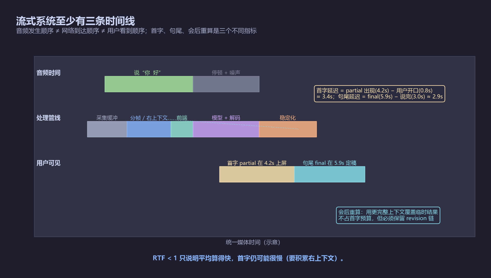

WeNet 的两遍思路是一个有代表性的工程折中：第一遍用 chunk 约束的 CTC/注意力路径快速给出结果，第二遍在更完整的上下文上重打分。它并没有消灭延迟，只是把延迟和准确率的边界显式化。

## 7.3 判停、唤醒与打断

**KWS（Keyword Spotting，关键词检测）**输出目标词是否出现或其分数。例如“今天天气不错”会触发 VAD 的语音判断，却不该触发只监听“你好小助手”的 KWS。**false alarm（误触发）**是没有目标词却唤醒了；**漏唤醒**是目标词说了却没触发。

KWS 关注是否出现目标词，VAD 关注是否有语音，endpoint 关注是否结束，三者的阈值和误报代价不同。唤醒词的 false alarm 不能只按“每次测试多少句”报告，因为设备可能连续监听数小时；更自然的单位是非目标时间内的误触发次数。

$$\text{FAR} = \frac{N_{\text{false\_alarm}}}{T_{\text{non\_target}}}$$

本节 FAR 指 **False Alarm Rate（误触发率）**：`N_false_alarm` 是误触发次数，`T_non_target` 是没有目标词的监听时长。若 10 小时发生 2 次，就是 0.2 次/小时，不是 20%。第 10 章声纹验证中的 FAR 则通常指 False Acceptance Rate（误接受率），分母是冒充尝试次数，不能混用。

快速打断需要一个明确的状态机：播报中检测到用户语音时，是立即降低播放、暂停播放，还是等待关键词？如果 AEC 后仍有播放残留，被后续检测模块误判成用户语音，就可能让系统反复打断自己。因此 KWS、VAD 和 AEC 必须在同一套回放测试里验收。

**状态机**是把系统分成几个明确状态，并规定什么事件触发切换。例如“正在播放 → 检测到打断候选 → 确认用户讲话 → 取消播放”。AEC 留下的播放声若被后面的 VAD/KWS 当成用户输入，就可能触发系统自己打断自己；真正作语音或关键词判断的是后续检测模块。

## 7.4 LID 和多语种边界

**LID（Language Identification，语种识别）**输入一段声音，输出语言标签或各语言分数，例如中文 0.8、英文 0.2；这些分数是否可当可靠概率，还要检查模型校准。**代码切换（code-switching）**在语言学里指同一次交流中切换语言，例如“明天开一个 meeting”，不是切换程序代码。**文本归一化**是按约定统一“二十三”和“23”等写法，避免格式差异被误算成识别错误。

语种识别可以在整段级、短窗级或 ASR 解码级完成。短窗级更早，但更容易受代码切换、专名和噪声影响；整段级更稳定，却可能错过用户刚开始说话的语言。中文、英文、日文和方言混合时，标签、词表、文本归一化和指标都要分开记录。

### 动手实验：比较 partial、final 和 revision
运行 `python_examples/06_streaming_revisions.py`，记录 revision 次数、回改字符数、首字 P95 和句尾 P95。再改变窗口大小，解释哪些变化来自模型，哪些变化来自协议和队列。

## 本章小结

- 流式系统的核心是可修订的时间协议，而不是把离线函数放进循环。
- RTF、首字延迟、句尾延迟和会后定稿是不同指标。
- KWS、VAD、endpoint 和 AEC 的误判会相互放大，需要统一回放测试。

## 思考题

1. 为什么 RTF=0.4 仍可能有很高的首字延迟？
2. partial 和 final 的时间范围应该由谁负责，为什么不能只传文本？
3. 多语种系统里，LID 错误会如何影响词表、解码和评测？

---

# 第 8 章 数据、训练与鲁棒性：模型上限先由输入决定

**鲁棒性（robustness）**是输入遇到噪声、口音、设备变化时，系统还能保持可接受结果的能力。**pipeline（流水线）**是一系列按顺序执行的处理；**checkpoint（训练检查点）**保存训练到某时刻的参数等状态。**基线（baseline）**是固定下来用于比较的已有方案，例如先用一个模型默认配置测分，再看改动有没有帮助。

很多“算法问题”其实是数据问题：远场样本没有远场标签，口音只出现在训练集，重叠语音被错误地当成单人语音，或者测试集被反复听过导致指标失去意义。训练 pipeline 的第一项产物不是 checkpoint，而是一个能说明数据从哪里来、为什么保留、如何切分的版本。

## 8.1 从音频到样本的流水线

**训练集（train）**用来学习参数，**开发集/验证集（dev/validation）**用来选参数和方案，**测试集（test）**用来评估选定方案。**manifest（样本清单）**是结构化索引，记录每条音频在哪、对应文字是什么、属于哪个集合等。**数据泄漏**是测试信息进入训练或选型过程，例如同一个人的近似录音分到训练和测试两边，让分数显得过于乐观。

**高质量标注**是经过较严格检查的参考答案；**弱标注**来自较粗、可能错位或出错的信息，例如未精校的字幕；**未标注**表示没有所需任务答案。**伪标签**是另一个模型生成的答案，可用于扩大训练数据，但不能默认它全对。

一条可复现流水线至少包含许可检查、音频解码、静音和重叠切分、文本归一化、说话人或语种标签、质量过滤、训练/开发/测试划分和 manifest 生成。每一步都应该有统计：时长分布、采样率、说话人数量、噪声标签、空文本比例和被过滤的原因。

WenetSpeech 论文报告了超过 10000 小时的高质量标注、约 2400 小时弱标注和约 10000 小时未标注的多领域中文语料，并提供面向互联网和真实会议的测试集。GigaSpeech 论文则描述了 10000 小时高质量英文标注和 40000 小时总音频，以及不同规模的训练子集。数字说明数据规模和覆盖方式，不能直接推出某个业务的可用性；版权、许可、领域和说话人分布仍需单独核验。

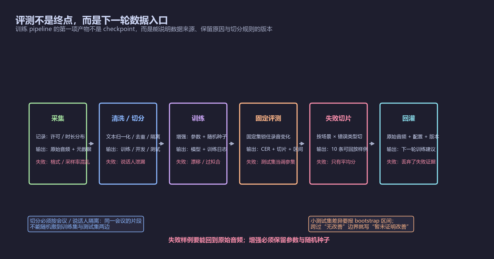

## 8.2 增强不是随机加噪声

这里的**数据增强（data augmentation）**是主动制造训练变化，例如给干净语音混入可控噪声，让模型学会处理困难输入；第 3 章的**语音增强（speech enhancement）**则是把已录到的音频处理得更清楚。两者都叫“增强”，目标不同。

增强的价值在于模拟部署中会发生、且可以控制的变化：混响、远近距离、设备频响、背景噪声、混响尾巴、混合说话、丢包和增益变化。每种增强都要记录参数和概率，避免训练集被制造成一个与真实世界同样陌生的合成世界。

对 ASR，速度扰动、噪声混合和 SpecAugment 常用于增加变化；对 AEC，需要控制参考信号、回声路径和双讲；对说话人任务，过强的混响可能抹掉身份线索。增强后的样本仍要保留原始音频和随机种子，才能做失败回放。

**速度扰动**把训练声音适当加快或放慢，是否改变音高取决于实现。**SpecAugment（频谱增强方法）**常在时频特征图上遮住一些时间段或频带，迫使模型利用剩余信息；不是在真实录音中删掉说话内容再沿用错误标签。**设备频响**表示设备对不同频率放大或衰减的程度；**丢包**是传输中部分数据块没有到达；**随机种子**是控制随机过程的初始设置，配合固定版本和环境帮助复现增强样本。

## 8.3 自监督与个性化适配

**自监督学习（self-supervised learning）**从输入本身构造练习题，而不要求人工给每段声音写文字。例如把一段音频的内部表示遮住，让模型利用前后内容预测被遮住的部分。**表示/embedding（嵌入向量）**是一组模型提取的数字，用于概括输入；**潜空间**就是这些内部表示所在的空间，不是实际的房间空间。

**对比学习**让正确匹配的表示更容易被区分出来；**聚类（clustering）**把相似表示分成组；**隐藏单元**在这里是聚类得到的编号，不必对应真实音素或汉字。**wav2vec 2.0**是模型名称；**HuBERT（Hidden-Unit BERT，基于隐藏单元的 BERT 方法）**用聚类编号构造遮盖预测任务，BERT 在此指利用双向上下文进行表示学习的模型思路。

wav2vec 2.0 在潜空间遮盖语音并做对比学习，论文展示了用大量未标注音频降低标注需求的路径。HuBERT 使用离线聚类产生隐藏单元，再对被遮盖区域做预测，强调聚类一致性而不是标签语义本身。它们告诉工程师：未标注数据可以提供表示学习信号，但并不会自动解决领域偏移、隐私、算力和下游标签质量。

个性化适配可以从词表、提示、说话人 embedding、LoRA 或少量微调开始。每次适配都要问两个问题：它是否改善目标用户，是否伤害未适配用户？如果没有独立的回归集，个性化很容易变成对单个样本的过拟合。

**微调（fine-tuning）**是在已有模型上继续用目标数据训练；**LoRA（Low-Rank Adaptation，低秩适配）**通常冻结原权重，只训练较小的新增矩阵，用较少可训练参数适配任务。**低秩**可以先理解成用更少的独立变化方向近似一次大矩阵更新，不必先做矩阵推导。**过拟合**是训练样本上表现好，换新样本就差；**回归集**是每次修改后都重跑的一组检查样本，这里的“回归”指检查旧能力是否退步。

**领域偏移**是训练和使用场景不同，例如训练多为近距离朗读，使用却是远场会议。大数据或自监督可以帮忙，但不能保证自动跨过这种差异。

## 8.4 口音、方言和长尾

**长尾**指大量各自出现较少、加起来却很重要的情况，例如少见人名、地名和专业词。**bootstrap（自助重采样法）**反复从测试样本中有放回抽样，估计结果的统计波动；第 10 章会用一个差值例子解释。这里的“下降 0.2 个点”是下降 0.2 个百分点，例如 CER 从 5.0% 变为 4.8%，不是相对下降 0.2%。

“支持方言”不是在模型名称后面加一个标签。需要定义方言或口音的采样范围、文本规范、说话人隔离和公平性指标。长尾专名、数字、单位和代码混读往往比平均 CER 更能暴露产品风险。数据切片应和业务词表、声学条件、说话人属性和时间段一起保存。

:::warn 常见误区
把测试集当调参集，或者只报告一个总 CER。小测试集上的差异应给出 bootstrap 区间或至少报告样本数、切片和失败案例；“下降 0.2 个点”在不同规模和分布下不是同一件事。

### 动手实验：做一张数据覆盖矩阵
按近讲/远场、安静/噪声、单人/重叠、普通话/口音、短句/长句建立矩阵。给每个格子填时长、说话人数量、标签来源和当前 CER。先找空格，再决定下一轮采集，不要先追逐更大的模型。

## 本章小结

- 数据版本、许可、切分和质量统计是训练 pipeline 的一部分，而不是文档附录。
- 增强应模拟可解释的部署变化，并保留参数和原始音频。
- 自监督和个性化适配降低了某些门槛，却没有消除领域偏移和回归评测。

## 思考题

1. 为什么弱标注数据可能扩大规模，却也可能扩大错误？
2. 设计一个实验区分“模型容量不足”和“口音数据覆盖不足”。
3. 哪些字段必须从训练集切分规则中隔离，才能避免说话人泄漏？

---

# 第 9 章 说话人、语种与音频理解

语音岗位经常把 ASR、声纹、语种识别、说话人分段、语音合成和音频检测放在同一份要求里。它们共享采样、特征和时间轴，却有不同的输出、错误代价和标注需求。先把任务边界说清楚，才能选择合适的模型和指标。

## 9.1 分段、识别、验证与分离

这里反复出现的**声纹 embedding（说话人嵌入向量）**是模型从一段声音提取的数字向量，训练目标是让同一人的声音表示更接近、不同人的更容易区分。它不是身份证号码，也不是单独的音高。**注册（enrollment）**先把已知人的语音变成参考向量；后续再比较新的语音与参考是否相似。

说话人分段（diarization）回答“谁在何时说话”，通常输出匿名的 SPEAKER_00、SPEAKER_01；说话人识别（identification）回答“这段声音更像哪个已知候选人”，需要注册声纹或其他身份证据，并在适用时允许返回“未知”；说话人验证（verification）回答“这段声音是否属于声称的某人”，通常是二分类或阈值决策；分离（separation）则尝试生成多个源信号。识别得到姓名是与外部登记资料匹配的结果，不是音频中直接包含姓名。

一个容易误导的类比是会议签到：可以先把人标成甲、乙，等整场录像和签到表齐了再映射姓名。类比的边界在于，真正的声纹 embedding 是统计表示，不是直接读取音高或“听起来像”。距离、混响、设备和情绪都会让 embedding 漂移。

## 9.2 在线聚类与匿名标签

**簇（cluster）**是一组暂时被认为来自同一人的语音片段；**在线**表示音频陆续到达时立即处理，不能先看完整场会议。比如第一个片段先建“说话人 A”簇，第二个片段与 A 的表示足够相似就加入，否则新建 B。下面说的阈值高低，采用“相似度越高越像同一人”的约定；若工具用距离，比较方向就相反。

一个简单的在线分段器可以对 VAD 段做子窗切分、提取 embedding、与已有簇比较，再根据阈值创建或合并标签。整段只提一个 embedding 会把说话人切换混在一起；阈值太低会过度合并，太高会产生过多簇。在线算法只能看过去，会后全局重算通常更稳定。

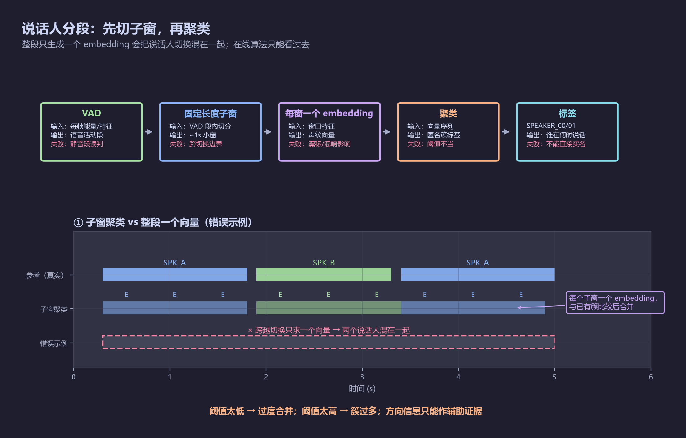

多个证据可以融合：声音相似度、方向轨迹、时间连续性和可选的视觉信息。下面的式子表示加权分数，不是概率。每个特征 `f` 都应先固定方向和数值范围，权重再用开发集选择；只有经过单独的校准并验证可靠性后，分数才可以被解释成概率。它也不是某个工具包的官方算法，更不能把匿名簇直接变成实名。

$$S(s \mid x) = \lambda_v f_{\text{voice}} + \lambda_d f_{\text{doa}} + \lambda_t f_{\text{time}} + \lambda_a f_{\text{active}}$$

这里 `x` 是当前片段，`s` 是候选说话人簇，`S` 是匹配总分。四个 `f` 分别表示声音相似、方向一致、时间连续和当前活跃状态的线索；`λ`（lambda）是各线索占多大权重。**归一化**是把特征调整到可比较的数值尺度；**校准**是检查并调整分数与实际正确比例的关系，例如输出 0.8 的样本是否真的约有 80% 正确。加权总分未经这一步检验，不应直接叫“80% 的身份概率”。

例如，声音 embedding 相似度很高但方向轨迹突然跳变时，系统可以降低当前簇的合并分数并暂缓实名映射。若四类特征未经归一化，数值较大的那一项会在无意中支配结果；此时再精细地调权重也没有可解释意义。

## 9.3 LID、TTS 与音频事件

**TTS（Text-to-Speech，文本转语音/语音合成）**输入文字，输出声音，例如把“会议开始了”读出来，与 ASR 的输入输出方向相反。**韵律**是重音、节奏、语调和停顿的组织；**音色**是声音的听觉特质；**声码器（vocoder）**在常见神经语音合成流程中把声学特征变成可播放的波形。**MOS（Mean Opinion Score，平均意见得分）**是听众按约定量表打分后求平均，常见自然度测试用 1-5 分；不同测试条件下不能直接比较。

**混淆矩阵**是把“真实类别”和“预测类别”交叉列成表，便于看出中文被误判成英文等具体错误。**召回率（recall）**是实际存在的目标中找到了多少；**精确率（precision，也常称查准率）**是系统报出的目标中有多少是真的。例如有 10 次警报，检出其中 8 次、另外误报 2 次，召回率为 8/10，精确率为 8/(8+2)。

LID 可以是整段分类、短窗分类或与 ASR 联合解码。多语种系统的困难往往不在分类器，而在语言切换、文本归一化、词表和评测口径。TTS 还要额外处理韵律、停顿、音色、发音词典和实时合成；音频事件检测则关注咳嗽、玻璃破碎、警报等非语音类别，标签粒度和误报代价与 ASR 完全不同。

因此“音频算法”不是一个指标。一个会议产品可能同时需要 ASR 的 CER、分段的 DER、语言识别的混淆矩阵、TTS 的 MOS 或延迟，以及音频事件的召回率。它们必须共享音频时间轴，但不能共享同一个阈值。

## 9.4 DER 与证据强度

**DER（Diarization Error Rate，说话人分段错误率）**按时间统计错误。**漏检**是有人说话却没标，**误检**是没人说话却标了说话，**说话人混淆**是时间找对了但分给了错误的人。评分时一般先把匿名标签与参考标签匹配，否则仅仅交换 A、B 的名字也会被误算成错误。

**collar（边界容忍区间）**是在人工标注切换点附近忽略或容忍一小段时间，以减少边界标注偏差的影响；必须说明具体宽度是两侧各多少。**overlap（重叠语音）**指两人同时说话的区间；评测可以包含或排除它，但必须明确。把困难重叠区间不计分，往往会让分数降低，却不表示模型能力提高。

DER 通常拆成漏检、误检和说话人混淆，并依赖 collar、重叠语音处理和参考标注。不同评测设置会得到不同数字，报告时必须把口径写出来。

$$\text{DER} = \frac{T_{\text{miss}} + T_{\text{false}} + T_{\text{conf}}}{T_{\text{ref}}}$$

`T_miss`、`T_false`、`T_conf` 是按同一评测规则统计的三类错误时长，`T_ref` 是参考说话人总时长。无重叠的例子：100 秒参考语音里漏了 5 秒、误报 2 秒、认错说话人 3 秒，DER 就是 10%。重叠计分时，两人同时说 1 秒可以贡献 2 秒参考说话人时长，所以分母不一定等于录音长度。

### 动手实验：在切换点附近做对齐
运行 `python_examples/07_online_speaker_clustering.py` 和 `python_examples/08_timeline_alignment.py`，只把一个词的时间戳向前或向后移动，观察说话人归属如何变化。再把一个短重叠区间标成“未知”，比较 DER 的哪一项变化最大。

## 本章小结

- diarization、identification、verification 和 separation 是不同任务。
- 在线聚类必须处理切换、阈值和匿名标签的修订；方向信息只能作为辅助证据。
- 多任务系统共享音频时间轴，但不能把不同任务的阈值和指标混用。

## 思考题

1. 为什么匿名说话人标签不能直接当真实姓名？
2. collar 和 overlap 口径变化时，DER 为什么会变化？
3. 设计一个同时输出 ASR 和 LID 的系统，语言切换时如何避免文本归一化污染指标？

---

# 第 10 章 评测：一个分数永远不够

评测不是项目结束时的一张表，而是系统设计的一部分。它决定你采集什么数据、保留哪些中间结果、是否允许修订，以及下一轮该优化哪个模块。没有评测，模型升级、前端调整和硬件替换都可能只是运气。

## 10.1 CER/WER 要先固定文本口径

**CER（Character Error Rate，字错误率）**按字符计数，**WER（Word Error Rate，词错误率）**按词计数。先把参考答案与识别结果做序列对齐，再数 **S（Substitution，替换）**、**D（Deletion，删除）**和 **I（Insertion，插入）**；**N** 是参考中的字符数或词数。它们不等于“错句占所有句子的比例”。

中文常用 CER，英文常用 WER；两者都把替换、删除和插入分开计数。标点、大小写、数字、空格、繁简转换和专名归一化会改变分子和分母。先固定文本规范，再比较模型，否则一个“更低”的数字可能只是去掉了更多标点。

$$\text{CER} = \frac{S + D + I}{N}$$

例如参考是“今天开会”，识别为“今天开门”，一个字替换，CER 为 1/4 = 25%；识别为“今天会”，少了“开”，是一次删除；识别为“今天要开会”，多了“要”，是一次插入。插入特别多时，CER/WER 可以超过 100%，所以不能总把它当成普通的错误占比上限。

总分之外要保存对齐序列和错误类型。替换集中在数字，可以排查声学混淆、词表、语言模型和数字归一化；删除集中在远场尾音，可能是 VAD 或 endpoint；插入集中在风扇噪声，可能是前端或声学模型。错误类别提供排查线索，不能单凭类别断定故障模块。

## 10.2 音频、说话人与端侧指标

先按“这个指标在问什么”来选，不必一次背完全部公式：

| 指标及全称 | 中文解释与用途 | 主要边界 |
| --- | --- | --- |
| SI-SDR：Scale-Invariant Signal-to-Distortion Ratio | 尺度不变的信号失真比，比较处理后波形与干净参考有多一致，通常越高越好 | 需要参考和时间对齐；整体音量缩放不会单独导致变差 |
| STOI：Short-Time Objective Intelligibility | 短时客观可懂度，用信号特征估计语音是否容易听懂，通常越高越好 | 是可懂度的代理指标，不是直接测人的理解能力 |
| PESQ：Perceptual Evaluation of Speech Quality | 语音质量感知评估，模拟部分人耳质量判断，通常越高越好 | 需核验采样率、任务条件、实现和许可 |
| JER：Jaccard Error Rate | Jaccard 错误率，按匹配说话人的时间集合重合程度计算错误，再按规则汇总 | 仍依赖说话人映射和重叠计分设置 |
| FAR：False Acceptance Rate | 误接受率，声纹验证时冒充者被放行的比例 | 分母是冒充尝试数，与 KWS 的每小时误触发不同 |
| FRR：False Rejection Rate | 误拒绝率，声纹验证时本人被拒绝的比例 | 分母是真实本人尝试数；阈值变严通常会增加它 |
| EER：Equal Error Rate | 等错误率，在 FAR 与 FRR 相等或近似相等的阈值处报告错误率 | 是比较判别能力的一种概括，不一定是上线阈值 |
| P50 / P95 | 第 50/95 百分位；P50 是中位数，P95 反映较慢那部分请求 | 必须同时报告测量起止点和样本条件 |

例如声纹阈值越严格，通常越不容易放过冒充者，但也更可能拒绝本人；FAR 和 FRR 就是在描述这个取舍。**阈值任务**指通过分数是否越过某个边界来决定通过或拒绝的任务。

增强可以报告 SNR、SI-SDR、STOI、PESQ 或主观听感，但这些指标回答的问题不同，且部分指标有适用范围和许可限制。SI-SDR 先把估计信号 `s_hat` 投影到参考信号 `s` 上：投影系数 `alpha` 吸收整体增益差，`s_target` 是允许缩放后的参考分量，`e_res` 是估计信号中没有被该参考解释的残差。通常还要先对两路信号去均值，并固定裁剪、对齐和静音处理规则。

$$
\begin{aligned}
\alpha &= \frac{\langle \hat{s}, s\rangle}{\|s\|^2}, & s_{\text{target}} &= \alpha s, & e_{\text{res}} &= \hat{s} - s_{\text{target}} \\
\text{SI-SDR} &= 10 \log_{10}\left(\frac{\|s_{\text{target}}\|^2}{\|e_{\text{res}}\|^2}\right)
\end{aligned}
$$

公式里的 `⟨a,b⟩` 是两串对应样本相乘后求和，叫**内积**；`‖s‖²` 是样本平方和，表示该段的能量。**投影**在这里可以理解成先找一个最合适的音量倍数 `alpha`，让参考更接近输出，再看还差多少。若输出只是参考乘以 2，理想情况下残差为零；若输出多了别人的话，即使调音量也无法把那部分解释掉。参考全零或残差为零时，实现需处理除零和对数边界。

“尺度不变”只表示整体增益不会单独主导分数，不表示指标对时间错位、非线性失真或参考信号错误不敏感。`e_res` 也不应简单叫作噪声，它可能同时包含干扰、处理伪影和对齐误差。即使 SI-SDR 上升，也不能推出 ASR 或用户听感一定变好。

说话人任务需要 DER、JER、EER、FAR/FRR 等指标，并明确 collar、重叠区间、阈值和校准方法。端侧系统至少要报告 RTF、首字 P50/P95、句尾 P50/P95、内存峰值、线程数、功耗和失败回退。平均值掩盖长尾，P95 才更接近用户等待。

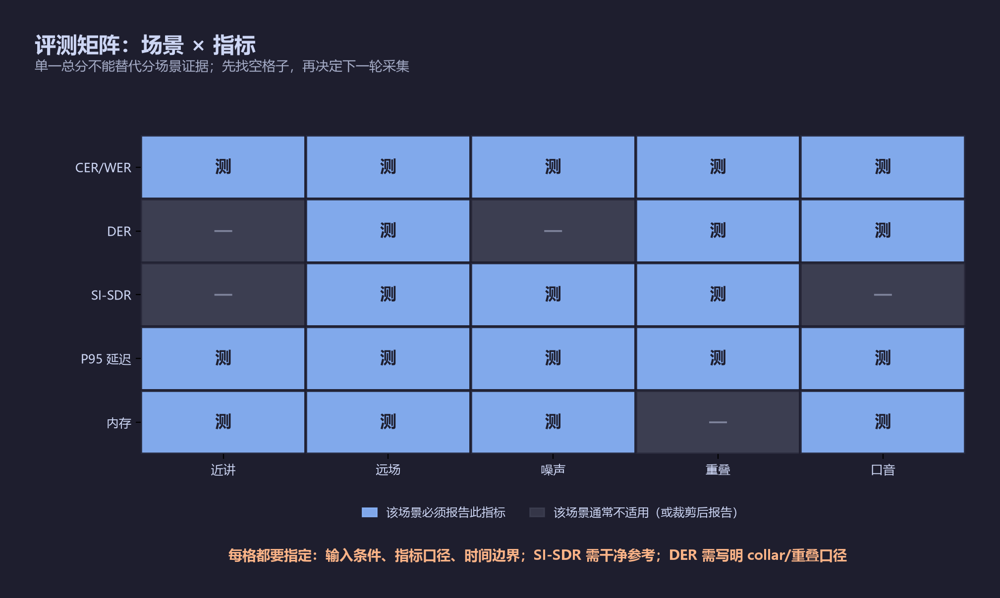

## 10.3 固定集、切片和统计不确定性

训练、开发和最终测试要按会议或说话人隔离，不能把同一会议的片段随机撒到两边。固定测试集的意义是锁住录音变化，让算法变化可以归因；它不意味着测试集永远代表生产分布。生产还需要持续采样和漂移监控。

小测试集的差异要用 bootstrap 区间、配对比较或至少报告样本量来解释。若区间跨过“没有改善”的边界，结论应该写成“暂未证明改善”，而不是把小数点后两位当成确定事实。

**配对比较**是让新旧系统处理同一批录音，再比较差值；**bootstrap**则从这批样本中有放回抽取很多组，每组都算一次新旧差值，观察差值有多不稳定。相关片段应按会议或说话人等合适单位一起抽样，避免把高度相关的片段误当成独立证据。

**置信区间**表示按一定统计方法估计的不确定范围。例如定义差值为“新 CER − 旧 CER”，估计为 -0.2 个百分点，但区间是 [-0.6, +0.2] 个百分点：负值代表改善，正值代表变差，区间跨 0，所以证据还不足以断言改善。跨 0 的是**差值的区间**，不是看 CER 本身是否接近 0。区间也不能涵盖未来所有场景的变化。

## 10.4 从指标回到失败样例

一次评测结束后，先看哪些场景变坏，再看总分。对每个失败样例保留原始音频、配置、模型版本、时间范围、参考文本和中间输出。这样可以判断问题来自数据、前端、声学模型、解码器、协议还是部署运行时。

### 动手实验：建立最小评测表
运行 `python_examples/04_cer.py`，把 CER 拆成替换、删除、插入。再为同一批音频增加 RTF、首字时间和模型版本字段。最后随机抽取 10 条错误，手工给每条标注一个最可能的模块原因。

## 本章小结

- CER/WER 必须绑定文本归一化和对齐口径。
- 增强、说话人和端侧系统需要不同指标，平均值不能代表长尾。
- 固定测试集用于归因，切片和失败回放用于决定下一步。

## 思考题

1. 为什么去掉标点会改变 CER，却不一定改变模型声学能力？
2. 如果 RTF 变好但首字 P95 变坏，你会先查哪一层？
3. 如何设计一个能发现“远场口音变差”的回归集？

---

# 第 11 章 模型压缩与部署：从 checkpoint 到设备

先把部署链上的对象分开：**训练框架**负责训练和表达模型，如 PyTorch；**模型权重**是学到的参数；**导出格式**描述计算步骤和参数怎样存放；**运行时（runtime）**读取模型并执行运算；**硬件**实际完成计算。`.pt` 常是 PyTorch 保存文件使用的扩展名，但文件内容和加载方式仍由保存方法决定。

**张量（tensor）**是多维数字数组，**shape（形状）**是各维长度。例如 `[1, 100, 80]` 可表示 1 条音频、100 帧、每帧 80 维特征；维度的具体顺序必须查接口。**算子（operator）**是矩阵乘法、卷积等基本运算；**内核（kernel）**是执行某种运算的具体底层程序。

模型部署不是把 `.pt` 文件复制到设备。训练框架、导出格式、算子集合、量化校准、运行时调度和设备内存共同决定最终行为。岗位里同时出现剪枝、量化、蒸馏、ONNX、TensorRT、Triton、ARM、DSP 和 NPU，说明企业要的是一条转换和验收链，而不是某个单点技巧。

## 11.1 三种压缩思路

蒸馏让小模型学习大模型的软输出或中间表示，通常先保住任务行为，再减少参数和计算。剪枝移除部分权重、通道或结构，收益取决于硬件是否能跳过被删掉的计算；非结构化稀疏在纸面上很漂亮，但普通内核未必更快。量化把浮点范围映射到整数，减少内存和带宽，代价是校准误差和算子支持限制。

**知识蒸馏（knowledge distillation）**像让小模型向大模型学习判断：不仅学“答案是甲”，还学“甲得 0.8、乙得 0.2”这类**软输出**。**结构化剪枝**删除整组通道或结构，较容易转成更小的运算；**非结构化稀疏**只让许多零散权重变成零，若硬件仍逐个计算这些零，就未必提速。

**量化（quantization）**用较少离散数值近似原来的浮点数。FP32（32-bit Floating Point，32 位浮点）每个参数通常占 4 字节，INT8（8-bit Integer，8 位整数）通常占 1 字节；理想情况下仅权重存储可约缩小到四分之一，但整个模型还含缩放参数、缓存和其他开销。**带宽**在此指单位时间能搬运多少数据，不是网络下载速度；小数值格式也有助于减少内存到计算单元之间的数据搬运。

## 11.2 量化不是按一个按钮

**ONNX（Open Neural Network Exchange，开放神经网络交换格式）**描述模型的计算图；**计算图**记录算子如何连接。**ONNX Runtime**是能执行 ONNX 等模型的运行时软件，格式与执行软件不是同一个东西。

**scale（缩放系数）**表示整数每增加 1 对应多少真实数值变化，**zero point（零点）**表示哪个整数代表真实的零。**动态量化**通常在运行时为激活计算量化参数；**静态量化**先用代表性数据确定这些参数。**激活（activation）**是网络计算中间产生的数值，**校准数据**是用来观察其数值范围的样本。这里的量化校准和第 9 章的概率分数校准解决不同问题。

**QOperator（量化算子表示）**直接在图中使用量化版本算子；**QDQ（Quantize/Dequantize，量化/反量化表示）**在普通算子前后插入数值转换节点，向后端表达量化边界。它们是表达量化计算的两种图形式，不是两种准确率指标。

ONNX Runtime 文档把常见 8-bit 线性量化写成 scale 和 zero point 的仿射关系，并区分 QOperator 与 QDQ 两种图表示，也区分动态和静态量化。静态量化需要代表性校准数据；如果校准集没有覆盖远场、口音和长尾词，模型可能只在校准分布上看起来正常。

$$x_{\text{fp32}} \approx s\,(q - z)$$

`x_fp32` 是原浮点数，`q` 是量化整数，`s` 是 scale，`z` 是 zero point。举例取 `s = 0.1`、`z = 0`，0.26 可近似到整数 3，反量化得到 0.3，误差是 0.04。整数范围有限，范围选择不当时还会把超出部分截断；量化需要同时控制舍入误差和截断误差。

量化后要重新检查每个敏感模块：声学前端、LayerNorm、softmax、声码器和后处理的容忍度不同。比较时固定输入、线程、批大小、版本和热身次数，分别记录准确率、峰值内存和 P95 延迟。

**LayerNorm（Layer Normalization，层归一化）**按模型规定的特征维度调整中间数值尺度；**softmax**把一组分数转换为总和为 1 的非负数，但这种形式本身不保证概率可靠。**批大小（batch size）**是一次合并处理多少个样本；**热身（warm-up）**是在正式测速前运行几次，让编译、内存分配等首次开销完成。需要测冷启动时，则应单独保留这些首次开销。

## 11.3 ONNX、TensorRT 与 Triton 的分工

用一条示例链理解：PyTorch 里训练好模型，导出 ONNX；可由 ONNX Runtime 执行，也可在合适硬件和支持条件下交给 TensorRT 优化；需要网络服务时，再由 Triton 管理模型和请求。它们不是每个项目都必须按顺序安装的四个部件。

**TensorRT**是 NVIDIA 的推理优化工具，名字不必硬拆缩写；**GPU（Graphics Processing Unit，图形处理单元）**擅长大规模并行计算。**SDK（Software Development Kit，软件开发工具包）**是一套开发接口和工具。**engine（推理引擎文件）**在这里是 TensorRT 为目标环境构建的执行计划。**动态轴/动态形状**表示某些输入维度可变化，例如音频帧数不固定；**算子版本（opset）**声明模型采用哪套算子定义。

ONNX 是交换和图审计的边界，不是自动加速保证。导出后要检查动态轴、算子版本、数值范围和控制流。TensorRT 官方文档把自己定位为面向 NVIDIA GPU 的推理优化 SDK，支持多种精度和动态形状；它会根据目标硬件构建 engine，因此 engine 的兼容性和测量结果必须绑定 GPU、驱动和 TensorRT 版本。

Triton 是服务层。官方文档描述了模型仓库、请求协议、按模型调度、批处理、后端和模型管理 API。它可以把 TensorRT、PyTorch、ONNX Runtime 等后端放进一个服务框架，但不会替你设计流式音频的状态、取消、背压和时间戳。

这里 **Triton**特指 NVIDIA Triton Inference Server（推理服务器），不是同名 GPU 编程语言。**后端（backend）**是服务用来真正执行模型的组件；**API（Application Programming Interface，应用程序编程接口）**是程序之间约定的调用方式。**背压（backpressure）**是在处理速度赶不上输入时，通知上游减速、限流或拒绝部分任务，避免队列无限增长。**并发**是同时有多个请求在进行，不等于把它们全部塞进同一个批次。

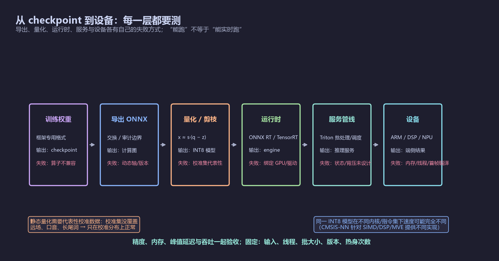

## 11.4 ARM、DSP 与 NPU

**CPU（Central Processing Unit，中央处理器）**执行通用程序；**Arm/ARM**涉及一类处理器架构与内核家族，Cortex-A 常面向应用处理器，Cortex-M 常面向微控制器。**DSP**在这里指 Digital Signal Processor（数字信号处理器），与导读中 Digital Signal Processing（数字信号处理）同缩写但指硬件；**NPU（Neural Processing Unit，神经网络处理单元）**加速其支持的神经网络运算。它们各有所长，模型不能仅因“是神经网络”就自动在任何 NPU 上运行。

**CMSIS-NN**是 CMSIS（Common Microcontroller Software Interface Standard，通用微控制器软件接口标准）体系中的神经网络内核库，NN 指 Neural Network。**SIMD（Single Instruction, Multiple Data，单指令多数据）**让一条指令处理一组数据；**MVE（M-Profile Vector Extension，M 系列向量扩展）**是面向部分 Arm M 系列处理器的向量指令扩展。这里说的**向量化**就是把能一起处理的数字成组计算。

CMSIS-NN 官方手册把自己定义为面向 Arm Cortex-M 的高效神经网络 kernel 集合，目标是降低内存并提高性能，并针对没有 SIMD、带 DSP 扩展和带 MVE 的处理器提供不同实现。这个事实说明“同一个 INT8 模型”仍可能因为内核、编译选项和指令集不同而有完全不同的速度。

端侧 C/C++ 代码要把算法状态、内存生命周期、线程和错误码写清楚。Python 适合原型、数据和回归；C/C++ 负责稳定的音频环、零拷贝、SIMD、设备接口和异常回退。二者之间的边界应该用固定的 tensor shape、采样格式和版本协议描述。

**线程**是程序执行工作的单位；**内存生命周期**规定数据什么时候创建、还能被谁使用、什么时候释放。**零拷贝**是尽量让模块共享可安全访问的数据缓冲，而不是不断复制整段音频，并不意味着所有平台都能完全没有拷贝。**音频环/环形缓冲区**是可循环读写的存储区，让采集端持续写入、处理端持续取走声音。Python 和 C/C++ 的分工是常见做法，不是语言能力的绝对边界。

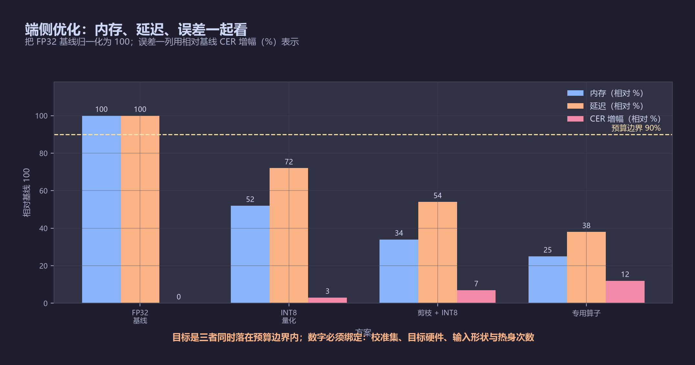

:::warn 常见误区
“模型能在本机跑”不等于“模型能在目标设备实时跑”。最常见的漏项包括数据拷贝、线程唤醒、动态内存、首帧编译、GPU/CPU 同步和音频设备阻塞。

### 动手实验：做一份压缩前后对照表
选择一个小型声学模型，记录 FP32、动态 INT8、静态 INT8 三种版本的文件大小、峰值内存、RTF、首字延迟和 CER。把校准集和目标硬件写入表头；没有这些字段，数字不可复现。

## 本章小结

- 蒸馏、剪枝和量化分别改变知识、结构和数值表示，收益必须在目标硬件上测量。
- ONNX 是交换与审计边界，TensorRT 是 GPU engine 构建，Triton 是服务与调度层。
- ARM/DSP/NPU 的真正难点在算子、内存、线程和接口，而不只是导出模型。

## 思考题

1. 为什么静态量化需要代表性校准数据？
2. 一个 QDQ 图能被 ONNX Runtime 执行，是否代表它能被 NPU 编译器接受？
3. 如何把“端侧实时”写成一组可自动回归的指标？

---

# 第 12 章 生产系统与职业交付：把算法变成可维护的能力

**生产系统**是实际持续服务用户的系统；**IoT（Internet of Things，物联网）**指音箱、传感器等设备通过网络协作的场景。**事件（event）**是一条带时间和状态的记录，例如“1.2-2.4 秒出现语音”；**版本链**记录它由哪段输入、哪次配置和哪个模型生成。**回放**是重新输入已保存的同一段音频，用来复现当时行为。

当语音系统进入会议、车载、IoT 或智能体对话，算法不再是一个孤立函数。系统要处理多通道采集、时间戳、VAD、增强、ASR、说话人、纠错、网络、缓存、取消和回放；模型升级还要能回答“哪一段输入、哪一个版本、哪一次配置产生了这条结果”。

## 12.1 事件和版本链

建议把原始音频视为只追加的证据仓库，把每个模块输出视为带来源的版本。事件至少包括音频时间范围、样本序号、模块名、模型版本、配置摘要和状态。字符串可以被修订，音频时间和来源不能靠猜。

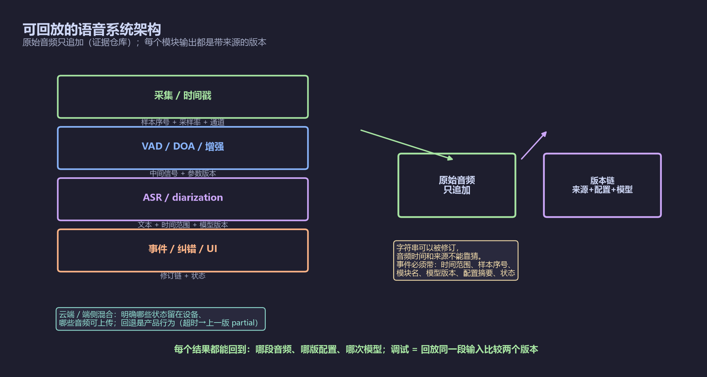

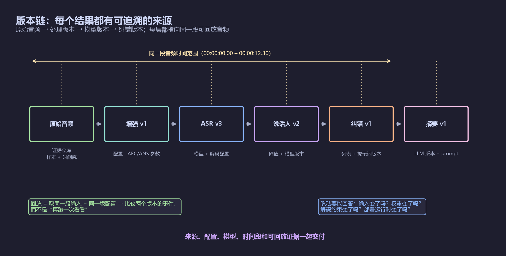

这类设计会让调试从“再跑一次看看”变成“回放同一段输入，比较两个版本的事件”。它也让跨团队协作更清楚：产品可以讨论用户看到的事件，算法可以讨论特征和后验，工程可以讨论队列和资源。

## 12.2 云端、端侧和故障回退

**故障回退（fallback）**是在当前方案失败时切换到预先准备的可用路径，例如加速器不可用就改用 CPU；**降级（degradation）**是在资源不足时提供较少能力，例如失去阵列通道后只做单通道识别。**回滚（rollback）**则是把有问题的新版本恢复成之前的版本，三者相关但不是同一个动作。

云端适合大模型和集中更新，端侧适合低延迟、隐私和断网可用。混合架构要明确哪些状态必须留在设备，哪些音频可以上传，网络不可用时返回什么。把“云端更准”当作唯一策略，会忽略隐私、带宽、服务抖动和数据合规；把“端侧完全离线”当作唯一策略，也可能无法承担多语种和复杂会议。

故障回退应在设计时写出：模型超时是否返回上一版 partial，NPU 不支持某个算子是否切 CPU，音频通道丢失是否降级为单通道，纠错模型不确定时是否保留原始转写。回退不是异常日志，而是用户可观察的产品行为。

## 12.3 研究、专利和沟通

下面是论文会议名，不是需要接进系统的算法：**ICASSP（International Conference on Acoustics, Speech and Signal Processing，国际声学、语音与信号处理会议）**和 **INTERSPEECH**主要涵盖语音相关研究；**ACL（Association for Computational Linguistics，计算语言学协会及其年会语境）**涉及语言处理；**NeurIPS（Neural Information Processing Systems，神经信息处理系统大会）**、**ICML（International Conference on Machine Learning，国际机器学习会议）**涵盖更广泛的机器学习。

跟踪 ICASSP、INTERSPEECH、ACL、NeurIPS 和 ICML 的意义，不是把论文标题贴进周报，而是抽取问题定义、数据条件、基线、指标和可复现限制。专利挖掘也应从工程差异开始：一个可保护的方案通常包含明确的输入约束、处理步骤、状态转换和效果证据，而不是“使用深度学习提高准确率”。

技术方案文档要让没有参与实验的人复现关键结论。至少包括背景和失败现象、接口、数据与切分、模型和超参、部署环境、评测口径、已知风险和回滚方案。把“官方未明确，需自己实测”保留下来，比用肯定语气掩盖缺口更专业。

**超参数（hyperparameter）**是训练或运行前由人选择的设置，例如学习率、批大小、阈值；**模型参数**通常指训练学到的权重。**主指标**判断目标是否改善，**保护指标**防止改善主指标时损害其他能力，例如主指标为 CER、保护指标为首字延迟和内存峰值。

## 12.4 一份可面试、可交付的作品

一个完整作品可以从固定的 5 分钟会议录音开始：先做 WAV/PCM 和 STFT 检查，再做 VAD、离线 ASR、CER，随后加入流式 revision、说话人匿名分段、阵列或增强，最后导出一个小模型并在目标硬件或容器服务中测延迟。每一步都保留输入、配置、版本、指标和失败样例。

作品的叙述顺序应当是“现象 → 假设 → 实验 → 结果 → 边界”。不要从“我用了某某模型”开始。面试官真正想知道的是：当数据、模型或设备不按预期工作时，你能否快速缩小问题范围，并让下一位工程师接手。

### 动手实验：写一页技术方案
用自己的一个实验写出一页方案，只允许包含：问题定义、输入输出、一个主指标、两个保护指标、失败回放方式和回滚条件。删掉所有无法验证的形容词，例如“显著”“高效”“鲁棒”。

## 本章小结

- 生产系统需要事件、时间轴、版本链和回退，而不只是模型推理。
- 云端和端侧是约束不同的系统边界，不能用单一“更准”排序。
- 研究、专利和技术沟通都应落到可复现的输入、步骤和证据。

## 思考题

1. 如何设计一个能同时支持 partial、final 和会后重算的事件协议？
2. NPU 不支持某个算子时，系统怎样回退才能保持时间轴和版本可追踪？
3. 你的作品集里哪一个失败样例最能证明你理解系统，而不是只会调用模型？

---

# 第 13 章 语音大模型与全双工交互：让扩展能力受证据约束

**LLM（Large Language Model，大语言模型）**通常处理和生成文本；**多模态（multimodal）**表示同时使用声音、图像、文字等不同类型的信息。**全双工（full-duplex）**指能同时播放和监听；**半双工（half-duplex）**则按轮次切换收与发。能使用语音作为输入，不等于模型本身一定听到了原音频，也可能只是读取 ASR 转写。

一个能转写的模型还不是语音助手。会议系统要把专名写对，助手要在播报时听见打断，音频产品还可能判断情绪、警报或画面中的说话人。岗位要求因此会把 Whisper、FunASR、LLM、TTS、全双工、情感识别和多模态写在一起。真正的难点不是把模型首尾相接，而是保证后一个模块没有抹掉前一个模块的证据。

## 13.1 二次开发先从可回放基线开始

**Whisper**是语音识别模型系列；**FunASR**是包含语音识别等模型和工具的开源体系。它们是项目或模型名，先认清用途即可。**预训练模型**是已在一批数据上训练好的模型；**二次开发**是在已有实现上调整数据、模型、解码或接口；**冻结基线**在这里是固定用于比较的版本与配置，并非特指训练时冻结某层权重。

可以把开源模型想成一台已经装好的发动机：它缩短了从零训练的距离，却没有替你选择燃料、道路和验收规则。Whisper、FunASR 这样的名称只指向模型家族或工具体系；具体 checkpoint、前后处理、解码参数、依赖版本和运行方式不同，行为就可能不同。所谓“二次开发”至少应从一条冻结的基线开始：固定音频和文本规范，记录原始输出与延迟，再只改变一个主要变量。

实现层可以把改动分成四类。数据层处理切分、伪标签、领域覆盖和许可；模型层做微调、蒸馏或适配；解码层加入热词、上下文和文本归一化；系统层负责流式切块、缓存、并发、导出和服务。每次改动都应能回答：输入变了吗，权重变了吗，解码约束变了吗，部署运行时变了吗？只说“基于某模型优化”无法定位收益来源。

边界也要提前写明。离线整段效果不能直接证明流式能力，把长音频切成小块循环调用也不自动等于真正的流式模型；仓库示例能运行，不代表许可证允许当前分发方式，也不代表目标硬件支持全部算子。开源仓库的维护状态、模型卡、权重许可和接口会变化，使用前必须按锁定版本重新核验。

## 13.2 ASR 与 LLM：校对员不能改写录音证据

**token**是模型处理的字、子词或其他符号单元；**置信度（confidence）**是模型对候选有多确定的评分，未经校准不能直接当成正确概率；**n-best**是若干条靠前候选。**强制对齐（forced alignment）**在已知音频和给定文字的前提下，估计文字对应的时间位置；对齐成功本身不证明给定文字就是真实内容。

LLM 很像一位熟悉上下文的校对员：它能看到“移远/宜远”哪一个更像公司名，却未必听过原音频。这个类比的边界十分重要。如果 LLM 的输入只有 ASR 文本，它拥有语言证据，却没有新的声学证据；它可以提出候选，不能把流畅当成听清了。

一个受约束的纠错接口应同时输入原始转写、n-best 或 token 置信度、允许使用的领域词表、语言信息和不可修改规则。输出不能只有一段新文本，还应包含修改区间、修改类型、所用证据、不确定标记，以及 ASR 模型、纠错模型、提示词和词表版本。数字、否定词、人名、金额和地址可设为保护字段：证据不足时保留原文或转人工，而不是追求句子更自然。

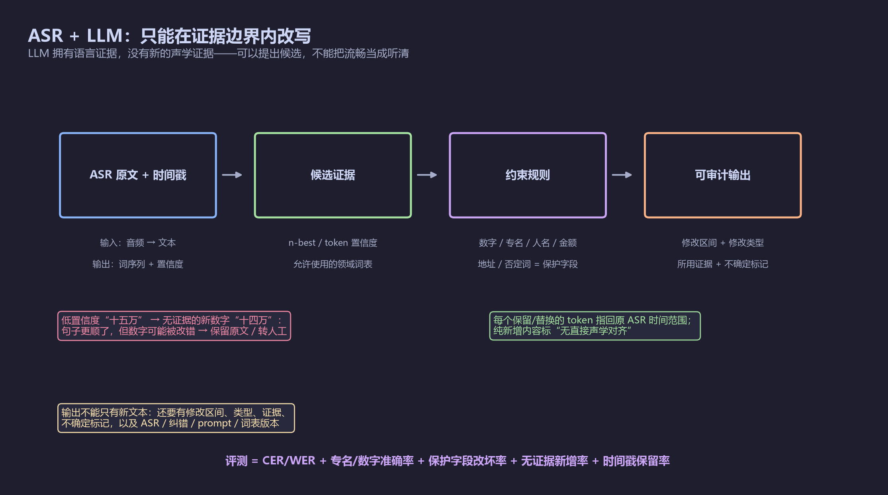

时间戳尤其不能靠改后文本的字符位置重新平均分配。可靠做法是让每个保留或替换 token 指回原 ASR 时间范围；纯新增内容标为“无直接声学对齐”，必要时通过强制对齐重新估计。系统还要同时保存 `raw_text`、`corrected_text`、差异和版本链，这样才能回放“是 ASR 听错，还是 LLM 改错”。

`raw_text` 是原始转写，`corrected_text` 是纠错后文本。这里的**幻觉（hallucination）**指模型生成输入证据不支持的内容，例如录音没提金额却补出一个金额；不只指句子读起来荒谬，通顺的句子也可能没有证据。

评测时除 CER/WER 外，还要单独统计专名和数字准确率、受保护字段改坏率、无证据新增率、时间戳保留率和人工接受率。LLM 让句子更通顺但增加不存在的事实，应判为失败；总 CER 下降也不能掩盖关键数字被改错。

## 13.3 TTS、全双工与打断是一套状态协议

**下行播报**是系统把声音送往扬声器，**上行监听**是麦克风把声音送入处理系统；**双流回放**是按同步时间轴重放这两条流，模拟播放和用户说话同时发生。**首包延迟**是从约定请求起点到收到第一块合成音频的时间，不等于完整句子合成完成的时间。

半双工助手像对讲机：系统说话时用户只能等。全双工系统则要同时维护下行播报和上行监听。播报音频必须作为远端参考送给 AEC，否则麦克风会把系统自己的 TTS 当成用户输入；AEC 之后的 VAD 或 KWS 再决定是否出现真实打断候选。

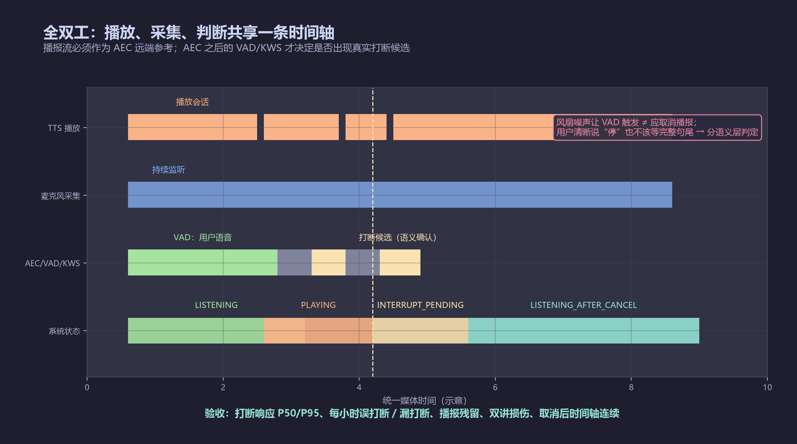

实现时至少区分 `LISTENING`、`PLAYING`、`INTERRUPT_PENDING` 和 `LISTENING_AFTER_CANCEL` 等状态。声学层回答“像不像近端人在说话”，语义层回答“这句话是否足以打断或已经说完整”，播放控制层决定淡出、暂停还是取消。三者不能共用一个阈值：风扇噪声造成的 VAD 触发不该立刻取消播报，用户清晰说出的“停”也不该等待完整句尾。

这些状态名分别表示“监听中”“播放中”“等待确认打断”“取消播放后继续监听”。**淡出**是逐渐降低音量再停止，避免突兀；**语义层**使用句子的意思辅助决策，而不是只看声音强弱。

验收必须使用可控的双流回放：保存干净近端语音、TTS 参考、扬声器到麦克风的回声路径和混合后的采集信号。除 ASR 准确率外，还要测打断响应 P50/P95、每小时误打断、漏打断、播报残留、双讲语音损伤和取消后的时间轴连续性。MOS 可以评价 TTS 的自然度，但不能替代可懂度、首包延迟和连续播放稳定性。

## 13.4 情绪、音频事件与多模态不要共用一个结论

**模态（modality）**是一类信息来源，例如声音或画面；**多任务头（task head）**是在共享模型上针对某个任务单独设置的输出部分。比如同一音频编码器后面，一个头判断警报，一个头判断情绪。**融合（fusion）**把多个来源的线索组合起来，**缺失模态**指其中某一路暂时不可用。**帧率**表示每秒有多少幅画面，不是音频采样率；两者需要映射到共同时间轴。

情绪识别回答的是“在某套标签定义下，这段信号更接近哪一类”，音频事件检测回答“某类声音在何时发生”，多模态融合则利用画面、文本或传感器补充证据。三者可以共享编码器和时间轴，却不应共享标签含义。激动语气不等于负面情绪，玻璃声不等于危险事件，画面中的人脸也不自动等于当前说话人。

实现多任务系统时，先为每个头分别写输入范围、输出粒度、缺失模态行为和主指标，再定义融合规则。视觉帧率、音频采样钟和网络到达时间不同，必须先对齐到同一媒体时间；某个模态迟到或不可用时，系统要降级并标注证据缺失，而不是悄悄沿用旧状态。

评测同样要分层：情绪分类看每类召回、混淆和跨人群稳定性，音频事件看事件级 precision/recall 与起止偏差，多模态看单模态基线、融合增益和缺失模态退化。情绪还涉及主观标注、文化差异、隐私和高风险决策边界；没有相应数据和治理证据时，不应把输出包装成对人的确定判断。

### 动手实验：做一次受约束纠错与双流回放
选 20 条包含专名、数字和否定词的 ASR 结果，保存原音频、原始文本、置信度和时间戳。让纠错模块只能从给定词表选择替换，并输出逐项差异；统计正确修复、误改、无证据新增和无法对齐四类结果。随后取一条 TTS 播放与三种近端输入（静音、噪声、“停止”）合成双流时间轴，画出 VAD、AEC、打断候选和实际取消时刻，解释每次状态转换的证据。

## 本章小结

- Whisper 或 FunASR 的二次开发必须绑定 checkpoint、数据、解码、运行时和固定评测，模型名称本身不是交付证据。
- ASR+LLM 的核心不是“润色”，而是受约束修改、时间戳对齐、版本追踪和对幻觉的单独评测。
- TTS、AEC、VAD、语义判停和播放控制共同构成全双工状态机，需要双流回放验收。
- 情绪、音频事件和多模态各有标签与风险边界，共享时间轴不等于共享结论。

## 思考题

1. LLM 把低置信度的“十五万”改成“十四万”，句子更通顺但没有声学证据。接口和评测应如何让这个错误暴露出来？
2. 为什么“播放时 VAD 触发”不能直接等于用户打断？设计一个至少包含 AEC 和播放状态的判定流程。
3. 多模态模型在摄像头断开后仍输出说话人身份，系统应保留哪些状态、清除哪些状态，并怎样标记证据强度？

---

# 附录 A 24 周学习路线

这条路线不是要求每个人用 24 周完成所有主题，而是把岗位要求拆成可以留下证据的阶段。每个阶段都以一个可回放的最小系统为出口；如果某个主题没有进入目标岗位，可以在“按需补给”处停下来。

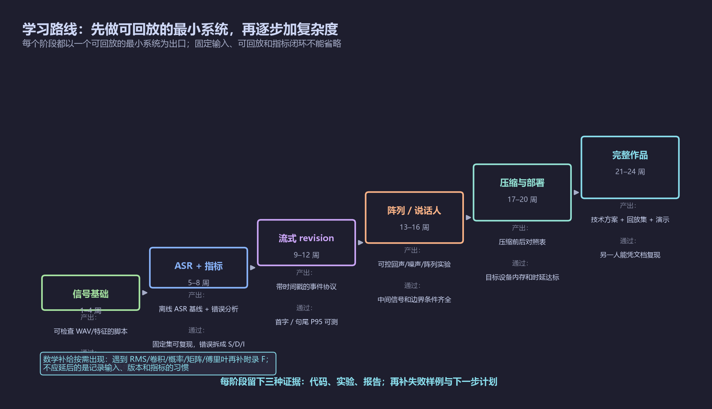

| 周期 | 主线 | 最小产物 | 通过条件 |
| --- | --- | --- | --- |
| 1-4 | Python、C/C++、采样、STFT、Fbank、VAD | 可检查 WAV 和特征的脚本 | 能解释每个时间和频率参数 |
| 5-8 | CTC/AED/RNN-T、解码、CER/WER | 离线 ASR 基线和错误分析 | 固定集可复现，错误能拆成 S/D/I |
| 9-12 | 流式、revision、KWS、LID、分段 | 带时间戳的事件协议 | 首字/句尾 P95 可测 |
| 13-16 | AEC、ANS、AGC、阵列、DOA | 可控回声/噪声/阵列实验 | 中间信号和边界条件齐全 |
| 17-20 | 蒸馏、量化、ONNX、TensorRT、C++ | 压缩前后对照表 | 目标设备内存和时延达标 |
| 21-24 | 完整会议或设备项目 | 技术方案、回放集、演示 | 另一人能从文档复现实验 |

数学补给不必先于所有实验。遇到 RMS、卷积、概率、矩阵或傅里叶变换时，按附录 F 补齐对应工具即可。真正不应延后的，是记录输入、版本和指标的习惯。

## 三条分叉路线

**ASR 主线**：第 2、5、6、7、8、10、11、13 章优先，补 WFST、语言模型、流式解码、数据清洗，以及 Whisper/FunASR 和受约束纠错的边界。

**音频前端与端侧**：第 2、3、4、10、11、12 章优先，补 C/C++、DSP、ARM、算子和功耗测量。

**会议与多任务**：第 3、7、8、9、10、12、13 章优先，补 diarization、LID、事件协议、会后重算和全双工回放。

## 本章小结

- 每个阶段都要有代码、实验和解释三种证据。
- 路线可以分叉，但固定输入、可回放和指标闭环不能省略。

## 思考题

1. 你目标岗位最短的 8 周路线是什么？删掉哪些主题，为什么？
2. 如果只有 CPU 和 1 小时音频，哪一个项目最适合做第一份作品？

---

# 附录 B 开源工具包怎么选

这一节的 **toolkit（工具包）**是一组完成任务的程序；**recipe（实验配方）**是数据处理、训练、评测所需脚本和配置的组合；**模型卡（model card）**是介绍模型来源、适用范围、指标和限制的说明。Kaldi、WeNet、SpeechBrain、FunASR 是项目名；**ESPnet**通常展开为 End-to-End Speech Processing Toolkit（端到端语音处理工具包）。这些名字不需要逐字翻译，重点是分清用途。

表中的 **FSA（Finite-State Automaton，有限状态自动机）**是有限节点和有向边组成的状态图，K2 提供相关计算工具；**可微**表示相关计算可与梯度训练连接。**CUDA（Compute Unified Device Architecture，统一计算设备架构）**是 NVIDIA GPU 的并行计算平台。**Transformers**在表中指 Hugging Face 的模型工具库，与第 6 章泛指网络架构的 Transformer 要区分。

工具包的选择应由任务、设备和团队现有代码决定。下表只描述公开资料中的定位，不把某个仓库当前的版本或维护活跃度写成永久事实；在真正使用前，应查看官方仓库最近提交、发行说明、许可证和模型卡。

| 工具 | 更适合学习或验证的边界 | 需要自己确认的风险 |
| --- | --- | --- |
| Kaldi | DNN-HMM、特征、对齐、WFST、经典解码 | 工程接口较老，现代端到端组件需额外拼接 |
| K2 / FSA | 可微有限状态、图和解码实验 | 版本、算子和 CUDA 兼容性要锁定 |
| WeNet | 流式/非流式 E2E、chunk、两遍解码 | 具体模型和量化效果要用目标数据复测 |
| ESPnet | 研究复现、ASR/TTS/多任务 recipe | recipe 依赖多，部署链需另做工程化 |
| SpeechBrain | 说话人、ASR、音频任务的模块化实验 | 预训练模型许可和接口随版本变化 |
| FunASR | 中文 ASR、VAD、标点和工程原型 | 模型卡、依赖版本和商用许可逐项核验 |
| Transformers | 统一模型接口、自监督和微调 | 默认 pipeline 不等于流式或端侧方案 |

一个稳妥的选择顺序是：先用最熟悉的工具做可解释基线，再用第二个工具复现一个小结果，最后才决定生产栈。跨工具比较时固定音频、文本归一化、模型权重、线程和硬件；否则“工具 A 更好”没有意义。

:::source 资料来源
Kaldi 官方文档、WeNet 论文、ESPnet 官方文档、SpeechBrain 官方站点、FunASR 项目页和 Hugging Face Transformers ASR 文档，访问日期 2026-08-07。仓库访问若受网络代理影响，使用本地缓存或官方发行包，并重新核验版本。

## 本章小结

- 工具包是实验和接口选择，不是能力本身。
- 选型要同时看任务边界、部署路径、许可证和版本可复现性。

## 思考题

1. 为什么用两个工具复现一个小实验，比安装五个工具更有价值？
2. 什么时候应优先 Kaldi/WFST，什么时候应优先流式 E2E？

---

# 附录 C 数据集、模型与许可检查

**语料/数据集**是供训练或评测的一组样本。WenetSpeech、GigaSpeech、AISHELL、LibriSpeech 是数据集或系列名称；表里的 **DNS**指 Deep Noise Suppression（深度噪声抑制）挑战及相关数据，不是网络里的域名系统。**benchmark（基准评测）**是约定数据和规则下的对照测试；**tokenizer（分词/符号切分器）**把文字转换成 token 序列，例如切成字或子词；**词表**规定模型可处理哪些 token。

数据集和预训练模型的“可下载”不等于“可用于你的产品”。至少要检查来源、许可、用途限制、说话人隐私、文本版权、地域和模型卡中的已知偏差。下面的清单用于起步，不替代法务或数据保护审查。

| 资源 | 公开资料强调的价值 | 使用前要核验 |
| --- | --- | --- |
| WenetSpeech | 多领域中文，包含高质量、弱标注和未标注数据，并有互联网与会议测试集 | 具体下载版本、许可、域分布和标签质量 |
| GigaSpeech | 多领域英文，提供多个训练规模和过滤/对齐流程 | 数据来源许可、语言和业务领域是否匹配 |
| AISHELL 系列 | 中文 ASR、会议和多说话人研究常用基线 | 版本、研究/商用条款和文本规范 |
| LibriSpeech | 英文 ASR 论文的经典对照集 | 读书语音与真实业务差异 |
| DNS / 噪声数据 | 增强、噪声抑制和主观质量实验 | 噪声许可、混合比例和真实场景覆盖 |

模型检查表：

- 是否给出了训练数据来源、采样率、语言和许可？
- tokenizer、词表、文本归一化和时间戳格式是否明确？
- 模型在远场、重叠、口音、代码切换和长音频上是否有报告？
- 推理代码是否包含 VAD、分块、解码和后处理，还是只展示离线调用？
- 导出到 ONNX 或端侧时，算子、动态轴和精度是否改变？

## 固定数据的最小结构

每条样本保存 `audio_path`、`sample_rate`、`channels`、`duration`、`text`、`speaker_id`（若允许）、`language`、`scenario`、`license`、`split` 和 `source_version`。如果涉及隐私，使用不可逆的内部编号，保留删除和撤回记录。

这些字段依次是：音频路径、采样率、通道数、时长、参考文本、说话人编号、语言、场景、许可、所属数据集划分、来源版本。内部编号通常只能减少直接身份暴露，不能自动保证匿名；声音本身、映射表和其他元数据仍可能关联到本人。

## 本章小结

- 数据集和模型的许可、版本、分布和标签质量必须一起审计。
- 公开 benchmark 用于对照，不自动代表业务场景。

## 思考题

1. 为什么“训练小时数更多”不一定降低你的会议 CER？
2. 如何设计一个不泄漏说话人的 train/dev/test 切分？

---

# 附录 D 五份岗位要求的能力映射

表中的 **toB（面向企业客户）**描述业务对象；**IPC（Inter-Process Communication，进程间通信）**让不同程序进程交换数据；**分布式训练**让多块设备或多台机器协作训练；**多租户**表示同一个服务系统供多个客户使用，并需要隔离各自的数据和资源。**rubric**只是“评分标准表”，不是技术算法。

岗位文本是招聘时点的快照。下面把用户提供的五份岗位要求映射到书中内容，同时把“书里已经讲到”和“仍需自己完成项目”分开。这里的“覆盖”只表示本书解释了概念、边界和最小验收方法，不等于读者已经获得生产经验，也不代表某个公司认可这套划分。

| 岗位 | 书内已覆盖 | 仍需扩展或在目标环境实测 |
| --- | --- | --- |
| 移远语音算法工程师 | 第 2、5-8、10-13 章：特征、经典/E2E ASR、流式、数据、压缩与版本链 | 训练并对照真实 DNN-HMM/E2E recipe；C/C++ 端侧移植；CUDA/分布式、专利或大规模数据经验 |
| 海康音频算法工程师 | 第 2-4、9、10、13 章：信号、阵列、说话人/TTS/音频事件边界与评测 | 至少一个声纹、TTS 或音频检测模型的训练部署；目标设备阵列数据与更完整数学推导 |
| 涂鸦音频算法工程师 | 第 2-4、10-12 章：3A、阵列、量化、设备预算和测试闭环 | Cortex-A/M 上的 C/C++ 实时管线；IPC、内存、功耗、SIMD/算子优化及真机回放 |
| toB 办公场景岗位 | 第 6-13 章：ASR/LID/分段、Whisper/FunASR 二次开发边界、会议协议、云端与评测 | 锁定版本后的源码改动或微调；多租户并发与成本实测；按业务定义完成 SSD 项目 |
| 淘天音频算法工程师 | 第 3、7、9-13 章：3A、判停、TTS、全双工、情绪/事件和端侧边界 | 真实设备双流训练与回放；TTS/对话模型训练；全双工长稳、功耗和复杂声学现场测试 |

:::warn “SSD 说话人分离”需要先问清楚
岗位原文没有展开 SSD 的英文全称，仅靠这个缩写不能确认它指波形级 separation、时间段级 diarization、两者组合，还是公司内部模块。面试或立项前应直接确认输入是单/多通道、输出是多路波形还是“谁在何时说话”、是否需要实名，以及重叠语音怎样计分。本书覆盖这些任务的边界和评测思路，但不把含义未明的 SSD 当成已经完成的具体算法。

## 面试题的四层回答法

遇到“你做过某算法吗”，按四层回答：

1. **现象**：输入和失败样例是什么？
2. **原理**：为什么这个算法可能解决它？假设是什么？
3. **工程**：线程、内存、延迟、设备和回退怎么处理？
4. **评测**：用什么固定集、指标和统计方法证明变化？

如果只能回答第二层，说明你会讲论文但还没有完成工程闭环；如果只能回答第三层，说明你会接线但还没有说明算法为什么有效。

## 评分 rubric

| 维度 | 0 分 | 1 分 | 2 分 |
| --- | --- | --- | --- |
| 信号基础 | 只会调用库 | 能解释参数 | 能用波形/频谱定位问题 |
| 模型原理 | 只记模型名 | 能描述训练和解码 | 能比较假设、延迟和失败边界 |
| 数据评测 | 只有总分 | 有固定集 | 有切片、区间和回放 |
| 工程部署 | 只在本机运行 | 能导出模型 | 能在目标设备测量并回退 |
| 协作交付 | 无文档 | 有实验记录 | 他人可复现并能审阅风险 |

## 本章小结

- 不同岗位的重点不同，但都可以用输入、输出、约束和指标来验收。
- 面试回答应该同时覆盖原理、工程和证据，而不是只报模型名称。

## 思考题

1. 选择一个目标岗位，写出两个月内能达到 2 分的三个项目里程碑。
2. 哪一项要求最容易被简历上的“熟悉”掩盖？你会用什么实验证明它？

---

# 附录 E 实验记录模板与指标词典

实验记录的目的不是写日志，而是让另一个人能从输入、配置、输出和版本复现你的结论。每次实验复制下面模板，删掉不适用字段，但不要删掉失败样例。

## E.1 实验记录模板

| 字段 | 内容 |
| --- | --- |
| 问题与假设 | 哪个现象需要解释，预期改变什么 |
| 输入 | 音频路径、采样率、通道、时长、许可 |
| 数据切分 | train/dev/test 规则，是否按说话人或会议隔离 |
| 配置 | 前端、模型、解码、线程、批大小、硬件 |
| 版本 | 代码提交、模型权重、依赖、驱动 |
| 指标 | 主指标、保护指标、P50/P95、区间 |
| 失败样例 | 时间范围、参考、输出、中间信号 |
| 结论 | 支持、否定或暂未证明 |
| 下一步 | 只改变一个主要变量 |

## E.2 常用指标的边界

缩写想不起来时，可按下面的中文回忆任务，再回到对应正文查看例子。计算和口径解释位于：SNR 在 2.2，ERLE 在 3.1，RTF 和唤醒 FAR 在 7.2-7.3，DER 在 9.4，CER/WER 和其他质量、验证指标在 10.1-10.2。

- CER/WER（字/词错误率）：转写错了多少；依赖归一化、分词和对齐。
- DER（说话人分段错误率）：谁在何时说话标错了多少；依赖边界容忍区间、重叠语音和标签映射策略。
- FAR/FRR/EER（验证中的误接受率/误拒绝率/等错误率）：放过冒充者、拒绝本人及两种错误的平衡点；必须说明人群和阈值。唤醒场景的 FAR 要另写分母和单位。
- SNR/ERLE（信噪比/回声返回损耗增强）：信号与噪声的强弱关系、回声压低程度；不等于下游 ASR 质量。
- SI-SDR/STOI/PESQ（尺度不变信号失真比/短时客观可懂度/语音质量感知评估）：分别侧重波形失真、可懂度和感知质量；需确认适用范围和许可。
- RTF（实时因子）：处理耗时除以音频时长；不等于首字或句尾延迟。
- P95 延迟（第 95 百分位延迟）：约 95% 测量值不超过的等待时间；要写明起止时间点和热身策略。

## E.3 一页评测声明

每份报告至少写明音频切分、文本归一化、模型与权重版本、DER 的 collar 和 overlap 口径、硬件、并发数以及 P50/P95 的测量起点。对于越低越好的指标，若新旧差值为负，但差值的置信区间跨零，结论写成“暂未证明改善”。

## 本章小结

- 好的实验记录让结论可以被复现、质疑和回滚。
- 指标名称相同不代表口径相同，边界必须随数字一起交付。

## 思考题

1. 设计一张表，同时记录 CER、RTF、首字 P95 和模型版本。
2. 一个增强算法 SNR 上升但 CER 也上升，你会怎样组织失败回放？

---

# 附录 F 数学按需补给

数学不是开始语音工程前必须通过的门槛，而是遇到一个现象时用来缩小问题范围的工具。本附录按“你想解释什么”组织，而不是按课程章节组织。

## F.1 能量和对数

**平方和**把一段样本各自平方后相加，可描述数字信号能量；再除以样本数得到平均平方值，与平均功率相关。**对数（log）**可以理解为问“某个底数要乘自己多少次，才能得到这个数”，例如 `log10(100) = 2`。所以功率比从 10 倍到 100 倍，SNR 从 10 dB 到 20 dB，而不是从 10 到 100。**动态范围**指需要表示的最大和最小有效数值之间的跨度。

RMS、dBFS 和 SNR 用于把振幅和功率放进可比较的坐标。对数把乘法关系变成加法，也让很大的动态范围更容易观察。注意零值保护、窗口和参考功率。

## F.2 卷积和相关

**卷积**在回声模型里可以理解成“把输入的许多延迟、缩放副本加起来”。例如一条路径让声音晚 10 ms、变成一半大小，另一条晚 30 ms、变成四分之一，麦克风收到它们的叠加。**相关**则是在问“把两条信号相对挪动后，它们有多像”，第 4 章的 GCC-PHAT 用它找时差。

滤波、回声路径和阵列延迟都可以从卷积的角度理解；STFT 加窗通常是在时域逐点相乘，对应频域中的卷积，不能把加窗步骤直接说成时域卷积。相关峰值给出两个信号最相似的候选位移；GCC-PHAT 归一化互功率谱幅度、强调相位差，仍会受到混响和窄带信号影响。**窄带**表示能量主要集中在很小的频率范围，例如单一提示音；它的重复周期可能导致多个相似峰。

## F.3 概率与搜索

`P(A|B)` 读作“已知 B 时 A 的概率”，竖线不是除号。很多小概率相乘会小到超出计算机能表示的范围，称为**下溢**；取对数后可以把乘法变加法，数值更容易处理。**长度归一化**是对候选句子的长度影响做调整：长句要乘更多项，原始概率可能更小，解码时有时需要按规则修正这种偏好，但具体规则会改变结果。

ASR 训练和解码常在 log 概率域工作，避免很多小概率相乘下溢。CTC 是路径概率求和，AED 是条件概率连乘，WFST 是带权路径搜索。看到 beam、后验、语言模型分数时，先问它们是否在同一尺度和归一化下相加。

## F.4 矩阵与复杂度

**向量**是一列或一行数字，**矩阵**是二维数字表，**张量**推广到更多维。**线性层**通过矩阵运算把一组特征变成另一组特征；**复杂度**描述输入变大时计算或存储如何增长。**访存**是读取和写入内存；一个模型参数少，也可能因为中间结果很大、反复搬运数据而变慢。

Fbank 可以看成频谱向量乘滤波器矩阵；线性层和注意力的内存主要由张量形状决定。比较模型时，参数量不是全部：还要看序列长度、缓存、访存和算子是否能在目标硬件上向量化。

## F.5 统计与置信区间

**样本**是实际测到的数据，**总体**是希望结论适用的更大范围；有限样本只能提供有限证据。置信区间的直觉例子见 10.3：把新旧系统在同一批样本上的差值反复重算，观察结论是否稳定。它不是对未见过的所有设备和人群作保证。

一个总 CER 是样本误差的函数，不是宇宙常数。bootstrap 可以从固定测试集反复重采样，估计差异区间；配对比较保留同一条音频在两个系统中的对应关系。样本少时，区间宽是信息，不是需要隐藏的缺点。

## 本章小结

- 用数学解释现象，不要为公式本身收集公式。
- 概率、复杂度和统计区间都必须和工程边界一起出现。

## 思考题

1. 为什么 log 概率适合解码？什么时候还需要长度归一化？
2. 哪些张量形状会主导流式模型的内存？

---

# 附录 G 网上调研与参考资料

本附录记录本书写作时使用的公开资料，并区分“已打开核验”和“仅取得入口、仍待复核”。访问日期为 2026-08-07。论文中的 benchmark 数字只在论文给出的数据、模型和评测设置下成立；官方文档中的版本、硬件支持和 API 会变化，使用前应重新打开链接核验。

## 论文与数据

1. [Conformer: Convolution-augmented Transformer for Speech Recognition](https://arxiv.org/abs/2005.08100)。论文摘要说明卷积用于局部模式、Transformer 用于全局交互，并给出 LibriSpeech 结果；本书用它解释架构能力与部署边界的区别。
2. [wav2vec 2.0](https://arxiv.org/abs/2006.11477)。论文讨论在潜空间遮盖并做对比学习，以及少量标注下的表现；本书用它说明自监督降低标注需求但不消除领域偏移。
3. [HuBERT](https://arxiv.org/abs/2106.07447)。论文描述离线聚类和 masked prediction；本书用它说明隐藏单元、聚类一致性和下游微调。
4. [Robust Speech Recognition via Large-Scale Weak Supervision](https://arxiv.org/abs/2212.04356)。Whisper 论文报告大规模多语种、多任务弱监督；本书把它作为鲁棒性和二次开发的讨论对象，不把零样本结果当成端侧保证。
5. [Sequence Transduction with Recurrent Neural Networks](https://arxiv.org/abs/1211.3711)。RNN Transducer 的原始论文；本书用它解释单调流式输出和二维时间/标签历史。
6. [WeNet: Production oriented Streaming and Non-streaming End-to-End Speech Recognition Toolkit](https://arxiv.org/abs/2102.01547)。论文摘要描述 dynamic chunk attention、hybrid CTC/attention 和两遍解码；本书用它解释“生产导向”的流式折中。
7. [WenetSpeech](https://arxiv.org/abs/2110.03370)。论文给出多领域中文语料的高质量、弱标注和未标注规模，以及互联网/会议测试集；本书保留其数据规模的原始语境。
8. [GigaSpeech](https://arxiv.org/abs/2106.06909)。论文描述多领域英文语料、强弱标注和过滤/对齐流程；本书用它说明数据规模与质量控制必须同时报告。
9. [Connectionist Temporal Classification](https://www.cs.toronto.edu/~graves/icml_2006.pdf)。Graves 等人在 ICML 2006 的原始论文；本书用 blank、路径坍缩和无分段标签训练的基本思想。

## 官方工程文档

10. [WebRTC Audio Processing Module](https://webrtc.googlesource.com/src/+/main/modules/audio_processing/g3doc/audio_processing_module.md)。官方文档把 AEC、NS、AGC 作为 APM 的典型语音增强效果，并说明可嵌入 WebRTC 管线或独立使用。
11. [ONNX Runtime: Quantize ONNX Models](https://onnxruntime.ai/docs/performance/model-optimizations/quantization.html)。官方文档说明 8-bit 线性量化、scale/zero point、QOperator/QDQ、动态/静态量化和预处理。
12. [NVIDIA TensorRT Documentation](https://docs.nvidia.com/deeplearning/tensorrt/latest/)。官方入口说明 TensorRT 面向 NVIDIA GPU 推理优化，支持多种精度、动态形状和性能测量；engine 必须绑定目标硬件和版本核验。
13. [NVIDIA Triton Inference Server](https://docs.nvidia.com/deeplearning/triton-inference-server/user-guide/docs/index.html)。官方文档说明模型仓库、协议、调度器、批处理、后端和模型管理 API；本书用它区分服务层和流式状态层。
14. [Arm CMSIS-NN](https://arm-software.github.io/CMSIS-NN/latest/)。官方手册说明面向 Cortex-M 的高效 kernel、不同指令集实现和 int8/int16 量化规范。
15. [Hugging Face Automatic Speech Recognition](https://huggingface.co/docs/transformers/tasks/asr)。官方任务文档提供数据加载、预处理、训练、评估和推理的统一入口；本书提醒默认 recipe 不等于流式和端侧方案。
16. [Kaldi documentation](https://kaldi-asr.org/doc/)。官方文档作为经典特征、声学模型和解码工具的入口；具体 recipe 和依赖版本需锁定。

## 课程组织参考（未实时打开核验）

17. [Microsoft: AI For Beginners](https://github.com/microsoft/AI-For-Beginners)。本书只借鉴“概念 → 小实验 → 复盘问题”的课程节奏，用它帮助读者从理解走到动手；没有把该仓库的正文、代码、图像或练习答案当作本书素材。当前写作环境未能实时打开 GitHub 仓库页面，因此这里不对其当前默认分支、提交版本或许可证作断言。再次分发本书前，必须重新打开该 URL，核对仓库版本、许可证及所引用资源的单独许可。

## 资料使用声明

用户提供的岗位汇总文件是本书的需求来源，不是公开技术标准。岗位中的公司、地点、薪资、发布日期和“加分项”会变化；本书只把其中反复出现的能力转成学习与验收任务，不对招聘结果作承诺。项目仓库、模型卡和数据许可可能因代理、登录或版本变动而无法在当前环境直接访问，遇到这种情况应以官方发行页、许可证和本地实测为准。
